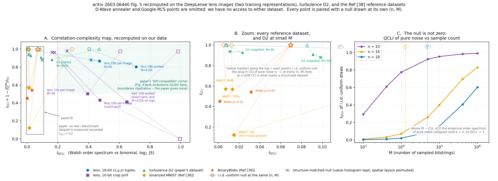

# Correlation–Complexity Map（arXiv 2603.06440 Fig. 5）在我們資料上的重算

跑於 2026-09-07，login node、純 CPU、`OMP_NUM_THREADS=4`、單 seed（0）、**63 s** 全部跑完。
程式：`experiments/13_iqp_turbulence_replication/paper_suite/map/`（`map_estimators.py` 新估計器＋self-test、`run_map.py` 產生所有點、`plot_map.py` 畫圖）。
數字：`paper_suite/map/results_map.json`。圖：`docs/figures/iqp_lens_map.png`。計畫：`docs/IQP_LENS_PAPER_SUITE_PLAN.md` 第 1 列。

**估計器**：n ≤ 18 一律用 round 1 的精確版（`diagnostics_qcli_cci.qcli_exact` / `cci_exact`，2^n 枚舉）。
n = 484 / 784 用新寫的 `map_estimators.py`：QCLI 走論文 Appendix C 的 Monte-Carlo（eq. 51–53，L = 2×10⁴，equal-per-order allocation），
CCI 走 plug-in（邊際與 C(n,2) 對邊際由一次 BLAS matmul 得到，joint entropy 由觀察到的相異 bitstring 估，Chow–Liu 樹沿用同一份 Kruskal）。
兩者都對照精確版驗過（`python3 map_estimators.py`）：n=12 CCI 差 3.7e-14、n=10 QCLI（此時 L 足以窮舉）差 2.8e-16、n=18 QCLI MC 對精確 |Δ| < 1e-4。



## TL;DR

1. **透鏡的 18-bit 表示法確實落在論文的「右上」IQP-compatible 區**（per-image `I_QCLI` = 0.472、`I_CCI` = 0.868），而且遠高於論文說的「真實資料集 QCLI 幾乎都 < 0.2」。**但這個位置幾乎全部是編碼造成的**：把每張影像的 kz 在 4,096 個像素間隨機重排（保留完整的強度直方圖與 (kx,ky) 全掃描，只毀掉空間結構），QCLI 只從 0.472 掉到 **0.415**、CCI 反而**升到** 0.878。真正屬於「透鏡結構」的部分只有 QCLI +0.056，CCI −0.011。
2. **同一個結論適用於論文自己的 turbulence D2**。D2 per-snapshot（N_t = 5×10⁴）(0.091, 0.909)，把 |u| 在原生網格點間重排後是 **(0.098, 0.878)**——QCLI 甚至更高。**論文據以宣稱 turbulence 落在 IQP-compatible 象限的位置，無法區分真實流場與被完全打散的同一批速度值。** 這兩個指標在 18-bit (x,y,z) tuple 編碼下對空間結構近乎不敏感。
3. **兩種訓練表示法給出互相矛盾的 CCI**：同一批影像，18-bit tuple 給 CCI ≈ 0.87（「強烈 beyond-pairwise」），10-bit crop pmf 給 **0.41–0.50**（「pairwise tree 已能解釋大半」）。CCI 是**表示法的性質**，不是資料的性質。10-bit 才是 round 3 實際訓練用的表示法。
4. **在兩個有 permutation null 的資料集裡，只有 10-bit 透鏡兩個座標都「明顯」偏離對照**：CCI 0.431 遠低於 permutation null 0.963（比隨機重排更容易被 tree 解釋），QCLI 0.473 遠高於 permutation null 0.178。18-bit 透鏡的對應偏離只有 QCLI +0.056 / CCI −0.011，D2 的 N_t=5e4 列連方向都不對（QCLI 0.091 低於 perm null 0.098；M=4096 列方向雖對但只有 +0.012）。這是這份分析裡唯一站得住的「透鏡有 IQP-對齊結構」訊號。（低於 **i.i.d.-uniform** null 的 CCI 不算訊號——每個資料集都低於它，見 §2。）
5. **參考資料集全部擠在 QCLI 軸的最左緣（≤ 0.032）**：MNIST 16-bit (0.016, 0.124)、484-bit (0.007, 0.571)、784-bit (0.014, 0.568)、BinaryBlobs p=0.05 (0.032, 0.542)。QCLI 方向與論文 Fig. 5 把 MNIST/blobs 畫在原點附近一致；CCI 方向只有 16-bit 版真的接近 0，484/784-bit 停在 0.57（仍遠低於自己 0.999 的 null）。
6. **這個位置對生成結果沒有預測力**（§5）：地圖說透鏡「IQP 相容」，round 3 的實測是 IQP 在 physics 與 PDF–JS 贏 RBM/DCGAN、在 Conv2D-MMD² 輸給兩者，pre-registered 判定是 failure。

## 1. 地圖表

每個點都配一個**同 (n, M) 的 i.i.d.-uniform null**；透鏡與 D2 另配一個**structure-matched permutation null**（保留值的直方圖，只打散空間排列）。

| dataset | representation | n | M | I_QCLI | I_CCI | null QCLI | null CCI | perm QCLI | perm CCI |
|---|---|---|---|---|---|---|---|---|---|
| lens | 18-bit (x,y,z) tuples, per-image | 18 | 4,096 | 0.4715 ± 0.0075 | 0.8677 ± 0.0078 | 0.0077 | 0.9980 | **0.4154** | **0.8782** |
| lens | 18-bit tuples, pooled 100 train | 18 | 409,600 | 0.7095 | 0.8013 | 0.4046 | 0.9998 | – | – |
| lens | 10-bit crop pmf, per-image (exact pmf) | 10 | 母體 pmf | 0.4731 ± 0.0693 | 0.4313 ± 0.0507 | 0.9944 | 0.0000 | **0.1782** | **0.9633** |
| lens | 10-bit crop pmf, per-image (M draws) | 10 | 4,096 | 0.3942 ± 0.0472 | 0.5014 ± 0.0452 | 0.6061 | 0.9748 | 0.1629 | 0.9640 |
| lens | 10-bit crop pmf, pooled (exact pmf) | 10 | 母體 pmf | 0.6519 | 0.4112 | 0.9944 | 0.0000 | 0.2605 | 0.9788 |
| lens | 10-bit crop pmf, pooled (M draws) | 10 | 409,600 | 0.6483 | 0.4115 | 0.9814 | 0.9747 | – | – |
| turbulence D2 | 18-bit (x,y,\|u\|), pooled 11 anchors | 18 | 550,000 | 0.1619 | 0.8837 | 0.4691 | 0.9997 | – | – |
| turbulence D2 | 18-bit, per-snapshot (N_t = 5e4) | 18 | 50,000 | 0.0910 | 0.9085 | 0.0852 | 0.9996 | **0.0984** | **0.8779** |
| turbulence D2 | 18-bit, per-snapshot (M matched) | 18 | 4,096 | 0.0232 | 0.9294 | 0.0077 | 0.9985 | 0.0113 | 0.9371 |
| binarized MNIST | 16-bit（7×7 mean-pool → 4×4, thr 0.5） | 16 | 10,000 | 0.0157 | 0.1237 | 0.0696 | 0.9984 | – | – |
| binarized MNIST | 16-bit（同上） | 16 | 60,000 | 0.0150 | 0.1225 | 0.2931 | 0.9991 | – | – |
| binarized MNIST | 484-bit（中央 22×22, thr 0.5） | 484 | 10,000 | 0.0072 | 0.5705 | 0.0050 | 0.9993 | – | – |
| binarized MNIST | 784-bit（完整 28×28, thr 0.5） | 784 | 10,000 | 0.0135 | 0.5684 | 0.0129 | 0.9992 | – | – |
| BinaryBlobs | 16-bit, 8 patterns, flip p = 0.05 | 16 | 10,000 | 0.0316 | 0.5417 | 0.0694 | 0.9986 | – | – |
| BinaryBlobs | 16-bit, 8 patterns, flip p = 0.01 | 16 | 10,000 | 0.0015 | 0.4503 | 0.0695 | 0.9983 | – | – |

透鏡 18-bit 兩列直接沿用 round 1 的 `outputs_lens_pilot/qcli_cci_lens.json`（三類 axion/cdm/no_sub 彼此差 <1%，取 600 張 val 的平均），D2 前兩列沿用 `outputs_anchor_fit/qcli_cci_d2.json`；其餘（含全部 null）本次新算。
論文位置無法重畫的兩點：**D-Wave annealer 與 Google RCS 樣本**——我們沒有這兩份資料，圖上與表上都省略並在圖說註明。

## 2. 怎麼讀這張地圖（兩個指標都是強烈依賴 (n, M) 的有限樣本統計量）

- **QCLI 的 null 不是 0。** 圖 C：純 i.i.d.-uniform 抽樣的 QCLI 隨 M 單調上升，在 M ≈ C(n, n/2) 附近起飛（n=18 時 C(18,9)=48,620）。n=18 的 null 在 M=4,096 是 0.008，M=5×10⁴ 是 0.086，M=409,600 已達 **0.405**。所以「透鏡 pooled 0.710」看起來很大，扣掉 null 只剩 0.305；而 D2 pooled 的 0.162 **低於**自己的 null 0.469。跨 M 直接比 QCLI 沒有意義。
- **plug-in CCI 的 null 幾乎是 1。** joint entropy 上限是 log₂M（MNIST 484-bit：ΣH(X_i) = 289.8 bits，H_joint 只能到 13.29），所以 I_TC 被系統性放大、tree 佔比被壓低。這張圖上每一個**有限樣本** i.i.d.-uniform null 的 CCI 都落在 0.975–0.9998（n=10 的兩列 0.975，其餘 11 列 0.998–0.9998，最高是透鏡 18-bit pooled 的 0.99978）。**因此「高 CCI」本身沒有資訊；有資訊的是「CCI 明顯低於 null」**，代表資料真的能被 tree 解釋——但每個資料集都低於這個 null，所以它只排除「純噪音」，不足以分辨資料集之間的差別（要分辨得靠 §3 的 permutation null）。唯二的例外是 10-bit 的「精確 pmf」兩列，它們的對照是**母體** uniform pmf，定義上 I_TC = 0 → CCI = 0，不是有限樣本 null。
- **permutation null 才是有用的對照。** 它同時控制掉編碼幾何與邊際直方圖，只問「空間結構貢獻了多少」。這是本次唯一新增的方法學，論文沒有做。

## 3. 透鏡在地圖上的位置，與兩種表示法的差異

- 18-bit tuple 表示法把一張 64×64 影像變成「4,096 個 (kx,ky) 全掃描 × 各自一個 kz」——那是**函數的圖形**，不是一個分布的樣本。12 個座標 bit 因此完全均勻且兩兩獨立（pairwise MI ≈ 0），所有依賴性都藏在「kz 是 (kx,ky) 的函數」這種高階關係裡，tree 一定抓不到 → CCI 被結構性推高到 0.87。permutation null 0.878 證實了這點。
- 10-bit crop pmf 把影像本身當成 1,024 個 code 上的 pmf，沒有這個人工高階項。它的 CCI 0.41–0.43 遠低於 permutation null 0.963，QCLI 0.473 遠高於 permutation null 0.178——**兩個座標都朝「有結構」的方向偏離對照**，這才是可信的訊號。
- 注意 n=10 時 2^10 = 1024 ≪ M = 4,096，指標處在飽和 regime（uniform null 的 QCLI 已達 0.606）。所以 10-bit 一律同時報「精確 pmf」版（無抽樣噪音）與「M draws」版；兩者結論一致（pooled 兩列差 0.004 / 0.0003）。

## 4. 與 turbulence / MNIST / BinaryBlobs 的相對位置

- 論文的 **Fig. 5 讀法**（turbulence 在右上、MNIST 與 blobs 在原點附近）在我們重算下**定性成立**：MNIST 與 BinaryBlobs 的 QCLI 都 ≤ 0.032，D2 pooled 0.162，透鏡 0.39–0.71。論文說「所觀察到的真實資料集 QCLI 都低於 ~0.2」也與我們的 MNIST/blobs/D2 相符——只有透鏡超過，而 §1 第 1 點已說明那主要來自編碼。
- **CCI 軸上三個參考資料集彼此分開得很清楚**：MNIST 16-bit 0.124（16 bit 只剩粗略筆劃，pairwise tree 幾乎全解釋）＜ BinaryBlobs p=0.01 0.450 ＜ p=0.05 0.542 ≈ MNIST 484-bit 0.571 ≈ 784-bit 0.568。翻大 n 並沒有把 MNIST 推向 1，反而穩在 0.57——與它們的 null（0.999）相比是很低的值，符合論文把 MNIST 歸為「classically expressible」。
- **BinaryBlobs 的 flip 機率直接控制 QCLI**：p=0.01 時 0.0015（幾乎就是 8 個 delta），p=0.05 時 0.0316。這是一個乾淨的 sanity check——指標確實在量「離 binomial baseline 多遠」。

## 5. 這個位置對生成結果有沒有預測力？

論文式讀法是「右上象限 → IQP 相容 → IQP 生成模型會比古典 baseline 好」。用 round 3 / 3b 的實測（`docs/IQP_LENS_ROUND3_RESULTS.md` 表 A，N = 100，同一批 held-out、同一份 eval）對照論文自己用的兩個 baseline：

| metric | 最好的 IQP arm | RBM-10bit | DCGAN-32 | 誰贏 |
|---|---|---|---|---|
| physics ↓ | **0.513**（lowvar-joint-MMD-resample） | 0.727 | 0.861 | IQP |
| PDF–JS ↓ | **0.00065**（lowvar-joint-MMD-prior8） | 0.0020 | 0.0076 | IQP |
| Conv2D-MMD² ↓ | 0.0861（affine-M4-MMDflat-resample） | 0.0752 | **0.0371** | DCGAN，IQP 兩項皆輸 |

**結論：互有勝負，地圖位置沒有預測到勝負方向。** 地圖說透鏡（在兩種表示法下）都比 D2 更靠右上，但 round 3 的 pre-registered 判定是 failure，且 IQP 輸掉論文最重視的 MMD² 指標。
這與 §2–§3 的方法學發現一致：地圖的座標主要由**編碼**與**有限樣本效應**決定，而生成品質由訓練協定與 latent 參數化決定（round 3b 顯示「學到的仿射方向」才是讓 IQP 生成出環的關鍵，固定基底全部失敗）。
把地圖當作「值不值得試 IQP」的篩選器，在這個資料集上會給出偽陽性。

## 6. 做不到 / 沒做的部分

- **D-Wave annealer 樣本與 Google RCS 資料**：沒有資料源，兩個點省略（論文 Fig. 5 有）。Lorenz attractor 與 D1 同樣未做（不在派工範圍）。
- **Ref [38] 的 MNIST 其實是 784-bit，不是 484-bit**（`docs/REF38_IQPOPT_METHOD_NOTES.md` §9.3；484 是它的 **D-Wave** 資料集的 qubit 數）。本次三個版本都算了：16-bit（降採樣代用品）、484-bit（中央 22×22，僅為滿足派工單）、784-bit（Ref [38] 的真正定義）。結論不受影響。
- **BinaryBlobs 的 p 值有歧義**：Ref [38] 正文寫 0.05（`<WORK>/data/papers/2503.02934/paper.txt:608`），而它引用的 `qml-benchmarks` 套件 `generate_8blobs` 預設是 0.01。兩個都算了，兩者都落在左下。八個 base pattern 直接取自 `qml_benchmarks/data/spin_blobs.py` 的 `config1..config8`（本次從 GitHub 抓原始碼硬拷進 `run_map.py`）。
- **單 seed**。per-image 的列有 200–600 張影像的 sd，pooled 與參考資料集的列沒有重複抽樣的誤差棒。permutation null 每點只做一次重排。
- **CCI 在 n = 484 / 784 帶著已知的 plug-in joint-entropy 偏差**（見 §2），只能與同 (n, M) 的 null 比，不能跨 n 比絕對值。

## 7. 重跑

```bash
cd <HOME>/gsoc2026-deeplense-qml/experiments/13_iqp_turbulence_replication/paper_suite/map
OMP_NUM_THREADS=4 /usr/bin/python3 map_estimators.py          # self-test，對照精確估計器
OMP_NUM_THREADS=4 /usr/bin/python3 -u run_map.py --with-d2    # ~65 s，寫 results_map.json
OMP_NUM_THREADS=4 /usr/bin/python3 plot_map.py                # 寫 docs/figures/iqp_lens_map.png
```

MNIST 原始檔：`<WORK>/data/mnist/train-images-idx3-ubyte.gz`（本次從 `https://storage.googleapis.com/cvdf-datasets/mnist/` 下載，60,000 張，`run_map.py:load_mnist_images` 直接解 idx 格式，不經 torchvision）。
