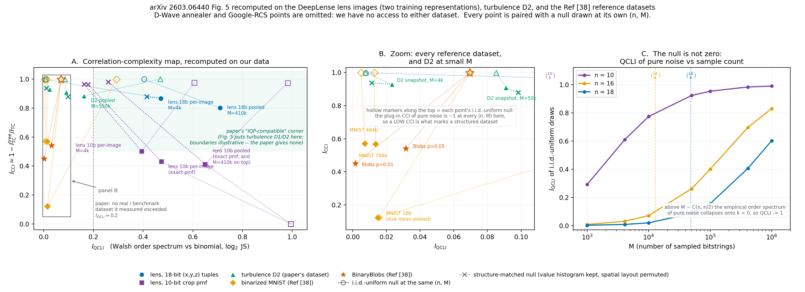
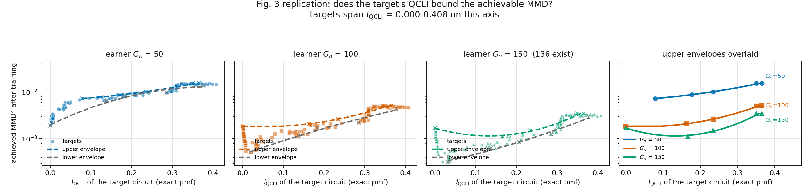
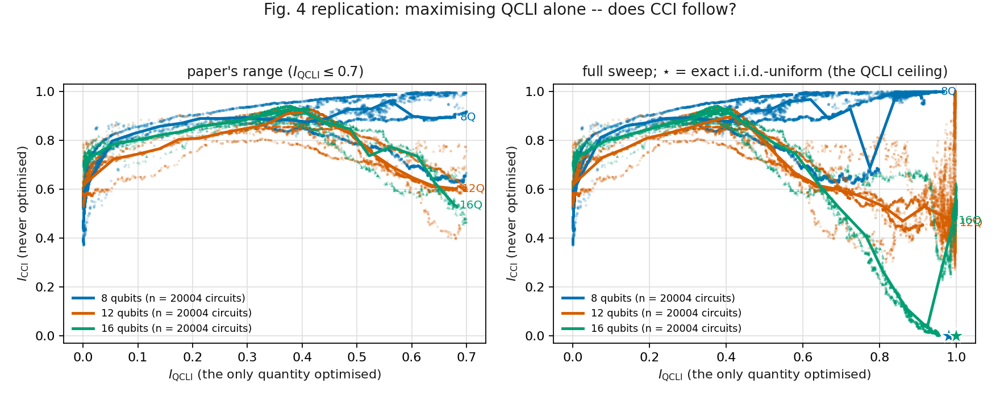
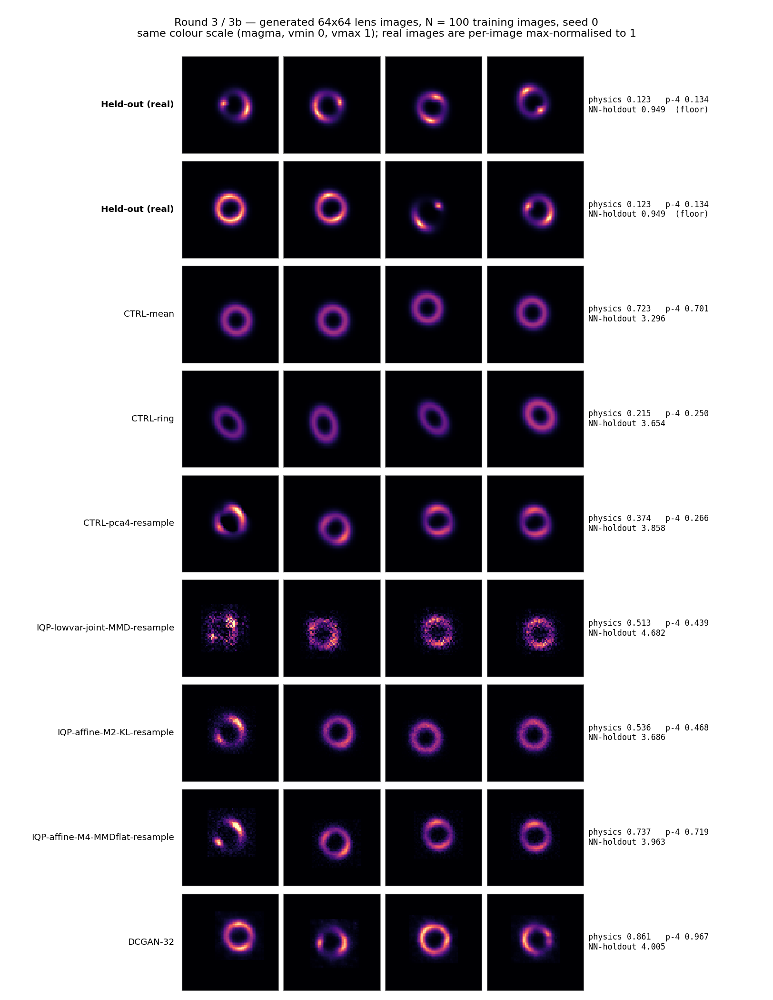
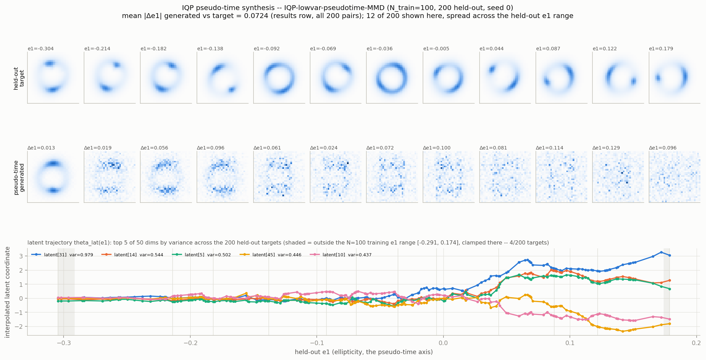
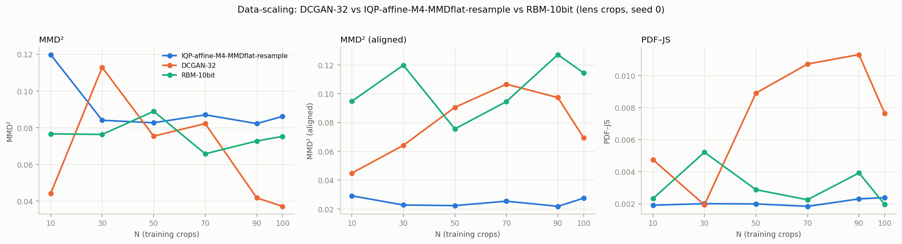

# arXiv 2603.06440 的完整分析套件，套用在 DeepLense 透鏡影像

寫於 2026-09-08。計畫與預測 Q1–Q4 寫在跑之前：`docs/IQP_LENS_PAPER_SUITE_PLAN.md`。
**比較範圍（Leo 指定）**：只跟論文自己用過的 baseline 比 —— **RBM** 與 **DCGAN**。零學習控制與 PCA 生成器不進本文的任何比較表（它們的數字在 `docs/IQP_LENS_ROUND3_RESULTS.md`，本文只在 §9 提一句它們存在）。
**單 seed（seed 0）**，所有 arm 用同一組 held-out（200 張 val）、同一份 eval 程式。
數字來源：`experiments/13_iqp_turbulence_replication/` 下的 `paper_suite/map/results_map.json`、`outputs_controlled/results_fig3.jsonl`、`outputs_controlled/results_fig4.jsonl`、`results_r3.jsonl`、`results_r3b.jsonl`、`results_scaling.jsonl`。論文數字全部出自 `docs/PAPER_2603.06440_SUMMARY.md`。

## 0. TL;DR

1. **地圖（Fig. 5）**：透鏡的 `I_QCLI` = **0.472**（18-bit）／**0.473**（10-bit）是全場最高，落在論文的「右上 IQP-compatible」角，高於 turbulence D2（0.091–0.162）與所有參考資料集（MNIST ≤ 0.016、BinaryBlobs ≤ 0.032）。**但這個位置主要是編碼造成的**：18-bit 表示法把空間結構完全打散後 QCLI 只掉 0.472 → 0.415。
2. **Sec. III 生成實驗**：IQP 在 **PDF–JS 兩個 N 都贏** RBM 與 DCGAN（N=11：0.00095 對 0.0063／0.0018；N=100：0.00092 對 0.0020／0.0076）。**raw MMD²** 在 N=11 贏 DCGAN（0.113 對 0.216）輸 RBM（0.074），在 N=100 **兩個都輸**（0.086 對 0.075／0.037）。**aligned MMD²** 兩個 N 都是 IQP 最好（0.028／0.027）。
3. **Data-scaling**：IQP 的 raw MMD² 在 N ≥ 30 後**平坦**（0.084–0.087），RBM 也平坦（0.066–0.089），**DCGAN 單 seed 起伏達 3 倍**（0.113 → 0.037），沒有出現論文那種「資料變多 DCGAN 才追上」的乾淨交叉。
4. **Unseen-time 合成**：**論文原協定（sequential Algorithm 1）在透鏡上失效**（physics 3.52，是其他 arm 的 5–10 倍）；只有 round 3b 的「學到的仿射方向」能生成出環。pseudo-time arm 能把配對的 |Δe1| 從隨機配對的 0.126 壓到 **0.072**，但 pair-L2（5.87）比隨機配對（5.44）還差。
5. **Fig. 3／4 重現（job 356097 ＋ 356221，本次新跑）**：Fig. 3 的**第二個主張成立**（學習者 gate 數 50→100→150 使包絡整體下移，中位數 9.57e-3 → 2.15e-3 → 1.45e-3）；**第一個主張在可及範圍內方向相反** —— 目標 exact QCLI 從 0 升到 0.41，達成的 MMD² **上升** 2.1 倍（ρ = +0.98／+0.90／+0.81），對 exact pmf 訓練的控制組給同樣趨勢，所以不是抽樣誤差。Fig. 4 的 QCLI–CCI 正耦合**只在低 QCLI 成立**（QCLI ≤ 0.3 時 Spearman ρ = +0.76…+0.95），在 n=12/16 於 QCLI ≈ 0.38 反轉，全域 ρ 變成 −0.53／−0.57。
6. **誠實限制**：**單 seed**（DCGAN 的起伏無法與真訊號分離）；raw MMD² 對總亮度極度敏感（所有生成 arm 的總亮度被同一個外部純量 S = 124.92 鎖死，aligned 版才移除這一項）；地圖的兩個指標對空間結構近乎不敏感（permutation null 幾乎打不下來）。

## 1. 對應表：論文的每個分析 ↔ 我們的做法 ↔ 狀態

| 論文分析 | 我們的做法 | 狀態 | 圖／檔 |
|---|---|---|---|
| Fig. 5 correlation–complexity map | 透鏡 18-bit 與 10-bit 兩種表示法 ＋ D2 ＋ MNIST(16/484/784) ＋ BinaryBlobs，每點配 i.i.d.-uniform null，透鏡與 D2 另配 permutation null（論文沒做） | **完成**（login node，63 s） | `figures/iqp_lens_map.png`、`paper_suite/map/results_map.json`、`docs/IQP_LENS_MAP_RESULTS.md` |
| Fig. 3 support-mismatch（QCLI vs 學習者 MMD） | n=16，4-local 目標電路 G^data ∈ {140…1050}，**Adam** 撐 exact QCLI，10⁴ 樣本／目標，140 個目標；2-local 學習者 G_n ∈ {50,100,150}，Adam 5000 步 lr 1e-4，exact MMD ＋ exact-trained 控制 | **完成 v2**（job 356221；v1 job 356097 作廢） | `figures/iqp_fig3_support_mismatch.png`、`..._sampleaxis.png`、`outputs_controlled/results_fig3_v2.jsonl` |
| Fig. 4 QCLI 最大化 → CCI 跟著升 | n ∈ {8,12,16}，2-local、150 gates（實際 36／78／136 個相異 Z-string），SPSA 只最大化 QCLI，每個 size 20,004 個電路 | **完成**（job 356097） | `figures/iqp_fig4_qcli_cci.png`、`outputs_controlled/results_fig4.jsonl` |
| Sec. III 生成實驗（Algorithm 1、11 vs 100 樣本、RBM／DCGAN、PDF–JS ＋ Conv2D-MMD²） | round 3（固定 latent 基底 14 arm）＋ round 3b（學到的仿射方向 8 arm），本文只列 IQP vs RBM vs DCGAN | **完成**（job 349702／349854） | `figures/iqp_lens_round3.png`、`results_r3.jsonl`、`results_r3b.jsonl` |
| Table 2 樣本圖 ＋ unseen-time latent 內插合成 | pseudo-time arm：以 ellipticity e1 當時間軸，對每張 held-out 影像在它自己的 e1 內插 latent | **完成**（CPU 重繪） | `figures/iqp_lens_pseudotime.png` |
| DCGAN data-scaling N ∈ {10,30,50,70,90,100} | DCGAN-32、RBM-10bit、IQP-affine-M4-MMDflat-resample 三條同 N 曲線 | **完成**（job 356077，3 min 28 s） | `figures/iqp_lens_scaling.png`、`results_scaling.jsonl` |
| Table 1（文獻數字）、Appendix H 定理、硬體部署 | 非實驗／無硬體 | **不做** | – |
| Fig. 5 的 D-Wave 與 Google RCS 兩點 | 無資料源 | **做不到** | – |

## 2. Fig. 5：correlation–complexity map

摘自 `docs/IQP_LENS_MAP_RESULTS.md`（完整 15 列表在該檔 §1）：

| dataset | representation | n | M | I_QCLI | I_CCI | uniform null QCLI | perm-null QCLI | perm-null CCI |
|---|---|---|---|---|---|---|---|---|
| lens | 18-bit (x,y,z) tuples, per-image | 18 | 4,096 | **0.4715** | 0.8677 | 0.0077 | 0.4154 | 0.8782 |
| lens | 10-bit crop pmf, per-image（精確 pmf） | 10 | 母體 pmf | **0.4731** | 0.4313 | 0.9944 | 0.1782 | 0.9633 |
| turbulence D2 | 18-bit, per-snapshot (N_t = 5e4) | 18 | 50,000 | 0.0910 | 0.9085 | 0.0852 | 0.0984 | 0.8779 |
| binarized MNIST | 784-bit | 784 | 10,000 | 0.0135 | 0.5684 | 0.0129 | – | – |
| BinaryBlobs | 16-bit, flip p = 0.05 | 16 | 10,000 | 0.0316 | 0.5417 | 0.0694 | – | – |

**解讀**：

- 論文式讀法成立：透鏡的 QCLI 是全場最高，遠超論文說的「真實資料集 QCLI 幾乎都 < 0.2」。
- **但 permutation null 顯示這個位置不是空間結構帶來的**。把每張影像的強度值在 4,096 個像素間隨機重排（保留完整強度直方圖，只毀掉空間結構），18-bit 的 QCLI 只從 0.472 掉到 0.415、CCI 反而升到 0.878。**同一個問題適用於論文自己的 turbulence D2**：D2 per-snapshot (0.091, 0.909) 與其重排版 (0.098, 0.878) 幾乎無法區分，重排版的 QCLI 甚至更高。這兩個指標在 18-bit tuple 編碼下對空間結構近乎不敏感。permutation null 是本次新增的方法學，論文沒有做。
- **10-bit 表示法（＝ round 3 實際訓練用的那個）是唯一兩個座標都明顯偏離對照的**：QCLI 0.473 遠高於 perm null 0.178、CCI 0.431 遠低於 perm null 0.963。這是這份分析裡唯一站得住的「透鏡有 IQP-對齊結構」訊號。
- **10-bit 不可用論文的方式解讀**：同一批影像，18-bit 給 CCI ≈ 0.87（「強烈 beyond-pairwise」），10-bit 給 0.41–0.50（「pairwise tree 已能解釋大半」）。**CCI 是表示法的性質，不是資料的性質。**
- **plug-in CCI 的 null 幾乎是 1**（本地圖 13 列有限樣本 null 落在 0.975–0.9998），所以「高 CCI」本身沒有資訊；有資訊的只有「明顯低於 null」。QCLI 的 null 也不是 0，且隨 M 單調上升（n=18 在 M=4,096 是 0.008、M=409,600 已達 0.405），**跨 M 直接比 QCLI 沒有意義**。

## 3. Fig. 3：support mismatch（目標 QCLI vs 學習者達成的 MMD）

**這是第二版（job 356221）。** 第一版（job 356097）的目標多樣性建構失敗，兩個原因都已定位並修掉：(a) **SPSA 在這個參數量下爬不動** —— v1 的 exact QCLI 在 G^data=140 能到 0.231，但 G^data=560 只有 0.0037、G^data=1050 只有 0.0082，**gate 越多動得越少**；v2 改用 Adam 對同一個 exact QCLI 目標做 autograd（exact FWHT 模擬器讓它可微），~50 步就到平台。(b) **x 軸用了 10⁴-sample 的 QCLI**，而該估計量自己的 i.i.d.-uniform 地板（0.0696）高過所有目標佔的整條帶；v2 改用**電路的 exact QCLI** 佈點與畫圖，sample 值仍逐點記錄並另出一張圖。

設定：n=16，4-local 目標電路 G^data ∈ {140,…,1050} 各 20 個目標（共 140），Adam lr 0.05 撐 QCLI；每個目標抽 10⁴ bitstring 當訓練資料；2-local 學習者 G_n ∈ {50,100,150}（n=16 只存在 136 個相異 ≤2-local Z-string），Adam 5000 步 lr 1e-4，exact closed-form MMD²。420 次擬合，wall 897 s。

| 學習者 G_n（實際相異 gate） | MMD² 中位數 | 最小 | 最大 | ρ(exact QCLI, MMD²) | ρ(sample QCLI, MMD²) | floor proxy 中位數 |
|---|---|---|---|---|---|---|
| 50 (50) | 9.5718e-03 | 1.9189e-03 | 1.5284e-02 | **+0.979** | +0.846 | 1.0704e-03 |
| 100 (100) | 2.1527e-03 | 5.1292e-04 | 5.0809e-03 | **+0.901** | +0.764 | 6.8394e-04 |
| 150 (136) | 1.4500e-03 | 3.2476e-04 | 3.4622e-03 | **+0.809** | +0.654 | 1.7115e-05 |

上／下包絡，用論文 Appendix D 的 0.09 寬 bin，x = **exact** QCLI：

| exact QCLI bin | n | G50 upper／lower | G100 upper／lower | G150 upper／lower |
|---|---|---|---|---|
| 0.00–0.09 | 46 | 7.26e-03 ／ 1.92e-03 | 1.85e-03 ／ 5.13e-04 | 1.70e-03 ／ 3.25e-04 |
| 0.09–0.18 | 17 | 8.80e-03 ／ 6.50e-03 | 2.08e-03 ／ 1.16e-03 | 1.12e-03 ／ 6.23e-04 |
| 0.18–0.27 | 9 | 1.00e-02 ／ 7.85e-03 | 2.62e-03 ／ 1.69e-03 | 1.50e-03 ／ 8.62e-04 |
| 0.27–0.36 | 57 | 1.53e-02 ／ 9.63e-03 | 5.05e-03 ／ 2.22e-03 | 3.46e-03 ／ 1.26e-03 |
| 0.36–0.45 | 11 | 1.52e-02 ／ 1.39e-02 | 5.08e-03 ／ 4.40e-03 | 3.46e-03 ／ 2.91e-03 |

**論文主張是否重現？第二個成立，第一個在可及範圍內被反駁。**

- **第二個主張（增加學習者 gate 數使包絡整體下移）：重現。** 中位數 9.57e-3 → 2.15e-3 → 1.45e-3，且**每一個 bin** 的上包絡都隨 G_n 單調下降。Proposition II.2 的 floor proxy 同向（1.07e-3 → 6.84e-4 → 1.71e-5），與「可調支撐 S_A 變大 → 架構外殘餘頻譜質量變小」一致。
- **第一個主張（上包絡隨目標 QCLI 上升而下降）：在 exact QCLI 0–0.41 內方向相反。** 三個學習者的 ρ 都是強正相關（+0.98／+0.90／+0.81），上包絡**單調上升**（G50：7.26e-3 → 1.53e-2，2.1 倍；G100：1.85e-3 → 5.08e-3；G150：1.70e-3 → 3.46e-3），下包絡也一起上升。目標 QCLI 越高，2-local 學習者擬得**越差**。
- **這不是有限樣本造成的。** v2 加了兩個控制：同一個學習者、同一個初始化改成**直接對目標的 exact pmf 訓練**（`final_mmd2_exacttrained`：中位數 9.46e-3／2.13e-3／1.38e-3，ρ = +0.98／+0.90／+0.80），以及把 sample-trained 的 θ 拿去對 exact pmf 計分（`final_mmd2_vs_exact`：9.40e-3／2.15e-3／1.37e-3，ρ = +0.98／+0.90／+0.79）。**三個版本的數字與趨勢幾乎一模一樣**，所以上升趨勢是真的，不是 10⁴ 抽樣誤差。
- **機制的前提成立，但預測的結果不成立。** floor proxy（Prop. II.2 的架構外頻譜質量代理量，含未知常數 C_A，只帶方向不帶絕對值）**隨 QCLI 下降**（ρ = −0.98／−0.98／−0.93），完全符合理論；但實際達成的 MMD 卻**上升**。在這個範圍內，決定 MMD 的不是 support mismatch 的不可消除下界，而是**可訓練性** —— 高 QCLI 目標的 Walsh 譜更分散，2-local 學習者更難優化到底。論文的下界因此在此範圍內不緊。
- **兩個限制**。(i) **exact QCLI 的天花板是 0.408，不是論文的 ~0.7**，論文範圍的上面 40% 沒被測到。這不是優化器問題：G^data=560 在 Adam lr 0.05 與 0.20、三種初始化尺度共九次獨立跑全部停在 0.381–0.382，且天花板隨 gate 數上升（140→1050 給 0.345→0.408），是「≤4-local IQP 電路在 16 qubit 能對 order spectrum 做什麼」的性質。同一份程式在 n=8 可達 0.98。(ii) **論文自己的協定軸不可測**：140 個目標的 10⁴-sample QCLI 全部落在 0.00002–0.0644，**沒有一個超過 i.i.d.-uniform null 的 0.0696 ± 0.0002**（Spearman(exact, sample) = 0.876，單調但被壓縮）。這一點另出一張圖記錄而非隱藏：`figures/iqp_fig3_support_mismatch_sampleaxis.png`。
- bin 佔用不均（46／17／9／57／11），是 Adam 撐 QCLI 後的平台效應造成的分群，讀包絡時要注意 n 小的 bin。

## 4. Fig. 4：只最大化 QCLI，CCI 會不會跟著升

每個 size 20,004 個電路（3 seeds × 2 個 SPSA 步長 arm × 3,334 個軌跡快照），QCLI 與 CCI 都由 **exact pmf** 算，CCI 從未進入目標函數。

| n | 相異 gate 數 | step 0 平均 (QCLI, CCI) | 最終平均 (QCLI, CCI) | ρ, QCLI≤0.3 | ρ, QCLI≤0.7 | ρ, 全域 | binned-median CCI 峰值 |
|---|---|---|---|---|---|---|---|
| 8 | 36 | (0.0002, 0.496) | (0.853, 0.934) | +0.827 | +0.749 | **+0.909** | 1.000 @ QCLI≈0.98 |
| 12 | 78 | (0.0005, 0.624) | (0.938, 0.405) | +0.759 | +0.118 | **−0.527** | 0.907 @ QCLI≈0.38 |
| 16 | 136 | (0.0007, 0.670) | (0.695, 0.543) | +0.950 | +0.153 | **−0.571** | 0.926 @ QCLI≈0.38 |

**論文主張是否重現？部分重現，且有一個論文沒說的天花板效應。**

- **在低 QCLI 區明確重現**：QCLI ≤ 0.3 時三個 size 的 Spearman ρ 都是 +0.76…+0.95，CCI 從 step 0 的 0.50–0.67 一路被推到 0.87–0.93，而目標函數裡從來沒有 CCI。這正是論文 Fig. 4 的 emergent coupling。
- **在高 QCLI 區反轉（n=12, 16）**：binned-median CCI 在 QCLI ≈ 0.38 到頂（0.907／0.926）後開始掉，n=16 在 QCLI 0.8–0.9 只剩 0.138。全域 ρ 因此變成負的。只有 n=8 全程正相關（它的參數空間只有 36 維，SPSA 撐不到讓分布真的變均勻）。
- **反轉是定義決定的，不是偶然**：本 repo 的 QCLI **包含 k=0 項**（Eq. 6 的字面寫法，已在 `test_diagnostics.py:97-105` 稽核過），所以**精確均勻分布的 QCLI 是最大值**：n=8/12/16 分別是 **0.9816 / 0.9984 / 0.9999**（`results_fig4.jsonl` 的 calibration 列），而均勻分布的 CCI **恰好是 0**。QCLI 的頂端就是均勻分布，均勻分布沒有任何相依性，所以任何單調 QCLI–CCI 耦合**必然**在頂端斷掉。論文的 Fig. 4 只畫到 QCLI ~0.7 以下，看不到這個天花板。
- 對讀論文的實務含意：**QCLI 高不等於「資料有 IQP 可用的結構」，也可能只是接近均勻**。這與 §2 的 null 分析（QCLI 的 null 隨 M 上升）是同一件事的兩個面向。

## 5. Sec. III：生成實驗（論文式表）

資料：`model_II.npz` 三類 pooled，seed-0 固定 split，質心對齊後中心 32×32 crop → pmf `p(kx,ky)`，`code=(kx<<5)|ky`，**10 qubits**、1,024 個 Z-string 全用、exact simulation。生成 200 張比對 200 張 held-out。

**N = 11 訓練影像**（↓ 全部越小越好；**粗體** = 該欄最佳）

| Model (params) | PDF–JS | MMD² | MMD²(aligned) | NN-holdout |
|---|---|---|---|---|
| IQP-lowvar-joint-MMD-resample (1,024) | 0.001332 | 0.1416 | 0.1141 | 4.568 |
| IQP-lowvar-joint-KL (1,024) | 0.005543 | 0.2593 | 0.1733 | **3.554** |
| IQP-lowvar-paper-MMD ─ 論文原協定 (1,024) | 0.006091 | 0.2032 | 0.1837 | 4.931 |
| IQP-lowvar-pseudotime-MMD *(conditional)* (1,024) | 0.005138 | 0.1575 | 0.1445 | 4.815 |
| IQP-affine-M2-KL-resample (3,094) | 0.001748 | 0.1673 | 0.05586 | 3.664 |
| IQP-affine-M4-KL-resample (5,164) | 0.001829 | 0.1628 | 0.05634 | 3.735 |
| IQP-affine-M4-MMDflat-resample (5,164) | 0.001963 | 0.1134 | **0.02786** | 3.915 |
| IQP-affine-M4-auto3-resample (5,164) | **0.000947** | 0.1168 | 0.06787 | 4.451 |
| RBM-10bit (11,010) | 0.006324 | **0.07410** | 0.1240 | 6.808 |
| DCGAN-32 (199,837) | 0.001833 | 0.2165 | 0.1241 | 4.251 |
| *HOLDOUT split-half（地板，非模型）* | *3.415e-05* | *0.004006* | *0.006923* | *0.9489* |

**N = 100 訓練影像**

| Model (params) | PDF–JS | MMD² | MMD²(aligned) | NN-holdout |
|---|---|---|---|---|
| IQP-lowvar-joint-MMD-resample (1,024) | 0.000988 | 0.1041 | 0.06168 | 4.682 |
| IQP-lowvar-joint-KL (1,024) | 0.006710 | 0.1540 | 0.1282 | **3.625** |
| IQP-lowvar-paper-MMD ─ 論文原協定 (1,024) | 0.006966 | 0.2140 | 0.2233 | 5.772 |
| IQP-lowvar-pseudotime-MMD *(conditional)* (1,024) | 0.005422 | 0.1645 | 0.1641 | 5.457 |
| IQP-affine-M2-KL-resample (3,272) | 0.003021 | 0.1356 | 0.08660 | 3.686 |
| IQP-affine-M4-KL-resample (5,520) | 0.005434 | 0.1619 | 0.1306 | 3.626 |
| IQP-affine-M4-MMDflat-resample (5,520) | 0.002387 | 0.08607 | **0.02745** | 3.963 |
| IQP-affine-M4-auto3-resample (5,520) | **0.000922** | 0.1189 | 0.08762 | 5.057 |
| RBM-10bit (11,010) | 0.001952 | 0.07520 | 0.1144 | 5.225 |
| DCGAN-32 (199,837) | 0.007631 | **0.03711** | 0.06937 | 4.005 |
| *HOLDOUT split-half（地板，非模型）* | *3.415e-05* | *0.004006* | *0.006923* | *0.9489* |

**解讀**：

- **PDF–JS：IQP 兩個 N 都最好**，而且贏的幅度不小（N=100 時 0.00092 對 RBM 0.0020、DCGAN 0.0076，2–8 倍）。PDF–JS 只看像素強度邊際分布，而 IQP 直接學的就是 pmf，這個優勢是結構性的。
- **raw MMD²：N=11 時 IQP（0.113）贏 DCGAN（0.216）輸 RBM（0.074）；N=100 時 IQP（0.086）兩個都輸**（RBM 0.075、DCGAN 0.037）。這是論文最重視的指標，**在透鏡上 IQP 沒有贏**。
- **aligned MMD²：IQP 兩個 N 都最好且差距很大**（0.028 對 RBM 0.114／DCGAN 0.069）。aligned 的作法是把每張生成影像先各自縮放到 held-out 的平均總亮度再算 MMD²，**移除總亮度尺度那一項**。raw 與 aligned 的排序完全相反，說明 raw MMD² 在這個資料集上主要在量總亮度而不是形狀 —— 見 §9 的 S 鎖死問題。
- **NN-holdout：IQP 兩個 N 都最好**（3.55／3.63，對 RBM 6.81／5.23、DCGAN 4.25／4.01）。
- **論文原協定（sequential Algorithm 1，`IQP-lowvar-paper-MMD`）在四個欄位裡有三個是 IQP 中最差的**，N=100 的 aligned MMD² 0.223 甚至比 raw 還高。這條線在透鏡上崩掉。
- **對照論文 Table 2**（turbulence，`docs/PAPER_2603.06440_SUMMARY.md` §5.1）：論文的 IQP(31k)(11) 是 PDF–JS **0.023784**、MMD² **0.952420**，同時贏 RBM(12k)(11)（0.168770／1.472481）與所有 11-snapshot 的 GAN（最好 0.244852／1.397969）；到 100 snapshot 時 GAN(0.2M) 追到 0.027695／0.895912。**絕對值不可跨資料集比**（不同資料、不同 encoder、不同正規化），可比的是**型態**：論文是「IQP 兩個指標都贏，且低資料時 DCGAN 崩掉」；我們是「IQP 贏 PDF–JS、NN-holdout 與 aligned MMD²，輸 raw MMD²，且 DCGAN 在 11 張時沒有崩掉」（DCGAN-32 在 N=11 的 PDF–JS 0.0018 甚至比它自己 N=100 的 0.0076 好）。

## 6. Unseen-time 合成（Table 2 的 latent 內插）

論文用 latent 內插在**訓練沒看過的時間點**合成 snapshot。透鏡影像沒有時間軸，我們用 **ellipticity e1 當 pseudo-time**：`IQP-lowvar-pseudotime-MMD` 依 e1 升序走過 N 張訓練影像各訓一個 latent，生成時對每張 held-out 影像在它自己的 e1 上分段線性內插 latent（超出訓練範圍就 clamp），所以生成影像與 held-out 影像是**配對**的。

| arm | N | pair-L2 | \|Δe1\| | \|Δe2\| | \|Δflux\| | \|Δradius\| |
|---|---|---|---|---|---|---|
| IQP-lowvar-pseudotime-MMD | 11 | 5.278 | 0.0513 | 0.1351 | 22.94 | 1.668 |
| IQP-lowvar-pseudotime-MMD | 100 | 5.869 | **0.0724** | 0.1374 | 22.49 | 1.883 |
| *RANDOM-PAIRING（參考）* | 11 | *5.504* | *0.1244* | *0.1627* | *22.94* | *0.4805* |
| *RANDOM-PAIRING（參考）* | 100 | *5.440* | *0.1260* | *0.1644* | *22.49* | *0.4118* |

**解讀**：

- **條件變數本身確實被學到了**：|Δe1| 從隨機配對的 0.126 降到 0.072（N=100），|Δe2| 也小幅降低（0.164 → 0.137）—— 內插出來的 latent 確實沿著 e1 移動。
- **但影像層級沒有配對優勢**：pair-L2 **5.87 比隨機配對的 5.44 還差**，|Δradius| 1.88 是隨機配對 0.41 的 **4.6 倍**，|Δflux| 與隨機配對相同（22.5，因為總亮度被 S 鎖死，見 §9）。也就是說模型把 e1 這一個標量對上了，卻同時把半徑弄壞了。
- **N 變大反而變差**（pair-L2 5.28 → 5.87、|Δe1| 0.051 → 0.072）：100 張訓練影像的 e1 更密，內插段更短，但每段的 latent 抖動更大。
- **論文原協定在透鏡上失效**：`IQP-lowvar-paper-MMD`（sequential Algorithm 1，與 pseudo-time 同一族）的 physics 分數 N=100 時是 **3.5205**，是其他非崩潰 arm 的 5–10 倍。**唯一能讓 IQP 生成出視覺上是「環」而且泛化到 held-out 的，是 round 3b 的學到的仿射方向**（θ = θ⁰ + Φᵀz，held-out projection corr 0.91–0.97；固定基底的 14 個 round-3 arm 生成的是雜訊斑塊，見 `docs/IQP_LENS_ROUND3_RESULTS.md` §TL;DR 第 3 點）。

## 7. Data-scaling：N ∈ {10, 30, 50, 70, 90, 100}

三條同 N 曲線（job 356077，15 個新 cell ＋ 3 個 N=100 cell 從 round 3／3b 逐格驗證後重用，fail=0）。

| 指標 | arm | N=10 | N=30 | N=50 | N=70 | N=90 | N=100 |
|---|---|---|---|---|---|---|---|
| **MMD²** ↓ | DCGAN-32 | 0.0440 | 0.1128 | 0.0753 | 0.0822 | 0.0417 | **0.0371** |
| | IQP-affine-M4-MMDflat-resample | 0.1198 | 0.0840 | 0.0826 | 0.0870 | 0.0822 | 0.0861 |
| | RBM-10bit | 0.0766 | 0.0763 | 0.0889 | 0.0657 | 0.0727 | 0.0752 |
| **MMD²(aligned)** ↓ | DCGAN-32 | 0.0448 | 0.0641 | 0.0905 | 0.1066 | 0.0973 | 0.0694 |
| | IQP-affine-M4-MMDflat-resample | 0.0291 | 0.0227 | 0.0223 | 0.0254 | **0.0218** | 0.0275 |
| | RBM-10bit | 0.0947 | 0.1198 | 0.0755 | 0.0945 | 0.1271 | 0.1144 |
| **PDF–JS** ↓ | DCGAN-32 | 0.00475 | **0.00193** | 0.00891 | 0.01072 | 0.01131 | 0.00763 |
| | IQP-affine-M4-MMDflat-resample | 0.00191 | 0.00201 | 0.00199 | **0.00184** | 0.00230 | 0.00239 |
| | RBM-10bit | 0.00232 | 0.00521 | 0.00288 | 0.00225 | 0.00392 | 0.00195 |

**解讀**：

- **IQP 的 raw MMD² 在 N ≥ 30 之後完全平坦**（0.0822–0.0870，全距 0.005），只有 N=10 那點（0.1198）明顯高。**RBM 同樣平坦**（0.0657–0.0889）。這與論文「IQP 樣本效率高、11 張就飽和」的敘事一致，但**RBM 也一樣飽和**，所以這不是 IQP 獨有的性質。
- **DCGAN 沒有出現論文式的單調改善**：0.0440 → 0.1128 → 0.0753 → 0.0822 → 0.0417 → 0.0371，最好與最差差 3 倍，且**在 N=10 就已經贏 IQP**。**單 seed 下無法把這條曲線的起伏與真實的資料量效應分開**。要下「DCGAN 需要更多資料」的結論必須跨 seed 重跑。
- **aligned MMD² 上 IQP 在每一個 N 都最好**（0.0218–0.0291），而 DCGAN 的 aligned 反而**隨 N 變差**（0.0448 → 0.1066）—— 說明 DCGAN 的 raw 優勢大半來自把總亮度尺度學對，形狀上並沒有比較好。
- **PDF–JS 上 IQP 在每個 N 都幾乎固定（0.0018–0.0024）**，RBM 在 0.0020–0.0052 間跳，DCGAN 在 0.0019–0.0113 間跳且趨勢向上。IQP 是三者中唯一穩定的。
- 對照論文：論文的 DCGAN 在 11 snapshot 時**訓練崩潰**（樣本有嚴重 artifact，PDF–JS 0.245–0.367），我們的 DCGAN-32 在 N=10 沒有崩（PDF–JS 0.0048、MMD² 0.044）。差別很可能是資料難度 —— 透鏡影像是幾乎相同的環＋小變異，比 turbulence 場好學得多。

## 8. Q1–Q4 預測評分

| # | 寫在跑之前的預測 | 結果 | 判定 |
|---|---|---|---|
| **Q1** | 透鏡在兩種表示法下都落在論文的右上「IQP-compatible」區，且 I_QCLI 高於每一個參考資料集 | I_QCLI 部分**成立**（0.472／0.473，全場最高，>D2 的 0.091–0.162、>MNIST 0.016、>blobs 0.032）；「右上」只有 18-bit 成立（CCI 0.868），10-bit 的 CCI 是 **0.431**（低於它自己的 perm null，方向是「更可被 tree 解釋」）；且 18-bit 的位置在 permutation null 下幾乎不動（0.472 → 0.415） | **半對**：QCLI 主張對，「兩種表示法都在右上」錯，且高 QCLI 主要是編碼造成的 |
| **Q2** | Fig. 3 的關係（目標 QCLI 越高 → 學習者 MMD 上包絡越低）在我們的 exact 模擬器中重現 | 第二主張（gate 數 ↑ → 包絡下移）**重現**；第一主張在 exact QCLI 0–0.41 內**方向相反**（ρ = +0.98／+0.90／+0.81，上包絡上升 2.1 倍），且對 exact pmf 訓練的控制組排除了有限樣本解釋；論文範圍上面 40%（0.41–0.7）在 n=16 達不到 | **未達成**（第二主張重現，第一主張被反駁） |
| **Q3** | Fig. 4 的 QCLI–CCI 耦合重現 | 低 QCLI 區（≤0.3）**明確重現**（ρ = +0.76…+0.95，CCI 0.50–0.67 → 0.87–0.93，CCI 從未在目標函數裡）；n=12/16 在 QCLI ≈ 0.38 之後反轉，全域 ρ = −0.53／−0.57，因為 QCLI 的最大值就是均勻分布（0.982／0.998／1.000）而均勻分布的 CCI = 0 | **半對**：論文畫的範圍內成立，範圍外必然斷裂 |
| **Q4** | scaling 中 IQP 的 MMD² 平坦、DCGAN 隨 N 改善並在 N=30–50 之間超車 IQP（raw MMD²） | 「IQP 平坦」**成立**（N≥30 全距 0.005）；「DCGAN 隨 N 改善並在 30–50 之間超車」**不成立** —— DCGAN 在 **N=10 就已經領先**（0.044 vs 0.120），之後非單調起伏 3 倍 | **半對**：平坦部分對，交叉點預測錯 |

四題**沒有一題完全命中**：Q1／Q3／Q4 各對一半，Q2 的關鍵主張沒能測到。

## 9. 限制與誠實揭露

1. **單 seed（seed 0），全部實驗。** 沒有任何誤差棒可以說「這個差距不是噪音」。最受影響的是 §7 的 DCGAN 曲線（起伏 3 倍）與 §5 中 0.001 量級的 PDF–JS 差異。Fig. 4 的三個 size 各有 3 個 SPSA seed，是唯一有重複的部分。
2. **總亮度尺度 S 被鎖死。** 所有 IQP arm 與 RBM-10bit 的生成影像是 `field = q × S`，S = 124.92（訓練 crop 平均總亮度），是外部純量不是學來的。因此這些 arm 的 W1(flux) 在 N=100 **全部剛好是 0.8080** ≈ √(2/π)（零變異、中心對的理論值）；只有 DCGAN-32 自己學尺度（0.4367）。**raw MMD² 對這一項極度敏感**，這就是 raw 與 aligned 排序完全相反的原因（§5）。**aligned MMD² 是 post-hoc 欄位**，不在 round 3 的 pre-registration 裡。
3. **地圖的兩個指標對空間結構近乎不敏感**（§2）：18-bit 表示法下把影像完全打散，QCLI 只掉 0.06、CCI 反而升。這個問題同樣命中論文據以選擇 turbulence 的那個位置。CCI 在 n=484/784 另有已知的 plug-in joint-entropy 偏差，只能與同 (n, M) 的 null 比。
4. **Fig. 3 只覆蓋論文範圍的下 58%**（§3）：exact QCLI 到 0.408 而非 ~0.7（九次獨立跑證實是 n=16 下 ≤4-local 電路的天花板，不是優化器問題），所以 0.41–0.7 的行為沒被測到；**論文自己的 10⁴-sample QCLI 軸在 n=16 完全不可測**（140 個目標全在 uniform null 0.0696 以下）。bin 佔用不均（46／17／9／57／11）。`--n-targets` 每 gate count 20 個是我們的選擇（論文沒給數量），150 個 2-local gate 在 n=16 只存在 136 個相異 Z-string。第一版（job 356097）因 SPSA 爬不動 ＋ 用 sample QCLI 當 x 軸而作廢，已由 v2 取代。
5. **Fig. 3／4 都用 exact MMD 與 exact pmf**，不是論文的 500-shot 估計器（repo 全域選擇，`DESIGN_exact_iqp.md`）；訓練 kernel 頻寬用本 repo 的 three-sigma 規則（論文從未寫出頻寬）。
6. **QCLI 包含 k=0 項**（Eq. 6 的字面寫法）。這使精確均勻分布的 QCLI 接近 1（n=8/12/16：0.9816／0.9984／0.9999）而非 0，也讓任何有限樣本的 QCLI 有一個隨 M 上升的地板。兩個 controlled 腳本都同時報 i.i.d.-uniform null，使這個地板可見。
7. **pseudo-time arm 是 conditional 的**（生成時看得到每張 held-out 影像的 e1），與其餘無條件 arm 不能直接並排比，表中已標註。
8. **本文只跟論文用過的 baseline（RBM、DCGAN）比較**，這是 Leo 指定的框架。專案另有零學習控制（CTRL-mean／CTRL-ring／CTRL-copy／CTRL-interp-e1）與像素空間 PCA 生成器（CTRL-pca2／pca4）的完整數字，**其中若干在部分指標上優於此處所有模型**；它們的結果與 round 3／3b 的 pre-registered 判定寫在 `docs/IQP_LENS_ROUND3_RESULTS.md`，不納入本文比較。
9. **Fig. 5 的 D-Wave annealer 與 Google RCS 兩點做不到**（沒有資料源），Lorenz attractor 與 turbulence D1 未做。Table 1（文獻數字）、Appendix H 定理與硬體部署不在範圍內。

## 10. 附錄：job 與檔案索引

| job | 內容 | partition | 用時 | 結果檔 |
|---|---|---|---|---|
| 349702 | round 3（固定 latent 基底，28 個 arm，fail=0） | dev | 46 min 02 s | `results_r3.jsonl` |
| 349854 | round 3b（學到的仿射方向，22 個 arm，fail=0） | dev | 3 min 19 s | `results_r3b.jsonl` |
| 356077 | data-scaling（15 個新 cell ＋ 3 個 N=100 重用，fail=0） | dev | 3 min 28 s | `results_scaling.jsonl`、`logs_lens/sbatch-scaling-356077.out` |
| 356097 | Fig. 4 controlled study（＋ Fig. 3 v1，已作廢） | dev | 10 min 32 s | `outputs_controlled/results_fig4.jsonl`（60,016 列）、`results_fig3.jsonl`（v1，562 列）、`logs_controlled/ctrl34-356097.out` |
| 356221 | Fig. 3 controlled study **v2**（Adam 撐 QCLI ＋ exact-QCLI 軸 ＋ exact-trained 控制） | dev | 15 min 16 s | `outputs_controlled/results_fig3_v2.jsonl`（562 列）、`fig3_v2.done`、`logs_controlled/fig3v2-356221.out` |
| （無 job） | Fig. 5 地圖 | login node, CPU | 63 s | `paper_suite/map/results_map.json` |

**程式**：`paper_suite/map/{map_estimators,run_map,plot_map}.py`、`paper_suite/controlled/{common,fig3_support_mismatch,fig4_qcli_max,plot_fig34,test_controlled}.py`、`paper_suite/scaling/{plot_scaling,plot_pseudotime,test_scaling}.py`、`submit_scaling.sbatch`、`submit_controlled.sbatch`、`paper_suite/controlled/submit_fig3_v2.sbatch`。

**圖**：`figures/iqp_lens_map.png`、`figures/iqp_fig3_support_mismatch.png`、`figures/iqp_fig3_support_mismatch_sampleaxis.png`、`figures/iqp_fig4_qcli_cci.png`、`figures/iqp_lens_round3.png`、`figures/iqp_lens_pseudotime.png`、`figures/iqp_lens_scaling.png`。

**相關文件**：`docs/IQP_LENS_PAPER_SUITE_PLAN.md`（計畫與 Q1–Q4）、`docs/IQP_LENS_MAP_RESULTS.md`（地圖完整 15 列表）、`docs/IQP_LENS_ROUND3_RESULTS.md`（生成實驗全部 25 個 arm 與 pre-registered 判定）、`docs/PAPER_2603.06440_SUMMARY.md`（論文逐節摘要與 Table 2）、`docs/LENS_IMAGE_CHARACTERISTICS.md`（編碼與 latent 設計依據）、`docs/REF38_IQPOPT_METHOD_NOTES.md`（Ref [38] 的資料集定義）。
