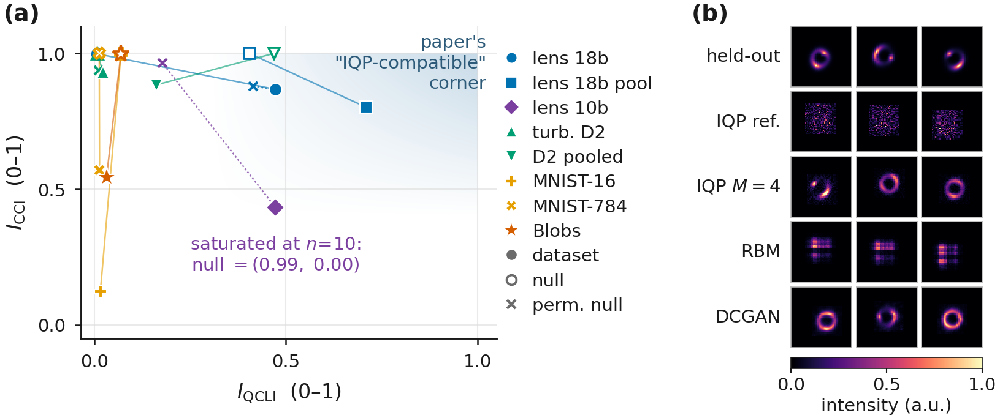
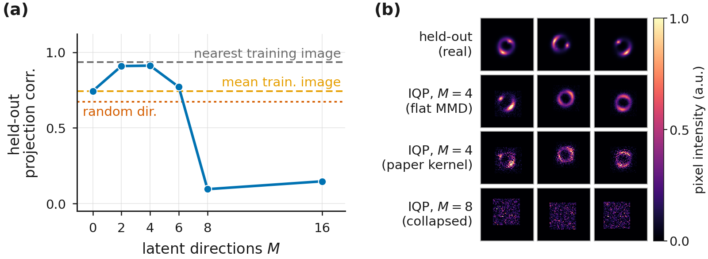
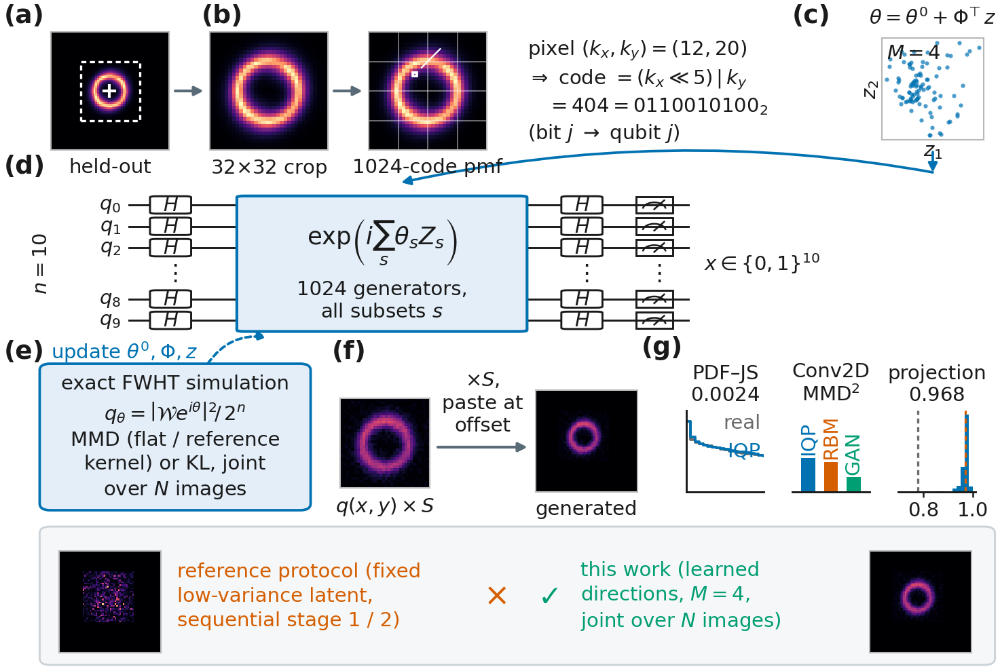
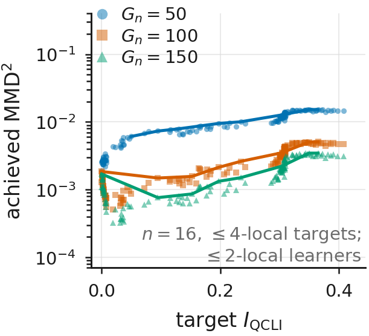
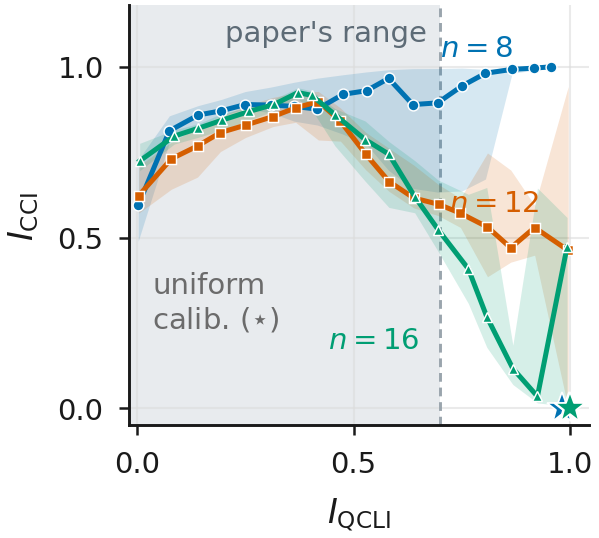
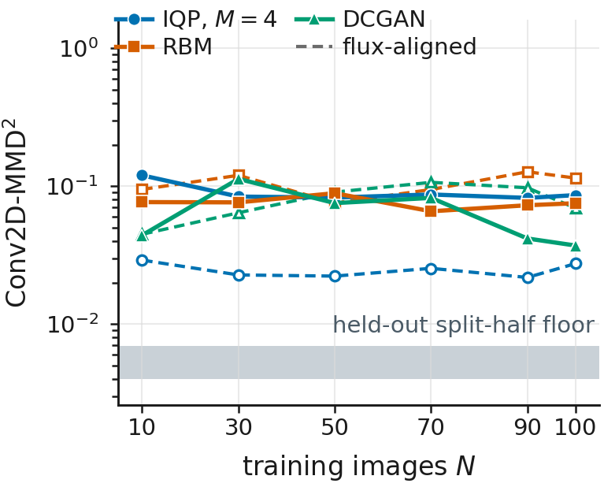
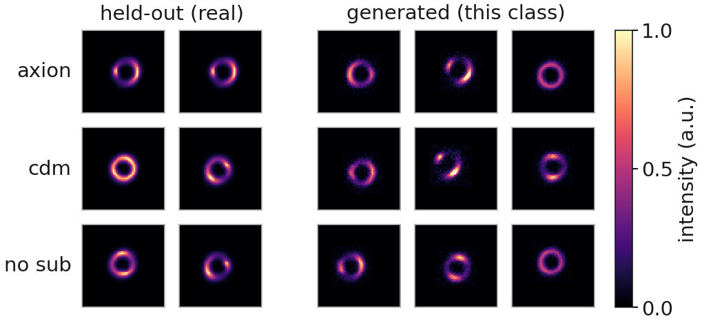

# IQP 生成模型於強重力透鏡影像

> 本文為 NeurIPS ML4PS 2026 投稿稿 `paper/ml4ps2026/main.tex` 的繁體中文翻譯，供作者與合作者閱讀，非投稿用版本。逐段忠實翻譯，未增刪內容、未更動任何數字。

---

## 摘要

瞬時量子多項式（instantaneous quantum polynomial, IQP）電路一般認為難以用古典方法取樣 [Bremner 等 2011; Bremner 等 2016]，而最大平均差異（maximum mean discrepancy, MMD）損失所需的期望值仍保持可計算，因此一個 IQP Born machine 可以在古典端訓練、再部署到量子硬體上 [Recio-Armengol 等 2025]。近期提出的相關性–複雜度地圖（correlation–complexity map）由資料集的 Walsh 階譜與其多重資訊（multi-information）算出兩個指標，用以預測哪些資料集適合這類模型；在這張地圖上，DeepLense 強重力透鏡影像是我們量測過最適合 IQP 的資料集（$I_{\mathrm{QCLI}} = 0.47$、$I_{\mathrm{CCI}} = 0.87$），位置高於提出這張地圖的那篇論文所使用的湍流資料。只要給定「學到的」潛變數方向 $\theta = \theta^{0} + \Phi^{\!\top} z$，在透鏡裁切影像上訓練的 10 量子位元 IQP Born machine，在訓練影像數 $N = 11$ 與 $N = 100$ 時，於原論文的 PDF–JS 以及通量對齊的 Conv2D-MMD$^2$ 上都勝過一個 RBM 與一個 DCGAN，所用參數量少了 $2$ 至 $39$ 倍，兩項指標各由不同的實驗組取勝，並能以 $0.97$ 的相關度重建未見過的影像。有三點保留條件為此設下界線。原論文自身的固定潛變數流程在影像上只產生雜訊；一個結構相符的置換零模型仍得到 $I_{\mathrm{QCLI}} = 0.42$；而在 $N = 100$ 時 DCGAN 於未對齊的 Conv2D-MMD$^2$ 上仍然領先。所有結果都是單一隨機種子、$n = 10$ 量子位元下的精確古典模擬，因此我們不宣稱任何量子優勢。

> 符號說明：原文以巨集定義 $\qcli \equiv I_{\mathrm{QCLI}}$ 與 $\cci \equiv I_{\mathrm{CCI}}$，本譯文一律直接寫成 $I_{\mathrm{QCLI}}$ 與 $I_{\mathrm{CCI}}$。

---

## 1 引言

IQP 電路是由互相對易的閘所構成的電路，其輸出分布為某個相位函數的 Walsh–Hadamard 變換的平方。若能對它們做精確的古典取樣，多項式階層就會塌縮 [Bremner 等 2011]，而且一般猜想這種困難性在平均情況下的近似取樣中仍然成立 [Bremner 等 2016; Codsi 與 van de Wetering 2025]，不過足夠的雜訊會恢復古典可模擬性 [Rajakumar 等 2024]。同樣的對易結構讓 MMD 損失的期望值保持可計算，因此這類模型可以「在古典端訓練、在量子硬體上部署」[Recio-Armengol 等 2025; Recio-Armengol 與 Bowles 2025]。

真實資料是否落在那個有用的位置上，是一個實證問題，而近期的一項提案 [Liu 等 2026] 用兩個要素來處理它。(i) 一張「相關性–複雜度地圖」，把資料集放到兩個座標上：量子相關似然指標（quantum correlation-likeness indicator）$I_{\mathrm{QCLI}}$，即資料的 Walsh 階譜與獨立同分布二項基準 $b_k = \binom{n}{k}/2^{n}$ 之間的 Jensen–Shannon 散度；以及古典相關複雜度指標（classical correlation-complexity indicator）$I_{\mathrm{CCI}}$，即最佳成對樹漏掉了多少總相關性 [Watanabe 1960; Schneidman 等 2003; Chow 與 Liu 1968]。該提案主張高 $I_{\mathrm{QCLI}}$、高 $I_{\mathrm{CCI}}$ 的角落就是 IQP 電路表現良好的地方。(ii) 一套潛變數調適流程（原論文的 Algorithm 1：先在單一錨點樣本上訓練一個共用的相位核心，接著逐一樣本地調適一組依 Hamming 順序取出的、固定的 $50$ 個 Walsh 基底相位，再對這組相位做內插以觸及未見過的樣本）。兩者都只在一個資料集上示範過，也就是 $n=18$ 量子位元下的二維湍流快照 [Khojasteh 等 2022]。

我們把這兩者都搬到 DeepLense [Alexander 等 2020a; Alexander 等 2020b] 的模擬暗物質強重力透鏡影像上。透鏡裁切影像落在我們量測過的所有資料集中最適合 IQP 的位置；在其上訓練的 10 量子位元 IQP Born machine，以遠少的參數量在原論文的兩項指標上都勝過該論文自己的 RBM 與 DCGAN 基準（每項指標各由一組取勝），而且唯有把原流程中固定的 Walsh 潛變數區塊改成「可學習」之後才做得到。附錄 B 至附錄 D 把同一批測試搬回原論文自己的資料上，其湍流結果在我們預先登錄的評估慣例下無法重現，另有兩項內部主張的結果好壞參半。

**圖 1**：**(a)** 相關性–複雜度地圖。資料集以實心標記表示，位於相同 $(n,K)$ 的獨立均勻零模型以空心標記表示並標為 null，置換零模型以叉號表示並標為 perm. null（本工作所加，原論文中沒有）。圖例中另外將每張影像 18 位元編碼縮寫為 lens 18b、其池化版本為 lens 18b pool、10 位元裁切機率質量函數（pmf）為 lens 10b、原論文的湍流資料為 turb. D2 與 D2 pooled、MNIST 先均值池化到 $4\times4$ 再二值化與其完整 $28\times28$ 版本為 MNIST-16 與 MNIST-784、BinaryBlobs 為 Blobs。**(b)** 每個模型的前三個非條件生成樣本，$N{=}100$，未經挑選，共用 $0$–$1$ 色階，其中 IQP ref. 表示原流程。

---

## 2 實驗設定

**模型。** 我們把原流程拿來與以下兩者比較：一是把它那組固定的 $50$ 個相位改成跨影像「聯合」訓練，二是我們的「學到的方向」模型，也就是一個可訓練的 $\Phi$，其 $M$ 個列是相位空間中的方向，於是每張影像都是 $M$ 維空間中的一個點 $z_i$，

$$\theta_i \;=\; \theta^{0} + \Phi^{\!\top} z_i,
\qquad \theta^{0}\in\mathbb{R}^{1024},\quad
\Phi\in\mathbb{R}^{M\times 1024},\quad z_i \in \mathbb{R}^{M} \tag{1}$$

其中 $M \in \{2,4,8\}$，$\Phi$ 的每一列都做 $L^2$ 正規化到 $\sqrt{1024}$，並對 $z$ 施加 $10^{-3}$ 的 $L^2$ 懲罰（$M{=}8$ 這一組提高到 $0.3$）。目標函數為原論文核（原論文的多頻寬高斯 MMD 核）、平坦 MMD（對每個 Walsh 係數給予均等權重，使其可由硬體取樣次數估計）以及精確 KL（僅限模擬使用的診斷量，附錄 E），而 $z$ 則由擬合的高斯分布抽取，或以抖動重新取樣。

**基準模型與指標。** 基準模型為一個受限波茲曼機（restricted Boltzmann machine, RBM；$10$ 個可見單元與 $1{,}000$ 個隱藏單元，採用單步 Gibbs 的持續對比散度 [Hinton 2002; Tieleman 2008]）以及一個深度卷積生成對抗網路（deep convolutional generative adversarial network, DCGAN）[Radford 等 2015]，其參數規模列於表 2。我們沿用原論文的兩項指標，即強度直方圖之間的機率密度 Jensen–Shannon 散度（PDF–JS），以及在一個固定隨機卷積編碼器特徵空間中的 Conv2D-MMD$^2$ [Gretton 等 2012]，並加上一項留出集的投影相關。每一個 IQP 實驗組與 RBM 都共用通量純量 $S$，而 DCGAN 自行學習其尺度，因此未對齊的 Conv2D-MMD$^2$ 有一部分是在比較亮度，我們也另外回報一個通量對齊的版本並標示為事後分析；每一組都在 $N \in \{11,100\}$ 下生成 $200$ 張影像，並對照同樣的 $200$ 張留出影像評分，全程使用隨機種子 $0$。

**與原論文設定的差異。** 有六項選擇與原論文不同，每一項都源自資料本身。原論文的快照帶有時間索引，其任務是內插到未見過的時間點，而我們所使用的 DeepLense `Model II` 影像 [Alexander 等 2020a; Alexander 等 2023; ML4SCI Collaboration 2025] 是靜態的，且分成三個子結構類別，因此我們從潛變數先驗做非條件生成。原論文把一個樣本編碼成 18 位元的 $(x,y,\mathrm{intensity})$ 三元組、置於 $18$ 個量子位元上，而我們則把每張 $64\times64$ 影像對齊質心、裁切出包含 $99.4\%$ 光量的中央 $32\times32$ 視窗，並把它讀成 $n=10$ 量子位元上、涵蓋 $1{,}024$ 個格點的單一機率質量函數（pmf）（附錄 A），因為原始的強度軸所攜帶的資訊僅略多於一個位元。原論文循序式的「錨定並調適」流程（第 1 節）把潛變數區塊固定住，而我們則學習 $\Phi$ 並把 $N$ 張影像聯合訓練，因為固定的 Walsh 方向是在像素之間做交叉淡化，而不是移動一個環（3.2 節）。原論文每一步由 $500$ 個模型樣本估計其 MMD，而我們以封閉形式計算它，因為 $10$ 量子位元的 pmf 可以精確算出。原論文以合成未見過的時間點來衡量泛化能力，而靜態影像沒有時間軸可以留出，因此我們改用留出影像上的投影相關。我們把每一張生成的裁切影像以固定通量 $S = 124.92$ 與一個取樣得到的位移貼回 $64\times64$，因為評分必須回到原始的影像尺度。

---

## 3 結果

### 3.1 透鏡影像是地圖上最適合 IQP 的資料集

表 1 重新計算了這張地圖。以原論文編碼湍流的方式來編碼時，透鏡影像的 $I_{\mathrm{QCLI}}$ 遠高於湍流，落在地圖所稱的 IQP 相容角落之內；然而一個保留每張影像強度直方圖、並摧毀所有空間結構的置換零模型，其分數也非常接近它們，而湍流資料的表現也是一樣，因此在這種編碼下，這張地圖大致上只是在追蹤強度直方圖。只有我們用來訓練的 10 位元裁切 pmf 在兩個座標上都與其置換零模型分離開來，所以我們把地圖上有利的位置解讀為必要條件而非充分條件。

**表 1**：我們資料上的相關性–複雜度地圖，每一個置換零模型都保留上一列的數值直方圖。

| 資料集與編碼 | $K$ | $I_{\mathrm{QCLI}}$ | $I_{\mathrm{CCI}}$ |
|---|---|:---:|:---:|
| 透鏡，18 位元 $(x,y,z)$ 三元組 | $4{,}096$ | 0.4715 | 0.8677 |
| 　置換零模型 | $4{,}096$ | 0.4154 | 0.8782 |
| 湍流 D2，18 位元三元組 | $4{,}096$ | 0.0232 | 0.9294 |
| 　置換零模型 | $4{,}096$ | 0.0113 | 0.9371 |
| 透鏡，10 位元裁切 pmf | 精確 | 0.4731 | 0.4313 |
| 　置換零模型 | 精確 | 0.1782 | 0.9633 |

### 3.2 原流程為何需要學到的方向

在我們低變異的潛變數區塊上循序執行時，Algorithm 1 產生的是雜訊（圖 1(b) 第二列；依 Hamming 順序排列的版本見附錄 E）。原因不在表達能力，因為完整的 $1{,}024$ 相位電路在平坦 MMD 下能把「單一」一張對齊裁切影像擬合到 $0.99997$ 的相關度。原因在流程本身。當核心被凍結在單一錨點上時，那 $50$ 個固定的潛變數座標重建其他每一張訓練影像時只有 $0.47$ 的相關度，因為固定的 Walsh 方向的作用像是一種 XOR 位移干涉圖樣，只會在像素之間做交叉淡化，而不會移動透鏡結構。

### 3.3 學到的潛變數方向能夠泛化

式 (1) 修好了這個問題。凍結 $\theta^{0}$ 與 $\Phi$、只在 $200$ 張「留出」影像上最佳化 $z$ 時，$N{=}100$ 的最佳實驗組（$M{=}4$ 的平坦 MMD）達到 $0.968$ 的平均相關度，對照最近鄰訓練影像的參考值 $0.970$，而原論文核只達到 $0.74$ 至 $0.79$。這個增益來自學習方向本身，而不是來自額外的參數，因為在圖 2(a) 受控的 $N{=}20$ 掃描中，訓練過的 $\Phi$ 大幅勝過同樣大小的隨機 $\Phi$。該掃描也顯示有用的 $M$ 一直維持在很小的範圍，並在 $M{=}8$ 時崩潰，因為此時所需的 $\|z\|$ 超過了模型的同調半徑。

**圖 2**：面板 (a) 與 (b) 是不同的實驗。**(a)** 受控的潛變數寬度掃描（$N{=}20$），留出集投影相關對 $M$ 作圖，並附上其自身的參考水準（最近鄰訓練影像 $0.934$、平均訓練影像 $0.744$、隨機方向 $0.672$）；$M{=}8$ 與 $16$ 兩個點取自一次學習率掃描中的最佳值。**(b)** $N{=}100$ 的 Round-3b 各實驗組，最上方是留出裁切影像，接著依序是平坦 MMD 下的 $M{=}4$、原論文核下的 $M{=}4$，以及崩潰的 $M{=}8$ 實驗組（該組以 KL 與一個 $z$ 懲罰項訓練）。

**表 2**：在透鏡裁切影像上、對照同樣兩個基準模型的原論文式比較。數值越低越好，**粗體**標示該欄中的最佳項。$^{\dagger}$ 表示在我們低變異的潛變數區塊上執行 Algorithm 1；學到的方向那幾列的參數量為 $N{=}11\,/\,N{=}100$；MMD$^2_{\mathrm{al}}$ 是通量對齊的版本（事後分析）；最後一列是實證下限而非一個模型。

| 模型 | 參數量 | $N = 11$ PDF–JS | $N = 11$ MMD$^2$ | $N = 11$ MMD$^2_{\mathrm{al}}$ | $N = 100$ PDF–JS | $N = 100$ MMD$^2$ | $N = 100$ MMD$^2_{\mathrm{al}}$ |
|---|---:|:---:|:---:|:---:|:---:|:---:|:---:|
| IQP，原論文流程（Algorithm 1）$^{\dagger}$ | $1{,}024$ | 0.00609 | 0.2031 | 0.1837 | 0.00697 | 0.2140 | 0.2233 |
| IQP，固定基底，聯合訓練 | $1{,}024$ | 0.00133 | 0.1416 | 0.1141 | 0.00099 | 0.1041 | 0.0617 |
| IQP，學到的方向 $M{=}4$（平坦 MMD） | $5{,}164$ / $5{,}520$ | 0.00196 | 0.1134 | **0.0279** | 0.00239 | 0.0861 | **0.0275** |
| IQP，學到的方向 $M{=}4$（原論文核） | $5{,}164$ / $5{,}520$ | **0.00095** | 0.1168 | 0.0679 | **0.00092** | 0.1189 | 0.0876 |
| RBM [Tieleman 2008] | $11{,}010$ | 0.00632 | **0.0741** | 0.1240 | 0.00195 | 0.0752 | 0.1144 |
| DCGAN [Radford 等 2015] | $199{,}837$ | 0.00183 | 0.2165 | 0.1241 | 0.00763 | **0.0371** | 0.0694 |
| *留出集對半切分（下限）* | n/a | *0.00003* | *0.0040* | *0.0069* | *0.00003* | *0.0040* | *0.0069* |

**表 3**：以表 2 的實驗組在 $N{=}100$ 下做各類別分別生成，每一次執行都在單一類別內訓練與評分，並與合併訓練的實驗組對照。$N{=}11$ 的執行結果見附錄 F。

| 訓練集 | PDF–JS | MMD$^2$ | MMD$^2_{\mathrm{al}}$ | 投影相關 |
|---|:---:|:---:|:---:|:---:|
| 僅 axion | 0.002050 | 0.09012 | 0.02346 | 0.9720 |
| 僅 cdm | 0.002275 | 0.09783 | 0.01848 | 0.9686 |
| 僅 no sub | 0.002001 | 0.1034 | 0.02773 | 0.9703 |
| *合併* | *0.002387* | *0.08607* | *0.02745* | *0.9684* |

### 3.4 原論文式比較與資料量縮放

在表 2 中，$M{=}4$ 的原論文核實驗組在兩種訓練集大小下都在 PDF–JS 上取勝，而 $M{=}4$ 的平坦 MMD 實驗組在兩者上都於通量對齊的 Conv2D-MMD$^2$ 上取勝，所用參數量比 RBM 少 $2$ 倍、比 DCGAN 少 $36$ 至 $39$ 倍，不過沒有任何單一實驗組同時贏下兩項指標。四個 IQP 實驗組中有兩個在 $N{=}11$ 的 PDF–JS 上落後於 DCGAN，有兩個在 $N{=}100$ 落後於 RBM；而在未對齊的 Conv2D-MMD$^2$ 上，每一個 IQP 實驗組在兩種大小下都輸，這個排序在通量對齊之後就反轉了。原論文關於資料量縮放的主張只有部分成立，因為我們的 DCGAN 在 PDF–JS 上於 $N{=}11$ 時「優於」$N{=}100$，與該論文所報告的低資料量 GAN 崩潰情形正好相反（圖 5、附錄 E）。

表 3 把獲勝的實驗組在每一個子結構類別上各自重做一次。三者都達到合併訓練的水準，而且三者在 $N{=}11$ 下同樣仍能訓練（附錄 F）；由於每個類別各自帶有自己的對半切分下限，因此每一列應與合併那一列比較，而不是與其他類別互相比較。

---

## 4 討論與限制

本文沒有任何內容構成量子優勢的證據，因為每一個電路都是在 $n=10$ 量子位元下精確模擬，而那些困難性結果所描述的是規模化之後的模型類別，而不是我們的這些實例。所有數字都出自單一隨機種子，而圖 5 中 DCGAN $3$ 倍的擺盪就界定了這個尺度。零學習與 PCA 對照組在某些物理量指標上與 IQP 實驗組相當、甚至超過它們。

---

# 附錄

## 附錄 A 管線流程

圖 3 總結了編碼方式、潛變數參數化與評估流程。

**圖 3**：管線流程。**(a)** 一張留出的 $64\times64$ 影像，白色十字位於其強度質心，虛線框為 $32\times32$ 的裁切視窗。**(b)** 對齊後的裁切影像被讀成涵蓋 $1{,}024$ 個格點的 pmf，其中範例像素 $(k_x,k_y) = (12,20)$ 帶有編碼 $404 = 0110010100_2$，而位元 $j$ 定址到量子位元 $j$。**(c)** $M = 4$ 時 $100$ 張訓練影像的前兩個學到的潛變數座標。**(d)** IQP 電路：一層 H 閘、一個涵蓋全部 $1{,}024$ 個子集 $s$ 的對角相位 $\exp(i\sum_s \theta_s Z_s)$、第二層 H 閘與測量。**(e)** 透過 $q_\theta = |\mathcal{W}e^{i\theta}|^{2}/2^{n}$ 做精確模擬，以 MMD（平坦核或原論文核）或以 KL 在 $N$ 張影像上聯合訓練，虛線箭頭表示更新 $\theta^{0}$、$\Phi$ 與 $z$。**(f)** 訓練後的 $q(x,y)$ 乘上 $S$ 並貼回一個取樣得到的位移處。**(g)** 真實樣本與 IQP 樣本的強度 PDF（PDF–JS $0.0024$）、$N{=}100$ 時的 Conv2D-MMD$^2$（IQP $0.086$、RBM $0.075$、DCGAN $0.037$），以及 $200$ 張留出影像上的投影相關（平均 $0.968$）。最下面一列對比了一個原流程樣本與本工作 $M{=}4$ 的樣本。

## 附錄 B 原論文湍流實驗的重現

我們在原論文自己的資料集（二維圓柱尾流湍流 D2 [Khojasteh 等 2022]，$n=18$ 量子位元，11 張錨點快照）上嘗試了直接重現。在我們預先登錄的評估慣例下，結果是**未能重現**，因為在 11 張快照的情境中，RBM 與一個 120 萬參數的 DCGAN 在該論文的「兩項」指標上都勝過我們的 IQP。有兩項發現為此加上但書。在一種原論文從未指明的「後寫覆蓋」（last-write-wins）彙整慣例下，我們 IQP 的 PDF–JS 數值確實落在已發表數值的附近（$0.0322$ 與 $0.0476$，對照 $0.0238$ 與 $0.0221$），但 RBM 仍然勝出。Conv2D-MMD$^2$ 在該處也已經飽和，因為在像素空間中打亂的真實資料就已經得到 $0.704$，低於原論文表 2 中的每一個模型（$0.90$ 至 $1.47$），而且合成未見過時間點的任務用線性內插即可解決（相關度 $0.9998$）。我們錨點擬合的上限（取樣為相關度 $0.69$、精確為 $0.77$）可追溯到第 1 階段中被凍結的 $\theta_{\mathrm{lat}}$（約 $-0.08$）、一個 $5\times10^{4}$ 樣本的 pmf（約 $-0.04$）以及 $0.88$ 至 $0.89$ 的模型族上限，而非我們的實作。

## 附錄 C 支撐集不匹配（原論文圖 3）

**圖 4**：**(a)** $n=16$ 的支撐集不匹配研究，$140$ 個目標電路（$\leq 4$-local）涵蓋精確 $I_{\mathrm{QCLI}} \in [0, 0.408]$，由 $50$、$100$ 與 $150$ 個閘的 $\leq 2$-local 學習器擬合（精確 MMD、Adam、$5{,}000$ 步）。閘數越多，整條包絡線就越低（主張 (b)，可重現），而在可達到的範圍內，達成的 MMD$^2$ 反而隨目標的 $I_{\mathrm{QCLI}}$ 「上升」，與主張 (a) 相反。**(b)** 只以最大化 $I_{\mathrm{QCLI}}$ 為目標而最佳化的電路，$n = 8, 12, 16$，每個 $n$ 有 3 個隨機種子與 2 種增益設定，各執行 $3{,}333$ 步，每個 $n$ 約記錄 $20{,}000$ 個點。$I_{\mathrm{CCI}}$ 從未進入目標函數。

原論文的圖 3 主張：(a) 可達成的 MMD 的上包絡線會隨著目標的 $I_{\mathrm{QCLI}}$ 上升而下降，因為支撐集所導致的下限縮小了；(b) 學習器的閘數越多，整條包絡線就整體下移（圖 4(a)）。主張 (b) 可以重現，因為三種學習器所達成的 MMD$^2$ 中位數依序下降為 $9.57\times10^{-3} \to 2.15\times10^{-3} \to 1.45\times10^{-3}$。主張 (a) 在我們能達到的範圍內則走向相反，因為當目標的精確 $I_{\mathrm{QCLI}}$ 從 $0$ 增加到 $0.41$ 時，達成的 MMD$^2$ 反而「上升」（Spearman $\rho = +0.98/+0.90/+0.81$），這個趨勢在一個以精確 pmf 訓練的對照組上同樣成立。該論文的前提在機制上仍然成立（Proposition II.2 下限代理量的 $\rho \le -0.98$），但在這裡，達成的 MMD 主要受可訓練性支配，而非受支撐集不匹配支配。我們的目標電路族在精確 $I_{\mathrm{QCLI}} \approx 0.41$ 處飽和，若照該論文的做法以 $10^{4}$ 個樣本估計則飽和在 $0$ 至 $0.064$，因此主張 (a) 所斷言的區間落在我們所能建構的範圍之外。

## 附錄 D $I_{\mathrm{QCLI}}$–$I_{\mathrm{CCI}}$ 上限

我們也重現了「只最大化 $I_{\mathrm{QCLI}}$ 就會附帶提高 $I_{\mathrm{CCI}}$」的那個實驗（圖 4(b)）。這種耦合在低 $I_{\mathrm{QCLI}}$ 處可以重現（限制在 $I_{\mathrm{QCLI}} \leq 0.3$ 時，$n=8/12/16$ 的 Spearman $\rho = +0.83/+0.76/+0.95$），但在 $n = 12,16$ 時於 $I_{\mathrm{QCLI}} \approx 0.38$ 以上反轉（整體 $\rho = -0.53, -0.57$）。這個反轉是由定義本身所強制造成的，因為完全均勻的分布會使 $I_{\mathrm{QCLI}}$ 最大化（$n=8/12/16$ 時分別為 $0.982/0.998/1.000$），而其 $I_{\mathrm{CCI}} = 0$。原論文的圖停在 $I_{\mathrm{QCLI}} \approx 0.7$ 以下，因此高 $I_{\mathrm{QCLI}}$ 未必代表存在可利用的結構，也可能只是代表接近均勻分布。

## 附錄 E 附加實驗組

**圖 5**：Conv2D-MMD$^2$ 對訓練集大小作圖，未對齊者為實線，通量對齊者為帶空心標記的虛線，繪於留出集對半切分下限的帶狀區域之上。

**資料量縮放。** 在 $N \in \{10,30,50,70,90,100\}$ 下，學到方向的 IQP 實驗組在 $N \geq 30$ 時保持平坦（未對齊的 Conv2D-MMD$^2$ 為 $0.082$ 至 $0.087$），RBM 也是如此（$0.066$ 至 $0.089$），而 DCGAN 在 $N{=}10$ 時就已經領先（$0.044$ 對 $0.120$），並且非單調地擺盪達 $3$ 倍（$0.113 \to 0.037$），如圖 5 所示。

**精確 KL。** KL 需要完整的模擬分布，無法由硬體取樣次數估計，因此我們把它排除在表 2 之外並記錄於此。它的 $M{=}2$ 實驗組使用 $3{,}094$ / $3{,}272$ 個參數，在 $N{=}11$ 時 PDF–JS 為 $0.00175$、在 $N{=}100$ 時為 $0.00302$，未對齊的 Conv2D-MMD$^2$ 為 $0.1673$ 與 $0.1356$，通量對齊者為 $0.0559$ 與 $0.0866$。圖 2(b) 中崩潰的 $M{=}8$ 實驗組同樣是一個 KL 實驗組。

**$M{=}2$ 的先驗抽樣。** 從 $M{=}2$ 先驗抽出的樣本全都是環狀結構，均方根半徑為 $9.40 \pm 0.21$ 像素，對照真實資料的 $9.21 \pm 0.15$，不過在橢率上的離散程度偏低（$0.048$ 對 $0.099$）。

**其他實驗組。** 我們共執行了 25 種條件：16 個 IQP 實驗組、RBM 與 DCGAN 基準，以及七個零學習或 PCA 對照組。表 2 以外的實驗組（依 Hamming 順序排列的潛變數區塊、其他目標函數與先驗、一個偽時間條件實驗組）與這些對照組，都在已釋出的表格中以相同的指標評分。原流程中依 Hamming 順序排列的潛變數區塊，在改為聯合訓練而非循序訓練之後，在 $N{=}11$ 時 PDF–JS 達到 $0.00137$、在 $N{=}100$ 時達到 $0.00139$，這與「3.2 節中失敗的是循序流程，而不是區塊的選擇」一致。我們並未在循序流程下執行 Hamming 區塊。每一個 IQP 實驗組與留出集之間的最近鄰距離（$3.6$ 至 $5.9$）都遠高於對半切分下限（$0.95$），因此沒有任何一組是在記憶訓練集；而 $M{=}8$ 實驗組崩潰（$N{=}100$ 時 PDF–JS $0.0103$、MMD$^2$ $0.244$）。

## 附錄 F 各類別樣本

圖 6 呈現表 3 中各類別執行所生成的內容，每個類別一列，來自表 2 的實驗組在每個類別內重新訓練與評分、其餘設定完全沒有更動；而在 $N{=}11$ 時，同樣這三次執行的留出集投影相關達到 $0.9232$、$0.9238$ 與 $0.8998$，對照合併實驗組的 $0.9092$。各列看起來相似，是因為三個類別只在幾個百分點的像素變異上有差別，所以我們主張的是每個類別都能各自被生成，而不是模型能把它們區分開來。

**圖 6**：各類別樣本。每一列為一個類別，先是兩張留出影像，接著是三張由僅以該類別 $100$ 張影像訓練的實驗組所生成的影像，分別依索引順序取前兩張與前三張、未經挑選，使用共用的 $0$–$1$ 色階。

---

## 翻譯說明

- **對應的英文原稿 commit**：`d09bc96`（Paper revision 3: shorter Setup, map and per-class tables in the body, native-size appendix figures, main.bbl for offline builds），來源 `release/iqp-lens-ml4ps2026`；譯自 `paper/ml4ps2026/main.tex`。
- **翻譯日期**：2026-09-09。
- **用途**：供作者與合作者閱讀的中文版，非投稿用版本。逐段忠實翻譯，未增刪內容、未更動任何數字、未加入評論。
- **編號對應**：圖 1（地圖與樣本）、圖 2（機制）、圖 3（管線流程）、圖 4（支撐集不匹配與上限）、圖 5（資料量縮放）、圖 6（各類別樣本）；表 1（地圖）、表 2（原論文式比較）、表 3（各類別）。原文的 `\cite` 已改寫為 `[作者 年份]`。

### 固定譯法表

| 原文 | 譯法 |
|---|---|
| IQP circuit | IQP 電路 |
| instantaneous quantum polynomial | 瞬時量子多項式 |
| Born machine | Born machine |
| maximum mean discrepancy (MMD) | 最大平均差異（MMD） |
| Walsh basis / Walsh order spectrum | Walsh 基底／Walsh 階譜 |
| correlation–complexity map | 相關性–複雜度地圖 |
| $I_{\mathrm{QCLI}}$ / $I_{\mathrm{CCI}}$ | 保留符號 |
| latent | 潛變數 |
| learned directions | 學到的方向 |
| held-out | 留出集 |
| projection correlation | 投影相關 |
| flux-aligned | 通量對齊 |
| permutation null | 置換零模型 |
| i.i.d.-uniform null | 獨立均勻零模型 |
| reference paper | 原論文 |
| strong gravitational lensing | 強重力透鏡 |
| substructure | 子結構 |
| crop | 裁切 |
| pmf | 機率質量函數（pmf） |
| seed | 隨機種子 |
| arm | 實驗組 |
| flat MMD / paper kernel | 平坦 MMD／原論文核 |
| split-half floor | 對半切分下限 |
| envelope | 包絡線 |
| coherence radius | 同調半徑 |
| trainability | 可訓練性 |
| support mismatch | 支撐集不匹配 |
| pre-registered | 預先登錄 |
| post-hoc | 事後分析 |
| zero-learning control | 零學習對照組 |
