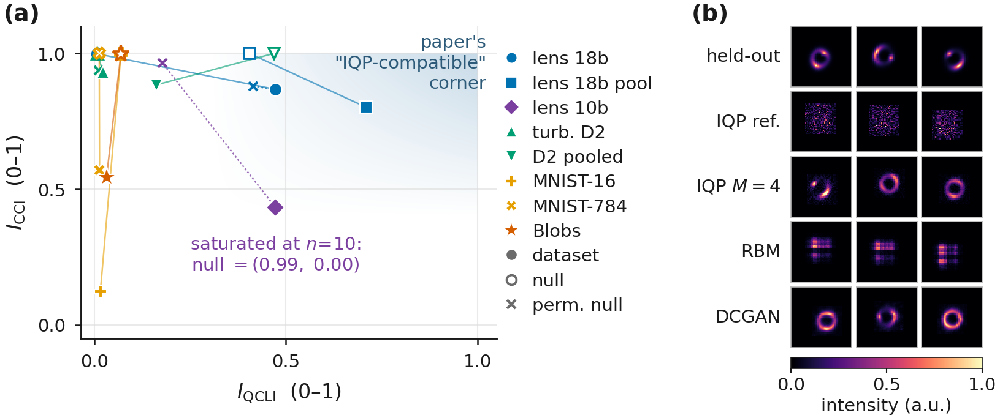
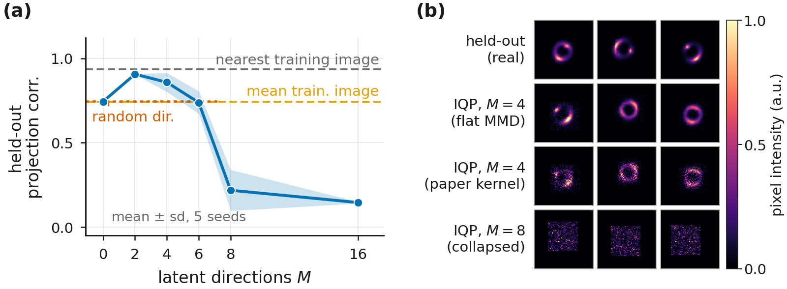
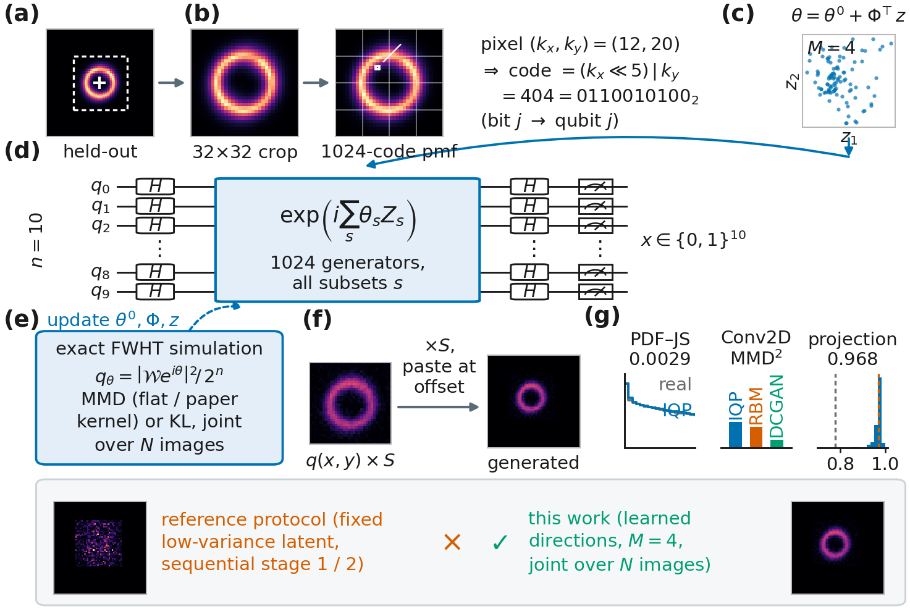
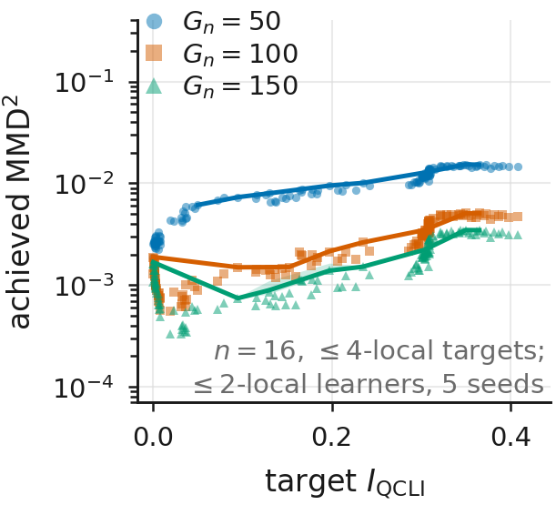
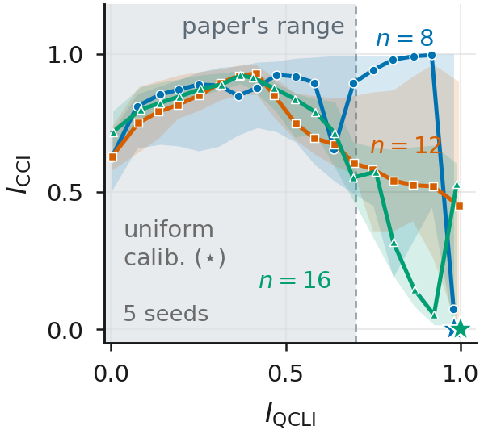
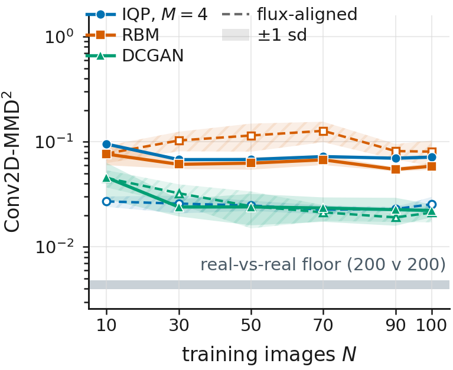
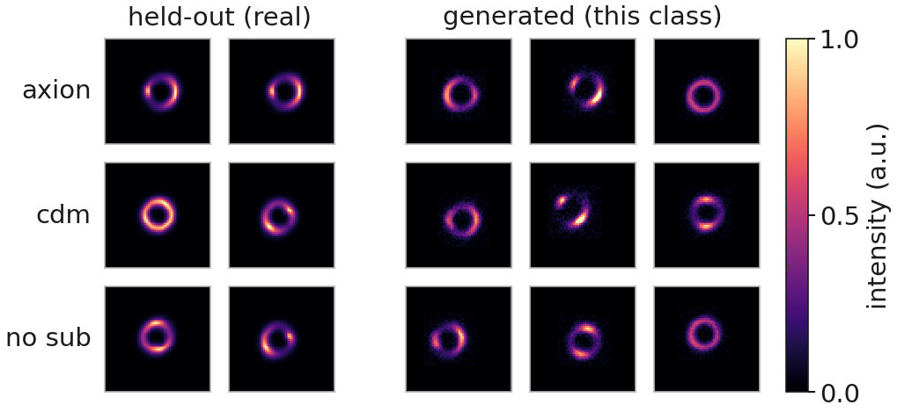

# IQP 生成模型於強重力透鏡影像

> 本文為 NeurIPS ML4PS 2026 投稿稿 v11（`paper/ml4ps2026/v11/main.tex`）的繁體中文翻譯，供作者與合作者閱讀，非投稿用版本。逐段忠實翻譯，未增刪內容、未更動任何數字。

---

## 摘要

瞬時量子多項式（instantaneous quantum polynomial, IQP）電路一般認為難以用古典方法取樣 [Bremner 等 2011; Bremner 等 2016]，而最大平均差異（MMD）損失所需的期望值仍保持可計算，因此這樣的 Born machine 可以在古典端訓練、再部署到量子硬體上 [Recio-Armengol 等 2025]。近期提出的相關性–複雜度地圖，由資料集的 Walsh 階譜與其多重資訊（multi-information）算出兩個指標，用來預測哪些資料集適合這類模型；而 DeepLense 強重力透鏡影像正位於我們量測過最適合 IQP 的位置（18 位元三元組為 $0.47$、$0.87$；我們用來訓練的 10 位元裁切 pmf 為 $0.47$、$0.43$），高於當初提出這張地圖時所用的湍流資料。只要給定「學到的」潛變數方向 $\theta = \theta^{0} + \Phi^{\!\top} z$，在透鏡裁切影像上的 10 量子位元模型，在 11 張訓練影像時足以與參數量多出 $2$ 至 $39$ 倍的 RBM 與 DCGAN 相競爭、並在部分指標上與之相當，同時能以 $0.9684 \pm 0.0004$ 的相關度重建未見過的影像。有三點保留條件為此設下界線。原論文流程中固定的潛變數區塊只產生雜訊；一個結構相符的置換零模型仍得到 $I_{\mathrm{QCLI}} = 0.42$；而在 $100$ 張影像時 DCGAN 領先，正如原論文所預測。所有結果都是 $n = 10$ 量子位元下、跨五個隨機種子的精確古典模擬，因此我們不宣稱任何量子優勢。

> 符號說明：原文以巨集定義 $\qcli \equiv I_{\mathrm{QCLI}}$ 與 $\cci \equiv I_{\mathrm{CCI}}$，本譯文一律直接寫成 $I_{\mathrm{QCLI}}$ 與 $I_{\mathrm{CCI}}$。

---

## 1 引言

IQP 電路是由互相對易的閘所構成的電路，其輸出分布為某個相位函數的 Walsh–Hadamard 變換的平方。若能對它們做精確的古典取樣，多項式階層就會塌縮 [Bremner 等 2011]，而且一般猜想這種困難性在近似取樣下仍然成立 [Bremner 等 2016]，不過足夠的雜訊會恢復古典可模擬性 [Rajakumar 等 2024]，而且對某些 IQP 實例已存在古典演算法 [Codsi 與 van de Wetering 2025]。同樣的對易結構讓 MMD 損失的期望值保持可計算，因此這類模型可以「在古典端訓練、在量子硬體上部署」[Recio-Armengol 等 2025; Recio-Armengol 與 Bowles 2025]。

真實資料是否落在那個有用的位置上，是一個實證問題，而近期的一項提案 [Liu 等 2026] 用兩個要素來處理它。(i) 一張「相關性–複雜度地圖」，把資料集放到兩個座標上：量子相關似然指標（quantum correlation-likeness indicator）$I_{\mathrm{QCLI}}$，即資料的 Walsh 階譜與獨立同分布二項基準 $b_k = \binom{n}{k}/2^{n}$ 之間的 Jensen–Shannon 散度；以及古典相關複雜度指標（classical correlation-complexity indicator）$I_{\mathrm{CCI}}$，即最佳成對樹漏掉了多少總相關性 [Watanabe 1960; Schneidman 等 2003; Chow 與 Liu 1968]，而高 $I_{\mathrm{QCLI}}$、高 $I_{\mathrm{CCI}}$ 的角落就是 IQP 電路應當表現良好之處。(ii) 一套潛變數調適流程（原論文的 Algorithm 1：先在單一錨點上訓練一個共用的相位核心，接著逐一樣本地調適一組依 Hamming 順序取出的、固定的 $50$ 個 Walsh 基底相位，再對它做內插以觸及未見過的樣本）。兩者都只在 $n=18$ 量子位元下的二維湍流快照上示範過 [Khojasteh 等 2022]。

我們把這兩者都搬到 DeepLense [Alexander 等 2020a; Alexander 等 2020b] 的模擬暗物質強重力透鏡影像上。透鏡裁切影像落在這張地圖上最適合 IQP 的位置；在其上訓練的 10 量子位元 IQP Born machine，在 11 張影像時以少 $2$ 至 $39$ 倍的參數量在兩項指標上都足以與該論文自己的 RBM 與 DCGAN 基準相競爭，而且唯有把該流程中固定的 Walsh 潛變數區塊改成「可學習」之後才達得到這個水準。附錄 B 至附錄 D 把同一批測試搬回原論文自己的資料上，其湍流結果在我們預先登錄的慣例下無法重現，另有兩項內部主張的結果好壞參半。

**圖 1**：**(a)** 相關性–複雜度地圖，資料集以實心標記表示，獨立均勻零模型以空心標記表示並標為 null，置換零模型以叉號表示（本工作所加，原論文中沒有）。圖例中 lens 18b 與 18b pool 為 18 位元的每張影像編碼與其池化編碼，lens 10b 為 10 位元裁切 pmf，turb. D2 與 D2 pooled 為原論文的湍流資料，MNIST-16 與 MNIST-784 為 $4\times4$ 與 $28\times28$ 的 MNIST，Blobs 為 BinaryBlobs。**(b)** 每個模型的前三個非條件生成樣本，$N{=}100$，未經挑選，共用 $0$–$1$ 色階。

---

## 2 實驗設定

**模型。** 我們把原流程拿來與以下兩者比較：一是把它那組固定的 $50$ 個相位改成跨影像「聯合」訓練，二是我們的「學到的方向」模型，也就是一個可訓練的 $\Phi$，其中有 $M$ 個相位空間中的方向，於是每張影像都是 $M$ 維空間中的一個點 $z_i$，

$$\theta_i \;=\; \theta^{0} + \Phi^{\!\top} z_i,
\qquad \theta^{0}\in\mathbb{R}^{1024},\quad
\Phi\in\mathbb{R}^{M\times 1024},\quad z_i \in \mathbb{R}^{M} \tag{1}$$

其中表 2 中 $M{=}4$，而圖 2(a) 的掃描中 $M \in \{0,2,4,6,8,16\}$；$\Phi$ 的每一列都做 $L^2$ 正規化到 $\sqrt{1024}$，並對 $z$ 施加相對的 $L^2$ 懲罰 $\lambda = 10^{-3} L_{0}$（$M{=}8$ 這一組提高到 $0.3 L_{0}$），其中 $L_{0}$ 是在 $\theta^{0}$ 與 $z = 0$ 處的資料損失。目標函數為原論文核（原論文取自 IQPopt 的多頻寬高斯 MMD 核 [Recio-Armengol 與 Bowles 2025]，由於該論文未給出頻寬規則，我們沿用該函式庫的規則，見附錄 E）、平坦 MMD（均等的 Walsh 權重，可由硬體取樣次數估計）以及精確 KL（僅限模擬使用）；$z$ 由擬合的高斯分布抽取，或以抖動重新取樣，而 $\theta^{0}$ 則以 $1{,}000$ 步的精確 KL 做暖啟動，這一步本身同樣僅限模擬使用。

**基準模型與指標。** 基準模型為一個受限波茲曼機（restricted Boltzmann machine, RBM；$10$ 個可見單元與 $1{,}000$ 個隱藏單元，採用單步 Gibbs 的持續對比散度 [Hinton 2002; Tieleman 2008]）以及一個深度卷積生成對抗網路（deep convolutional generative adversarial network, DCGAN）[Radford 等 2015]，其參數規模列於表 2；兩者都在 $200$ 張與留出集互斥的驗證影像上做驗證集提前停止（RBM 為 $160$k 或 $80$k 步，DCGAN 為 $5$k 至 $30$k 步），而 IQP 實驗組則固定跑 $4{,}000$ 步，這一點只會對它們有利。我們沿用原論文的兩項指標，即強度直方圖之間的 Jensen–Shannon 散度（PDF–JS），以及 Conv2D-MMD$^2$，也就是在一個固定隨機卷積編碼器特徵空間中的有偏 V 統計量 [Gretton 等 2012]，並加上一項留出集的投影相關。PDF–JS 使用固定在 $[0,1]$ 上的 $50$ 個分箱，而 Conv2D-MMD$^2$ 的尺度與頻寬僅取自留出集，因此兩項指標都不會隨著被評分的實驗組而變動；下限則來自 $20$ 次抽樣，每次以 $200$ 張對照 $200$ 張互斥的驗證影像（附錄 E）。每一個 IQP 實驗組與 RBM 都共用通量純量 $S$，而 DCGAN 自行學習其尺度，因此未對齊的 Conv2D-MMD$^2$ 有一部分是在比較亮度，我們也另外加上一個通量對齊的版本並標示為事後分析，作法是把每一張影像重新縮放到留出集的平均總強度。每一組都在 $N \in \{11,100\}$ 下生成 200 張影像，並對照同樣的 200 張留出影像評分，所有數值皆為跨五個隨機種子的平均值 $\pm$ 樣本標準差，而投影相關則由八次重啟中最佳化 $z$（附錄 E）。

**與原論文設定的差異。** 有六項選擇與原論文不同，每一項都源自資料本身。原論文的快照要內插到未見過的時間點，而我們所使用的 DeepLense `Model II` 影像 [Alexander 等 2020a; Alexander 等 2023; ML4SCI Collaboration 2025] 是靜態的、分成三個類別，因此我們從潛變數先驗做非條件生成。它把一個樣本編碼成 18 位元的 $(x,y,\mathrm{intensity})$ 三元組，而我們則把每張 $64\times64$ 影像對齊質心，並把其中央 $32\times32$ 的裁切（佔全部光量的 $99.4\%$）讀成 $n=10$ 之下、涵蓋 $1{,}024$ 個格點的單一機率質量函數（pmf）（附錄 A），因為原始的強度軸所攜帶的資訊僅略多於一個位元。它的「錨定並調適」流程把潛變數區塊固定住，而我們則學習 $\Phi$ 並把 $N$ 張影像聯合訓練（3.2 節）；而且它每一步由 $500$ 個樣本估計其 MMD，而 $10$ 量子位元的 pmf 是精確的。它留出的是時間點，而靜態影像沒有時間點，因此我們改為投影到留出影像上。每一張生成的裁切影像都以訓練集的平均總強度 $S$（$N{=}11$ 時為 $112.3$、$N{=}100$ 時為 $124.9$；留出集為 $123.9$）與一個訓練集的位移貼回 $64\times64$。

---

## 3 結果

### 3.1 透鏡影像是地圖上最適合 IQP 的資料集

表 1 重新計算了這張地圖。以原論文編碼湍流的方式來編碼時，透鏡影像的 $I_{\mathrm{QCLI}}$ 遠高於湍流，落在地圖所稱的 IQP 相容角落之內；然而一個保留每張影像強度直方圖、並摧毀所有空間結構的置換零模型，其分數也幾乎與它們相當，而湍流資料的表現也是一樣，因此在這種編碼下，這張地圖大致上只是在追蹤直方圖。只有我們用來訓練的 10 位元裁切 pmf 在兩個座標上都與其零模型分離開來，所以有利的位置是必要條件而非充分條件。

**表 1**：我們資料上的相關性–複雜度地圖，每一個置換零模型都保留上一列的數值直方圖，數值為跨五個隨機種子的平均值 $\pm$ 標準差。$K$ 是每張影像或每個快照的 $n$ 位元編碼數量；透鏡 18 位元那一列掃過 $64\times64$ 影像全部 $4{,}096$ 個 $(k_x,k_y)$ 格點，因此沒有取樣噪音，而湍流那一列則是從更大的網格上做次取樣。兩者都與 $K$ 有關，所以每一列只能對照它自己相同 $K$ 的零模型來讀；而在原論文自己的 $K = 5\times10^{4}$ 之下，湍流的 $I_{\mathrm{QCLI}}$ 為 $0.091 \pm 0.000$，其零模型為 $0.098 \pm 0.001$。

| 資料集與編碼 | $K$ | $I_{\mathrm{QCLI}}$ | $I_{\mathrm{CCI}}$ |
|---|---|:---:|:---:|
| 透鏡，18 位元 $(x, y, \mathrm{intensity})$ 三元組 | $4{,}096$ | $0.4715 \pm 0.0000$ | $0.8677 \pm 0.0000$ |
| 　置換零模型 | $4{,}096$ | $0.4154 \pm 0.0000$ | $0.8783 \pm 0.0001$ |
| 湍流 D2，18 位元三元組 | $4{,}096$ | $0.0232 \pm 0.0002$ | $0.9285 \pm 0.0008$ |
| 　置換零模型 | $4{,}096$ | $0.0114 \pm 0.0000$ | $0.9371 \pm 0.0009$ |
| 透鏡，10 位元裁切 pmf | 精確 pmf | $0.4731 \pm 0.0000$ | $0.4313 \pm 0.0000$ |
| 　置換零模型 | 精確 pmf | $0.1782 \pm 0.0000$ | $0.9634 \pm 0.0004$ |

### 3.2 原流程為何需要學到的方向

在我們低變異的潛變數區塊上循序執行時，Algorithm 1 產生的是雜訊（圖 1(b) 第二列；依 Hamming 順序排列的版本見附錄 E）。原因不在可表達性，因為完整的 $1{,}024$ 相位電路在平坦 MMD 下能把「單一」一張對齊裁切影像擬合到 $0.99997 \pm 0.00001$ 的相關度。原因在流程本身。當核心被凍結在單一錨點上時，那 50 個固定的潛變數座標重建其他每一張訓練影像時只有 $0.44 \pm 0.04$，因為固定的 Walsh 方向的作用像是一種 XOR 位移干涉圖樣，只會在像素之間做交叉淡化，而不會移動透鏡結構。

### 3.3 學到的潛變數方向能夠泛化

式 (1) 修好了這個問題。凍結 $\theta^{0}$ 與 $\Phi$、只在 200 張「留出」影像上最佳化 $z$ 時，$N{=}100$ 的最佳實驗組（$M{=}4$ 的平坦 MMD）達到 $0.9684 \pm 0.0004$ 的平均相關度，對照最近鄰訓練影像的參考值 $0.970$，而原論文核在 $N{=}11$ 時只達到 $0.792 \pm 0.006$、在 $N{=}100$ 時只達到 $0.805 \pm 0.012$。這個增益來自學習方向本身，而不是來自額外的參數，因為在圖 2(a) 的 $N{=}20$ 掃描中，訓練過的 $\Phi$ 勝過在同一個無潛變數偏移上的隨機方向（$0.7458 \pm 0.0005$）。有用的 $M$ 也一直維持在很小的範圍，$M{=}2$ 是最好的、也遠比其他穩定（$0.9060 \pm 0.0021$ 對照 $M{=}4$ 的 $0.8577 \pm 0.0559$），而到 $M{=}8$ 就崩潰（$0.218 \pm 0.121$），因為此時所需的 $\|z\|$ 超過了同調半徑。

**圖 2**：不同的實驗。**(a)** 受控的潛變數寬度掃描（$N{=}20$），留出集投影相關對 $M$ 作圖，數值為跨五個模型隨機種子的平均值 $\pm$ 標準差，並附上其自身的參考水準（最近鄰訓練影像 $0.934$、平均訓練影像 $0.744$、在無潛變數的 $M{=}0$ 偏移上的隨機方向 $0.746$）；$M{=}8$ 與 $16$ 兩個點取自一次學習率掃描中、依所繪相關度選出的最佳值，而 $M{=}0$ 與 $M{=}4$ 為單一學習率。**(b)** $N{=}100$ 的 Round-3b 各實驗組，先是留出裁切影像，接著依序是 $M{=}4$ 的平坦 MMD、$M{=}4$ 的原論文核，以及崩潰的 $M{=}8$ 實驗組。

**表 2**：在透鏡裁切影像上的原論文式比較，數值為跨五個隨機種子的平均值 $\pm$ 標準差，PDF–JS 以 $10^{-3}$ 為單位，兩個 MMD$^2$ 欄位以 $10^{-2}$ 為單位。數值越低越好；**粗體**標示平均值最佳、且領先次佳者的幅度大於兩者各自標準差的項目，因此沒有粗體的欄位代表其勝負無法由種子離散度支持。參數量為 $N{=}11\,/\,N{=}100$ 的總數；MMD$^2_{\mathrm{al}}$ 是通量對齊的版本（事後分析），最後一列是 $20$ 次抽樣、每次 $200$ 張對照 $200$ 張的真實對真實下限。$^{\dagger}$ 與參數計算慣例見附錄 E。

| 模型 | 參數量 | $N = 11$ PDF–JS | $N = 11$ MMD$^2$ | $N = 11$ MMD$^2_{\mathrm{al}}$ | $N = 100$ PDF–JS | $N = 100$ MMD$^2$ | $N = 100$ MMD$^2_{\mathrm{al}}$ |
|---|---:|:---:|:---:|:---:|:---:|:---:|:---:|
| IQP，原論文流程（Alg. 1）$^{\dagger}$ | $1{,}524$ / $5{,}974$ | 7.2 $\pm$ 0.7 | 18.8 $\pm$ 1 | 22.5 $\pm$ 2 | 8.4 $\pm$ 0.4 | 21.8 $\pm$ 0.6 | 26.6 $\pm$ 0.7 |
| IQP，固定基底，聯合訓練 | $1{,}524$ / $5{,}974$ | 1.6 $\pm$ 0.4 | 12.3 $\pm$ 0.4 | 12.5 $\pm$ 1 | 1.0 $\pm$ 0.1 | 10.2 $\pm$ 0.8 | 8.5 $\pm$ 1 |
| IQP，學到的方向 $M{=}4$（平坦 MMD） | $5{,}164$ / $5{,}520$ | 3.0 $\pm$ 0.2 | 8.9 $\pm$ 0.2 | 2.7 $\pm$ 0.2 | 2.9 $\pm$ 0.3 | 7.2 $\pm$ 0.3 | 2.6 $\pm$ 0.4 |
| IQP，學到的方向 $M{=}4$（原論文核） | $5{,}164$ / $5{,}520$ | 0.81 $\pm$ 0.05 | 9.6 $\pm$ 0.3 | 7.4 $\pm$ 0.6 | 1.4 $\pm$ 0.2 | 11.3 $\pm$ 0.5 | 10.0 $\pm$ 0.8 |
| RBM [Tieleman 2008] | $11{,}510$ / $15{,}960$ | 1.7 $\pm$ 0.8 | 6.5 $\pm$ 0.8 | 11.1 $\pm$ 4 | 0.9 $\pm$ 0.1 | 5.9 $\pm$ 0.4 | 8.1 $\pm$ 2 |
| DCGAN [Radford 等 2015] | $199{,}837$ | 1.1 $\pm$ 0.6 | 5.1 $\pm$ 2 | 3.9 $\pm$ 1 | **0.55** $\pm$ 0.12 | **2.2** $\pm$ 0.3 | 2.1 $\pm$ 0.4 |
| *真實對真實下限* | n/a | *0.04* $\pm$ 0.02 | *0.5* $\pm$ 0.3 | *0.4* $\pm$ 0.2 | *0.04* $\pm$ 0.02 | *0.5* $\pm$ 0.3 | *0.4* $\pm$ 0.2 |

### 3.4 原論文式比較與資料量縮放

在表 2 中，十一張影像的情境才是 IQP 實驗組具競爭力的地方。$M{=}4$ 的原論文核實驗組在該處持有最佳的平均 PDF–JS，而 $M{=}4$ 的平坦 MMD 實驗組持有最佳的平均通量對齊 Conv2D-MMD$^2$，所用參數量少了 $2$ 至 $39$ 倍，不過兩項領先都落在基準模型的一個標準差之內，因此我們把它們讀成相當，而不是勝過。未對齊的 Conv2D-MMD$^2$ 在兩種大小下都走向相反，兩個基準模型都領先每一個 IQP 實驗組，這個排序在通量對齊的欄位中被部分反轉。在 $N{=}100$ 時，DCGAN 在三個欄位上都領先，其中 PDF–JS 與未對齊的 Conv2D-MMD$^2$ 是決定性的領先，而在通量對齊的那一欄則落在 $M{=}4$ 平坦 MMD 實驗組的離散度之內。這個排序正是原論文的資料量縮放圖像，其跨 $N$ 的軌跡見圖 5。在單一類別內訓練時，同一個實驗組維持 $0.969$ 至 $0.972$ 的投影相關，而 PDF–JS 與 Conv2D-MMD$^2$ 則維持在合併訓練的水準，每一項各自對照它自己的下限（表 4）。

---

## 4 討論與限制

本文沒有任何內容構成量子優勢的證據，因為每一個電路都是在 $n=10$ 量子位元下精確模擬，而那些困難性結果所描述的是規模化之後的模型類別，而不是我們的這些實例。五個隨機種子並不算多，而且 DCGAN 在某一個設定與某一個種子上，於未對齊的 Conv2D-MMD$^2$ 上帶來高達 $57\%$、於 PDF–JS 上高達 $74\%$ 的離散度，因為 cuDNN 沒有確定性的轉置卷積核心。$S$ 是強加在 IQP 實驗組與 RBM 上的，而 DCGAN 則是自行學習它。

---

# 附錄

## 附錄 A 管線流程

圖 3 總結了編碼方式、潛變數參數化與評估流程。

**圖 3**：管線流程。**(a)** 一張留出的 $64\times64$ 影像，白色十字位於其強度質心，虛線框為 $32\times32$ 的裁切視窗。**(b)** 對齊後的裁切影像被讀成涵蓋 $1{,}024$ 個格點的 pmf，其中範例像素 $(k_x,k_y) = (12,20)$，即 $(x,y)$ 的整數形式，帶有編碼 $404 = 0110010100_2$，而位元 $j$ 定址到量子位元 $j$。**(c)** $M = 4$ 時 $100$ 張訓練影像的前兩個學到的潛變數座標。**(d)** IQP 電路：一層 H 閘、一個涵蓋全部 $1{,}024$ 個子集 $s$ 的對角相位 $\exp(i\sum_s \theta_s Z_s)$、第二層 H 閘與測量。**(e)** 透過 $q_\theta = |\mathcal{W}e^{i\theta}|^{2}/2^{n}$ 做精確模擬，以 MMD（平坦核或原論文核）或以 KL 在 $N$ 張影像上聯合訓練，其中快速 Walsh–Hadamard 變換（FWHT）提供 $\mathcal{W}$，虛線箭頭則表示更新 $\theta^{0}$、$\Phi$ 與 $z$。**(f)** 訓練後的 $q(x,y)$ 乘上 $S$ 並貼在一個取樣得到的位移處。**(g)** 真實樣本與 IQP 樣本的強度 PDF（PDF–JS $0.0029$）、$N{=}100$ 時的 Conv2D-MMD$^2$（IQP $0.072$、RBM $0.059$、DCGAN $0.022$），以及 $200$ 張留出影像上的投影相關（平均 $0.968$）。最下面一列對比了一個原流程樣本與本工作 $M{=}4$ 的樣本。

## 附錄 B 原論文湍流實驗的重現

我們在原論文自己的資料集（二維圓柱尾流湍流 D2 [Khojasteh 等 2022]，$n=18$ 量子位元，11 張錨點快照）上、跨五個隨機種子嘗試了直接重現。在我們預先登錄的慣例下，結果是**未能重現**，因為在 11 張快照的情境中，RBM（PDF–JS $0.217 \pm 0.007$）與一個 $1.2$M 參數的 DCGAN（$0.045 \pm 0.062$）在「兩項」指標上都勝過我們 31k 參數的 IQP（$0.272 \pm 0.004$）。有兩項發現為此加上但書。在一種原論文從未指明的「後寫覆蓋」（last-write-wins）彙整慣例下，我們 IQP 的 PDF–JS 數值確實落在已發表數值的附近（$0.0324 \pm 0.0011$ 與 $0.0473 \pm 0.0005$，對照 $0.0238$ 與 $0.0221$，其 Conv2D-MMD$^2$ 為 $0.711 \pm 0.012$ 與 $0.738 \pm 0.017$），但 RBM 仍然勝出。Conv2D-MMD$^2$ 在該處也已經飽和，因為在像素空間中打亂的真實資料就已經得到 $0.7045 \pm 0.0095$，低於原論文表 2 中的每一個模型（$0.90$ 至 $1.47$），而且合成未見過時間點的任務用線性內插即可解決（$0.9998$，確定性）。我們錨點擬合的水準（31k 那一組為取樣 $0.651 \pm 0.010$、精確 $0.739 \pm 0.010$）可追溯到第 1 階段凍結潛變數區塊（$-0.114 \pm 0.021$），以及一個不帶隨機種子的 $0.892$ 模型族上限（該次擬合中沒有任何步驟消耗隨機數流），而非我們的實作；至於那個 $5\times10^{4}$ 樣本的 pmf，曾因單一隨機種子而看似是第二個成因，但在五個種子上其代價已小到量不出來（$-0.001 \pm 0.022$），而第 2 階段則帶來 $0.000 \pm 0.000$。

## 附錄 C 支撐集不匹配（原論文圖 3）

**圖 4**：**(a)** $n=16$ 的支撐集不匹配研究，$140$ 個目標電路（$\leq 4$-local）涵蓋精確 $I_{\mathrm{QCLI}} \in [0, 0.408]$，由請求閘數 $G_n = 50$、$100$ 與 $150$ 的 $\leq 2$-local 學習器擬合，其中 $G_n$ 是學習器的閘數，最後一個被截在 $n = 16$ 時 $\leq 2$-local 電路所具有的 $136$ 個生成元（精確 MMD、Adam、$5{,}000$ 步、五個學習器隨機種子）。閘數越多，整條包絡線就越低（主張 (b)，可重現），而在可達到的範圍內，達成的 MMD$^2$ 反而隨目標的 $I_{\mathrm{QCLI}}$ 「上升」，與主張 (a) 相反。**(b)** 只以最大化 $I_{\mathrm{QCLI}}$ 為目標而最佳化的電路，$n = 8, 12, 16$，每個 $n$ 有五個隨機種子與 2 種增益設定，各執行 $3{,}333$ 步，每個 $n$ 約記錄 $33{,}000$ 個點。$I_{\mathrm{CCI}}$ 從未進入目標函數。

原論文的圖 3 主張：(a) 可達成的 MMD 的上包絡線會隨著目標的 $I_{\mathrm{QCLI}}$ 上升而下降，因為支撐集所導致的下限縮小了；(b) 學習器的閘數越多，整條包絡線就整體下移（圖 4(a)）。主張 (b) 可以重現，因為三種學習器所達成的 MMD$^2$ 中位數依序下降為 $9.58\times10^{-3} \to 2.15\times10^{-3} \to 1.44\times10^{-3}$，其種子離散度至多為 $2\times10^{-5}$。主張 (a) 在我們能達到的範圍內則走向相反，因為當目標的精確 $I_{\mathrm{QCLI}}$ 從 $0$ 增加到 $0.41$ 時，達成的 MMD$^2$ 反而「上升」（Spearman $\rho = +0.979 \pm 0.001 / +0.901 \pm 0.001 / +0.809 \pm 0.004$），這個趨勢在一個以精確 pmf 訓練的對照組上同樣成立。該論文的前提在機制上仍然成立（Proposition II.2 下限代理量的精確 pmf 形式 $\rho \le -0.98$、其 $10^{4}$ 樣本形式 $\le -0.92$），但達成的 MMD 主要受可訓練性支配，而非受支撐集不匹配支配。我們的目標電路族在精確 $I_{\mathrm{QCLI}} \approx 0.41$ 處飽和，若照該論文的做法以 $10^{4}$ 個樣本估計則飽和在 $0$ 至 $0.064$，因此主張 (a) 所斷言的區間落在我們所能建構的範圍之外。

## 附錄 D $I_{\mathrm{QCLI}}$–$I_{\mathrm{CCI}}$ 上限

我們也重現了「只最大化 $I_{\mathrm{QCLI}}$ 就會附帶提高 $I_{\mathrm{CCI}}$」的那個實驗（圖 4(b)）。這種耦合在低 $I_{\mathrm{QCLI}}$ 處可以重現（限制在 $I_{\mathrm{QCLI}} \leq 0.3$ 時，$n=8/12/16$ 的合併 Spearman $\rho = +0.79/+0.79/+0.90$，逐個種子則為 $+0.92 \pm 0.10 / +0.91 \pm 0.04 / +0.96 \pm 0.01$），但在五個種子合併之後，三種大小都在 $I_{\mathrm{QCLI}} \approx 0.38$ 以上反轉（整體 $\rho = +0.08, -0.57, -0.64$），而在兩個較小的尺寸上，逐個種子的整體 $\rho$ 本身就依種子而異（$+0.25 \pm 0.92$ 與 $-0.52 \pm 0.36$），因為一條軌跡能否在 $3{,}333$ 步之內抵達上限是隨機種子的性質。這個反轉是由定義本身所強制造成的，因為完全均勻的分布會使 $I_{\mathrm{QCLI}}$ 最大化（$0.982/0.998/0.9999$），而其 $I_{\mathrm{CCI}} = 0$。原論文的圖停在 $I_{\mathrm{QCLI}} \approx 0.7$ 以下，因此高 $I_{\mathrm{QCLI}}$ 未必代表存在可利用的結構，也可能只是代表接近均勻分布。

## 附錄 E 附加實驗組

**圖 5**：Conv2D-MMD$^2$ 對訓練集大小作圖，數值為跨五個隨機種子的平均值 $\pm$ 標準差，未對齊者為實線，通量對齊者為帶空心標記的虛線，繪於真實對真實下限的帶狀區域之上。隨機種子只改變模型，訓練子集則是同一次抽樣的巢狀前綴。

**資料量縮放。** 在 $N \in \{10,30,50,70,90,100\}$ 下，學到方向的 IQP 實驗組在 $N \geq 30$ 時保持平坦（未對齊的 Conv2D-MMD$^2$ 為 $0.068$ 至 $0.072$），RBM 也是如此（$0.055$ 至 $0.067$），而 DCGAN 在 $N{=}10$ 時就已經領先（$0.046 \pm 0.017$ 對照 $0.095 \pm 0.002$），並在 $N{=}100$ 時再降低 $2$ 倍（$0.046 \to 0.022$），如圖 5 所示。在通量對齊的那一欄，IQP 實驗組在 $N{=}10$ 與 $N{=}30$ 領先，DCGAN 則從 $N{=}50$ 起領先，兩者除了 $N{=}10$ 與 $N{=}90$ 之外，在各處都落在一個種子標準差之內而互相重疊。

**精確 KL。** KL 需要完整的模擬分布，無法由硬體取樣次數估計，因此我們把它排除在表 2 之外，並在此僅以隨機種子 0 記錄。它的 $M{=}2$ 實驗組使用 $3{,}094$ / $3{,}272$ 個參數，在 $N{=}11$ 時 PDF–JS 為 $0.00172$、在 $N{=}100$ 時為 $0.00302$，未對齊的 Conv2D-MMD$^2$ 為 $0.119$ 與 $0.091$，通量對齊者為 $0.046$ 與 $0.075$。圖 2(b) 中崩潰的 $M{=}8$ 實驗組同樣是一個 KL 實驗組。

**$M{=}2$ 的先驗抽樣。** 從 $M{=}2$ 先驗抽出的樣本全都是環狀結構，均方根半徑為 $9.40 \pm 0.21$ 像素，對照真實資料的 $9.21 \pm 0.15$，不過在橢率上的離散程度偏低（$0.048$ 對照 $0.099$）。

**其他實驗組。** 我們共回報 18 種條件：16 個 IQP 實驗組，以及 RBM 與 DCGAN 基準。表 2 以外的實驗組（依 Hamming 順序排列的潛變數區塊、其他目標函數與先驗、一個偽時間條件實驗組）都在已釋出的表格中以相同的指標評分。改為聯合訓練而非循序訓練之後，依 Hamming 順序排列的區塊在 $N{=}11$ 時 PDF–JS 達到 $0.00178$、在 $N{=}100$ 時達到 $0.00175$，這與「3.2 節中失敗的是循序流程，而不是區塊本身」一致；我們並未在循序流程下執行它。$M{=}8$ 實驗組崩潰（$N{=}100$、隨機種子 0 時 PDF–JS $0.0102$、MMD$^2$ $0.241$）。

**表 2 的慣例。** 標記 $^{\dagger}$ 的實驗組是在我們低變異的潛變數區塊上執行 Algorithm 1，其第 1 階段是把相位核心與錨點自身的潛變數區塊聯合訓練，而原流程則是凍結一個隨機的區塊。它的參數量欄位計入共用核心，加上各個 $N$ 之下每張影像的潛變數區塊；DCGAN 那一項只計其生成器，其判別器另外帶有 $53{,}497$ 個僅用於訓練的參數。RBM 同樣是一個聯合模型，其可見偏置與 $40$ 個隱藏偏置是每張影像各有一份，因此它持有 $10{,}960$ 個共用權重加上每張影像 $50$ 個，其總數也隨 $N$ 增長。把同一套驗證規則套用到 IQP 實驗組時，會選出 $1$k 至 $16$k 步，並且不會讓表 2 的任何一格變動超過一個標準差（在 v10 流程下，$N{=}11$ 的原論文核 PDF–JS 從 $0.92$ 改善到 $0.78 \times 10^{-3}$，這是十六個比較中唯一分得開的一個）；我們保留固定 $4{,}000$ 步的數值。

**流程細節。** 原論文核是 IQPopt 函式庫 [Recio-Armengol 與 Bowles 2025] 的三頻寬高斯 MMD。生成的像素若落在 $[0,1]$ 之外，會在 PDF–JS 之前被裁掉，被裁掉的質量至多為 $6\times10^{-3}$；下限的抽樣則來自留出集切分之後剩下的 $8{,}710$ 張驗證影像。該核心即為該函式庫在 $\sigma = \{0.989, 1.729, 2.236\}$ 時所用者，平均 Pauli 權重為 $2.00$、$0.77$ 與 $0.48$；原論文採用了這個核，卻沒有公布頻寬，因此這些數值是依該函式庫的規則而來。Conv2D-MMD$^2$ 的頻寬在留出特徵上一次固定，並由每張表的每一列共用，其值為未對齊 $0.005547$、通量對齊 $0.002558$。若把 $\theta^{0}$ 那 $1{,}000$ 步的精確 KL 暖啟動改成在同一張平均裁切影像上的平坦 MMD 暖啟動，使每一個階段都可由取樣次數估計，則在兩種 $N$ 之下都不會讓任何指標變動超過一個標準差。留出集投影的八次重啟中，我們保留與目標相關度最高的那一次，而以損失挑選的做法至多落後 $0.005$；單就零初始化的那一次重啟，在 $N{=}11$ 時達到 $0.899 \pm 0.018$、在 $N{=}100$ 時達到 $0.9684 \pm 0.0004$。DCGAN 是此處唯一無法逐位元重現的一組，因為 cuDNN 沒有確定性的轉置卷積核心，所以某一個設定在某一個種子上，於未對齊的 Conv2D-MMD$^2$ 上相差達 $57\%$、於 PDF–JS 上達 $74\%$，而每一個訓練兩次的 RBM 與 IQP 設定都能精確重現。

**固定預算下的基準模型。** 表 3 給出兩個基準模型在我們 round-3 流程固定 $20{,}000$ 步之下的結果，並與表 2 中由驗證集選出的預算並列；提前停止對兩者都有幫助，其中 $N{=}11$ 的 DCGAN 更達一個數量級以上。

**表 3**：兩個基準模型在固定 $20{,}000$ 步之下對照其由驗證集選出的預算，數值為跨五個隨機種子的平均值 $\pm$ 標準差，並在 round-3 慣例下評分（分箱與編碼器頻寬依各實驗組設定），因此這兩欄只能互相比較，不能與表 2 比較。

| 實驗組 | $N$ | PDF–JS（$\times10^{-3}$）20k 步 | PDF–JS（$\times10^{-3}$）選出的預算 | MMD$^2$（$\times10^{-2}$）20k 步 | MMD$^2$（$\times10^{-2}$）選出的預算 |
|---|---:|:---:|:---:|:---:|:---:|
| RBM | 11 | 4.25 $\pm$ 1.40 | 1.59 $\pm$ 0.29 | 8.6 $\pm$ 0.8 | 5.3 $\pm$ 0.7 |
| RBM | 100 | 4.27 $\pm$ 3.01 | 1.16 $\pm$ 0.23 | 9.6 $\pm$ 2.6 | 5.4 $\pm$ 0.6 |
| DCGAN | 11 | 27.7 $\pm$ 33.6 | 1.11 $\pm$ 0.56 | 67.5 $\pm$ 50.3 | 5.5 $\pm$ 1.7 |
| DCGAN | 100 | 9.01 $\pm$ 1.22 | 0.55 $\pm$ 0.12 | 7.2 $\pm$ 1.7 | 2.0 $\pm$ 0.3 |

## 附錄 F 各類別樣本

圖 6 呈現表 4 中各類別執行所生成的內容，每個類別一列，來自表 2 的實驗組在每個類別內重新訓練；而在 $N{=}11$ 時，同樣這三次執行的留出集投影相關達到 $0.9227 \pm 0.0014$、$0.9248 \pm 0.0030$ 與 $0.8986 \pm 0.0032$，對照合併實驗組的 $0.9102 \pm 0.0026$。表 4 的每一列都與它自己的真實對真實下限比較，而不是與另一個類別比較；以該表的單位計，這些下限為 axion $0.032/0.36/0.31$、cdm $0.034/0.30/0.32$、no sub $0.035/0.45/0.45$、合併 $0.041/0.48/0.40$，各自的標準差約為其平均值的一半。各列看起來相似，是因為三個類別只在幾個百分點的像素變異上有差別，所以我們主張的是每個類別都能各自被生成，而不是模型能把它們區分開來。

**表 4**：以表 2 的實驗組在 $N{=}100$ 下做各類別生成，每一次執行都在單一類別內訓練與評分，並與合併訓練的實驗組對照；數值為跨五個隨機種子的平均值 $\pm$ 標準差，單位同表 2，標準差取到小數點後兩位，投影相關則取到小數點後四位。每個類別都有自己的下限，列於正文中。**粗體**的意義同表 2。

| 訓練集 | PDF–JS（$\times10^{-3}$） | MMD$^2$（$\times10^{-2}$） | MMD$^2_{\mathrm{al}}$（$\times10^{-2}$） | 投影相關 |
|---|:---:|:---:|:---:|:---:|
| 僅 axion | 2.84 $\pm$ 0.08 | 7.11 $\pm$ 0.22 | 2.08 $\pm$ 0.23 | **0.9718** $\pm$ 0.0004 |
| 僅 cdm | 2.77 $\pm$ 0.24 | 7.85 $\pm$ 0.19 | 1.84 $\pm$ 0.28 | 0.9688 $\pm$ 0.0004 |
| 僅 no sub | 2.95 $\pm$ 0.32 | 7.99 $\pm$ 0.13 | 2.94 $\pm$ 0.27 | 0.9701 $\pm$ 0.0002 |
| *合併* | *2.91* $\pm$ 0.28 | *7.16* $\pm$ 0.29 | *2.55* $\pm$ 0.44 | *0.9684* $\pm$ 0.0004 |

**圖 6**：各類別樣本。每一列為一個類別，先是兩張留出影像，接著是三張由僅以該類別 $100$ 張影像訓練的實驗組所生成的影像，分別依索引順序取前兩張與前三張、未經挑選，使用共用的 $0$–$1$ 色階。

---

## 翻譯說明

- **對應的英文原稿**：`paper/ml4ps2026/v11/main.tex`（v11 投稿稿），圖檔取自 `paper/ml4ps2026/v11/figures/`。
- **翻譯日期**：2026-09-09。
- **用途**：供作者與合作者閱讀的中文版，非投稿用版本。逐段忠實翻譯，未增刪內容、未更動任何數字、未加入評論。
- **編號對應**：圖 1（地圖與樣本）、圖 2（機制）、圖 3（管線流程）、圖 4（支撐集不匹配與上限）、圖 5（資料量縮放）、圖 6（各類別樣本）；表 1（地圖）、表 2（原論文式比較）、表 3（附錄 E 的固定 20k 步基準模型）、表 4（附錄 F 的各類別生成）。原文的 `\cite` 已改寫為 `[作者 年份]`。
- **與 v10 中文版的差異**：v11 全面改為五個隨機種子的 mean ± sd（v10 為單一隨機種子），基準模型改用驗證集提前停止、下限改稱真實對真實下限，主張由「勝過基準」下修為「在 11 張影像時相當」，並新增表 3（固定 20k 步 vs 由驗證集選出的預算）。

### 固定譯法表

| 原文 | 譯法 |
|---|---|
| IQP circuit | IQP 電路 |
| instantaneous quantum polynomial | 瞬時量子多項式 |
| Born machine | Born machine |
| maximum mean discrepancy (MMD) | 最大平均差異（MMD） |
| Walsh basis / Walsh order spectrum | Walsh 基底／Walsh 階譜 |
| correlation–complexity map | 相關性–複雜度地圖 |
| $I_{\mathrm{QCLI}}$ / $I_{\mathrm{CCI}}$ | 保留符號 |
| latent | 潛變數 |
| learned directions | 學到的方向 |
| held-out | 留出集 |
| projection correlation | 投影相關 |
| flux-aligned | 通量對齊 |
| raw (metric) | 未對齊 |
| permutation null | 置換零模型 |
| i.i.d.-uniform null | 獨立均勻零模型 |
| reference paper | 原論文 |
| strong gravitational lensing | 強重力透鏡 |
| substructure | 子結構 |
| crop | 裁切 |
| pmf | 機率質量函數（pmf） |
| seed | 隨機種子 |
| arm | 實驗組 |
| flat MMD / paper kernel | 平坦 MMD／原論文核 |
| split-half floor | 對半切分下限 |
| real-vs-real floor | 真實對真實下限 |
| validation early stopping | 驗證集提前停止 |
| seed noise / seed spread | 種子噪音／種子離散度 |
| biased V-statistic | 有偏 V 統計量 |
| envelope | 包絡線 |
| coherence radius | 同調半徑 |
| trainability | 可訓練性 |
| support mismatch | 支撐集不匹配 |
| pre-registered | 預先登錄 |
| post-hoc | 事後分析 |
| warm start | 暖啟動 |
| restart | 重啟 |
| bin | 分箱 |
| bandwidth | 頻寬 |
