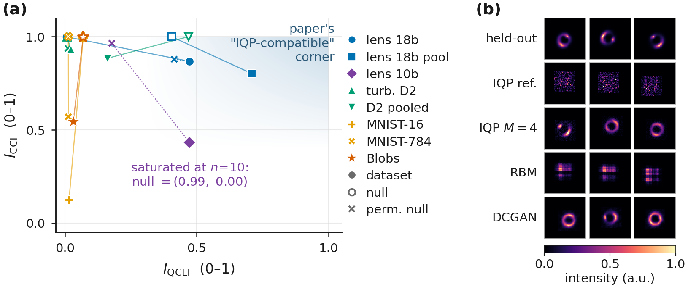
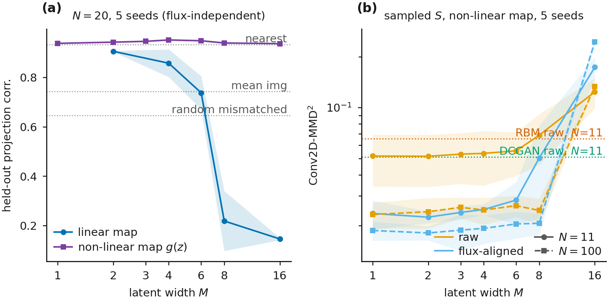
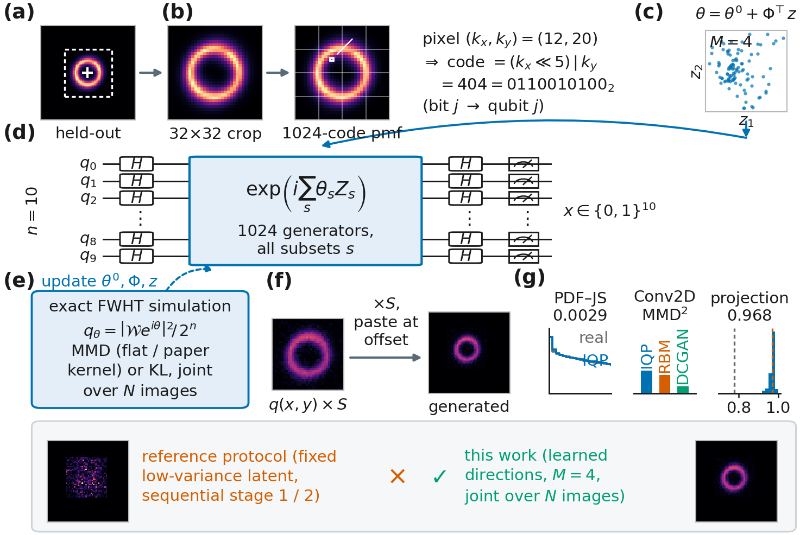
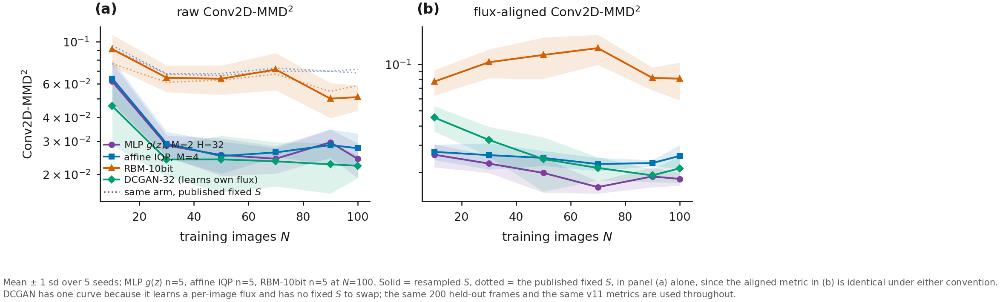

# IQP 生成模型於強重力透鏡影像

> 本文為 NeurIPS ML4PS 2026 投稿稿 v12（`paper/ml4ps2026/v12/main.tex`，7 頁版）的繁體中文翻譯，供作者與合作者閱讀，非投稿用版本。逐段忠實翻譯，未增刪內容、未更動任何數字。

---

## 摘要

瞬時量子多項式（instantaneous quantum polynomial, IQP）電路一般認為難以用古典方法取樣 [Bremner 等 2011; Bremner 等 2016]，而最大平均差異（MMD）損失所需的期望值仍保持可計算，因此這樣的 Born machine 可以在古典端訓練、再部署到量子硬體上 [Recio-Armengol 等 2025]。近期提出的相關性–複雜度地圖能預測哪些資料適合這類模型，而 DeepLense 強重力透鏡影像正位於我們量測過最適合 IQP 的位置，高於當初提出這張地圖時所用的湍流資料。原論文流程中固定的潛變數區塊只產生雜訊，而學到的線性映射在 $M{=}6$ 之後就失去同調性，因此我們改讓一個小的非線性映射來承載潛變數。在 11 張訓練影像時，由此得到的 10 量子位元模型在兩項生成指標上都在種子離散度之內與參數量六倍於它的 DCGAN 相當，在一個通量對齊的變體上領先它，在三項指標上都領先 RBM，並能以 $0.901$ 的相關度重建未見過的影像；在 $100$ 張影像時 DCGAN 領先，而該相關度達到 $0.977$。每一個電路都是在 $n=10$ 量子位元下、跨五個隨機種子做精確模擬，因此我們不宣稱任何量子優勢，只主張這是朝著「訓練資料稀缺時的實用性」邁出的一步。

> 符號說明：原文以巨集定義 $\qcli \equiv I_{\mathrm{QCLI}}$ 與 $\cci \equiv I_{\mathrm{CCI}}$，本譯文一律直接寫成 $I_{\mathrm{QCLI}}$ 與 $I_{\mathrm{CCI}}$。

---

## 1 引言

IQP 電路是由互相對易的閘所構成的電路，其輸出分布為某個相位函數的 Walsh–Hadamard 變換的平方。若能對它們做精確的古典取樣，多項式階層就會塌縮 [Bremner 等 2011]，而且一般猜想這種困難性在近似取樣下仍然成立 [Bremner 等 2016]，不過在某些情況下，雜訊或特殊結構會恢復古典可模擬性 [Rajakumar 等 2024; Codsi 與 van de Wetering 2025]。同樣的結構讓 MMD 損失的期望值保持可計算，因此這類模型可以「在古典端訓練、在量子硬體上部署」[Recio-Armengol 等 2025; Recio-Armengol 與 Bowles 2025]。

真實資料是否落在那個有用的位置上，是一個實證問題，而近期的一項提案 [Liu 等 2026] 用兩個要素來處理它。(i) 一張「相關性–複雜度地圖」，把資料集放到 $I_{\mathrm{QCLI}}$ 與 $I_{\mathrm{CCI}}$ 兩個座標上：前者是資料的 Walsh 階譜與獨立同分布二項基準之間的 Jensen–Shannon 散度，後者是最佳成對樹漏掉了多少相關性 [Watanabe 1960; Schneidman 等 2003; Chow 與 Liu 1968]，而高 $I_{\mathrm{QCLI}}$、高 $I_{\mathrm{CCI}}$ 的角落就是 IQP 電路應當表現良好之處。(ii) 一套潛變數調適流程（該論文的 Algorithm 1：一個在單一錨點上訓練的相位核心，加上一組固定的 $50$ 個 Walsh 相位並逐一樣本地調適它）。兩者都只在 $n=18$ 量子位元下的二維湍流上示範過 [Khojasteh 等 2022]。

我們把這兩者都搬到 DeepLense [Alexander 等 2020a; Alexander 等 2020b] 的模擬暗物質強重力透鏡影像上，並貢獻三件事。我們在透鏡裁切影像上重算這張地圖，它們落在地圖上最適合 IQP 的位置，而我們用一個置換零模型指出這樣的位置是必要條件而非充分條件。我們追查了原論文的潛變數流程為何在靜態影像上只產生雜訊，並把它的潛變數映射換成一個非線性的映射。接著我們在兩種強度慣例之下與一個 RBM 和一個 DCGAN 做比較，並在附錄 D 中回報一次在湍流資料上的重現。

**圖 1**：**(a)** 相關性–複雜度地圖，資料集以實心標記表示，獨立均勻零模型以空心標記表示，置換零模型以叉號表示（本工作所加，原論文中沒有）；lens 18b 與 18b pool 為 18 位元的每張影像編碼與其池化編碼，lens 10b 為裁切 pmf，turb. D2 為原論文的湍流資料。**(b)** 每個模型的前三個非條件生成樣本，$N{=}100$，未經挑選。

---

## 2 實驗設定

**模型。** 每一個實驗組都是一個涵蓋 $1{,}024$ 個 Walsh 相位 $\theta$ 的 $10$ 量子位元 IQP Born machine，彼此只差在每張影像的潛變數如何進入模型。原論文的流程把其中隨機的 $50$ 個相位凍結成一個區塊、並逐一樣本地調適它，而在靜態的透鏡裁切影像上，這樣做會讓其他訓練影像被重建得很差（3.2 節），因此我們把那個映射改成可訓練的，先是一個由 $M$ 個方向構成的線性映射，

$$\theta_i \;=\; \theta^{0} + \Phi^{\!\top} z_i,
\qquad \theta^{0}\in\mathbb{R}^{1024},\quad
\Phi\in\mathbb{R}^{M\times 1024},\quad z_i \in \mathbb{R}^{M} \tag{1}$$

其中 $\Phi$ 的每一列都做 $L^2$ 正規化。一旦影像所要求的 $\|z\|$ 離開了 Walsh 相位能夠同調干涉的半徑，這個映射就會退化，在這批裁切影像上是在 $M{=}6$ 時發生，因此我們的主要實驗組把 $\Phi^{\!\top} z$ 換成一個單隱藏層、寬度 $H{=}32$ 的 $\tanh$ 映射 $g$，其中 $z_i$ 在一個小的 $L^2$ 懲罰之下與 $g$ 一起聯合訓練。目標函數為平坦 MMD（均等的 Walsh 權重，可由硬體取樣次數估計）與原論文核（取自 IQPopt 的多頻寬高斯 MMD 核 [Recio-Armengol 與 Bowles 2025]），而 $\theta^{0}$ 則以 $1{,}000$ 步的精確 KL 做暖啟動，這一步可以由一個平坦 MMD 的暖啟動取代而不付出代價（附錄 E）。

**解碼、基準模型與指標。** 訓練好的 pmf 只是一個形狀，因此它會以一個總強度 $S$ 與一個訓練集的位移被貼進 $64\times64$ 的框裡。原論文的慣例給每一張框同一個訓練集平均的 $S$，這會讓生成的通量變異數為零，而真實裁切影像的離散程度大約是其平均值的四分之一，因此我們改成從 $N$ 張訓練影像總強度的核密度估計中，為每張影像抽出一個 $S$，而且不重新訓練；附錄 B 在固定 $S$ 之下把每一件事重做一次。基準模型是一個受限波茲曼機（restricted Boltzmann machine, RBM）[Hinton 2002; Tieleman 2008] 與一個深度卷積生成對抗網路（deep convolutional generative adversarial network, DCGAN）[Radford 等 2015]，兩者都在 $200$ 張驗證影像上做提前停止，而 IQP 實驗組則固定跑 $4{,}000$ 步，這一點只會對基準模型有利。我們用兩項指標評分，即強度直方圖之間的 Jensen–Shannon 散度（PDF–JS），以及在一個固定隨機編碼器特徵空間中的 Conv2D-MMD$^2$ [Gretton 等 2012]，而由於各實驗組對通量如何設定並不一致，我們另外加上一個事後分析的通量對齊 Conv2D-MMD$^2$，作法是把每一張影像重新縮放到留出集的平均總強度，並加上一個留出集的投影相關，取自八次重啟中擬合損失最低的那一次。分箱、尺度與頻寬都只由留出資料決定，所以沒有任何指標會隨著被評分的實驗組而變動；而在 $N \in \{11,100\}$ 之下，每一個實驗組都生成 $200$ 張影像來對照同樣的 $200$ 張留出影像，每一個數值都是跨五個隨機種子的平均值 $\pm$ 樣本標準差，並列於一個真實對真實下限之上。

**與原論文設定的差異。** 有五項選擇與原論文不同，每一項都源自資料本身。它的快照要內插到未見過的時間點，而我們所使用的 DeepLense `Model II` 影像 [Alexander 等 2020a; Alexander 等 2023; ML4SCI Collaboration 2025] 是靜態的，因此我們從潛變數先驗做非條件生成。它把一個樣本編碼成 18 位元的 $(x,y,\mathrm{intensity})$ 三元組，而我們則把每張影像對齊質心，並把其中央 $32\times32$ 的裁切（佔全部光量的 $99.4\%$）讀成 $n=10$ 之下、涵蓋 $1{,}024$ 個格點的單一機率質量函數（pmf）（附錄 A），因為原始的強度軸幾乎只攜帶一個位元。它把潛變數區塊固定住，而我們則學習這個映射並把 $N$ 張影像聯合訓練；而且它是由樣本估計其 MMD，而 $10$ 量子位元的 pmf 是精確的。它留出的是時間點，因此我們改為投影到留出影像上。

---

## 3 結果

### 3.1 透鏡影像是地圖上最適合 IQP 的資料集

表 1 重新計算了這張地圖。以原論文編碼湍流的方式來編碼時，透鏡影像的 $I_{\mathrm{QCLI}}$ 遠高於湍流，並落在地圖所稱的 IQP 相容角落之內；然而一個保留每張影像強度直方圖的置換零模型，其分數也幾乎與它們相當，而湍流的表現也是一樣，因此在這種編碼下，這張地圖大致上只是在追蹤直方圖。只有 10 位元裁切 pmf 在兩個座標上都與其零模型分離開來，所以有利的位置是必要條件，還不夠。

**表 1**：相關性–複雜度地圖，每一個置換零模型都保留上一列的數值直方圖，五個隨機種子。兩個指標都與 $K$ 有關，$K$ 是每張影像的 $n$ 位元編碼數量，所以每一列只能對照它自己相同 $K$ 的零模型來讀；而在原論文自己的 $K = 5\times10^{4}$ 之下，湍流的 $I_{\mathrm{QCLI}}$ 為 $0.091$，其零模型為 $0.098$。

| 資料集與編碼 | $K$ | $I_{\mathrm{QCLI}}$ | $I_{\mathrm{CCI}}$ |
|---|---|:---:|:---:|
| 透鏡，18 位元 $(x, y, \mathrm{intensity})$ 三元組 | $4{,}096$ | $0.4715 \pm 0.0000$ | $0.8677 \pm 0.0000$ |
| 　置換零模型 | $4{,}096$ | $0.4154 \pm 0.0000$ | $0.8783 \pm 0.0001$ |
| 湍流 D2，18 位元三元組 | $4{,}096$ | $0.0232 \pm 0.0002$ | $0.9285 \pm 0.0008$ |
| 　置換零模型 | $4{,}096$ | $0.0114 \pm 0.0000$ | $0.9371 \pm 0.0009$ |
| 透鏡，10 位元裁切 pmf | 精確 pmf | $0.4731 \pm 0.0000$ | $0.4313 \pm 0.0000$ |
| 　置換零模型 | 精確 pmf | $0.1782 \pm 0.0000$ | $0.9634 \pm 0.0004$ |

### 3.2 從原論文流程到非線性潛變數映射

在我們低變異的潛變數區塊上循序執行時，Algorithm 1 產生的是雜訊（圖 1(b) 第二列）。原因不在可表達性，因為完整的 $1{,}024$ 相位電路能把「單一」一張對齊裁切影像擬合到 $0.99997 \pm 0.00001$ 的相關度。原因在流程本身，因為當核心被凍結在單一錨點上時，那 $50$ 個固定的座標重建其他每一張訓練影像時只有 $0.44 \pm 0.04$，固定的 Walsh 方向的作用像是一種 XOR 位移圖樣，只會在像素之間做交叉淡化，而不會移動透鏡結構。式 (1) 修好了這個問題，但引入了它自己的寬度上限。在一個 $20$ 張影像的掃描中，學到的線性映射在 $M{=}2$ 時保持 $0.9060 \pm 0.0021$ 的留出集投影相關，在 $M{=}6$ 時掉到 $0.7378 \pm 0.0672$，在 $M{=}8$ 時則崩潰到 $0.2184 \pm 0.1213$。非線性映射移除了這個崩潰，在整個掃描範圍中都維持在 $0.9368$ 到 $0.9519$，高於最近鄰訓練影像的參考值 $0.9339$（圖 2(a)），但並未移除「有用的寬度很小」這件事，因為在生成指標上它到 $M{=}4$ 都是平的，而從 $M{=}8$ 起就退化。我們在 $M{=}2$ 下回報它，此時留出集投影相關在 $N{=}11$ 為 $0.9013 \pm 0.0012$、在 $N{=}100$ 為 $0.9773 \pm 0.0006$。

**圖 2**：潛變數寬度。**(a)** 在一個共用的 $20$ 張影像切分上，留出集投影相關對 $M$ 作圖，五個隨機種子，並附上該切分自身的參考水準；線性的那條曲線來自機制測試的驅動程式，非線性的那條來自 round-3 的訓練程式，兩者都在同樣的 $20$ 張留出影像上評分。**(b)** 抽樣強度之下的未對齊與通量對齊 Conv2D-MMD$^2$，並附上表 2 在 $N{=}11$ 時的基準模型水準。

**表 2**：在抽樣強度之下、於透鏡裁切影像上與古典基準模型的比較，五個隨機種子，PDF–JS 以 $10^{-3}$ 為單位，兩個 MMD$^2$ 欄位皆以 $10^{-2}$ 為單位。數值越低越好；**粗體**標示平均值最佳、且領先其他每一個實驗組的幅度都大於兩者標準差的項目，因此沒有粗體的欄位代表其勝負無法由種子離散度支持。參數量為 $N{=}11\,/\,N{=}100$ 的總數，最後一列是真實對真實下限，而附錄 E 給出 $^{\dagger}$ 與參數計算慣例。

| 模型 | 參數量 | $N = 11$ PDF–JS | $N = 11$ MMD$^2$ | $N = 11$ MMD$^2_{\mathrm{al}}$ | $N = 100$ PDF–JS | $N = 100$ MMD$^2$ | $N = 100$ MMD$^2_{\mathrm{al}}$ |
|---|---:|:---:|:---:|:---:|:---:|:---:|:---:|
| IQP，原論文流程（Alg. 1）$^{\dagger}$ | $1{,}524$ / $5{,}974$ | 6.5 $\pm$ 0.8 | 14.8 $\pm$ 1.6 | 22.5 $\pm$ 2.2 | 7.7 $\pm$ 0.4 | 14.7 $\pm$ 0.3 | 26.6 $\pm$ 0.7 |
| IQP，固定基底，聯合訓練 | $1{,}524$ / $5{,}974$ | 1.8 $\pm$ 0.4 | 8.7 $\pm$ 1.4 | 12.5 $\pm$ 1.3 | 1.1 $\pm$ 0.2 | 5.4 $\pm$ 0.4 | 8.5 $\pm$ 1.5 |
| IQP，線性映射 $M{=}4$（平坦 MMD） | $5{,}164$ / $5{,}520$ | 2.8 $\pm$ 0.1 | 5.6 $\pm$ 1.9 | 2.7 $\pm$ 0.2 | 2.6 $\pm$ 0.2 | 2.8 $\pm$ 0.5 | 2.6 $\pm$ 0.4 |
| IQP，線性映射 $M{=}4$（原論文核） | $5{,}164$ / $5{,}520$ | 1.0 $\pm$ 0.05 | 6.3 $\pm$ 1.5 | 7.4 $\pm$ 0.6 | 1.5 $\pm$ 0.2 | 5.9 $\pm$ 0.4 | 10.0 $\pm$ 0.8 |
| IQP，非線性映射 $M{=}2$（平坦 MMD） | $33{,}910$ / $34{,}088$ | 1.2 $\pm$ 0.07 | 5.2 $\pm$ 1.8 | **2.2** $\pm$ 0.2 | 1.7 $\pm$ 0.2 | 2.4 $\pm$ 0.5 | 1.8 $\pm$ 0.2 |
| IQP，非線性映射 $M{=}2$（原論文核） | $33{,}910$ / $34{,}088$ | 0.75 $\pm$ 0.07 | 5.4 $\pm$ 1.5 | 5.1 $\pm$ 0.3 | 0.99 $\pm$ 0.04 | 4.2 $\pm$ 0.4 | 6.6 $\pm$ 0.6 |
| RBM [Tieleman 2008] | $11{,}510$ / $15{,}960$ | 1.9 $\pm$ 1.0 | 7.9 $\pm$ 1.9 | 11.1 $\pm$ 3.9 | 1.1 $\pm$ 0.2 | 5.1 $\pm$ 0.8 | 8.1 $\pm$ 2.2 |
| DCGAN [Radford 等 2015] | $199{,}837$ | 1.1 $\pm$ 0.6 | 5.1 $\pm$ 1.5 | 3.9 $\pm$ 1.0 | **0.55** $\pm$ 0.12 | 2.2 $\pm$ 0.3 | 2.1 $\pm$ 0.4 |
| *真實對真實下限* | n/a | *0.04* $\pm$ 0.02 | *0.5* $\pm$ 0.3 | *0.4* $\pm$ 0.2 | *0.04* $\pm$ 0.02 | *0.5* $\pm$ 0.3 | *0.4* $\pm$ 0.2 |

### 3.3 與古典基準模型的比較

在表 2 中，十一張影像的情境才是 IQP 實驗組具競爭力的地方。在該處，非線性實驗組在 PDF–JS 與未對齊的 Conv2D-MMD$^2$ 上，於種子噪音之內與 DCGAN 相當（分別為 DCGAN 自身標準差的 $-0.13$ 與 $-0.04$），並在通量對齊的那一欄領先（$+1.57$ 個標準差）；而它在三項上都領先 RBM，幅度分別為 RBM 標準差的 $0.75$、$1.40$ 與 $2.27$ 倍，所用參數量是 DCGAN 的六分之一、RBM 的三倍。在原論文核之下，同一個映射持有該欄最佳的平均 PDF–JS，為 $0.75 \times 10^{-3}$，對照 DCGAN 的 $1.11 \pm 0.56$，這讓兩者落在一個標準差之內，而它用一個較差的通量對齊欄位換來這一點。在兩種大小之下，都沒有任何實驗組在三個欄位上都以超過一個種子標準差的幅度勝過 DCGAN；而在 $100$ 張影像時，DCGAN 在 PDF–JS 與未對齊的 Conv2D-MMD$^2$ 上領先，通量對齊的 $1.8 \pm 0.2$ 則落在它的 $2.1 \pm 0.4$ 的一個標準差之內。

有兩個性質為這張表怎麼讀劃下界線。通量對齊的那一欄對強度慣例是不變的，而不是與未對齊那一欄互相獨立；在我們的 $325$ 次執行中，該欄最大的配對差異是 $6\times10^{-9}$，因此那兩個 MMD$^2$ 欄位量的是形狀，以及形狀加通量，而不是兩件分開的事。抽樣規則在各實驗組之間也不是中性的：在 $N{=}11$ 時它讓每一個 IQP 實驗組的未對齊 Conv2D-MMD$^2$ 改善 $22$ 到 $39\%$，卻讓 RBM 的變差 $20\%$，而在 $N{=}100$ 時又讓 RBM 改善 $13\%$，因此十一張影像的那段差距有一部分來自基準模型自己在移動。抽樣固定住的是生成通量分布的形狀，而不是它的位置，因為那十一張訓練影像比留出集暗了 $9\%$，這也就是未對齊那一欄停在 DCGAN 旁邊的原因。

**資料量縮放與各類別訓練。** 在 $N \in \{10,\dots,100\}$ 之間（圖 4，附錄 C），非線性實驗組的未對齊 Conv2D-MMD$^2$ 從 $0.062 \pm 0.016$ 降到 $0.024 \pm 0.005$，RBM 的則從 $0.091 \pm 0.017$ 降到 $0.051 \pm 0.008$，而 DCGAN 在 $N{=}10$ 時就已經領先（$0.046 \pm 0.017$），最後與其他打平。在通量對齊的那一欄，非線性實驗組在每一個 $N$ 都持有最低的平均值，不過只有在 $N{=}10$ 與 $N{=}70$ 時其幅度超過一個種子標準差。在 $N{=}100$ 下於單一類別內重新訓練時，它在 axion、cdm 與 no-sub 上的通量對齊值分別達到 $0.017$、$0.015$ 與 $0.021$，對照的下限為 $0.0031$、$0.0032$ 與 $0.0045$（附錄 C），所以這代表每個類別都能各自被生成，而不是模型能把它們區分開來。

---

## 4 討論與限制

在十一張訓練影像時，一個帶有學到的非線性潛變數映射的 $10$ 量子位元 IQP Born machine，與一個 RBM 和一個 DCGAN 具有競爭力，並且在通量對齊的指標上以 DCGAN 六分之一的參數量勝過兩者，這是朝著「訓練資料是稀缺資源」時的實用性邁出的一步。本文沒有任何內容構成量子優勢的證據，因為每一個電路都是在 $n=10$ 量子位元下精確模擬，而那些困難性結果所描述的是這個模型類別在規模化之後的性質；而且這個地位並沒有延續到 $100$ 張影像。五個隨機種子並不算多，DCGAN 在某一個種子上於未對齊的 Conv2D-MMD$^2$ 上帶來高達 $57\%$ 的離散度，而抽樣強度在各實驗組之間對未對齊那一欄的移動幅度也不相同。

---

# 附錄

## 附錄 A 管線流程

**圖 3**：管線流程。**(a)** 一張留出影像與其裁切視窗。**(b)** 對齊後的裁切影像作為涵蓋 $1{,}024$ 個格點的 pmf，其中像素 $(12,20)$ 帶有編碼 $404$，而位元 $j$ 定址到量子位元 $j$。**(c)** $M = 4$ 時學到的潛變數。**(d)** 電路。**(e)** 精確模擬，圖中畫的是式 (1)；主要實驗組在該處放的是 $\theta = \theta^{0} + g(z)$。**(f)** 在 $S$ 之下解碼。**(g)** 線性 $M{=}4$ 實驗組的各項指標。

## 附錄 B 固定 $S$ 的慣例

表 3 就是表 2，只是換成每一個以 pmf 為基礎的實驗組所發表時採用的那個單一訓練集平均強度，而且是在同一批執行上做的；從每一次執行所存下的裁切影像重建那些框，能精確重現已發表的那些框，所以這兩張表只差在解碼方式，而且這個比較是配對的。在 $N{=}11$ 的未對齊 Conv2D-MMD$^2$ 上，抽樣讓每一個 IQP 實驗組改善 $0.033$ 到 $0.041$，配對標準差為 $0.012$ 到 $0.020$，其中包含被省略的那兩個固定區塊實驗組，同時讓 RBM 變差 $0.013 \pm 0.017$；而在 $N{=}100$ 時它改善了每一個實驗組，包括 RBM（$0.008 \pm 0.008$）。在 PDF–JS 上，配對效果至多為 $7\times10^{-4}$ 且正負互見，而在通量對齊的那一欄則低於 $10^{-8}$。

**表 3**：固定強度之下的表 2，同一批執行、同樣的隨機種子、單位、粗體規則與下限，那兩個固定區塊的實驗組留給正文說明。DCGAN 沒有固定的 $S$ 可以替換，所以它那一列重複列出。

| 模型 | 參數量 | $N = 11$ PDF–JS | $N = 11$ MMD$^2$ | $N = 11$ MMD$^2_{\mathrm{al}}$ | $N = 100$ PDF–JS | $N = 100$ MMD$^2$ | $N = 100$ MMD$^2_{\mathrm{al}}$ |
|---|---:|:---:|:---:|:---:|:---:|:---:|:---:|
| IQP，線性映射 $M{=}4$（平坦 MMD） | $5{,}164$ / $5{,}520$ | 3.0 $\pm$ 0.2 | 8.9 $\pm$ 0.2 | 2.7 $\pm$ 0.2 | 2.9 $\pm$ 0.3 | 7.2 $\pm$ 0.3 | 2.6 $\pm$ 0.4 |
| IQP，線性映射 $M{=}4$（原論文核） | $5{,}164$ / $5{,}520$ | 0.81 $\pm$ 0.05 | 9.6 $\pm$ 0.3 | 7.4 $\pm$ 0.6 | 1.4 $\pm$ 0.2 | 11.3 $\pm$ 0.5 | 10.0 $\pm$ 0.8 |
| IQP，非線性映射 $M{=}2$（平坦 MMD） | $33{,}910$ / $34{,}088$ | 0.96 $\pm$ 0.09 | 8.5 $\pm$ 0.2 | **2.2** $\pm$ 0.2 | 1.9 $\pm$ 0.2 | 6.8 $\pm$ 0.1 | 1.8 $\pm$ 0.2 |
| IQP，非線性映射 $M{=}2$（原論文核） | $33{,}910$ / $34{,}088$ | 0.49 $\pm$ 0.07 | 8.7 $\pm$ 0.2 | 5.1 $\pm$ 0.3 | 0.86 $\pm$ 0.08 | 9.8 $\pm$ 0.3 | 6.6 $\pm$ 0.6 |
| RBM [Tieleman 2008] | $11{,}510$ / $15{,}960$ | 1.7 $\pm$ 0.8 | 6.5 $\pm$ 0.8 | 11.1 $\pm$ 3.9 | 0.92 $\pm$ 0.13 | 5.9 $\pm$ 0.4 | 8.1 $\pm$ 2.2 |
| DCGAN [Radford 等 2015] | $199{,}837$ | 1.1 $\pm$ 0.6 | 5.1 $\pm$ 1.5 | 3.9 $\pm$ 1.0 | **0.55** $\pm$ 0.12 | **2.2** $\pm$ 0.3 | 2.1 $\pm$ 0.4 |

## 附錄 C 潛變數掃描與各類別結果

**圖 4**：Conv2D-MMD$^2$ 對訓練集大小作圖，**(a)** 為未對齊、**(b)** 為通量對齊，五個隨機種子；實線是抽樣強度，虛線是固定強度。

隱藏層寬度的重要性低於潛變數寬度，$H \in \{4,8,16,32\}$ 在 $M{=}4$、$N{=}100$ 時分別給出通量對齊的 $0.029$、$0.022$、$0.020$ 與 $0.019$。每個類別都對照它自己的下限評分，以該表的單位計，axion 為 $0.03/0.36/0.31$、cdm 為 $0.03/0.30/0.32$、no sub 為 $0.04/0.45/0.45$，所以每一欄要順著一個類別往下讀。

**表 4**：$H{=}32$、平坦 MMD 之下的潛變數寬度掃描，接著是同一個實驗組在單一類別內重新訓練的結果；抽樣強度，五個隨機種子，單位同表 2。

| $M$ | $N = 11$ PDF–JS | $N = 11$ MMD$^2$ | $N = 11$ MMD$^2_{\mathrm{al}}$ | $N = 100$ PDF–JS | $N = 100$ MMD$^2$ | $N = 100$ MMD$^2_{\mathrm{al}}$ |
|---|:---:|:---:|:---:|:---:|:---:|:---:|
| 2 | 1.2 $\pm$ 0.07 | 5.2 $\pm$ 1.8 | 2.2 $\pm$ 0.2 | 1.7 $\pm$ 0.19 | 2.4 $\pm$ 0.5 | 1.8 $\pm$ 0.2 |
| 4 | 1.2 $\pm$ 0.04 | 5.4 $\pm$ 1.9 | 2.5 $\pm$ 0.2 | 1.6 $\pm$ 0.10 | 2.5 $\pm$ 0.5 | 1.9 $\pm$ 0.4 |
| 16 | 7.7 $\pm$ 0.91 | 12.4 $\pm$ 2.5 | 17.3 $\pm$ 2.5 | 8.8 $\pm$ 0.14 | 13.3 $\pm$ 0.3 | 24.5 $\pm$ 0.8 |
| axion | 1.1 $\pm$ 0.10 | 4.6 $\pm$ 0.6 | 2.9 $\pm$ 0.4 | 1.8 $\pm$ 0.17 | 2.9 $\pm$ 0.2 | 1.7 $\pm$ 0.2 |
| cdm | 0.94 $\pm$ 0.05 | 4.4 $\pm$ 0.2 | 2.7 $\pm$ 0.3 | 1.7 $\pm$ 0.06 | 2.1 $\pm$ 0.3 | 1.5 $\pm$ 0.3 |
| no sub | 0.98 $\pm$ 0.10 | 3.1 $\pm$ 0.9 | 2.4 $\pm$ 0.6 | 1.7 $\pm$ 0.10 | 2.3 $\pm$ 0.4 | 2.1 $\pm$ 0.3 |

## 附錄 D 在湍流資料集上的重現

在原論文自己的資料集上（二維圓柱尾流湍流 D2 [Khojasteh 等 2022]，$n=18$ 量子位元，11 張錨點快照，五個隨機種子），在我們預先登錄的慣例下，結果是**未能重現**，因為 RBM（PDF–JS $0.217 \pm 0.007$）與一個 1.2M 參數的 DCGAN（$0.045 \pm 0.062$）在「兩項」指標上都勝過我們 31k 參數的 IQP（$0.272 \pm 0.004$）。在一種原論文從未指明的「後寫覆蓋」（last-write-wins）彙整慣例下，我們的 PDF–JS 數值落在已發表數值的附近（$0.0324$ 與 $0.0473$，對照 $0.0238$ 與 $0.0221$），但 RBM 仍然勝出；而且 Conv2D-MMD$^2$ 是飽和的，因為在像素空間中打亂的真實資料就已經得到 $0.7045 \pm 0.0095$，低於該論文表 2 中的每一個模型。

## 附錄 E 訓練與評估細節

**表格慣例。** 標記 $^{\dagger}$ 的實驗組是在我們低變異的潛變數區塊上執行 Algorithm 1，其第 1 階段把相位核心與錨點的潛變數區塊聯合訓練，而原論文的流程則是凍結一個隨機的區塊。參數量計入共用核心，加上各個 $N$ 之下每張影像的潛變數區塊；DCGAN 那一項只計其生成器；而 RBM 持有 $10{,}960$ 個共用權重加上每張影像 $50$ 個；它跑了 $160$k 或 $80$k 步，DCGAN 則是 $5$k 到 $30$k 步。

**流程細節。** 原論文核是 IQPopt [Recio-Armengol 與 Bowles 2025] 的三頻寬高斯 MMD，$\sigma = \{0.989, 1.729, 2.236\}$，而該論文一個都沒公布。Conv2D-MMD$^2$ 的頻寬在留出特徵上一次固定，並由每一張表共用，只有表 4 的各類別列除外（它們用各自類別的頻寬），其值為未對齊 $0.005547$、通量對齊 $0.002558$；下限的 $20$ 次抽樣來自留出集切分之後剩下的 $8{,}710$ 張驗證影像；而強度估計的 Silverman 頻寬在 $N{=}11$ 時為 $14.64$、在 $N{=}100$ 時為 $10.36$。把基準模型的驗證規則套用到 IQP 實驗組時，會選出 $2$k 到 $16$k 步，而且它所改變的每一格表 2 數值都是往對 IQP 更有利的方向移動，並沒有改變表中的任何一項比較，所以我們保留固定的 $4{,}000$ 步；而在固定 $20{,}000$ 步時兩個基準模型都差很多，所以它們的提前停止是關鍵的，並且全程都被允許使用。DCGAN 是此處唯一無法逐位元重現的一組。

**消融。** 主要實驗組的三項設定被改動過，而沒有任何一項讓某個生成指標移動超過一個種子標準差；只有最後提到的那個重啟初始化會移動投影相關。把 $\theta^{0}$ 的精確 KL 暖啟動換成平坦 MMD 暖啟動，使每一個階段都可由取樣次數估計，這讓 $N{=}11$ 的通量對齊 Conv2D-MMD$^2$ 停在 $0.0231$，對照 $0.0225$；以相關度而不是以擬合損失來挑選投影重啟，會讓相關度移動 $0.0003$；而兩次重啟就能與八次相當，不過單就零初始化的那一次重啟只達到 $0.838$ 與 $0.887$，對照 $0.901$ 與 $0.977$。

---

## 翻譯說明

- **對應的英文原稿**：`paper/ml4ps2026/v12/main.tex`（v12 投稿稿，7 頁版），圖檔取自 `paper/ml4ps2026/v12/figures/`。
- **翻譯日期**：2026-09-09。
- **用途**：供作者與合作者閱讀的中文版，非投稿用版本。逐段忠實翻譯，未增刪內容、未更動任何數字、未加入評論。
- **編號對應**：圖 1（地圖與樣本）、圖 2（潛變數寬度）、圖 3（附錄 A 的管線流程）、圖 4（附錄 C 的資料量縮放）；表 1（地圖）、表 2（與古典基準模型的比較，抽樣強度）、表 3（附錄 B 的固定 $S$）、表 4（附錄 C 的潛變數掃描與各類別）。附錄依序為 A 管線流程、B 固定 $S$ 的慣例、C 潛變數掃描與各類別結果、D 在湍流資料集上的重現、E 訓練與評估細節。原文的 `\cite` 已改寫為 `[作者 年份]`。
- **與 v11 中文版的差異**：v12 把主要實驗組從線性映射 $\theta = \theta^{0} + \Phi^{\!\top} z$ 換成非線性潛變數映射 $\theta = \theta^{0} + g(z)$、把生成時的總強度改為從訓練通量分布抽樣（通量抽樣），並據此重寫全部主表數字與主張；同時把稿件壓到 7 頁，刪去 v11 的附錄 C／D（支撐集不匹配與 $I_{\mathrm{QCLI}}$–$I_{\mathrm{CCI}}$ 上限）與固定 20k 步基準表，改為新增固定 $S$ 對照附錄與潛變數掃描附錄。

### 固定譯法表

| 原文 | 譯法 |
|---|---|
| IQP circuit | IQP 電路 |
| instantaneous quantum polynomial | 瞬時量子多項式 |
| Born machine | Born machine |
| maximum mean discrepancy (MMD) | 最大平均差異（MMD） |
| Walsh basis / Walsh order spectrum | Walsh 基底／Walsh 階譜 |
| correlation–complexity map | 相關性–複雜度地圖 |
| $I_{\mathrm{QCLI}}$ / $I_{\mathrm{CCI}}$ | 保留符號 |
| latent | 潛變數 |
| latent map | 潛變數映射 |
| non-linear latent map | 非線性潛變數映射 |
| linear map | 線性映射 |
| held-out | 留出集 |
| projection correlation | 投影相關 |
| flux-aligned | 通量對齊 |
| raw (metric) | 未對齊 |
| sampled flux / flux sampling | 通量抽樣 |
| sampled intensity / fixed intensity | 抽樣強度／固定強度 |
| permutation null | 置換零模型 |
| i.i.d.-uniform null | 獨立均勻零模型 |
| reference paper / reference protocol | 原論文／原論文流程 |
| strong gravitational lensing | 強重力透鏡 |
| crop | 裁切 |
| pmf | 機率質量函數（pmf） |
| seed | 隨機種子 |
| seed sd | 種子標準差 |
| seed noise / seed spread | 種子噪音／種子離散度 |
| arm | 實驗組 |
| flat MMD / paper kernel | 平坦 MMD／原論文核 |
| real-vs-real floor | 真實對真實下限 |
| validation early stopping | 驗證集提前停止 |
| latent width / hidden width | 潛變數寬度／隱藏層寬度 |
| coherence（相位干涉的） | 同調 |
| kernel density estimate | 核密度估計 |
| Silverman bandwidth | Silverman 頻寬 |
| pre-registered | 預先登錄 |
| post-hoc | 事後分析 |
| warm start | 暖啟動 |
| restart | 重啟 |
| bin | 分箱 |
| bandwidth | 頻寬 |
| bit-reproducible | 逐位元重現 |
| paired difference | 配對差異 |
| unconditional samples | 非條件生成樣本 |
