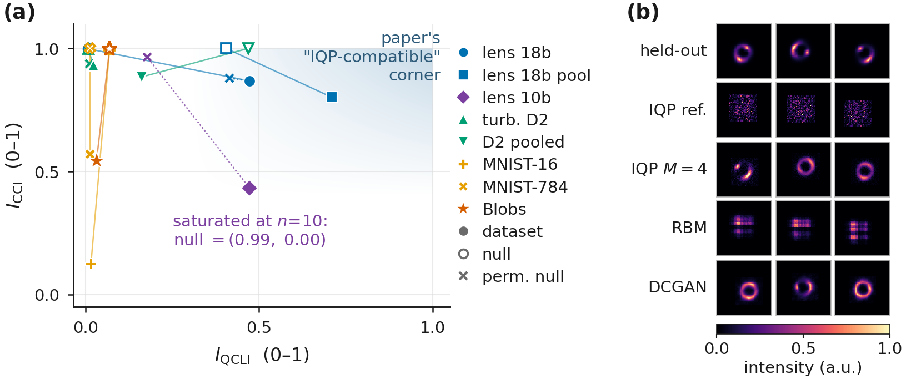
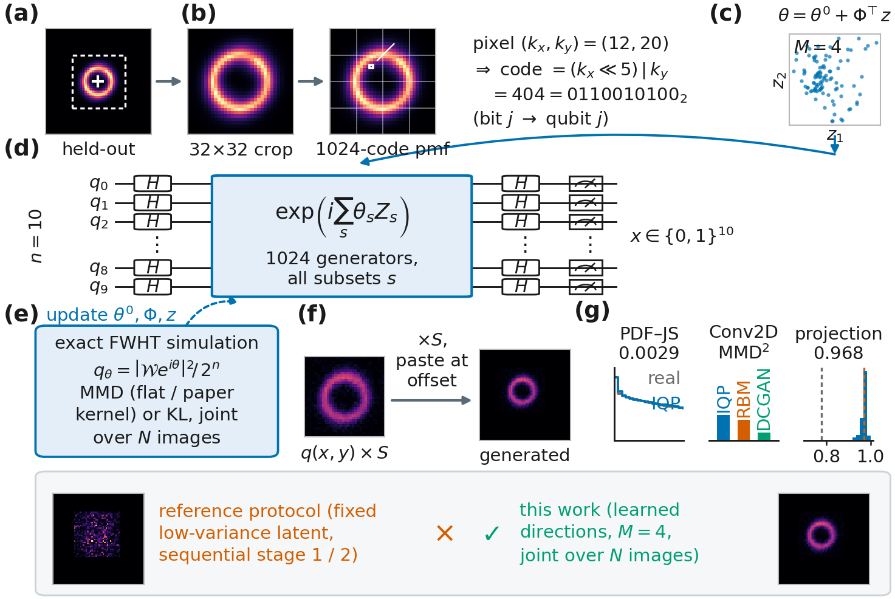
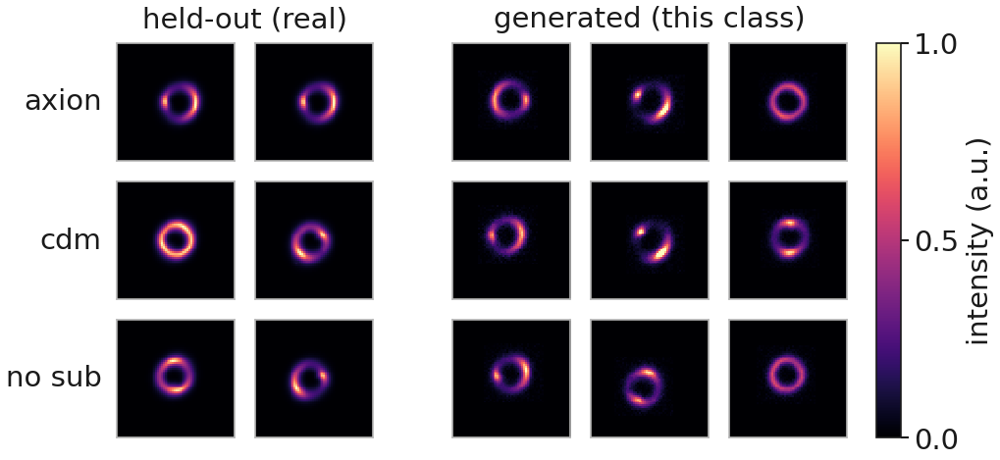
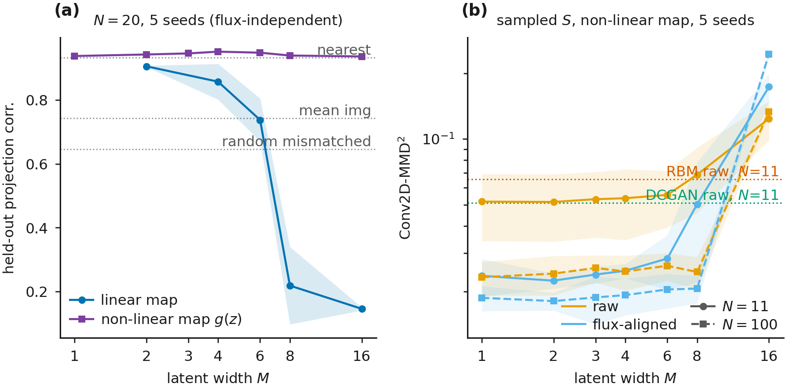
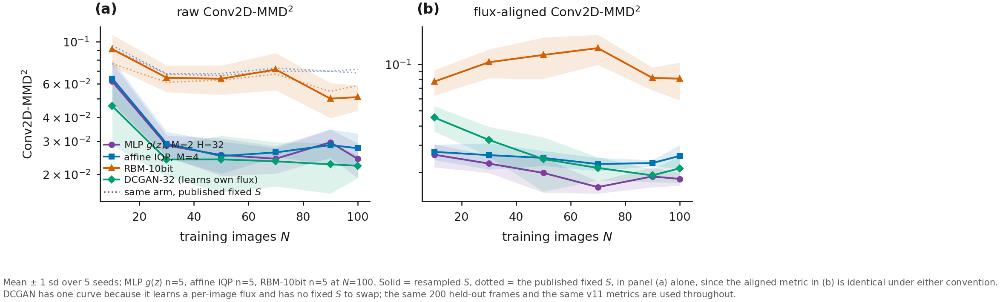

# IQP 生成模型於強重力透鏡影像（v12 中文完整版）

> **對應的英文原稿**：`paper/ml4ps2026/v12/main.tex`（NeurIPS ML4PS 2026 投稿定稿，9 頁：正文 4 頁、references、附錄 A–D）。本檔以磁碟上該檔的最終版本為準，已含三輪獨立審查的修正，節數由 7 併成 4。
> **用途**：供 Leo 與合作者閱讀的中文版，非投稿用版本。
> **與 `docs/IQP_LENS_PAPER_ZH_v12.md` 的關係**：那一份翻譯的是更早的 7 頁稿，保留不動。本檔是重新逐段翻譯的完整版，並額外補上英文版因附錄頁數上限而刪去或壓成一句的內容（見「英文版為頁數所捨去的內容」一節）。中文版沒有頁數限制。
> **編排**：所有表格以 markdown 重排、粗體照原文、圖以相對路徑引入；數學保留 LaTeX 原樣；`\cite` 改寫為 `[作者 年份]`；`\ref` 依 PDF 實際編號改為「圖 N／表 N／附錄 X／第 N 節」。

---

<!-- TRANSLATION-START -->

## 摘要

瞬時量子多項式（instantaneous quantum polynomial, IQP）電路一般認為難以用古典方法取樣 [Bremner 等 2011; Bremner 等 2016]，而最大平均差異（maximum mean discrepancy, MMD）損失所需的期望值仍保持可計算，因此這樣的 Born machine 可以在古典端訓練、再部署到量子硬體上 [Recio-Armengol 等 2025]。近期有人提出一張相關性–複雜度地圖，用來指示哪些資料適合這類模型，而在我們量測過的編碼之中，DeepLense 強重力透鏡影像落在最適合 IQP 的位置。原論文流程那種「凍結的核心加上循序調適」只產生雜訊，而聯合訓練可以把它修好；學到的線性映射則在 $M{=}6$ 之後失去同調性，因此我們改讓一個小的非線性映射來承載潛變數。在 11 張訓練影像時，由此得到的 10 量子位元模型在兩項生成指標上都在種子離散度之內與參數量六倍於它的 DCGAN 相當，在一個通量對齊的變體上領先 DCGAN，在兩個 MMD$^2$ 欄位上領先 RBM、而在直方圖指標上與 RBM 持平，並能以 $0.901$ 的相關度投影未見過的影像；在 $100$ 張影像時 DCGAN 領先，而該相關度達到 $0.977$。每一個電路都在 $n=10$ 量子位元下、跨五個隨機種子做精確模擬，因此我們不宣稱任何量子優勢，只是對「訓練資料稀缺之處，這樣的模型是否值得部署」做一次早期的檢驗。

> 符號說明：原文以巨集定義 $\qcli \equiv I_{\mathrm{QCLI}}$ 與 $\cci \equiv I_{\mathrm{CCI}}$，本譯文一律直接寫成 $I_{\mathrm{QCLI}}$ 與 $I_{\mathrm{CCI}}$。

---

## 1 引言

IQP 電路是由互相對易的閘所構成的電路，其輸出分布為某個相位函數的 Walsh–Hadamard [Walsh 1923] 變換的平方。對它們做精確的、或是乘性近似的古典取樣，都會讓多項式階層塌縮 [Bremner 等 2011]，而一般猜想這種困難性在加性誤差之下仍平均成立 [Bremner 等 2016]。這是一個有界的動機，因為雜訊會讓這類電路可在多項式時間內模擬 [Rajakumar 等 2025]、古典演算法也持續進步 [Maslov 等 2024]，而可訓練性本身就把模型往可古典模擬的方向拉 [Cerezo 等 2025]。同樣的結構讓 MMD 損失的期望值保持可計算 [Recio-Armengol 與 Bowles 2025]，就像其他為了保持可模擬而設計的編碼一樣 [Lizzio Bosco 等 2026]，因此這類模型可以「在古典端訓練、在量子硬體上部署」[Recio-Armengol 等 2025]，承襲的是以 MMD 損失訓練 Born machine 的這條路線 [Liu 與 Wang 2018; Benedetti 等 2019; Coyle 等 2020]。

真實資料是否落在那個有用的位置上，是一個實證問題，而近期的一項提案 [Liu 等 2026a] 用兩個要素來處理它。(i) 一張**相關性–複雜度地圖**，把資料集放在兩個座標上，一個是 $I_{\mathrm{QCLI}}$，即資料的 Walsh 階譜（也就是每一個 Hamming weight 上的 Fourier 功率）與獨立同分布二項基準之間的 Jensen–Shannon 散度，另一個是 $I_{\mathrm{CCI}} \in [0,1]$，即最佳成對樹漏掉了多少比例的相關性 [Watanabe 1960; Schneidman 等 2003; Chow 與 Liu 1968]，而高 $I_{\mathrm{QCLI}}$、高 $I_{\mathrm{CCI}}$ 的角落就是 IQP 電路應當表現良好之處。(ii) 一套潛變數調適流程（該論文 v2 的 Algorithm 1：一個在單一錨點上訓練的相位核心，加上 Hamming 順序中最前面的 $50$ 個相位，隨機初始化後逐一樣本地調適），在 $n=18$ 量子位元下的二維湍流上示範過 [Rahimi Khojasteh 等 2022]，而湍流只是該地圖所涵蓋的數個資料集之一。一份後續工作用一個物理知情的代理模型來初始化同一個固定區塊 [Liu 等 2026b]，而我們則是把那些方向學出來。

我們把這兩者都搬到 DeepLense [Alexander 等 2020a; Alexander 等 2020b] 的模擬暗物質強重力透鏡影像上，並貢獻三件事。我們在透鏡裁切影像上重算這張地圖，它們落在我們量測過最適合 IQP 的位置；同時我們以一個置換零模型指出，在那裡這個指標大致由強度直方圖決定，所以「位置有利」本身並不構成「具有適合 IQP 的結構」的證據。我們追查了原論文的潛變數流程為何在靜態影像上只產生雜訊，並把它的潛變數映射換成一個非線性的映射。接著我們在兩種強度慣例之下與一個 RBM 和一個 DCGAN 做比較，並在附錄 C 中回報一次在湍流資料上的重現。

**圖 1**：**(a)** 相關性–複雜度地圖，資料集以實心標記表示，獨立均勻零模型以空心標記表示，置換零模型以叉號表示（本工作所加）；lens 18b 與 18b pool 為 18 位元編碼的每張影像版本與池化版本，lens 10b 為裁切 pmf，turb. D2 為原論文的湍流資料。**(b)** 每個模型的前三個非條件生成樣本，$N{=}100$，未經挑選。

---

## 2 實驗設定

**模型。** 每一個實驗組都是一個涵蓋 $1{,}024$ 個 Walsh 相位 $\theta$ 的 $10$ 量子位元 IQP Born machine，每一個量子位元子集對應一個相位，其中 $1{,}023$ 個有效，因為空集合對應的是一個全域相位；各實驗組彼此只差在每張影像的潛變數如何進入模型。原論文的流程把 Hamming 順序中最前面的 $50$ 個相位凍結起來、並逐一樣本地調適它們，而在靜態的裁切影像上，這樣做會讓其他訓練影像被重建得很差（第 3.2 節），因此我們把那個映射改成可訓練的，先是一個由 $M$ 個方向構成的線性映射，

$$\theta_i \;=\; \theta^{0} + \Phi^{\!\top} z_i,
\qquad \theta^{0}\in\mathbb{R}^{1024},\quad
\Phi\in\mathbb{R}^{M\times 1024},\quad z_i \in \mathbb{R}^{M} \tag{1}$$

其中 $\Phi$ 的每一列都做 $L^2$ 正規化。在這批裁切影像上，這個映射到 $M{=}6$ 就退化了。我們懷疑原因是影像所要求的 $\|z\|$ 離開了 Walsh 相位能夠同調干涉的半徑，不過我們並沒有把這個原因單獨隔離出來。我們的主要實驗組把 $\Phi^{\!\top} z$ 換成一個單隱藏層、寬度 $H{=}32$ 的 $\tanh$ 映射 $g$，其中 $z_i$ 在一個小的 $L^2$ 懲罰之下與 $g$ 一起聯合訓練。主要的目標函數是平坦 MMD（均等的 Walsh 權重，可由硬體取樣次數估計），而 [Recio-Armengol 等 2025] 的三頻寬高斯核（也就是各表中的**原論文核**）則保留為次要實驗組；$\theta^{0}$ 以 $1{,}000$ 步的精確 KL 做暖啟動，而一個平坦 MMD 的暖啟動可以取代它而不付出代價（附錄 C）。

**解碼、基準模型與指標。** 訓練好的 pmf 只固定了相對強度，因此它會以一個總強度 $S$、以及一個從訓練裁切影像自身位移中抽出的位移，被貼進 $64\times64$ 的框裡。原論文的慣例給每一張框同一個訓練集平均的 $S$，這會讓生成的通量變異數為零，而真實裁切影像的離散程度大約是其平均值的四分之一，因此我們改成從 $N$ 張訓練影像總強度的核密度估計中，為每張影像抽出一個 $S$，而且不重新訓練；附錄 A 在固定 $S$ 之下把每一件事重做一次。基準模型是一個受限波茲曼機（restricted Boltzmann machine, RBM）[Smolensky 1986; Hinton 2002; Tieleman 2008] 與一個深度卷積生成對抗網路（deep convolutional generative adversarial network, DCGAN）[Radford 等 2015]，兩者都在 $200$ 張驗證影像上做提前停止，而 IQP 實驗組則固定跑 $4{,}000$ 步，這一點只會對基準模型有利。我們用強度直方圖之間的 Jensen–Shannon 散度（PDF–JS）以及一個固定隨機編碼器特徵空間中的 Conv2D-MMD$^2$ [Gretton 等 2012; Bińkowski 等 2018] 來評分，並且由於各實驗組對通量如何設定並不一致，我們另外加上一個事後的通量對齊 Conv2D-MMD$^2$，作法是把每一張框重新縮放到留出集的平均總強度；我們也回報一個留出集投影相關，取自八次潛變數重啟中、以擬合本身的損失挑出最好的那一次。分箱、尺度與頻寬都只由留出資料決定，所以沒有任何指標會隨著被評分的實驗組而變動；而在 $N \in \{11,100\}$ 之下，每一個實驗組都生成 $200$ 張影像來對照同樣的 $200$ 張留出框，每一個數值都是跨五個隨機種子的平均值 $\pm$ 樣本標準差，並與一個由兩組互斥真實影像算出的真實對真實下限並列。$N$ 張訓練影像在各隨機種子之間是固定的，所以那個離散度只包含初始化與取樣的變異。以標準差為單位的領先，指的是兩個平均值的差除以基準模型的種子標準差，這是描述性的敘述，不是顯著性檢定。

**與原論文設定的差異。** 有四項選擇與原論文不同，每一項都源自資料本身。原論文的快照要內插到未見過的時間點，而我們所使用的 DeepLense `Model II` 影像 [ML4SCI Collaboration 2025] 是靜態的，因此我們做非條件生成，並投影到留出影像上。它的 18 位元 $(x,y,\mathrm{intensity})$ 編碼適合一個由三元組構成的場，而透鏡裁切影像的原始強度軸幾乎只攜帶一個位元，因此我們把每張影像對齊質心，並把其中央 $32\times32$ 的裁切（佔全部光量的 $99.4\%$）讀成 $n=10$ 之下、涵蓋 $1{,}024$ 個格點的單一機率質量函數（pmf）（附錄 A）。它把潛變數區塊固定住，而我們則學習這個映射並把 $N$ 張影像聯合訓練；而且它是由樣本估計其 MMD，而 $10$ 量子位元的 pmf 是精確的。

---

## 3 結果

### 3.1 透鏡裁切影像落在相關性–複雜度地圖的哪裡

表 1 重新計算了這張地圖（圖 1(a)）。以原論文編碼湍流的方式來編碼時，透鏡影像的 $I_{\mathrm{QCLI}}$ 遠高於湍流，並落在地圖所稱的 IQP 相容角落之內；然而一個保留每張影像強度直方圖的置換零模型，其值與透鏡值只差 $14\%$ 以內，與小得多的湍流值也只差一個二倍，所以在那裡這個指標大致上只是在追蹤直方圖。兩個指標都與 $K$（每張影像的編碼數量）有關，所以每一列只能對照它自己相同 $K$ 的零模型來讀；而在該流程自己的每張快照 $N_t = 5\times10^{4}$ 個樣本之下 [Liu 等 2026a]，湍流的 $I_{\mathrm{QCLI}}$ 掉到 $0.091$，對照其零模型的 $0.098$。10 位元裁切 pmf，也就是我們實際建模的那個編碼，是唯一在兩個座標上都與其零模型分離的一列，但它位在 $I_{\mathrm{CCI}} = 0.43$，落在高 $I_{\mathrm{CCI}}$ 角落之外，所以它有利的 $I_{\mathrm{QCLI}}$ 是這個編碼的動機，而不是「選 IQP 而不選成對模型」的理由。

**表 1**：相關性–複雜度地圖，每一個置換零模型都保留上一列的數值直方圖，五個隨機種子；$\pm 0.0000$ 表示種子離散度低於 $5\times10^{-5}$。

| 資料集與編碼 | $K$ | $I_{\mathrm{QCLI}}$ | $I_{\mathrm{CCI}}$ |
|---|---|:---:|:---:|
| 透鏡，18 位元 $(x, y, \mathrm{intensity})$ 三元組 | $4{,}096$ | $0.4715 \pm 0.0000$ | $0.8677 \pm 0.0000$ |
| 　置換零模型 | $4{,}096$ | $0.4154 \pm 0.0000$ | $0.8783 \pm 0.0001$ |
| 湍流 D2，18 位元三元組 | $4{,}096$ | $0.0232 \pm 0.0002$ | $0.9285 \pm 0.0008$ |
| 　置換零模型 | $4{,}096$ | $0.0114 \pm 0.0000$ | $0.9371 \pm 0.0009$ |
| 透鏡，10 位元裁切 pmf | 精確 pmf | $0.4731 \pm 0.0000$ | $0.4313 \pm 0.0000$ |
| 　置換零模型 | 精確 pmf | $0.1782 \pm 0.0000$ | $0.9634 \pm 0.0004$ |

### 3.2 從原論文流程到非線性潛變數映射

在我們自己的 $50$ 相位區塊上循序執行時（附錄 C），Algorithm 1 產生的是雜訊（圖 1(b) 第二列）。原因既不是可表達性、也不是那個區塊，因為完整的電路能把**單一**一張對齊裁切影像擬合到 $0.99997 \pm 0.00001$ 的相關度，而把同樣那 $50$ 個相位與核心一起、跨全部 $N$ 張影像聯合訓練（表 2 的**固定基底，聯合訓練**那一列）就已經補回大部分的差距。真正失效的是「凍結的核心加上逐張影像的循序調適」，因為當核心被凍結在單一錨點上時，那 $50$ 個固定座標重建其他每一張訓練影像時只有 $0.44 \pm 0.04$；區塊大小 $50$ 本身沒有被掃描過。式 (1) 修好了其餘的部分，但引入了它自己的寬度上限。在一個 $20$ 張影像的掃描中，學到的線性映射在 $M{=}2$ 時保持 $0.906 \pm 0.002$ 的留出集投影相關，在 $M{=}6$ 時掉到 $0.738 \pm 0.067$，在 $M{=}8$ 時則崩潰到 $0.218 \pm 0.121$。非線性映射移除了這個崩潰，在整個掃描範圍中都維持在 $0.9368$ 到 $0.9519$，略高於該切分自身的最近鄰訓練影像參考值 $0.9339$；這兩條掃描來自兩支不同的驅動程式，最佳化排程與初始化不同，但都在同樣的 $20$ 張留出框上評分，所以兩者之間的小幅落差並不是模型差異。它並沒有換來很大的可用寬度，在生成指標上它到 $M{=}4$ 都是平的，而從 $M{=}8$ 起就退化。我們在 $M{=}2$ 下回報它，此時留出集投影相關在 $N{=}11$ 為 $0.901$、在 $N{=}100$ 為 $0.977$，對照「投影最近鄰訓練影像」的 $0.892$ 與 $0.970$，以及「單一零初始化重啟」的 $0.838$ 與 $0.887$。

### 3.3 與古典基準模型的比較

**表 2**：在抽樣強度之下的透鏡裁切影像，五個隨機種子，PDF–JS 以 $10^{-3}$ 為單位，兩個 MMD$^2$ 欄位皆以 $10^{-2}$ 為單位。數值越低越好；**粗體**標示的是平均值最佳、且其與**其他每一個**實驗組的差距都超過兩者種子標準差之和的項目，因此沒有粗體的欄位代表其中沒有任何一項勝負是種子離散度支持的。參數量為 $N{=}11\,/\,N{=}100$ 的總數，而附錄 C 說明 $^{\dagger}$ 與參數計算慣例。

| 模型 | 參數量 | $N = 11$ PDF–JS | $N = 11$ MMD$^2$ | $N = 11$ MMD$^2_{\mathrm{al}}$ | $N = 100$ PDF–JS | $N = 100$ MMD$^2$ | $N = 100$ MMD$^2_{\mathrm{al}}$ |
|---|---:|:---:|:---:|:---:|:---:|:---:|:---:|
| IQP，原論文流程（Alg. 1）$^{\dagger}$ | 1{,}524 / 5{,}974 | 6.5 $\pm$ 0.8 | 14.8 $\pm$ 1.6 | 22.5 $\pm$ 2.2 | 7.7 $\pm$ 0.4 | 14.7 $\pm$ 0.3 | 26.6 $\pm$ 0.7 |
| IQP，固定基底，聯合訓練 | 1{,}524 / 5{,}974 | 1.8 $\pm$ 0.4 | 8.7 $\pm$ 1.4 | 12.5 $\pm$ 1.3 | 1.1 $\pm$ 0.2 | 5.4 $\pm$ 0.4 | 8.5 $\pm$ 1.5 |
| IQP，線性映射 $M{=}4$（平坦 MMD） | 5{,}164 / 5{,}520 | 2.8 $\pm$ 0.1 | 5.6 $\pm$ 1.9 | 2.7 $\pm$ 0.2 | 2.6 $\pm$ 0.2 | 2.8 $\pm$ 0.5 | 2.6 $\pm$ 0.4 |
| IQP，線性映射 $M{=}4$（原論文核） | 5{,}164 / 5{,}520 | 1.0 $\pm$ 0.05 | 6.3 $\pm$ 1.5 | 7.4 $\pm$ 0.6 | 1.5 $\pm$ 0.2 | 5.9 $\pm$ 0.4 | 10.0 $\pm$ 0.8 |
| IQP，非線性映射 $M{=}2$（平坦 MMD） | 33{,}910 / 34{,}088 | 1.2 $\pm$ 0.07 | 5.2 $\pm$ 1.8 | **2.2** $\pm$ 0.2 | 1.7 $\pm$ 0.2 | 2.4 $\pm$ 0.5 | 1.8 $\pm$ 0.2 |
| IQP，非線性映射 $M{=}2$（原論文核） | 33{,}910 / 34{,}088 | 0.75 $\pm$ 0.07 | 5.4 $\pm$ 1.5 | 5.1 $\pm$ 0.3 | 0.99 $\pm$ 0.04 | 4.2 $\pm$ 0.4 | 6.6 $\pm$ 0.6 |
| RBM [Tieleman 2008] | 11{,}510 / 15{,}960 | 1.9 $\pm$ 1.0 | 7.9 $\pm$ 1.9 | 11.1 $\pm$ 3.9 | 1.1 $\pm$ 0.2 | 5.1 $\pm$ 0.8 | 8.1 $\pm$ 2.2 |
| DCGAN [Radford 等 2015] | 199{,}837 | 1.1 $\pm$ 0.6 | 5.1 $\pm$ 1.5 | 3.9 $\pm$ 1.0 | **0.55** $\pm$ 0.12 | 2.2 $\pm$ 0.3 | 2.1 $\pm$ 0.4 |
| *真實對真實下限* | n/a | *0.04* $\pm$ *0.02* | *0.5* $\pm$ *0.3* | *0.4* $\pm$ *0.2* | *0.04* $\pm$ *0.02* | *0.5* $\pm$ *0.3* | *0.4* $\pm$ *0.2* |

在表 2 中，十一張影像的情境是 IQP 實驗組具有競爭力的地方。在那裡，非線性實驗組在 PDF–JS 與未對齊 Conv2D-MMD$^2$ 上都在種子噪音之內與 DCGAN 相當（分別是 DCGAN 自身標準差的 $-0.13$ 與 $-0.04$），而在通量對齊那一欄領先（$+1.57$ 個標準差）；對上 RBM 時，它在兩個 MMD$^2$ 欄位上分別以 RBM 標準差的 $1.40$ 與 $2.27$ 倍領先，而 PDF–JS 在一個標準差之內（$0.75$），所用參數量是 DCGAN 的六分之一、RBM 的三倍。在原論文核之下，同一個映射保有最佳的平均 PDF–JS，$0.75 \times 10^{-3}$ 對照 DCGAN 的 $1.1 \pm 0.6$，這讓兩者落在一個標準差之內，而代價是通量對齊那一欄變差。在兩種訓練集大小之下，都沒有任何實驗組在三個欄位上都以超過一個種子標準差領先 DCGAN；而在 $100$ 張影像時，DCGAN 在 PDF–JS 與未對齊 Conv2D-MMD$^2$ 上領先，通量對齊的 $1.8 \pm 0.2$ 則落在它的 $2.1 \pm 0.4$ 的一個標準差之內。

有三項性質限制了這張表該怎麼讀。通量對齊那一欄對強度慣例是恆等不變的，在同時具有兩種慣例的 $325$ 次執行中，最大的配對差異是 $6\times10^{-9}$。那是不變性，不是與未對齊那一欄互相獨立，所以兩個 MMD$^2$ 欄位量的是「形狀」與「形狀加通量」，不是兩件分開的事。抽樣規則對各實驗組也不是中性的，它讓每一個 IQP 實驗組在 $N{=}11$ 的未對齊 Conv2D-MMD$^2$ 改善 $22$ 到 $39\%$，卻讓 RBM 變差 $20\%$；而在固定強度之下，RBM 在那裡領先非線性實驗組（$6.5 \pm 0.8$ 對照 $8.5 \pm 0.2$，附錄 A），所以未對齊那一欄相對 RBM 的名次，是抽樣解碼的性質，不是模型的性質。抽樣只固定了生成通量分布的形狀、固定不了它的位置，十一張訓練框比留出集暗了 $9\%$，這就是未對齊那一欄停在該處的原因。

$N \in \{10,\dots,100\}$ 的資料量縮放以及逐類別重新訓練的結果，回報於附錄 B。

---

## 4 討論與限制

在十一張訓練影像時，一個帶有學到的非線性潛變數映射的 $10$ 量子位元 IQP Born machine，與一個 RBM 和一個 DCGAN 具有競爭力，它在兩項生成指標上都在種子離散度之內與 DCGAN 相當，所用參數量只有它的六分之一，並且保有最低的通量對齊平均值；這個地位在 $100$ 張影像時就不再成立。這裡沒有任何東西是量子優勢的證據，因為每一個電路都是在 $n=10$ 量子位元下精確模擬的，而任何部署上的餘裕都受到連通性與雜訊的限制 [Placidi 等 2026]。生成的框在 $L_2$ 上離它們最近的訓練影像，比真實留出框離訓練影像更遠（$N{=}11$ 時是 $4.21 \pm 0.10$ 對照 $2.90$），所以這個實驗組沒有在背答案。有兩個步驟以目前的跑法而言不是取樣可估的，一個是精確 KL 暖啟動（附錄 C 在一個種子標準差之內把它換掉），另一個是投影，它是針對精確 pmf 去最佳化 $z$；而在 $n=10$ 時我們把全部 $2^{n}$ 個 Walsh 相位都參數化，若要往上擴展則需要把它們稀疏化 [Liu 等 2026a]，這一點本文並未測試。只有模型擬合這一步看得到 $N$ 張影像，而頻寬、下限與基準模型的提前停止都用到數百至數千張真實框，所以這是一個小訓練集研究，不是一條小資料流程；對齊與裁切也把平移與最外圍 $0.6\%$ 的光量排除在任務之外，下限也一樣。五個隨機種子太少，DCGAN 在某一個種子上會多出高達 $57\%$ 的離散度、而且它是唯一無法逐位元重現的一組，抽樣強度對未對齊那一欄的影響在各實驗組之間不均等，一切都建立在單一個模擬資料集上，這些指標並不檢驗次結構，而且我們沒有把任何一張被破壞的影像當成上界參考來評分。

---

## 參考文獻

原文以 `plain` 樣式列出 31 筆被引用的文獻。完整書目在 `paper/ml4ps2026/v12/refs.bib`；本譯文的 `[作者 年份]` 與 bib key 的對照表見文末「引用對照」。

---

## 附錄 A　管線流程與固定 $S$ 慣例

**圖 2**：管線流程。**(a)** 一張留出影像與裁切視窗。**(b)** 對齊後的裁切影像作為涵蓋 $1{,}024$ 個格點的 pmf，像素 $(12,20)$ 帶有編碼 $404$，位元 $j$ 定址到量子位元 $j$。**(c)** $M = 4$ 時學到的潛變數。**(d)** 電路。**(e)** 精確模擬，此處是依式 (1) 繪製的；主要實驗組用的是 $\theta = \theta^{0} + g(z)$。**(f)** 在 $S$ 之下解碼。**(g)** 線性 $M{=}4$ 實驗組的指標。

把表 2 改用每一個以 pmf 為基礎的實驗組所發表時採用的那個單一訓練平均強度重跑，可以從同一批執行中逐位元重建出已發表的框，因此兩種解碼是配對的。抽樣讓每一個 IQP 實驗組在 $N{=}11$ 的未對齊 Conv2D-MMD$^2$ 改善 $0.033$ 到 $0.041$（配對標準差 $0.012$ 到 $0.020$），卻讓 RBM 變差 $0.013 \pm 0.017$，這就是為什麼在固定強度之下 RBM 在那裡領先非線性實驗組（$6.5 \pm 0.8$ 對照 $8.5 \pm 0.2$）；在 $N{=}100$ 時它讓每一個實驗組都改善，PDF–JS 上的效應最多 $7\times10^{-4}$ 且正負不一，而通量對齊上的效應低於 $10^{-8}$。完整的表在已釋出的 seed tables 中。

---

## 附錄 B　潛變數掃描與各類別結果

隱藏層寬度的影響小於潛變數寬度，$H{=}16$ 以上的每一個設定都落在一個種子標準差之內；而潛變數寬度掃描在 $M \le 4$ 時是平的，到 $M{=}8$ 開始退化、到 $M{=}16$ 崩潰。兩個完整掃描都在已釋出的 seed tables 中。在 $N \in \{10,30,50,70,90,100\}$ 之間，非線性實驗組的未對齊 Conv2D-MMD$^2$ 從 $0.062 \pm 0.016$ 降到 $0.024 \pm 0.005$，RBM 從 $0.091 \pm 0.017$ 降到 $0.051 \pm 0.008$，DCGAN 在 $N{=}10$ 時領先（$0.046 \pm 0.017$）而最後打平；在通量對齊那一欄，非線性實驗組依序為 $0.026$、$0.023$、$0.020$、$0.016$、$0.019$、$0.018$，對照 RBM 的 $0.077$ 到 $0.127$，在每一個 $N$ 都是最低，但只有在 $N{=}10$ 與 $N{=}70$ 時領先幅度超過一個種子標準差。在單一類別內重新訓練時（表 3、圖 3），每一個類別都可以被單獨生成出來，而這與「模型能把它們分開」並不是同一件事。$N{=}11$ 時的平均 $\|z\|$ 在 $M{=}2$ 為 $0.101$、在 $M{=}8$ 為 $0.120$，而 $g$ 的仿射殘差則從 $0.70$ 掉到 $0.17$，所以 $g$ 最接近線性的地方，正是它失效的地方。

**圖 3**：$N{=}100$ 時每個次結構類別一列，共用同一個 $0$ 到 $1$ 的強度尺度。左邊是該類別的兩張留出框；右邊是只在該類別上重新訓練的非線性 $M{=}2$ 實驗組的三個非條件生成樣本，依索引順序取前兩張與前三張，未經挑選，隨機種子 $0$。

**表 3**：逐類別，每一個實驗組都只在該類別上重新訓練，並對照該類別自己的 $200$ 張留出框評分；抽樣強度，五個隨機種子，單位同表 2。每一欄要往下讀同一個類別，不能跨類別橫著讀。真實對真實下限為 axion 的 $0.03 / 0.36 / 0.31$、cdm 的 $0.03 / 0.30 / 0.32$ 與 no sub 的 $0.04 / 0.45 / 0.45$，單位與順序相同。

| 類別 | $N$ | 非線性 $M{=}2$ PDF–JS | 非線性 $M{=}2$ MMD$^2$ | 非線性 $M{=}2$ MMD$^2_{\mathrm{al}}$ | 線性 $M{=}4$ PDF–JS | 線性 $M{=}4$ MMD$^2$ | 線性 $M{=}4$ MMD$^2_{\mathrm{al}}$ |
|---|---|:---:|:---:|:---:|:---:|:---:|:---:|
| axion | 11 | 1.1 $\pm$ 0.10 | 4.6 $\pm$ 0.6 | 2.9 $\pm$ 0.4 | 3.4 $\pm$ 0.20 | 4.7 $\pm$ 0.7 | 2.8 $\pm$ 0.5 |
| axion | 100 | 1.8 $\pm$ 0.17 | 2.9 $\pm$ 0.2 | 1.7 $\pm$ 0.2 | 2.6 $\pm$ 0.11 | 2.7 $\pm$ 0.2 | 2.1 $\pm$ 0.2 |
| cdm | 11 | 0.94 $\pm$ 0.05 | 4.4 $\pm$ 0.2 | 2.7 $\pm$ 0.3 | 2.4 $\pm$ 0.09 | 4.3 $\pm$ 0.3 | 2.6 $\pm$ 0.5 |
| cdm | 100 | 1.7 $\pm$ 0.06 | 2.1 $\pm$ 0.3 | 1.5 $\pm$ 0.3 | 2.7 $\pm$ 0.25 | 2.3 $\pm$ 0.4 | 1.8 $\pm$ 0.3 |
| no sub | 11 | 0.98 $\pm$ 0.10 | 3.1 $\pm$ 0.9 | 2.4 $\pm$ 0.6 | 2.6 $\pm$ 0.22 | 3.5 $\pm$ 0.8 | 2.6 $\pm$ 0.1 |
| no sub | 100 | 1.7 $\pm$ 0.10 | 2.3 $\pm$ 0.4 | 2.1 $\pm$ 0.3 | 2.7 $\pm$ 0.31 | 2.7 $\pm$ 0.4 | 2.9 $\pm$ 0.3 |

---

## 附錄 C　湍流重現、訓練與評估細節

在該論文自己的資料集上（二維圓柱尾流湍流 D2 [Rahimi Khojasteh 等 2022]，$n=18$ 量子位元，11 張錨點快照，五個隨機種子），在我們預先登錄的慣例之下，其結果**未被重現**，RBM（PDF–JS $0.217 \pm 0.007$）與一個 1.2M 參數的 DCGAN（$0.045 \pm 0.062$）在**兩項**指標上都優於我們 31k 參數的 IQP（$0.272 \pm 0.004$）。在一個該論文從未指明的 last-write-wins 聚合規則之下 [Liu 等 2026a]，我們的 PDF–JS 往已發表的數值靠近但沒有達到（$0.0324$、$0.0473$ 對照 $0.0238$、$0.0221$），而 RBM 仍然領先。那裡的 Conv2D-MMD$^2$ 並不會把一張被破壞的影像排在一個訓練過的模型之後，像素打散後的 ground truth 得到 $0.7045 \pm 0.0095$，優於該論文 Table 2 中的每一個模型；該論文自己也指出它的基準模型並不窮盡，而這個指標無法取代能譜類的診斷 [Liu 等 2026a]。

**實驗組、基準模型與流程。** 標 $^{\dagger}$ 的實驗組是在我們自己的潛變數區塊上執行 v2 的 Algorithm 1 [Liu 等 2026a]，那個區塊是在一個由 $2{,}000$ 張影像構成的互斥池中，Walsh 係數變動最大的 $50$ 個 Hamming weight 至多為 $2$ 的子集，而原論文的區塊是 Hamming 順序中最前面的 $50$ 個；**固定基底，聯合訓練**則是把那個區塊與核心一起、跨全部 $N$ 張影像聯合訓練。參數量是該 $N$ 之下的總數，也就是共用參數（含 $\theta^{0}$）加上 $N$ 組每張影像的潛變數，所以固定基底的實驗組是 $974 + 50N$，學到方向的實驗組是 $5{,}120 + MN$，RBM 是 $10{,}960 + 50N$；DCGAN 那一項只算它的生成器，判別器另外有 $53{,}497$ 個參數。RBM 在 10 位元編碼上有 $10$ 個可見單元與 $1{,}000$ 個隱藏單元，每張影像擁有自己的可見層偏置與前 $40$ 個隱藏層偏置，跑 $160$k 或 $80$k 步；DCGAN 由一個 $128$ 維先驗經過四層轉置卷積建出裁切影像，跑 $5$k 到 $30$k 步，並自己學會強度。原論文核是 [Recio-Armengol 等 2025] 的三頻寬高斯 MMD，$\sigma = \{0.989, 1.729, 2.236\}$，其中 $\sigma_1$ 的設法使平均 Pauli weight 為 $2$，$\sigma_3$ 是中位數啟發法的平方根，而 $\sigma_2$ 是兩者的均方根，因為我們所複現的流程對這個編碼一個頻寬都沒有公布。Conv2D-MMD$^2$ 的頻寬未對齊時為 $0.005547$、通量對齊時為 $0.002558$，在留出特徵上一次固定，並由除了逐類別那幾列以外的每一張表共用；下限的 $20$ 次抽樣來自留出集切分之後剩下的 $8{,}710$ 張驗證影像；而強度估計的 Silverman 頻寬 [Silverman 1986] 在 $N{=}11$ 時為 $14.64$、在 $N{=}100$ 時為 $10.36$。把基準模型的驗證規則套用到 IQP 實驗組時會選出 $2$k 到 $16$k 步，而且它所改變的每一格表 2 數值都是往對 IQP 更有利的方向移動，並沒有改變任何一項比較，所以我們預先登錄的 $4{,}000$ 步是比較保守的選擇；而在固定 $20{,}000$ 步時兩個基準模型都差很多，所以它們的提前停止是關鍵的，我們也允許它們使用。在三項消融之中，沒有任何一項讓某個生成指標移動超過一個種子標準差。把 $\theta^{0}$ 改用平坦 MMD 暖啟動，使每一個階段都可由取樣次數估計，這讓 $N{=}11$ 的通量對齊那一欄停在 $0.0231$，對照 $0.0225$；以相關度而不是以擬合損失來挑選投影重啟，會讓相關度移動 $0.0003$；而兩次重啟就與八次相當（$0.901$、$0.977$），其中單一零初始化重啟只達到 $0.838$ 與 $0.887$。$M{=}2$ 時的投影參考值，最近鄰訓練影像是 $0.892$ 與 $0.970$，平均裁切影像是 $0.765$ 與 $0.779$。我們的 Conv2D-MMD$^2$ 就是 kernel inception distance [Bińkowski 等 2018]，只是編碼器沒有經過預訓練；我們並沒有使用 [Gili 等 2024] 那種為此目的打造的泛化指標；而用古典方法生成宇宙學影像已是成熟的做法 [Mustafa 等 2019]。以環半徑與兩個橢率分量上的 Wasserstein-1 距離而言，主要實驗組在 $N{=}11$ 為 $0.82 / 0.33 / 0.35$，對照 $3.23 / 0.46 / 0.24$（RBM）、$1.67 / 0.62 / 0.40$（DCGAN）與兩組真實影像之間的 $0.10 / 0.17 / 0.10$；在 $N{=}100$ 時 DCGAN 最接近，為 $0.40 / 0.28 / 0.15$，對照 $1.01 / 0.31 / 0.14$。用同樣的設定與同樣的隨機種子重新訓練同一個 DCGAN，會讓它的未對齊 Conv2D-MMD$^2$ 移動 $5$ 到 $57\%$、PDF–JS 移動 $2$ 到 $74\%$，這就是我們所說「唯一一個無法逐位元重現的實驗組」的意思。

---

## 附錄 D　量子位元數、原論文的 Fig. 4，以及完整的差異表

量子位元數必須與有效解析度相匹配，而原論文在 $n=18$、面對一個由三元組構成的場時並不需要處理這個選擇。在 $n=8$ 時，$16\times16$ 的 pmf 把環結構平均掉了，而固定的雙線性上採樣補不回來，所以通量對齊誤差是 $n=10$ 值的兩倍以上；在 $n=12$ 時，$4{,}096$ 個格點中約四分之三攜帶的是背景而不是透鏡光，實驗組學到了那個背景，並且在各隨機種子之間變得不穩定，它在 $N{=}100$ 的 PDF–JS 達到 $92 \pm 71$，離散度與平均值一樣大。因此我們在 $n=10$ 工作。

**表 4**：$N{=}11$ 時的量子位元階梯，五個隨機種子，單位同表 2。通量對齊那一欄對強度慣例是恆等不變的（附錄 A），可以跨列比較；另外兩欄除了標 $^{*}$ 的 $n=8$ 那一列以外，都是在固定強度之下。潛變數映射逐列不同，所以這是一個編碼的階梯，而不是單獨對 $n$ 的掃描。

| $n$ | 編碼 | 潛變數映射 | 參數量 | PDF–JS | MMD$^2$ | MMD$^2_{\mathrm{al}}$ |
|:---:|---|---|---:|:---:|:---:|:---:|
| 8 | $16\times16$ pmf，雙線性上採樣 | MLP $H{=}8$，$M{=}2$ | 2{,}350 | 1.7 $\pm$ 0.05$^{*}$ | 8.0 $\pm$ 1.7$^{*}$ | 5.1 $\pm$ 0.3 |
| 10 | $32\times32$ 對齊裁切 pmf | MLP $H{=}32$，$M{=}2$ | 33{,}910 | 1.0 $\pm$ 0.1 | 8.5 $\pm$ 0.2 | **2.3** $\pm$ 0.2 |
| 12 | 整張 $64\times64$ 框作為單一 pmf | 線性，$M{=}4$ | 20{,}524 | 43 $\pm$ 30 | 23.3 $\pm$ 8.8 | 18.4 $\pm$ 11.3 |

重跑該論文的 Fig. 4、跨五個 SPSA 隨機種子後，它在低 $I_{\mathrm{QCLI}}$（$I_{\mathrm{QCLI}} \le 0.3$）的正相關在每一個尺寸、每一個種子都重現，Spearman 相關在 $n = 8$、$12$、$16$ 分別為 $+0.92 \pm 0.10$、$+0.91 \pm 0.04$ 與 $+0.96 \pm 0.01$；而在該範圍之上，全域係數的正負號會隨種子而改變。

**表 5**：我們的流程與所複現的流程之間每一處差異，以及驅動該差異的資料性質；其中沒有任何一項是調參的結果。

| | 原論文流程 | 本文 | 資料的性質 |
|---|---|---|---|
| 編碼 | 18 位元 $(x,y,\mathrm{intensity})$ 三元組，每張快照多筆 | 一個涵蓋對齊後 $32\times32$ 裁切影像 $1{,}024$ 個格點的 10 位元 pmf | 原始強度軸幾乎只攜帶一個位元，而 $99.4\%$ 的光量都在裁切之內 |
| 潛變數 | 一個固定的 $50$ 相位區塊，取 Hamming 順序中最前面的那些 | 一個學出來的映射，線性 $\Phi^{\!\top} z$ 或 $\tanh$ 的 $g(z)$ | 在靜態影像上，固定方向做的是像素之間的交叉淡化，而不是移動環結構 |
| 訓練 | 核心在單一錨點上擬合，然後每個樣本依序調適 | 核心與全部 $N$ 個潛變數聯合訓練，$4{,}000$ 步 Adam | 在至多 $100$ 張靜態框之下，沒有可以沿著調適的資料流 |
| 目標函數 | 由樣本估計的多頻寬高斯 MMD | 以平坦 MMD 為主要實驗組，該核保留為次要實驗組 | 在 $n=10$ 時 pmf 是精確的，所以取樣噪音會是一種選擇而非必然 |
| 通量 | 每一張解碼後的框都帶訓練集平均總量 | $S$ 由 $N$ 個總量的密度估計逐張影像抽出 | 真實裁切影像的離散程度大約是其平均值的四分之一，單一個 $S$ 無法重現 |
| 評估 | 留出的時間點，該論文自己的指標 | $200$ 張留出框，跨實驗組與種子固定，分箱與頻寬只由它們決定 | 影像是靜態的，所以無法留出時間 |
| 基準模型 | 在固定預算下比較 | RBM 與 DCGAN 在 $200$ 張驗證框上提前停止，IQP 實驗組沒有 | 各基準模型收斂所需的步數差很多，單一預算會對我們有利 |

<!-- TRANSLATION-END -->

---

## 英文版為頁數所捨去的內容

> 以下不是原稿的翻譯，而是**補充**。英文版受限於「附錄至多三頁」，把這些表壓成一句話、或整張刪掉並註明「in the released seed tables」。中文版沒有頁數限制，因此把它們放回來。
> **每一個數字後面括號都註明來源**（seed tables 的檔名與節名）。所有數值都是 seeds 0–4 的 mean $\pm$ 樣本標準差（ddof = 1），除非另有說明。單位是原始值，不是主表的 $10^{-3}$／$10^{-2}$。

### S1. 潛變數寬度掃描（M）完整表

英文版只留下一句「the latent-width sweep is flat over $M \le 4$ before degrading at $M{=}8$ and collapsing at $M{=}16$」。完整的掃描如下。

**S1a. 抽樣強度之下的 M 掃描（主表所用的慣例），MLP 映射，$H = 32$，平坦 MMD**
（來源：`seed_tables_g.md` §2「Latent-width sweep (M), MLP map, H = 32, flat MMD -- resampled S」全表）

| $M$ | $N$ | 參數量 | PDF–JS | MMD$^2$ | MMD$^2_{\mathrm{al}}$ | MMD$^2$（固定 $S$，對照用） |
|---:|---:|---:|:---:|:---:|:---:|:---:|
| 1 | 11 | 33,867 | 0.001128 ± 6.546e-05 | 0.05169 ± 0.01756 | 0.02366 ± 0.004649 | 0.08593 ± 0.002553 |
| 2 | 11 | 33,910 | 0.001176 ± 7.025e-05 | 0.05153 ± 0.01762 | **0.02247 ± 0.001811** | 0.08508 ± 0.001855 |
| 3 | 11 | 33,953 | 0.001184 ± 9.29e-05 | 0.05304 ± 0.01767 | 0.02398 ± 0.002142 | 0.0854 ± 0.001762 |
| 4 | 11 | 33,996 | 0.001168 ± 3.865e-05 | 0.05359 ± 0.01909 | 0.02494 ± 0.0019 | 0.08663 ± 0.002438 |
| 6 | 11 | 34,082 | 0.001432 ± 0.0004445 | 0.05551 ± 0.01608 | 0.02837 ± 0.007931 | 0.08758 ± 0.002824 |
| 8 | 11 | 34,168 | 0.00296 ± 0.00128 | 0.06867 ± 0.02279 | 0.05034 ± 0.02831 | 0.09973 ± 0.01412 |
| 16 | 11 | 34,512 | 0.00767 ± 0.0009074 | 0.1239 ± 0.02505 | 0.1732 ± 0.02507 | 0.1621 ± 0.01314 |
| 1 | 100 | 33,956 | 0.00127 ± 9.108e-05 | 0.0233 ± 0.004082 | 0.01876 ± 0.002453 | 0.06938 ± 0.0014 |
| 2 | 100 | 34,088 | 0.001705 ± 0.0001888 | 0.02421 ± 0.00496 | 0.01812 ± 0.00171 | 0.06844 ± 0.001485 |
| 3 | 100 | 34,220 | 0.001669 ± 0.0001375 | 0.02569 ± 0.003669 | 0.01884 ± 0.004644 | 0.06924 ± 0.003094 |
| 4 | 100 | 34,352 | 0.001623 ± 9.664e-05 | 0.02477 ± 0.004506 | 0.0193 ± 0.003701 | 0.06998 ± 0.003063 |
| 6 | 100 | 34,616 | 0.001769 ± 5.693e-05 | 0.0263 ± 0.003793 | 0.02049 ± 0.003698 | 0.0706 ± 0.002103 |
| 8 | 100 | 34,880 | 0.002535 ± 0.00029 | 0.02462 ± 0.004246 | 0.02068 ± 0.002966 | 0.06842 ± 0.000413 |
| 16 | 100 | 35,936 | 0.008814 ± 0.0001383 | 0.133 ± 0.002981 | 0.2451 ± 0.008245 | 0.2083 ± 0.007475 |

粗體是主表所報的那一格（$M{=}2$、$N{=}11$ 的通量對齊欄），也是本工作唯一一個沒有任何實驗組在 1 sd 內與之重疊的勝負（`seed_tables_g.md` §1「N = 11 -- wins the seed spread does not support」）。

**S1b. 固定強度之下的同一組掃描，另附 projection corr、$\|z\|$ 與非線性殘差**
（來源：`seed_tables_f.md` §1「Latent-width sweep (M), flat MMD」，$H = 32$ 與 $H = 8$ 兩個區塊。`nonlin` 是對學到的映射做最佳仿射擬合後的相對殘差；$M \ge N$ 時該擬合在構造上必為精確，故標 n/a）

| $M$ | $H$ | $N$ | PDF–JS | MMD$^2$ | MMD$^2_{\mathrm{al}}$ | proj corr | $\|z\|$ | nonlin |
|---:|---:|---:|:---:|:---:|:---:|:---:|:---:|:---:|
| 1 | 32 | 11 | 0.0009 ± 0.0001 | 0.0859 ± 0.0026 | 0.0237 ± 0.0046 | 0.9001 ± 0.0007 | 0.1777 ± 0.0148 | 0.7813 ± 0.0291 |
| 2 | 32 | 11 | 0.0010 ± 0.0001 | 0.0851 ± 0.0017 | 0.0225 ± 0.0017 | 0.9016 ± 0.0012 | 0.1010 ± 0.0044 | 0.6961 ± 0.0254 |
| 3 | 32 | 11 | 0.0009 ± 0.0001 | 0.0854 ± 0.0018 | 0.0240 ± 0.0021 | 0.9059 ± 0.0014 | 0.0829 ± 0.0019 | 0.5541 ± 0.0356 |
| 4 | 32 | 11 | 0.0009 ± 0.0000 | 0.0866 ± 0.0023 | 0.0249 ± 0.0018 | 0.9076 ± 0.0014 | 0.0802 ± 0.0083 | 0.4915 ± 0.0371 |
| 6 | 32 | 11 | 0.0013 ± 0.0006 | 0.0876 ± 0.0028 | 0.0284 ± 0.0079 | 0.9054 ± 0.0026 | 0.0823 ± 0.0041 | 0.3083 ± 0.0330 |
| 8 | 32 | 11 | 0.0029 ± 0.0014 | 0.0997 ± 0.0141 | 0.0503 ± 0.0283 | 0.8986 ± 0.0051 | 0.1202 ± 0.0095 | 0.1725 ± 0.0591 |
| 16 | 32 | 11 | 0.0085 ± 0.0009 | 0.1621 ± 0.0131 | 0.1732 ± 0.0251 | 0.8953 ± 0.0006 | 0.2245 ± 0.0110 | n/a |
| 1 | 8 | 11 | 0.0019 ± 0.0004 | 0.0865 ± 0.0027 | 0.0243 ± 0.0046 | 0.8970 ± 0.0029 | 0.2003 ± 0.0272 | 0.7932 ± 0.0273 |
| 2 | 8 | 11 | 0.0018 ± 0.0002 | 0.0860 ± 0.0011 | 0.0244 ± 0.0028 | 0.9020 ± 0.0013 | 0.1150 ± 0.0163 | 0.7003 ± 0.0373 |
| 3 | 8 | 11 | 0.0016 ± 0.0001 | 0.0860 ± 0.0015 | 0.0256 ± 0.0020 | 0.9090 ± 0.0027 | 0.1056 ± 0.0189 | 0.5309 ± 0.0413 |
| 4 | 8 | 11 | 0.0017 ± 0.0001 | 0.0881 ± 0.0033 | 0.0282 ± 0.0027 | 0.9087 ± 0.0052 | 0.1084 ± 0.0097 | 0.4529 ± 0.0428 |
| 6 | 8 | 11 | 0.0032 ± 0.0009 | 0.0980 ± 0.0075 | 0.0489 ± 0.0105 | 0.9027 ± 0.0040 | 0.1358 ± 0.0110 | 0.3144 ± 0.0656 |
| 8 | 8 | 11 | 0.0050 ± 0.0009 | 0.1164 ± 0.0086 | 0.0867 ± 0.0158 | 0.8949 ± 0.0047 | 0.1669 ± 0.0179 | 0.2449 ± 0.0402 |
| 16 | 8 | 11 | 0.0063 ± 0.0006 | 0.1278 ± 0.0067 | 0.1072 ± 0.0143 | 0.8881 ± 0.0008 | 0.2825 ± 0.0254 | n/a |
| 1 | 32 | 100 | 0.0015 ± 0.0001 | 0.0694 ± 0.0014 | 0.0188 ± 0.0025 | 0.9624 ± 0.0016 | 0.3549 ± 0.0094 | 0.8326 ± 0.0183 |
| 2 | 32 | 100 | 0.0019 ± 0.0002 | 0.0684 ± 0.0014 | 0.0181 ± 0.0016 | 0.9773 ± 0.0006 | 0.1481 ± 0.0130 | 0.7322 ± 0.0315 |
| 3 | 32 | 100 | 0.0018 ± 0.0002 | 0.0692 ± 0.0031 | 0.0188 ± 0.0046 | 0.9807 ± 0.0004 | 0.1175 ± 0.0056 | 0.6498 ± 0.0318 |
| 4 | 32 | 100 | 0.0018 ± 0.0001 | 0.0700 ± 0.0029 | 0.0193 ± 0.0035 | 0.9840 ± 0.0003 | 0.0932 ± 0.0033 | 0.5596 ± 0.0201 |
| 6 | 32 | 100 | 0.0019 ± 0.0001 | 0.0706 ± 0.0021 | 0.0205 ± 0.0037 | 0.9855 ± 0.0011 | 0.0941 ± 0.0195 | 0.4363 ± 0.0762 |
| 8 | 32 | 100 | 0.0028 ± 0.0004 | 0.0684 ± 0.0004 | 0.0207 ± 0.0030 | 0.9752 ± 0.0023 | 0.2168 ± 0.0105 | 0.4909 ± 0.0304 |
| 16 | 32 | 100 | 0.0098 ± 0.0001 | 0.2083 ± 0.0075 | 0.2451 ± 0.0082 | 0.9120 ± 0.0013 | 0.4750 ± 0.0165 | 0.5417 ± 0.0108 |
| 1 | 8 | 100 | 0.0024 ± 0.0001 | 0.0705 ± 0.0022 | 0.0230 ± 0.0025 | 0.9488 ± 0.0017 | 0.2351 ± 0.0188 | 0.8214 ± 0.0286 |
| 2 | 8 | 100 | 0.0026 ± 0.0001 | 0.0696 ± 0.0017 | 0.0212 ± 0.0017 | 0.9699 ± 0.0007 | 0.1173 ± 0.0151 | 0.7158 ± 0.0269 |
| 3 | 8 | 100 | 0.0025 ± 0.0002 | 0.0696 ± 0.0030 | 0.0211 ± 0.0049 | 0.9737 ± 0.0006 | 0.0988 ± 0.0165 | 0.5941 ± 0.0286 |
| 4 | 8 | 100 | 0.0023 ± 0.0002 | 0.0706 ± 0.0029 | 0.0219 ± 0.0038 | 0.9760 ± 0.0008 | 0.0701 ± 0.0085 | 0.4865 ± 0.0388 |
| 6 | 8 | 100 | 0.0037 ± 0.0003 | 0.0753 ± 0.0026 | 0.0351 ± 0.0066 | 0.9588 ± 0.0065 | 0.1691 ± 0.0242 | 0.4603 ± 0.0592 |
| 8 | 8 | 100 | 0.0056 ± 0.0007 | 0.0858 ± 0.0049 | 0.0660 ± 0.0114 | 0.9156 ± 0.0126 | 0.2282 ± 0.0085 | 0.4646 ± 0.0341 |
| 16 | 8 | 100 | 0.0098 ± 0.0007 | 0.1905 ± 0.0642 | 0.2212 ± 0.0816 | 0.6720 ± 0.1192 | 0.2132 ± 0.1845 | 0.3241 ± 0.1319 |

正文第 3.2 節引用的「平均 $\|z\|$ 在 $M{=}2$ 為 $0.101$、在 $M{=}8$ 為 $0.120$，仿射殘差從 $0.70$ 掉到 $0.17$」就是這張表 $H{=}32$、$N{=}11$ 那六列的 `||z||` 與 `nonlin` 欄。

**S1c. 正文第 3.2 節引用的 $N = 20$ 留出集投影掃描**
（來源：`seed_tables_f.md` §1b「The N = 20 held-out projection sweep quoted in the paper (Sec. 3.2)」）

| $M$ | 留出集投影相關（$N = 20$） |
|---:|:---:|
| 1 | 0.9381 ± 0.0019 |
| 2 | 0.9429 ± 0.0016 |
| 3 | 0.9463 ± 0.0029 |
| 4 | 0.9519 ± 0.0025 |
| 6 | 0.9486 ± 0.0029 |
| 8 | 0.9397 ± 0.0029 |
| 16 | 0.9368 ± 0.0002 |
| *最近鄰訓練影像（參考值）* | *0.9339* |
| *平均訓練裁切影像（參考值）* | *0.7439* |

$M = 1 \dots 16$ 的範圍是 $0.9368$ 到 $0.9519$，這就是正文所說的「holding $0.9368$ to $0.9519$ across the sweep」，而每一項都高於 $0.9339$ 這條最近鄰訓練影像的線（`seed_tables_f.md` §1b 末段）。

### S2. 隱藏層寬度掃描（H）完整表

英文版只留下一句「Hidden width matters less than latent width, everything from $H{=}16$ up being inside a seed sd」。
（來源：`seed_tables_f.md` §2「Hidden-width sweep (H) at M = 4, flat MMD」全表，固定強度）

| $H$ | $N$ | 參數量 | PDF–JS | MMD$^2$ | MMD$^2_{\mathrm{al}}$ | proj corr | nonlin | 對照線性 IQP（MMD$^2_{\mathrm{al}}$） |
|---:|---:|---:|:---:|:---:|:---:|:---:|:---:|---|
| 4 | 11 | 5,184 | 0.0042 ± 0.0009 | 0.0955 ± 0.0061 | 0.0385 ± 0.0098 | 0.8938 ± 0.0117 | 0.3488 ± 0.0595 | worse / overlap |
| 8 | 11 | 9,300 | 0.0017 ± 0.0001 | 0.0881 ± 0.0033 | 0.0282 ± 0.0027 | 0.9087 ± 0.0052 | 0.4529 ± 0.0428 | worse / overlap |
| 16 | 11 | 17,532 | 0.0010 ± 0.0001 | 0.0866 ± 0.0023 | 0.0253 ± 0.0013 | 0.9093 ± 0.0028 | 0.5026 ± 0.0492 | better / overlap |
| 32 | 11 | 33,996 | 0.0009 ± 0.0000 | 0.0866 ± 0.0023 | 0.0249 ± 0.0018 | 0.9076 ± 0.0014 | 0.4915 ± 0.0371 | better / overlap |
| 4 | 100 | 5,540 | 0.0033 ± 0.0006 | 0.0722 ± 0.0046 | 0.0290 ± 0.0104 | 0.9625 ± 0.0123 | 0.4542 ± 0.0390 | worse / overlap |
| 8 | 100 | 9,656 | 0.0023 ± 0.0002 | 0.0706 ± 0.0029 | 0.0219 ± 0.0038 | 0.9760 ± 0.0008 | 0.4865 ± 0.0388 | better / overlap |
| 16 | 100 | 17,888 | 0.0020 ± 0.0001 | 0.0701 ± 0.0034 | 0.0197 ± 0.0037 | 0.9826 ± 0.0004 | 0.5331 ± 0.0143 | better / overlap |
| 32 | 100 | 34,352 | 0.0018 ± 0.0001 | 0.0700 ± 0.0029 | 0.0193 ± 0.0035 | 0.9840 ± 0.0003 | 0.5596 ± 0.0201 | better / overlap |

$H{=}16$ 是把主要實驗組從 33,996 個參數砍到 17,532 個（$N{=}11$）、或從 34,352 砍到 17,888（$N{=}100$）的現成槓桿，兩者所有欄位都在 1 sd 內重疊（`seed_tables_f.md` §2，`vs affine IQP` 欄）。

### S3. 資料量縮放完整數值表（六個 $N$ × 四個實驗組 × 未對齊與通量對齊）

英文版把它壓成附錄 B 的一句話加六個通量對齊數字。
（來源：非線性 MLP $M{=}2$、線性 $M{=}4$ 與 RBM 三欄取自 `seed_tables_g.md` §3「Data scaling -- resampled S」；DCGAN 兩欄取自 `seed_tables.md`「Figure 5 -- data scaling」，因為 DCGAN 自己學每張影像的通量，兩種慣例下同一列）

| $N$ | 非線性 $M{=}2$ MMD$^2$ | 非線性 $M{=}2$ MMD$^2_{\mathrm{al}}$ | 線性 $M{=}4$ MMD$^2$ | 線性 $M{=}4$ MMD$^2_{\mathrm{al}}$ | RBM MMD$^2$ | RBM MMD$^2_{\mathrm{al}}$ | DCGAN MMD$^2$ | DCGAN MMD$^2_{\mathrm{al}}$ |
|---:|:---:|:---:|:---:|:---:|:---:|:---:|:---:|:---:|
| 10 | 0.06171 ± 0.01554 | 0.02599 ± 0.004446 | 0.06396 ± 0.01635 | 0.02712 ± 0.003066 | 0.09117 ± 0.01745 | 0.07722 ± 0.01446 | 0.04651 ± 0.01939 | 0.05093 ± 0.009273 |
| 30 | 0.02846 ± 0.003613 | 0.02279 ± 0.002938 | 0.02906 ± 0.004492 | 0.02584 ± 0.004968 | 0.06454 ± 0.01035 | 0.103 ± 0.0218 | 0.02341 ± 0.004136 | 0.03409 ± 0.007773 |
| 50 | 0.02533 ± 0.005668 | 0.01982 ± 0.005044 | 0.02502 ± 0.004788 | 0.02479 ± 0.002751 | 0.06373 ± 0.01114 | 0.1149 ± 0.03428 | 0.02246 ± 0.007604 | 0.02511 ± 0.009952 |
| 70 | 0.02421 ± 0.003993 | 0.01605 ± 0.001457 | 0.02614 ± 0.001442 | 0.02262 ± 0.002206 | 0.07126 ± 0.01578 | 0.1272 ± 0.02807 | 0.02151 ± 0.005102 | 0.02221 ± 0.003625 |
| 90 | 0.02954 ± 0.005053 | 0.0188 ± 0.002804 | 0.02856 ± 0.005917 | 0.02296 ± 0.001042 | 0.05012 ± 0.0105 | 0.08166 ± 0.01382 | 0.02093 ± 0.00625 | 0.02017 ± 0.001901 |
| 100 | 0.02421 ± 0.00496 | 0.01812 ± 0.00171 | 0.02752 ± 0.005375 | 0.02551 ± 0.004413 | 0.05105 ± 0.007834 | 0.08067 ± 0.02205 | 0.02045 ± 0.00254 | 0.02222 ± 0.004382 |

非線性實驗組的 PDF–JS 同一條曲線為 0.001231 ± 0.0001054、0.001388 ± 9.34e-05、0.001639 ± 0.0001136、0.001703 ± 0.0001385、0.00176 ± 7.307e-05、0.001705 ± 0.0001888（`seed_tables_g.md` §3，`MLP PDF-JS` 欄）。

同樣三個實驗組在已發表的固定 $S$ 之下（用來看抽樣造成的差值，`seed_tables_g.md` §3 第二張表）：

| $N$ | 非線性 $M{=}2$ MMD$^2$ | 線性 $M{=}4$ MMD$^2$ | RBM MMD$^2$ |
|---:|:---:|:---:|:---:|
| 10 | 0.09159 ± 0.002582 | 0.0952 ± 0.001527 | 0.07649 ± 0.01655 |
| 30 | 0.0673 ± 0.001954 | 0.06775 ± 0.001577 | 0.06108 ± 0.005951 |
| 50 | 0.06636 ± 0.003434 | 0.06793 ± 0.00183 | 0.06269 ± 0.008308 |
| 70 | 0.06979 ± 0.001353 | 0.07242 ± 0.0008608 | 0.06742 ± 0.007281 |
| 90 | 0.06977 ± 0.003077 | 0.06985 ± 0.003029 | 0.05469 ± 0.002378 |
| 100 | 0.06844 ± 0.001485 | 0.07155 ± 0.002939 | 0.05865 ± 0.004363 |

兩點提醒。(1) 正文附錄 B 所引的「非線性實驗組領先 DCGAN 超過一個種子標準差只在 $N{=}10$ 與 $N{=}70$」，來自 `seed_tables_f.md` §4 的 `MLP vs DCGAN (MMD2_al)` 判定欄，該欄在這兩個 $N$ 讀作 SEPARATED、其餘讀作 overlap。(2) `seed_tables_f.md` §4 另有一組 DCGAN MMD$^2_{\mathrm{al}}$ 數列（$N{=}10$ 為 0.0452 ± 0.0085、$N{=}100$ 為 0.0212 ± 0.0041），與上表 `seed_tables.md`「Figure 5」的那一組來自不同的執行批次，兩者不可混用。

### S4. 固定 $S$ 慣例的完整主表（八個實驗組 × 兩個 $N$ × 三欄）

英文版把整張表刪掉，只在附錄 A 留下配對差值與「RBM 在那裡領先」這一句。
（來源：`seed_tables_g.md` §1「Table 2 (v12)」的 `fixed S` 三欄，$N = 11$ 與 $N = 100$ 兩張表。**粗體**照來源：該欄平均值最佳、且領先第二名的幅度超過兩者種子標準差之和。參數量欄照來源，採 part G 自己的舊「單張影像」慣例，與正文表 2 的 $N$ 相依慣例不同）

**$N = 11$，固定 $S$**

| 模型 | 參數量 | PDF–JS | MMD$^2$ | MMD$^2_{\mathrm{al}}$ |
|---|---:|:---:|:---:|:---:|
| IQP，原論文流程（Alg. 1） | 1,024 | 0.007199 ± 0.0006771 | 0.1883 ± 0.0103 | 0.2251 ± 0.02187 |
| IQP，固定基底，聯合訓練 | 1,024 | 0.001629 ± 0.0004399 | 0.1227 ± 0.003883 | 0.1253 ± 0.01326 |
| IQP，線性映射 $M{=}4$（平坦 MMD） | 5,164 | 0.002979 ± 0.0001767 | 0.08914 ± 0.002443 | 0.02737 ± 0.002194 |
| IQP，線性映射 $M{=}4$（原論文核） | 5,164 | 0.0008062 ± 5.176e-05 | 0.09632 ± 0.002696 | 0.07432 ± 0.006323 |
| IQP，非線性映射 $M{=}2$（平坦 MMD） | 33,910 | 0.0009595 ± 9.236e-05 | 0.08508 ± 0.001855 | **0.02247 ± 0.001811** |
| IQP，非線性映射 $M{=}2$（原論文核） | 33,910 | **0.0004921 ± 6.911e-05** | 0.08747 ± 0.001736 | 0.0514 ± 0.003457 |
| RBM | 11,010 | 0.001669 ± 0.0008203 | 0.06537 ± 0.008124 | 0.1106 ± 0.03881 |
| DCGAN *(自己學通量)* | 199,837 | 0.001106 ± 0.0005576 | 0.05094 ± 0.01514 | 0.03883 ± 0.0104 |
| *留出集 200 對 200 下限* | — | *4.079e-05 ± 2.057e-05* | *0.004806 ± 0.002783* | *0.003979 ± 0.00221* |

**$N = 100$，固定 $S$**

| 模型 | 參數量 | PDF–JS | MMD$^2$ | MMD$^2_{\mathrm{al}}$ |
|---|---:|:---:|:---:|:---:|
| IQP，原論文流程（Alg. 1） | 1,024 | 0.008383 ± 0.0004439 | 0.2176 ± 0.006072 | 0.2659 ± 0.006753 |
| IQP，固定基底，聯合訓練 | 1,024 | 0.001042 ± 0.0001092 | 0.102 ± 0.007668 | 0.08521 ± 0.0149 |
| IQP，線性映射 $M{=}4$（平坦 MMD） | 5,520 | 0.002912 ± 0.0002788 | 0.07155 ± 0.002939 | 0.02551 ± 0.004413 |
| IQP，線性映射 $M{=}4$（原論文核） | 5,520 | 0.001363 ± 0.0001801 | 0.1132 ± 0.004813 | 0.09991 ± 0.007786 |
| IQP，非線性映射 $M{=}2$（平坦 MMD） | 34,088 | 0.001902 ± 0.0002152 | 0.06844 ± 0.001485 | 0.01812 ± 0.00171 |
| IQP，非線性映射 $M{=}2$（原論文核） | 34,088 | 0.0008594 ± 7.899e-05 | 0.0978 ± 0.003107 | 0.06607 ± 0.005518 |
| RBM | 11,010 | 0.0009171 ± 0.000132 | 0.05865 ± 0.004363 | 0.08067 ± 0.02205 |
| DCGAN *(自己學通量)* | 199,837 | **0.0005534 ± 0.0001211** | **0.02225 ± 0.003118** | 0.02122 ± 0.004081 |
| *留出集 200 對 200 下限* | — | *4.079e-05 ± 2.057e-05* | *0.004806 ± 0.002783* | *0.003979 ± 0.00221* |

正文第 3.3 節「在固定強度之下 RBM 在那裡領先非線性實驗組（$6.5 \pm 0.8$ 對照 $8.5 \pm 0.2$）」就是 $N = 11$ 那張表的 RBM `0.06537 ± 0.008124` 與非線性 `0.08508 ± 0.001855` 兩格（`seed_tables_g.md` §1，fixed S）。

### S5. 英文版刪掉的兩張圖

**S5a. 潛變數寬度圖**

**補充圖 1**：潛變數寬度。**(a)** 在一個共用的 $20$ 張影像切分上，留出集投影相關對 $M$ 作圖，五個隨機種子，並附上該切分自身的參考水準（最近鄰訓練影像 $0.9339$、平均訓練裁切影像 $0.7439$）。線性那條曲線來自受控的機制測試驅動程式，非線性那條來自主訓練程式，兩者最佳化排程與初始化不同，但都在同樣的 $20$ 張留出框上評分，所以兩者之間的小幅落差不是模型差異。**(b)** 抽樣強度之下的未對齊與通量對齊 Conv2D-MMD$^2$ 對 $M$ 作圖，並附上表 2 在 $N{=}11$ 時的基準模型水準。數值見 S1a 與 S1c（`paper/ml4ps2026/figures/fig2_v12_msweep.py`；英文版移除理由見 `v12/NUMBERS_PROVENANCE.md`「2026-09-11 appendix compression」）。

這張圖說明的是正文第 3.2 節那兩件互相拉扯的事：投影相關的最佳點在 $M{=}4$ 附近（$0.9519 \pm 0.0025$，S1c），而生成指標的最佳點在 $M{=}2$（$0.02247 \pm 0.001811$，S1a），兩個方向並不一致，所以「非線性映射移除了崩潰」與「非線性映射買到了很大的可用寬度」是兩回事，論文只主張前者。

**S5b. 資料量縮放圖**

**補充圖 2**：資料量縮放。未對齊與通量對齊 Conv2D-MMD$^2$ 對 $N \in \{10,30,50,70,90,100\}$ 作圖，四個實驗組（非線性 $M{=}2$、線性 $M{=}4$、RBM、DCGAN），五個隨機種子，抽樣強度。數值見 S3（`paper/ml4ps2026/figures/figA_scaling_v12.py`）。

值得從這張圖讀出來、而英文版只用一句帶過的是：通量抽樣之後，非線性實驗組的未對齊欄不再對 $N$ 平坦（從 $N{=}10$ 的 0.06171 降到 $N{=}100$ 的 0.02421，S3），這與 v11 在固定 $S$ 之下所得的「對 $N$ 平坦」結論相反（固定 $S$ 那一組是 0.09159 → 0.06844，S3 第二張表）。

### S6. 各類別自己的真實對真實下限

英文版把三個類別的下限壓進表 3 的 caption 一句話。完整值如下。
（來源：`seed_tables_g.md` §4「Per class -- resampled S」的三列 `*... floor (200 vs 200)*`。每個類別都對照它自己的 200 張留出框，所以只能往下讀同一類別，不能跨類別橫著讀）

| 類別 | PDF–JS 下限 | MMD$^2$ 下限 | MMD$^2_{\mathrm{al}}$ 下限 |
|---|:---:|:---:|:---:|
| axion | 3.165e-05 ± 1.277e-05 | 0.003599 ± 0.001722 | 0.003068 ± 0.00162 |
| cdm | 3.41e-05 ± 1.308e-05 | 0.003024 ± 0.001663 | 0.003166 ± 0.001323 |
| no_sub | 3.519e-05 ± 1.378e-05 | 0.004462 ± 0.002691 | 0.004463 ± 0.002394 |

表 3 caption 的 $0.03 / 0.36 / 0.31$（axion）、$0.03 / 0.30 / 0.32$（cdm）、$0.04 / 0.45 / 0.45$（no sub）就是上表換成主表單位（PDF–JS 以 $10^{-3}$、兩個 MMD$^2$ 以 $10^{-2}$）之後的值。

各類別本身的完整結果（原始值，抽樣強度）：

| 類別 | $N$ | 非線性 PDF–JS | 非線性 MMD$^2$ | 非線性 MMD$^2_{\mathrm{al}}$ | 線性 PDF–JS | 線性 MMD$^2$ | 線性 MMD$^2_{\mathrm{al}}$ |
|---|---:|:---:|:---:|:---:|:---:|:---:|:---:|
| axion | 11 | 0.001101 ± 0.0001014 | 0.04576 ± 0.006455 | 0.0295 ± 0.003794 | 0.003366 ± 0.000197 | 0.04727 ± 0.007288 | 0.02823 ± 0.005261 |
| axion | 100 | 0.001826 ± 0.000172 | 0.02861 ± 0.001861 | 0.0166 ± 0.002033 | 0.002574 ± 0.0001051 | 0.0274 ± 0.002164 | 0.02081 ± 0.002261 |
| cdm | 11 | 0.0009426 ± 4.954e-05 | 0.04418 ± 0.002353 | 0.02655 ± 0.003228 | 0.00242 ± 9.354e-05 | 0.04282 ± 0.003407 | 0.02569 ± 0.004515 |
| cdm | 100 | 0.001707 ± 6.082e-05 | 0.02139 ± 0.00301 | 0.01462 ± 0.003116 | 0.002651 ± 0.0002463 | 0.02319 ± 0.004482 | 0.01835 ± 0.002811 |
| no_sub | 11 | 0.0009809 ± 9.981e-05 | 0.03141 ± 0.008833 | 0.02423 ± 0.005823 | 0.002603 ± 0.0002249 | 0.03489 ± 0.007929 | 0.02606 ± 0.00103 |
| no_sub | 100 | 0.001701 ± 9.525e-05 | 0.02347 ± 0.00417 | 0.02058 ± 0.002953 | 0.002687 ± 0.0003076 | 0.02734 ± 0.00409 | 0.02939 ± 0.002721 |

### S7. 投影的三條參考線，含平均影像參考值 0.765 / 0.779

英文版在附錄 C 只寫了一句「The projection references at $M{=}2$ are $0.892$ and $0.970$ for the nearest training image and $0.765$ and $0.779$ for the mean crop」。三條線並列如下。
（來源：`v12/NUMBERS_PROVENANCE.md` App. E 列，`results_seeds_mlp_suite_es.jsonl`，arm `IQP-mlpH32-M2-MMDflat-resample`。`ref_projection_nearest_train_corr` = 0.8919 / 0.9700，`ref_projection_mean_crop_corr` = 0.7653 / 0.7789，兩者在各隨機種子之間完全相同）

| 參考線 | $N = 11$ | $N = 100$ |
|---|:---:|:---:|
| 主要實驗組（非線性 $M{=}2$，八次重啟取擬合損失最低者） | 0.9013 ± 0.0012 | 0.9773 ± 0.0006 |
| 最近鄰訓練影像 | 0.8919 | 0.9700 |
| 平均訓練裁切影像 | 0.7653 | 0.7789 |
| 單一零初始化重啟（消融） | 0.8381 ± 0.0030 | 0.8871 ± 0.0154 |
| 以相關度而非擬合損失挑重啟（消融） | 0.9016 ± 0.0013 | 0.9773 ± 0.0006 |

四個消融的完整表（`seed_tables_g.md` §5b「MLP-side ablations」，固定 $S$）顯示：重啟與暖啟動這兩個槓桿完全不動三個生成指標欄（前三列的 PDF–JS／MMD$^2$／MMD$^2_{\mathrm{al}}$ 三欄逐格相同），只動 projection corr；而 $\theta^{0}$ 改用平坦 MMD 暖啟動時，$N{=}11$ 的通量對齊欄是 0.0231 ± 0.002219，對照基準的 0.02247 ± 0.001811。

### S8. 物理量（Wasserstein-1）的完整數字

英文版在附錄 C 壓成一句。完整的三個量與四個對照如下。
（來源：`v12/NUMBERS_PROVENANCE.md` App. E 列，`results_seeds_table2.jsonl` 的 `w1_radius` / `w1_e1` / `w1_e2` 欄，seeds 0–4 平均；主要實驗組取自 `results_seeds_mlp_suite_es.jsonl`，`kind = mlpsuite_fixed_steps`。全部在 `evaluate_lens.py` 的固定強度解碼之下）

| $N$ | 對象 | $W_1$（環半徑） | $W_1$（橢率 $e_1$） | $W_1$（橢率 $e_2$） |
|---:|---|:---:|:---:|:---:|
| 11 | 非線性 $M{=}2$（主要實驗組） | 0.816 | 0.331 | 0.353 |
| 11 | RBM | 3.234 | 0.460 | 0.240 |
| 11 | DCGAN | 1.667 | 0.621 | 0.402 |
| 11 | 兩組真實影像之間 | 0.102 | 0.171 | 0.100 |
| 100 | 非線性 $M{=}2$（主要實驗組） | 1.013 | 0.308 | 0.144 |
| 100 | RBM | 1.143 | 0.377 | 0.470 |
| 100 | DCGAN | 0.404 | 0.283 | 0.148 |
| 100 | 兩組真實影像之間 | 0.102 | 0.171 | 0.100 |

正文附錄 C 引的 $0.82 / 0.33 / 0.35$、$3.23 / 0.46 / 0.24$、$1.67 / 0.62 / 0.40$、$0.10 / 0.17 / 0.10$、$0.40 / 0.28 / 0.15$、$1.01 / 0.31 / 0.14$ 就是上表四捨五入到兩位小數的結果。英文版沒有印出 $N{=}100$ 的 RBM 那一列（$1.143 / 0.377 / 0.470$）。

### S9. DCGAN 同設定重跑的差異範圍

英文版在附錄 C 只寫「moves its raw Conv2D-MMD$^2$ by $5$ to $57\%$ and its PDF–JS by $2$ to $74\%$」。逐次的差異如下。
（來源：`v12/NUMBERS_PROVENANCE.md` App. E 列，引 `seed_tables.md`「Repeat runs of an identical configuration」。同一個 DCGAN-32 設定、同一個 seed 0 的七次重跑，與原始執行的相對差）

| 量 | 七次重跑的相對差（%） | 最小 | 最大 |
|---|---|:---:|:---:|
| 未對齊 Conv2D-MMD$^2$ | 17.9 / 28.6 / 34.3 / 57.0 / 11.9 / 4.6 / 38.5 | 4.6（進位為 5） | 57.0 |
| PDF–JS | 1.9 / 30.5 / 74.1 / 33.2 / 2.9 / 44.7 / 20.3 | 1.9（進位為 2） | 74.1（進位為 74） |

原因是 cuDNN 沒有 deterministic 的轉置卷積 kernel。RBM 與所有 IQP／MLP 設定重跑都是 bit-identical。同一份 provenance 另記一筆：更早的草稿曾把下界寫成 12%，那是只讀了前五列的結果，已更正為 5% 與 2%。

### S10. 主表的 sd 領先幅度（英文版只印了六個數）

（來源：`v12/NUMBERS_PROVENANCE.md`「Section 3.3 sd margins」與「Mechanical check run against this file's sources」；定義為（基準模型平均 − 實驗組平均）／基準模型種子標準差，正值代表實驗組領先）

| 對照 | PDF–JS | MMD$^2$ | MMD$^2_{\mathrm{al}}$ |
|---|:---:|:---:|:---:|
| 非線性 $M{=}2$ 對 DCGAN，$N{=}11$ | −0.13 | −0.04 | **+1.57** |
| 非線性 $M{=}2$ 對 RBM，$N{=}11$ | +0.75 | +1.40 | +2.27 |

$N{=}100$ 時，六個差距中最小的一個對 DCGAN 是 −9.51（`seed_tables_g.md` §1「N = 100 -- which arms beat BOTH DCGAN and RBM on all three columns」，resampled S，MLP $M{=}2$ flat 那一列）。

---

## 翻譯說明

- **對應的英文原稿**：`paper/ml4ps2026/v12/main.tex`（v12 定稿，9 頁版），圖檔取自 `paper/ml4ps2026/v12/figures/` 與 `paper/ml4ps2026/figures/`。
- **翻譯日期**：2026-09-11。
- **用途**：供作者與合作者閱讀的中文版，非投稿用版本。`<!-- TRANSLATION-START -->` 與 `<!-- TRANSLATION-END -->` 之間是逐段忠實翻譯，未增刪內容、未更動任何數字、未加入評論；兩個標記之外的內容是本中文版另加的補充。
- **編號對應**（依編譯後 PDF 的實際編號）：圖 1（相關性–複雜度地圖與樣本，正文）、圖 2（附錄 A 的管線流程）、圖 3（附錄 B 的各類別樣本）；表 1（地圖，正文）、表 2（與古典基準模型的比較，正文）、表 3（附錄 B 的各類別）、表 4（附錄 D 的量子位元階梯）、表 5（附錄 D 的完整差異表）。附錄依序為 A 管線流程與固定 $S$ 慣例、B 潛變數掃描與各類別結果、C 湍流重現與訓練評估細節、D 量子位元數與完整差異表。正文為 1 引言、2 實驗設定、3 結果（3.1／3.2／3.3）、4 討論與限制。
- **與 `docs/IQP_LENS_PAPER_ZH_v12.md`（7 頁稿）的差異**：那一版對應的英文稿有 7 節與 A–E 五個附錄；本版對應的定稿把節數併成 4、附錄併成 A–D，並依三輪獨立審查修正了主張的措辭（最重要的三處是：對 RBM 改成「兩欄領先、PDF–JS 在 1 sd 內」而不是「三欄全贏」；失效原因改成「凍結的核心加上循序調適」而不是「固定的潛變數區塊」；地圖的結論改成「位置有利不構成證據」並加上 10 位元編碼 $I_{\mathrm{CCI}} = 0.43$ 落在角落外的但書）。逐項清單見 `docs/IQP_LENS_METHOD_DIFFERENCES_ZH_v12_final.md`。

### 引用對照（`[作者 年份]` ↔ bib key）

| 本譯文寫法 | bib key | 文獻 |
|---|---|---|
| [Alexander 等 2020a] | `alexander_2020_deep` | Deep Learning the Morphology of Dark Matter Substructure, ApJ 893:15 |
| [Alexander 等 2020b] | `alexander_2021_decoding` | Decoding Dark Matter Substructure without Supervision（bib key 標 2021，year 欄為 2020） |
| [Benedetti 等 2019] | `benedetti_2019_generative` | npj QI 5, 45 |
| [Bińkowski 等 2018] | `binkowski_2018_demystifying` | Demystifying MMD GANs, ICLR 2018 |
| [Bremner 等 2011] | `bremner_2011_classical` | Proc. R. Soc. A 467(2126):459–472 |
| [Bremner 等 2016] | `bremner_2016_average` | PRL 117:080501 |
| [Cerezo 等 2025] | `cerezo_2025_does` | Nat. Commun. 16, 7907 |
| [Chow 與 Liu 1968] | `chow_1968_approximating` | IEEE Trans. Inf. Theory 14(3):462–467 |
| [Coyle 等 2020] | `coyle_2020_born` | npj QI 6, 60 |
| [Gili 等 2024] | `gili_2024_generalization` | Phys. Rev. Applied 21, 044032 |
| [Gretton 等 2012] | `gretton_2012_kernel` | JMLR 13:723–773 |
| [Hinton 2002] | `hinton_2002_training` | Neural Computation 14(8) |
| [Rahimi Khojasteh 等 2022] | `khojasteh_2022_lagrangian` | Data in Brief 40:107725（第一作者姓氏為 Rahimi Khojasteh） |
| [Liu 等 2026a] | `liu_2026_correlation` | Toward Generative Quantum Utility via Correlation–Complexity Map, arXiv:2603.06440v2 |
| [Liu 等 2026b] | `liu_2026_physics` | Generative IQP Circuit Learning with Physics-Informed Latent Initialization, arXiv:2607.28866 |
| [Liu 與 Wang 2018] | `liu_2018_differentiable` | Phys. Rev. A 98, 062324 |
| [Lizzio Bosco 等 2026] | `lizziobosco_2026_pauli` | Efficiently Simulable Pauli Correlation Encoding, arXiv:2607.20409 |
| [Maslov 等 2024] | `maslov_2024_fast` | arXiv:2402.03211 |
| [ML4SCI Collaboration 2025] | `ml4sci_deeplense` | DeepLense repo（Model II 的來源） |
| [Mustafa 等 2019] | `mustafa_2019_cosmogan` | Comput. Astrophys. Cosmol. 6, 1 |
| [Placidi 等 2026] | `placidi_2026_connectivity` | arXiv:2604.12635 |
| [Radford 等 2015] | `radford_2015_unsupervised` | DCGAN, arXiv:1511.06434 |
| [Rajakumar 等 2025] | `rajakumar_2024_polynomial` | SODA 2025, pp. 1037–1056（bib key 標 2024） |
| [Recio-Armengol 等 2025] | `recio_2025_train` | Train on classical, deploy on quantum, arXiv:2503.02934（三頻寬核規則的正確出處） |
| [Recio-Armengol 與 Bowles 2025] | `recio_2025_iqpopt` | IQPopt, arXiv:2501.04776 |
| [Schneidman 等 2003] | `schneidman_2003_network` | PRL 91:238701 |
| [Silverman 1986] | `silverman_1986_density` | Density Estimation for Statistics and Data Analysis |
| [Smolensky 1986] | `smolensky_1986_information` | Parallel Distributed Processing vol. 1, pp. 194–281 |
| [Tieleman 2008] | `tieleman_2008_training` | ICML 2008 |
| [Walsh 1923] | `walsh_1923_closed` | Amer. J. Math. 45(1):5–24 |
| [Watanabe 1960] | `watanabe_1960_information` | IBM J. Res. Dev. 4(1):66–82 |

### 固定譯法表

沿用 `docs/IQP_LENS_PAPER_ZH_v12.md` 的譯法表，並補上本版新增的詞。

| 原文 | 譯法 |
|---|---|
| IQP circuit | IQP 電路 |
| instantaneous quantum polynomial | 瞬時量子多項式 |
| Born machine | Born machine |
| maximum mean discrepancy (MMD) | 最大平均差異（MMD） |
| Walsh basis / Walsh order spectrum | Walsh 基底／Walsh 階譜 |
| Walsh–Hadamard transform | Walsh–Hadamard 變換 |
| Hamming weight | Hamming weight（保留英文） |
| Hamming order | Hamming 順序 |
| correlation–complexity map | 相關性–複雜度地圖 |
| $I_{\mathrm{QCLI}}$ / $I_{\mathrm{CCI}}$ | 保留符號 |
| latent | 潛變數 |
| latent map | 潛變數映射 |
| non-linear latent map | 非線性潛變數映射 |
| linear map / learned directions | 線性映射／學到的方向 |
| latent block | 潛變數區塊 |
| anchor | 錨點 |
| frozen core | 凍結的核心 |
| sequential adaptation | 循序調適 |
| joint training | 聯合訓練 |
| held-out | 留出集 |
| held-out frame | 留出框 |
| projection correlation | 投影相關 |
| flux-aligned | 通量對齊 |
| raw (metric) | 未對齊 |
| sampled flux / flux sampling | 通量抽樣 |
| sampled intensity / fixed intensity | 抽樣強度／固定強度 |
| permutation null | 置換零模型 |
| i.i.d.-uniform null | 獨立均勻零模型 |
| reference paper / reference protocol | 原論文／原論文流程 |
| strong gravitational lensing | 強重力透鏡 |
| crop | 裁切 |
| centroid-align | 質心對齊 |
| pmf | 機率質量函數（pmf） |
| seed | 隨機種子 |
| seed sd | 種子標準差 |
| seed noise / seed spread | 種子噪音／種子離散度 |
| lead in sd | 以標準差為單位的領先 |
| arm | 實驗組 |
| flat MMD / paper kernel | 平坦 MMD／原論文核 |
| real-vs-real floor | 真實對真實下限 |
| validation early stopping | 驗證集提前停止 |
| latent width / hidden width | 潛變數寬度／隱藏層寬度 |
| coherence（相位干涉的） | 同調 |
| kernel density estimate | 核密度估計 |
| Silverman bandwidth | Silverman 頻寬 |
| pre-registered | 預先登錄 |
| post-hoc | 事後 |
| warm start | 暖啟動 |
| restart | 重啟 |
| bin | 分箱 |
| bandwidth | 頻寬 |
| bit-reproducible | 逐位元重現 |
| paired difference | 配對差異 |
| unconditional samples | 非條件生成樣本 |
| substructure class | 次結構類別 |
| qubit ladder | 量子位元階梯 |
| bilinear upsampling | 雙線性上採樣 |
| affine residual / nonlinearity residual | 仿射殘差 |
| memorisation | 背答案（記憶訓練集） |
| shot-estimable | 可由取樣次數估計 |
| last-write-wins aggregation | last-write-wins 聚合（保留英文） |
| pixel-shuffled ground truth | 像素打散後的 ground truth |
| ring radius / ellipticity | 環半徑／橢率 |
| Wasserstein-1 distance | Wasserstein-1 距離 |
| kernel inception distance | kernel inception distance（保留英文） |
