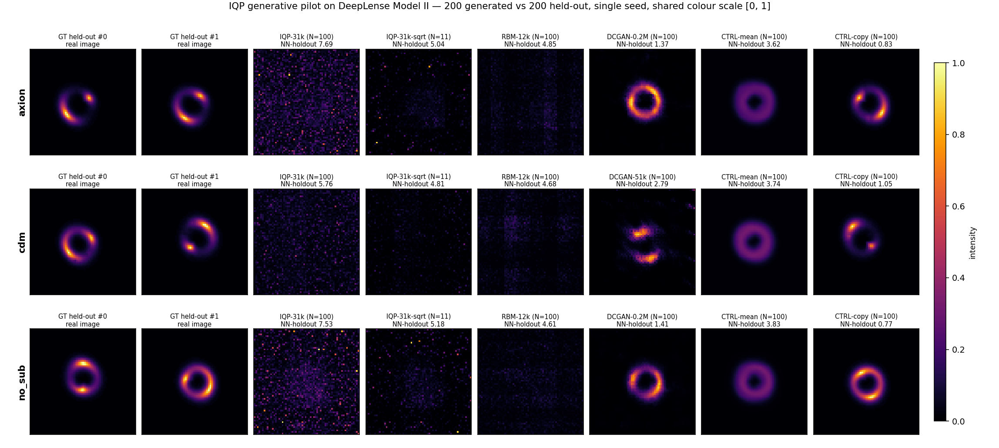

# IQP 生成模型於 DeepLense Model II（暗物質 substructure 影像）— pilot 結果

Job **345400**（`8gpus`，51 jobs，8-wide，**fail=0**，2026-09-06 05:07:38 → 06:29:27，**1 h 22 min**），**單 seed（seed 0）**，依 Leo 的要求。
協定與判定規則寫在跑之前：`docs/IQP_LENS_PILOT_PREREGISTRATION.md`。
程式：`experiments/13_iqp_turbulence_replication/`（與 turbulence 復刻共用同一條 pipeline，`--data lens` 分支，契約見 `INTERFACES.md` 的 `data_lens.py contract` 段）。
前置的 turbulence 復刻與 root-cause：`docs/IQP_TURBULENCE_REPLICATION_RESULTS.md` / `..._DIAGNOSIS.md`。
圖：`docs/figures/iqp_lens_pilot.png`。
**本文只涵蓋 round 1（job 345400）。** pre-reg 已加上 round-2 addendum（IQP-tuple-sqrt-fixed / IQP-pmf-* 等 5 個 arm、預測 P6–P9），那些 arm**尚未執行**，本文的任何數字都不涉及它們。

## TL;DR

1. **Pre-registered 判定：not useful under this protocol。** decision rule 要求 IQP 在 N = 100 regime 下**同時**在兩個指標上贏 CTRL-copy 與 CTRL-mean、且 NN-holdout 小於 CTRL-mean。IQP **一條都沒過**：NN-holdout **5.8 / 7.5 / 7.7**（cdm / no_sub / axion）對上 CTRL-mean 的 **3.6–3.8**、CTRL-copy 的 **0.77–1.05**。
2. **IQP 是所有沒崩潰的 arm 裡最差的**，而且輸給不是模型的東西：198/1800 參數的 CTRL-marginal（product-Bernoulli）在 **Conv2D-MMD² 與 NN-holdout 上三個類別全勝 IQP**。RBM-12k 在三個指標、三個類別上全面贏過 IQP。
3. **sqrt 變體確實有效但不夠**：N = 11 下 PDF–JS 從 0.29–0.42 掉到 **0.050–0.060**（機制清楚：bin-0 佔比從 7.4% 拉回 69.9%，真值 83.7%），但仍在**三個指標、三個類別上全輸 CTRL-mean**。排序只在「IQP vs RBM 的 PDF–JS」這一格翻轉，對控制組的關係沒變。
4. **DCGAN 單 seed 不穩，比較時要標**：18 個 DCGAN run 中 **5 個 mode collapse**（輸出近乎常數影像，跨影像 per-pixel std 0.0014–0.0037）——DCGAN-**1.2M 在 6 格裡崩了 4 格**（axion@100、cdm@11、cdm@100、no_sub@11），DCGAN-0.2M 崩在 cdm@11；另外 DCGAN-0.2M 在 cdm@100 以另一種方式失敗（沒崩潰但亮度爆掉，NN-holdout 16.1）。**DCGAN-51k 六格全存活。** 單 seed 下這些數字不是 DCGAN 的能力上限，只是「這條 DCGAN 配方在單 seed 下有崩潰風險」的證據；表中帶 `†` 的列不可用來代表 DCGAN。
5. **QCLI 高，但完全沒轉換成 IQP 的優勢。** per-image（M = 4096 ≪ 2¹⁸，指標 null 近 0 的有效 regime）I_QCLI = **0.4697 / 0.4693 / 0.4755**，配對 uniform null 只有 **0.0077**——比 null 高 **61 倍**，按論文的選題準則這批資料是教科書級的 "IQP-compatible"。結果 IQP 仍是最差的 arm。**「高 QCLI ⇒ 適合 IQP」在這裡被直接證偽。** 三類的 QCLI 也幾乎不可分（axion vs cdm AUC **0.507**，即兩個 substructure 類別在此指標下是隨機猜；只有 no_sub 弱可分，AUC 0.73）。

---

## 1. 設定摘要

**資料**：`<HOME>/mae-lensing/model_II.npz`，三類 axion / cdm / no_sub（順序由檔案讀出）。每類訓練集 = train_x 的 N 張（N ∈ {11, 100}，固定 permutation 的前綴，故 N = 11 是 N = 100 的子集），held-out = val_x 的 200 張，split seed 0，所有 arm 共用。

**編碼（照 pre-reg 字面套用，無 log 轉換）**：一張 64×64 影像 = 一個 "snapshot"；tuple (kx, ky, kz) = (欄, 列, `floor(64·intensity)` clip 0..63)，(a_z, b_z) = (0, 1) 對三類固定；code pool = 該影像的 4,096 個像素；ground truth = 6-bit 量化後的影像。**已知後果**（跑前量過）：**83.6–84.0% 的像素落在 intensity bin 0**，z-channel 幾乎被背景吃掉。

**Arms**（每類 17 jobs）：IQP-31k（|s| ≤ 6，Algorithm 1：core 30,000 步 + 每張影像 3,000 步 latent，warm-start）、RBM-12k、DCGAN-51k/0.2M/1.2M（20k G-steps）、CTRL-marginal、CTRL-copy、CTRL-mean，各 N ∈ {11, 100}；加 IQP-31k-sqrt（N = 11 secondary）。tuple-based arm 一律 N_t = 5×10⁴ draws、10⁵ synthesis samples。lens 資料沒有時間軸，Eq. 31 的 latent 內插無物可插，所以**所有生成 arm 都用 `--synth-mode gaussian-latent`**：對 N 個訓練 latent 擬合 N(μ, diag σ²) 後抽樣。

**指標**（200 生成 vs 200 held-out）：PDF–JS（B = 50, log₂）、Conv2D-MMD²（固定 seed 0 隨機 encoder，median heuristic），加兩個 L2 nearest-neighbour 距離——**NN-train**（到訓練集，測記憶）與 **NN-holdout**（到 held-out，測覆蓋）。QCLI / CCI：per-image（M = 4,096）與 pooled（M = 409,600），各附相同樣本數的 i.i.d. uniform null。

**聚合**：primary = mean（每格約 24 個樣本），secondary = last-write-wins（`-last` 列），與 turbulence 復刻同慣例。

---

## 2. 確認性結果（pre-registered，單 seed）

數字全部出自 `logs_lens/evaluate_{class}.log` / `results_lens_{class}.jsonl`（已逐格核對兩者一致）。
HOLDOUT (ref) 列 = 200 張真 held-out 影像自己的 NN 距離，是「完美生成器」的參考線。

### 全表（3 類 × 2 個 N；每格 `PDF–JS ↓ / Conv2D-MMD² ↓ / NN-train / NN-holdout ↓`）

與 `logs_lens/evaluate_{class}.log` 的三張分表同源、已逐格核對；此處併成一張以便橫向比較。
`†` = mode collapse（200 張生成影像的 per-pixel 跨影像 std < 0.005，即輸出近乎常數影像）。

| Arm (params) | N | axion JS / MMD² / NN-t / NN-h | cdm JS / MMD² / NN-t / NN-h | no_sub JS / MMD² / NN-t / NN-h |
|---|---|---|---|---|
| HOLDOUT (ref) | 11 | — / — / 3.29 / 0.88 | — / — / 2.89 / 1.02 | — / — / 2.59 / 0.71 |
| CTRL-copy | 11 | 0.0005351 / 0.06549 / 0.00 / 0.95 | 0.0003245 / 0.03378 / 0.00 / 1.01 | 0.0004814 / 0.04531 / 0.00 / 0.77 |
| CTRL-marginal (198) | 11 | 0.3285 / 0.7201 / 5.14 / 4.99 | 0.3348 / 0.7042 / 4.76 / 4.71 | 0.3572 / 0.5448 / 4.80 / 4.62 |
| CTRL-marginal-last (198) | 11 | 0.05329 / 0.6202 / 6.93 / 6.78 | 0.05349 / 0.6882 / 6.72 / 6.68 | 0.05424 / 0.7401 / 7.06 / 6.94 |
| CTRL-mean | 11 | 0.02569 / 0.4862 / 3.29 / 3.30 | 0.02222 / 0.4671 / 3.24 / 2.97 | 0.02065 / 0.3983 / 3.65 / 3.18 |
| DCGAN-51k (55339) | 11 | 0.003658 / 0.2723 / 3.34 / 3.37 | 0.007158 / 0.3821 / 2.64 / 2.43 | 0.006182 / 0.4971 / 4.67 / 4.54 |
| DCGAN-0.2M (202303) | 11 | 0.003494 / 0.1824 / 1.13 / 1.30 | 0.5806 / 0.9482 / 11.66 / 11.66 † | 0.004732 / 0.2289 / 2.14 / 2.13 |
| DCGAN-1.2M (1213889) | 11 | 0.004234 / 0.05293 / 0.99 / 1.24 | 0.7385 / 0.8975 / 15.65 / 15.63 † | 0.6994 / 0.9374 / 12.77 / 12.72 † |
| IQP-31k (31180) | 11 | 0.4233 / 1.228 / 8.41 / 8.16 | 0.3428 / 0.807 / 5.82 / 5.85 | 0.2899 / 1.276 / 7.83 / 7.85 |
| IQP-31k-last (31180) | 11 | 0.06555 / 1.083 / 14.18 / 14.04 | 0.0551 / 1.184 / 8.54 / 8.56 | 0.04262 / 1.126 / 13.35 / 13.33 |
| IQP-31k-sqrt (31180) | 11 | 0.05359 / 0.9168 / 5.40 / 5.04 | 0.05014 / 1.109 / 4.82 / 4.81 | 0.05989 / 0.6446 / 5.15 / 5.18 |
| IQP-31k-sqrt-last (31180) | 11 | 0.01624 / 1.21 / 10.66 / 10.42 | 0.01086 / 0.8988 / 8.02 / 8.02 | 0.02636 / 1.115 / 13.61 / 13.61 |
| RBM-12k (11988) | 11 | 0.1923 / 0.6418 / 5.37 / 4.81 | 0.1572 / 0.4792 / 4.44 / 4.59 | 0.2546 / 0.3728 / 4.58 / 4.61 |
| RBM-12k-last (11988) | 11 | 0.001765 / 0.6984 / 7.77 / 7.38 | 0.002693 / 0.7241 / 7.38 / 7.47 | 0.001468 / 0.8603 / 7.94 / 7.93 |
| HOLDOUT (ref) | 100 | — / — / 1.08 / 0.88 | — / — / 1.28 / 1.02 | — / — / 0.98 / 0.71 |
| CTRL-copy | 100 | 0.0001052 / 0.01198 / 0.00 / 0.83 | 4.793e-05 / 0.006122 / 0.00 / 1.05 | 7.152e-05 / 0.008204 / 0.00 / 0.77 |
| CTRL-marginal (1800) | 100 | 0.335 / 0.635 / 4.68 / 5.01 | 0.3689 / 0.5647 / 4.81 / 4.77 | 0.3478 / 0.5556 / 4.79 / 4.61 |
| CTRL-marginal-last (1800) | 100 | 0.0535 / 0.5883 / 6.76 / 6.96 | 0.05513 / 0.6926 / 7.07 / 7.04 | 0.05351 / 0.6893 / 6.99 / 6.86 |
| CTRL-mean | 100 | 0.03809 / 0.4792 / 3.82 / 3.62 | 0.03044 / 0.421 / 3.72 / 3.74 | 0.0299 / 0.4299 / 3.77 / 3.83 |
| DCGAN-51k (55339) | 100 | 0.004244 / 0.3891 / 2.47 / 2.31 | 0.005046 / 0.2926 / 2.82 / 2.79 | 0.008291 / 0.6442 / 3.51 / 3.42 |
| DCGAN-0.2M (202303) | 100 | 0.004112 / 0.1525 / 1.36 / 1.37 | 0.3399 / 1.088 / 16.15 / 16.11 | 0.002953 / 0.02731 / 1.40 / 1.41 |
| DCGAN-1.2M (1213889) | 100 | 0.8196 / 0.838 / 32.20 / 32.23 † | 0.7136 / 0.9217 / 14.06 / 14.07 † | 0.02717 / 0.05491 / 1.61 / 1.60 |
| IQP-31k (31180) | 100 | 0.3925 / 1.202 / 7.67 / 7.69 | 0.3051 / 0.6621 / 5.77 / 5.76 | 0.2835 / 1.269 / 7.51 / 7.53 |
| IQP-31k-last (31180) | 100 | 0.06743 / 1.147 / 12.93 / 12.95 | 0.0464 / 1.161 / 8.58 / 8.57 | 0.0438 / 1.13 / 12.50 / 12.50 |
| RBM-12k (11988) | 100 | 0.2062 / 0.5011 / 4.90 / 4.85 | 0.175 / 0.3172 / 4.53 / 4.68 | 0.2448 / 0.3918 / 4.59 / 4.61 |
| RBM-12k-last (11988) | 100 | 0.001415 / 0.6748 / 7.72 / 7.71 | 0.002635 / 0.7937 / 7.98 / 8.07 | 0.001392 / 0.7969 / 7.93 / 7.91 |

**HOLDOUT (ref)** 是 200 張真 held-out 影像自己的 NN 距離，即「完美生成器」的參考線。
DCGAN 失敗盤點（單 seed）：18 個 DCGAN run 中 **5 個 mode collapse**（`†`：DCGAN-1.2M 在 axion@100 / cdm@11 / cdm@100 / no_sub@11，跨影像 std 0.0014–0.0027；DCGAN-0.2M 在 cdm@11，std 0.0037），另有 **1 個非崩潰的失敗**（DCGAN-0.2M cdm@100：仍有多樣性 std 0.049，但平均亮度 0.192 對真值 0.036，NN-holdout 16.1）。**DCGAN-51k 六格全存活。**

### 跨類別濃縮表（N = 100，`JS / MMD² / NN-holdout`）

| Arm | axion | cdm | no_sub |
|---|---|---|---|
| HOLDOUT (ref) | — / — / 0.877 | — / — / 1.018 | — / — / 0.713 |
| CTRL-copy (0 params) | **0.000105 / 0.0120 / 0.833** | **0.0000479 / 0.00612 / 1.051** | **0.0000715 / 0.00820 / 0.772** |
| 最佳 DCGAN | 0.00411 / 0.153 / 1.373 (0.2M) | 0.00505 / 0.293 / 2.787 (51k) | 0.00295 / 0.0273 / 1.408 (0.2M) |
| CTRL-mean (0 params) | 0.0381 / 0.479 / 3.617 | 0.0304 / 0.421 / 3.743 | 0.0299 / 0.430 / 3.826 |
| RBM-12k | 0.206 / 0.501 / 4.849 | 0.175 / 0.317 / 4.679 | 0.245 / 0.392 / 4.608 |
| RBM-12k-last | 0.00142 / 0.675 / 7.708 | 0.00264 / 0.794 / 8.068 | 0.00139 / 0.797 / 7.908 |
| **IQP-31k** | 0.393 / 1.202 / **7.689** | 0.305 / 0.662 / **5.762** | 0.284 / 1.269 / **7.532** |
| IQP-31k-last | 0.0674 / 1.147 / 12.95 | 0.0464 / 1.161 / 8.566 | 0.0438 / 1.130 / 12.50 |

### 逐條套用 pre-registered decision rule

pre-reg 原文：*"IQP is useful on this data" would require IQP to beat CTRL-copy and CTRL-mean on both metrics AND have a smaller NN-distance to held-out than CTRL-mean, in the N = 100 regime. Anything less is reported as "not useful under this protocol".*

| 子條款（N = 100） | 判定 | 依據（三類全部） |
|---|---|---|
| IQP 在 PDF–JS 上贏 CTRL-copy | ✗ | 0.393 / 0.305 / 0.284 vs 0.000105 / 0.0000479 / 0.0000715（差 3–4 個數量級） |
| IQP 在 MMD² 上贏 CTRL-copy | ✗ | 1.202 / 0.662 / 1.269 vs 0.0120 / 0.00612 / 0.00820 |
| IQP 在 PDF–JS 上贏 CTRL-mean | ✗ | 0.393 / 0.305 / 0.284 vs 0.0381 / 0.0304 / 0.0299（差約 10 倍） |
| IQP 在 MMD² 上贏 CTRL-mean | ✗ | 1.202 / 0.662 / 1.269 vs 0.479 / 0.421 / 0.430 |
| IQP 的 NN-holdout 小於 CTRL-mean | ✗ | 7.689 / 5.762 / 7.532 vs 3.617 / 3.743 / 3.826（約 1.5–2.1 倍遠） |

**判定：not useful under this protocol（五個子條款零通過，三個類別一致）。** 用 last-write 聚合或 sqrt 編碼也翻不了盤：sqrt（N = 11）的 0.050–0.060 / 0.645–1.109 / 4.81–5.18 對 CTRL-mean 的 0.021–0.026 / 0.398–0.486 / 2.97–3.30，一樣三個指標全輸。

### 預測評分（P1–P5，寫在跑之前）

| # | 預測 | 結果 |
|---|---|---|
| P1 | IQP 不會在任一 regime、任一指標上贏 DCGAN-1.2M | ◐ **精神對、字面錯**。對上**沒崩潰**的 DCGAN-1.2M（axion@11、no_sub@100）IQP 兩個指標全輸；但在 1.2M 崩掉的 4 格裡 IQP 反而贏（如 cdm@100：0.305/0.662 vs 0.714/0.922）。這是 baseline 崩潰造成的假勝，不是 IQP 的能力 |
| P2 | CTRL-copy 在 N = 100 兩個指標上最好或接近最好；CTRL-mean 在 MMD² 好、在 PDF–JS 差 | ◐ 前半 ✓ **完全正確**（CTRL-copy 在三類的兩個指標上都是全場第一）；**後半反了**：CTRL-mean 的 PDF–JS（0.030–0.038）其實相當好，MMD²（0.42–0.48）才是中庸 |
| P3 | IQP 生成的是模糊的 class-mean 弧；NN-holdout 接近 CTRL-mean | ✗ **兩半都錯，而且錯得比預期嚴重**。IQP 生成的**不是模糊弧，是幾乎沒有結構的亮斑點雜訊**：與 class-mean 的 per-image 相關係數只有 **0.004 / 0.063 / 0.178**（cdm / axion / no_sub；真影像 0.668–0.695），弧/背景對比 **1.01 / 1.16 / 1.62**（真影像 16.5–17.7）——cdm 那一格等於**完全沒有弧結構**。NN-holdout 也不接近 CTRL-mean，是它的 **1.5–2.1 倍** |
| P4 | per-image QCLI 低（< 0.1）且與配對 null 不可分；CCI 高；三類不可分 | ✗ **QCLI 部分大錯**：實際 **0.4697 / 0.4693 / 0.4755**，是 null（0.0077）的 **61 倍**，可分性極強。CCI 絕對值高（0.868）✓，但**低於** uniform null（0.998）。「三類不可分」◐：CCI 三對全在隨機水準（AUC 0.50–0.53）、QCLI 的 axion vs cdm 也是（AUC **0.507**），但 no_sub 對另兩類弱可分（AUC 0.73–0.74） |
| P5 | sqrt 變體降低 IQP 的 PDF–JS，但不改變排序 | ◐ 前半 ✓ **且幅度很大**（0.29–0.42 → 0.050–0.060）；排序**大致不變**（對所有控制組的相對關係全部不變、MMD²/NN 上仍輸 RBM），但**有一格翻了**：sqrt 後 IQP 的 PDF–JS 反超 RBM-12k（0.050–0.060 vs 0.157–0.255） |

---

## 3. 解讀



### (a) IQP 在影像上失敗的機制

**延續 turbulence 的三個根因**（`IQP_TURBULENCE_REPLICATION_RESULTS.md` §3(d)/§4，數字在該檔）：Algorithm 1 的 stage 1 凍住全部 latent 參數、5×10⁴ 抽樣 pmf 取代精確 pmf、以及「這個模型族 + closed-form MMD 目標」本身約 0.88–0.89 的 anchor-fit 天花板；訓練 kernel 把 99.3% 權重放在 |s| ≤ 3，高階結構學不到。

**影像特有的三件事讓它更糟：**

1. **z-channel 退化。** 83.6–84.0% 的像素在 bin 0，6 個 z-qubit 裡有效資訊極少。IQP 學到的 intensity marginal 完全對不上：真值 bin-0 佔比 **83.7%**，IQP 只有 **7.4%**，機率質量全被推到 bins 1–15（`[0, 1/64) / [1/64, 2/64) / [2/64, 4/64) / [4/64, 8/64) / [8/64, 16/64) / ≥16/64` 的佔比，axion：真 0.837/0.028/0.029/0.032/0.032/0.041，IQP 0.074/0.158/0.272/0.283/0.169/0.044）。生成影像的平均亮度因此是真值的 **2.3 倍**（0.0855 vs 0.0369）。這一條就足以解釋 PDF–JS 的 0.28–0.42。
2. **弧根本沒學到。** 圖中 IQP 那一欄是**滿版的亮斑點雜訊**，不是「模糊的弧」——與 class-mean（100 張訓練影像的平均）的 per-image 相關係數只有 **0.004（cdm）/ 0.063（axion）/ 0.178（no_sub）**，真影像是 **0.668–0.695**；弧/背景對比（mask = class-mean 前 10% 亮像素）**1.01 / 1.16 / 1.62**，真影像 **16.5–17.7**（全部取 200 張生成 vs 200 張 held-out）。**cdm 的 1.01 / 0.004 等於完全沒有弧結構。** 也就是說 IQP 連 P3 預期的「退化到 class mean」都沒做到；它退化到的是**一個幾乎空間無結構的高亮度雜訊場**。（對照：RBM 0.088–0.256 / 1.21–1.54，sqrt 變體 0.026–0.196 / 1.11–2.25——sqrt 在 axion 與 no_sub 把對比推到 2.2，在 cdm 仍是 1.11。）這正好解釋為什麼 NN-holdout（7.5–7.7）比只會輸出 class mean 的 CTRL-mean（3.6–3.8）還差一倍：CTRL-mean 至少把亮度放對地方。
3. **高斯 latent 抽樣把多樣性放在錯的地方。** N(μ, diag σ²) 抽樣讓 IQP 的跨影像 per-pixel std 達 **0.046–0.065**（cdm 0.046、axion 0.063、no_sub 0.065），比真影像（0.029）還高——多樣性是有的，但那是雜訊的多樣性，不是弧位置/形狀的多樣性。RBM 走同一條抽樣路徑，per-pixel std 0.020–0.023，輸出是暗而平的模糊塊（max 只有 0.37–0.42，真值 0.99），同樣沒有弧。**問題出在「Algorithm 1 訓出的 latent 空間 + 高斯假設」，不只出在 IQP 的 circuit。**

**sqrt 變體是這條診斷的直接驗證**：把 intensity 開根號後再量化，bin-0 佔比從 7.4% 拉回 **69.9%**（真值 83.7%），PDF–JS 隨即掉一個數量級、NN-holdout 從 8.16 → 5.04（axion）。**編碼的動態範圍是最大的單一槓桿**——但把它修好之後 IQP 仍然輸給 CTRL-mean，代表**還有一個更根本的上限在後面**，與 turbulence 的結論一致。

### (b) 指標：控制組把獎勵結構整個拆穿

- **CTRL-copy 幾乎完美**（PDF–JS 4.8e-05 ~ 1.1e-04、MMD² 0.006–0.012，兩個指標三個類別全場第一），而它就是把 N 張訓練影像循環貼 200 次、**零參數、零泛化**。這證明 PDF–JS 與 Conv2D-MMD² **獎勵背資料**。唯一揭穿它的是 **NN-train = 0**（完美記憶），這也正是把這兩個 NN 距離加進協定的理由。
- **CTRL-mean 贏 IQP** 說明的事更難堪：一張常數的平均影像重複 200 次，在兩個指標與 NN-holdout 上都勝過訓練了 3.27×10⁵ 步的 31k 參數量子模型。
- **CTRL-marginal（198 / 1800 參數的 product-Bernoulli）在 MMD² 與 NN-holdout 上三類全勝 IQP**（0.56–0.64 vs 0.66–1.27；4.61–5.01 vs 5.76–7.69）。IQP 的 31k 參數沒有換到任何比獨立像素模型更好的東西。
- **RBM-12k-last 的 PDF–JS 是 0.0014–0.0027**，比它自己的 mean 聚合（0.175–0.245）好兩個數量級——再次說明**聚合慣例本身可以主宰 PDF–JS**（與 turbulence §3(c) 同一現象），這個指標的絕對值不能跨慣例比。

### (c) QCLI 高但無用，這代表什麼

論文用 QCLI/CCI 當「這個資料適不適合 IQP」的選題準則。這批影像在**指標最有效的 regime**（per-image，M = 4096 ≪ 2¹⁸ = 262,144，配對 null 只有 0.0077）拿到 **0.47**，比 null 高 61 倍——比 turbulence D2 的情況乾淨太多（D2 在 M ≳ 10⁴ 時 null 已經漂到 0.4，指標分不出結構與亂數）。**這是對該準則最有利的一次測試，而 IQP 照樣是全場最差的 arm。** 因此：高 QCLI **既非**好表現的充分條件，這條選題準則在此資料上沒有預測力。附帶：三個類別的 QCLI/CCI 幾乎重合（QCLI 0.4693–0.4755，axion vs cdm 的 AUC 0.507），**它也不能當 substructure 的判別特徵**。

### (d) 對 DeepLense 專案的含意

(1) 這條「IQP 生成模型」路線在 64×64 lensing 影像上、在這個協定下**不是可用的生成/資料增強途徑**，不值得再投 GPU 去做 seed 擴充或參數放大——瓶頸在編碼與 Algorithm 1 的協定，不在算力。
(2) 真正該留下來的產物是**控制組電池**（CTRL-copy / CTRL-mean / CTRL-marginal + 配對 null + NN-train/NN-holdout）：本 repo 之後任何「量子生成模型在 lensing 上有效」的宣稱，都應先過這一組，否則 PDF–JS/MMD² 的好看數字可以被零參數控制組複製。
(3) **不要**用 QCLI 這類「量子相容性指標」來挑 DeepLense 的子任務——本次是它最有利的測試條件，而它與實際表現無關。

---

## 4. 誠實的限制

1. **單 seed（seed 0）**，依 Leo 要求。所有比較都缺 seed 誤差棒，**DCGAN 特別受影響**：18 run 中 5 個 mode collapse（1.2M 崩 4/6、0.2M 崩 cdm@11）＋1 個非崩潰失敗（0.2M cdm@100），51k 六格全存活。表中帶 `†` 的列**不可當 DCGAN 的能力代表**。IQP/RBM 沒有觀察到崩潰，但它們的數字同樣是 n = 1。
2. **字面編碼、無 log 轉換**（pre-reg 明寫）。已知 84% 像素在 bin 0；sqrt 只是 secondary 且只跑 N = 11。因此本文只能說「**在這個編碼下**不 useful」，不能說 IQP 對 lensing 影像的上限就是這樣。
3. **N_t = 5×10⁴ 抽樣** 而非 `--full-grid`：code pool 就是 4,096 個像素，全格點會給精確經驗 pmf；保留抽樣是為了與 turbulence arm 的資料側雜訊一致，但這確實引入一個已知的、可去除的損失（turbulence §3(d) 量到約 −0.04 corr）。
4. **latent 的高斯假設**：lens 無時間軸，Eq. 31 無物可插，`gaussian-latent` 是我們自訂的替代。IQP 與 RBM 共用它，所以兩者可比；但「IQP 生成不出弧」有多少該歸給 circuit、多少該歸給這個抽樣假設，**本次沒有拆開**。
5. **沒有分類器指標**。三類的 axion/cdm/no_sub 判別能力（DeepLense 真正在乎的下游任務）完全沒測；PDF–JS/MMD²/NN 都是分布距離，不保證生成影像帶得動 substructure 訊息。
6. 所有 arm 的 Conv2D-MMD² 用同一個隨機初始化 encoder，**絕對值不跨實作可比**，只有本表內的相對排序有意義。

## 5. 下一步（三選一，或都不做）

1. **若要再給 IQP 一次機會，一次改三件事**（分開改沒有意義，前兩件已知是槓桿）：sqrt 或 log 編碼當 primary + 放開 stage 1 凍住的單體項（含全部 18 個 θ_lat）+ 用 full-pool 精確 pmf 取代 5×10⁴ 抽樣。turbulence 的歸因顯示這三件加起來可把 anchor corr 從 0.77 推到 0.886；本次 sqrt 單獨就讓 PDF–JS 掉一個數量級，值得測「合起來能不能過 CTRL-mean」這一關。**這條已被 pre-reg 的 round-2 addendum 涵蓋**（IQP-tuple-sqrt-fixed 與三個把影像當 pmf 的 12-qubit arm，預測 P6–P9），尚未執行。
2. **換指標**：用 DeepLense 既有的三類分類器當評估器（在真資料上訓練，對生成影像測 accuracy / 對生成資料增強測下游增益）。PDF–JS/MMD² 已被 CTRL-copy 證明會獎勵背資料，分類器指標是零參數控制組騙不過的。
3. **或者結論就是不值得**：五個 decision-rule 子條款零通過、三個類別一致、且輸給零參數控制組——這已經是清楚的負面結果。把它寫成「我們測過、附完整控制組」的一節，比再燒 GPU 更有價值。

## 附錄：runs、路徑、指令

| 項目 | 值 |
|---|---|
| Job | **345400**，partition `8gpus`（8×GPU），帳號 `<YOUR_ACCOUNT>`，node `25a-hgpn002` |
| 時間 | 2026-09-06 05:07:38 → 06:29:27（**1 h 22 min**），51 jobs 8-wide，**fail=0** |
| 提交腳本 | `experiments/13_iqp_turbulence_replication/submit_lens_pilot.sbatch` |
| Slurm log | `logs_lens/sbatch-345400.out`（`.err` 為空） |
| 逐 arm log | `logs_lens/{class}_{arm}_n{N}.log`（51 個） |
| 評估表 | `logs_lens/evaluate_{axion,cdm,no_sub}.log` |
| 機器可讀結果 | `results_lens_{axion,cdm,no_sub}.jsonl`（各 26 列） |
| 生成影像 | `outputs_lens_pilot/{class}/{arm}_n{N}/generated_{000..199}.npy`（`_last` 為 last-write 聚合的同批樣本） |
| QCLI/CCI | `logs_lens/qcli_cci_lens.log`、`outputs_lens_pilot/qcli_cci_lens.json`（exact 2¹⁸ enumeration，260 s） |
| 資料載入 | `data_lens.py`：`load_lens(cls, n_train, seed=0, n_holdout=200, sqrt=False)`、`holdout_images(cls, n_holdout=200)`、`raw_training_images(cls, n_train)`；cache 在 `<WORK>/data/lens_cache` |
| 直譯器 | `/usr/bin/python3`（見 memory `qc-llm-env-broken.md`） |

代表性指令（其餘 arm 同構，見 sbatch 第 95–155 行）：

```bash
# IQP-31k, N = 100
/usr/bin/python3 train_iqp.py --data lens --lens-class axion --n-train 100 --n-holdout 200 \
  --synth-mode gaussian-latent --n-gen 200 --K 6 --steps-core 30000 --steps-lat 3000 \
  --n-synth 100000 --device cuda --seed 0 --out outputs_lens_pilot/axion/iqp31k_n100
# secondary: 加 --lens-sqrt，--n-train 11
# 控制組
/usr/bin/python3 controls_lens.py --arm mean --lens-class axion --n-train 100 --n-gen 200 --seed 0 ...
/usr/bin/python3 controls.py --arm marginal --data lens --lens-class axion --n-train 100 \
  --synth-mode gaussian-latent --n-gen 200 --n-synth 100000 --seed 0 ...
# 評估與診斷
/usr/bin/python3 evaluate_lens.py --lens-class axion --outputs-dir outputs_lens_pilot/axion --n-holdout 200
/usr/bin/python3 qcli_cci_lens.py --n-images 200 --n-train 100 --out outputs_lens_pilot/qcli_cci_lens.json
```

圖由 `docs/figures/iqp_lens_pilot.png` 呈現：每列一個類別，左起 GT held-out ×2、IQP-31k (N=100)、IQP-31k-sqrt (N=11)、RBM-12k (N=100)、該類最佳 DCGAN (N=100)、CTRL-mean、CTRL-copy，全部同色階 [0, 1]，標題附該 arm 的 NN-holdout。
