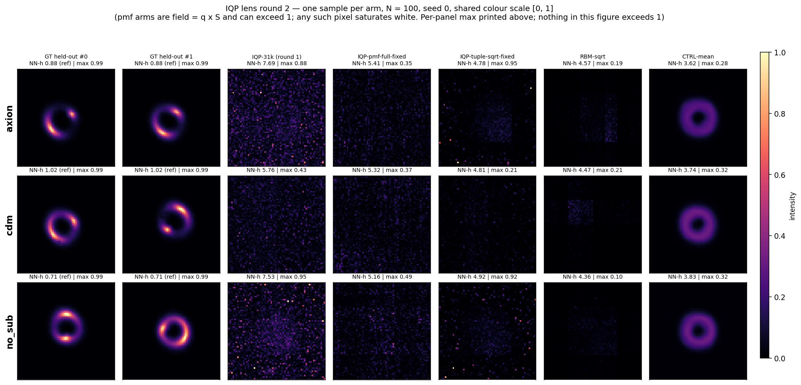

# IQP 生成模型於 DeepLense Model II — round 2 結果（image-as-pmf 編碼與協定修正）

Job **347344**（`8gpus`，30 jobs，8-wide，**fail=0**，2026-09-06 16:43:40 → 18:42:36，**1 h 58 min 56 s**，node `25a-hgpn009`），**單 seed（seed 0）**。
協定、5 個 arm 的定義、預測 P6–P9 與 decision rule 全部寫在跑之前：`docs/IQP_LENS_PILOT_PREREGISTRATION.md` 的 **Addendum 2026-09-06 — round 2**（含最後的 pmf scoring note）。
Round 1（job 345400）結果與 root-cause：`docs/IQP_LENS_PILOT_RESULTS.md`；跑前的影像特性量測：`docs/LENS_IMAGE_CHARACTERISTICS.md`。程式與契約：`experiments/13_iqp_turbulence_replication/` 與 `INTERFACES.md` 的「Round-2 lens arms」段。圖：`docs/figures/iqp_lens_round2.png`。
本文的**指標數字全部取自** `results_lens_round2_{class}.jsonl` 與 `results_lens_round2_clipped_{class}.jsonl`（已與 `logs_lens/evaluate_round2*.log` 逐格核對）；協定欄位（`stage1_latent_shift`、`intensity_scale_S` 等）取自各 run 的 `meta.json`。**唯一的例外是 §5(a) 的空間結構診斷與「總亮度對齊後」重評分**——那是事後另外算的、非 pre-registered 的診斷（腳本重算的 raw 欄與 jsonl 逐位相同以確認實作一致），不進 §4 的判定。

## TL;DR

1. **Pre-registered 判定：failure。** decision rule 要求在 N = 100 下「贏 RBM-sqrt 的 NN-holdout **與** PDF–JS，且贏 CTRL-mean 的 NN-holdout」。三個子條款、三個類別，**九格全滅**：最好的 IQP arm（tuple-sqrt-fixed）NN-holdout 4.78 / 4.81 / 4.92 對 RBM-sqrt 的 **4.57 / 4.47 / 4.36**、CTRL-mean 的 3.62 / 3.74 / 3.83；PDF–JS 0.0516 / 0.0509 / 0.0587 對 RBM-sqrt 的 **0.0406 / 0.0316 / 0.0495**。
2. **pmf 編碼把數字修好了，但修好的是「總亮度尺度」，不是空間結構。** 表面上 MMD² 從 round-1 IQP 的 0.66–1.27 掉到 **0.42–0.50**、NN-holdout 5.76–7.69 → **5.16–5.44**。但 (i) pmf arm 與 class-mean 的 per-image 相關係數是 **−0.006 ~ +0.041**、弧/背景對比 **0.98–1.15**（真影像 0.67–0.70 / 17.6–19.0）——**三個 pmf arm、三個類別都是零弧結構**，比 round-1 IQP（0.004–0.178 / 1.01–1.62）還少；(ii) 把每個 arm 的平均總亮度事後對齊 held-out 再重算（§5(a)，**post-hoc 診斷，不進 decision rule**），round-1 IQP 的 MMD² 掉到 **0.48–0.53**、pmf 停在 **0.45–0.47**——**round 2 相對 round 1 的全部 MMD² 增益消失**。改善的來源是 field = q × S 把平均總亮度從 round-1 的 **1.49–2.31 倍**鎖成 **0.96–1.03 倍**，而 S 是外部給的訓練集平均值，不是模型學到的。
3. **P8 錯得很乾淨：協定與 generator 數在 12-bit 上完全不是槓桿。** 凍 latent + 5×10⁴ 抽樣 pmf（paper 協定）對上全參數 + 精確 pmf，三類 N = 100 的差距是 |ΔJS| ≤ 0.010、|ΔMMD²| ≤ 0.011、|ΔNN| ≤ 0.027——**噪音等級**。`|s| ≤ 6`（2,510 參數）對上全 4,096 個 Z-string 同樣沒差（|ΔNN| ≤ 0.055），axion 那格 K6 反而略好。
4. **tuple 這條線上，「不凍 latent + 精確 pool」也一樣沒差**：IQP-tuple-sqrt-fixed 與 round-1 的 IQP-31k-sqrt（凍 latent）在 N = 11 三類上是 0.051/0.973/4.75 vs 0.054/0.917/5.04（axion）等——**sqrt 編碼一件事就吃光了 round-2 tuple arm 的全部增益**。meta.json 的 `stage1_latent_shift` 給出機制：解凍後 θ_lat 在 stage 1 只移動了 0.12–0.22 rad（paper 協定精確為 0.0），所以「解凍」在數值上幾乎是 no-op。
5. **sqrt 是一個交換，不是免費午餐**：對每一個模型（IQP tuple、RBM）都是「PDF–JS 大幅變好、MMD² 大幅變差」。RBM：0.175–0.245 / 0.317–0.501 → **0.0316–0.0495 / 1.13–1.19**；IQP tuple：0.284–0.392 / 0.66–1.27 → **0.0509–0.0587 / 0.745–1.11**。原因是 sqrt arm 的平均總亮度掉到真值的 0.27–0.60 倍，PDF–JS（bin 在暗端）獲益、MMD²（吃總能量）受損。

---

## 1. 設定摘要

**沿用 round 1 的一切**：同一份 `model_II.npz`、同樣三類、同樣 seed-0 split（N ∈ {11, 100} 訓練影像、200 張 val held-out）、同樣四個指標（PDF–JS B = 50 / Conv2D-MMD² seed-0 encoder / NN-train / NN-holdout）、同樣 `--synth-mode gaussian-latent`（lens 無時間軸，Eq. 31 無物可插）、同樣 d_lat = 50 的 Hamming-first latent 與每張影像 3,000 步 warm-start。**round-1 的 arm 不重跑，直接併表。5 個新 arm**（每類 10 jobs = 5 arm × 2 個 N）：

| Arm | 編碼 / qubits | Generators | Stage 1 | 訓練用 pmf | 重建 |
|---|---|---|---|---|---|
| IQP-tuple-sqrt-fixed (31,180) | tuple (x, y, **sqrt**-intensity), 18q | \|s\| ≤ 6 | **全參數** | 4,096 像素 pool（精確） | 10⁵ samples, mean 聚合 |
| IQP-pmf-full-fixed (4,096) | **image-as-pmf** `(kx<<6)\|ky`, 12q | 全 4,096 Z-strings | **全參數** | **精確** normalised image | **exact** q × S（無 Monte-Carlo） |
| IQP-pmf-K6-fixed (2,510) | 同上 | \|s\| ≤ 6 | **全參數** | 精確 | 同上 |
| IQP-pmf-full-paper (4,096) | 同上 | 全 4,096 | **paper 協定（凍 latent）** | 5×10⁴ 抽樣 codes | 同上 |
| RBM-sqrt (11,988) | tuple sqrt, 18 bits | – | 同 round 1 | 同 round 1 | 同 round 1 |

**pmf 的尺度 S（重要）**：12-qubit 電路只輸出機率分布 q(kx, ky)，**亮度尺度活在電路外面**——生成影像 = `q × S`，S = `data_lens.mean_total_intensity(cls, n_train)`，即**訓練影像**的平均總亮度（axion / cdm / no_sub = **144.71 / 154.08 / 149.57**，對應的 held-out 平均總亮度為 **151.31 / 149.28 / 144.64**，即 0.96 / 1.03 / 1.03 倍）。這是一個 pre-reg 已標記的 **confound**：pmf arm 的總亮度是被外部設定成幾乎正確的，其他 arm 的總亮度是模型自己產生的（見 §5(a)）。
**Clip 次評分**：q × S 的單一像素可以超過真影像的最大值 1.0，而 `metrics.pdf_js` / `conv_mmd2` 是 bin 在（held-out ∪ 該 arm）的**聯合值域**上，所以越界的 arm 是在被拉長的尺度上評分。次評分把生成影像先 `np.clip(·, 0, 1)` 再算（held-out 不動），結果在 §3。
**次要變體**：pmf arm 的 `_sampled`（10⁵ 次電路抽樣的計數密度，對照 primary 的 exact 重建），tuple arm 的 `-last`（last-write-wins 聚合）。主表排除，另列於 §2 表 C。

---

## 2. 確認性結果（pre-registered，單 seed）

### 表 A — 全表（3 類 × 2 個 N；每格 `PDF–JS ↓ / Conv2D-MMD² ↓ / NN-train / NN-holdout ↓`）

`†` = mode collapse（round-1 診斷，跨影像 per-pixel std < 0.005）；`‡` = 非崩潰但亮度失控（round-1 診斷）。**粗體 = round-2 新 arm。**

| Arm (params) | N | axion | cdm | no_sub |
|---|---|---|---|---|
| HOLDOUT (ref) | 11 | — / — / 3.29 / 0.877 | — / — / 2.89 / 1.018 | — / — / 2.59 / 0.713 |
| CTRL-copy (0) | 11 | 0.000535 / 0.0655 / 0.00 / 0.945 | 0.000324 / 0.0338 / 0.00 / 1.010 | 0.000481 / 0.0453 / 0.00 / 0.771 |
| CTRL-marginal (198) | 11 | 0.329 / 0.720 / 5.14 / 4.99 | 0.335 / 0.704 / 4.76 / 4.71 | 0.357 / 0.545 / 4.80 / 4.62 |
| CTRL-mean (0) | 11 | 0.0257 / 0.486 / 3.29 / 3.30 | 0.0222 / 0.467 / 3.24 / 2.97 | 0.0207 / 0.398 / 3.65 / 3.18 |
| DCGAN-51k (55,339) | 11 | 0.00366 / 0.272 / 3.34 / 3.37 | 0.00716 / 0.382 / 2.64 / 2.43 | 0.00618 / 0.497 / 4.67 / 4.54 |
| DCGAN-0.2M (202,303) | 11 | 0.00349 / 0.182 / 1.13 / 1.30 | 0.581 / 0.948 / 11.66 / 11.66 † | 0.00473 / 0.229 / 2.14 / 2.13 |
| DCGAN-1.2M (1,213,889) | 11 | 0.00423 / 0.0529 / 0.99 / 1.24 | 0.739 / 0.898 / 15.65 / 15.63 † | 0.699 / 0.937 / 12.77 / 12.72 † |
| IQP-31k (31,180) | 11 | 0.423 / 1.228 / 8.41 / 8.16 | 0.343 / 0.807 / 5.82 / 5.85 | 0.290 / 1.276 / 7.83 / 7.85 |
| IQP-31k-sqrt (31,180) | 11 | 0.0536 / 0.917 / 5.40 / 5.04 | 0.0501 / 1.109 / 4.82 / 4.81 | 0.0599 / 0.645 / 5.15 / 5.18 |
| RBM-12k (11,988) | 11 | 0.192 / 0.642 / 5.37 / 4.81 | 0.157 / 0.479 / 4.44 / 4.59 | 0.255 / 0.373 / 4.58 / 4.61 |
| **IQP-tuple-sqrt-fixed (31,180)** | 11 | 0.0511 / 0.973 / 5.27 / 4.75 | 0.0483 / 1.108 / 4.81 / 4.81 | 0.0573 / 0.750 / 4.89 / 4.92 |
| **IQP-pmf-full-fixed (4,096)** | 11 | 0.126 / 0.479 / 5.56 / 5.16 | 0.163 / 0.458 / 5.14 / 5.11 | 0.104 / 0.345 / 4.95 / 4.90 |
| **IQP-pmf-K6-fixed (2,510)** | 11 | 0.114 / 0.451 / 5.54 / 5.12 | 0.153 / 0.469 / 5.11 / 5.05 | 0.0647 / 0.334 / 5.29 / 5.30 |
| **IQP-pmf-full-paper (4,096)** | 11 | 0.130 / 0.447 / 5.53 / 5.16 | 0.171 / 0.481 / 5.11 / 5.10 | 0.0621 / 0.363 / 5.31 / 5.29 |
| **RBM-sqrt (11,988)** | 11 | 0.0396 / 1.138 / 5.18 / 4.62 | 0.0344 / 1.211 / 4.41 / 4.57 | 0.0469 / 1.185 / 4.41 / 4.38 |
| HOLDOUT (ref) | 100 | — / — / 1.08 / 0.877 | — / — / 1.28 / 1.018 | — / — / 0.98 / 0.713 |
| CTRL-copy (0) | 100 | 0.000105 / 0.0120 / 0.00 / 0.833 | 0.0000479 / 0.00612 / 0.00 / 1.051 | 0.0000715 / 0.00820 / 0.00 / 0.772 |
| CTRL-marginal (1,800) | 100 | 0.335 / 0.635 / 4.68 / 5.01 | 0.369 / 0.565 / 4.81 / 4.77 | 0.348 / 0.556 / 4.79 / 4.61 |
| CTRL-mean (0) | 100 | 0.0381 / 0.479 / 3.82 / 3.62 | 0.0304 / 0.421 / 3.72 / 3.74 | 0.0299 / 0.430 / 3.77 / 3.83 |
| DCGAN-51k (55,339) | 100 | 0.00424 / 0.389 / 2.47 / 2.31 | 0.00505 / 0.293 / 2.82 / 2.79 | 0.00829 / 0.644 / 3.51 / 3.42 |
| DCGAN-0.2M (202,303) | 100 | 0.00411 / 0.153 / 1.36 / 1.37 | 0.340 / 1.088 / 16.15 / 16.11 ‡ | 0.00295 / 0.0273 / 1.40 / 1.41 |
| DCGAN-1.2M (1,213,889) | 100 | 0.820 / 0.838 / 32.20 / 32.23 † | 0.714 / 0.922 / 14.06 / 14.07 † | 0.0272 / 0.0549 / 1.61 / 1.60 |
| IQP-31k (31,180) | 100 | 0.392 / 1.202 / 7.67 / 7.69 | 0.305 / 0.662 / 5.77 / 5.76 | 0.284 / 1.269 / 7.51 / 7.53 |
| RBM-12k (11,988) | 100 | 0.206 / 0.501 / 4.90 / 4.85 | 0.175 / 0.317 / 4.53 / 4.68 | 0.245 / 0.392 / 4.59 / 4.61 |
| **IQP-tuple-sqrt-fixed (31,180)** | 100 | 0.0516 / 0.972 / 4.80 / **4.78** | 0.0509 / 1.105 / 4.85 / **4.81** | 0.0587 / 0.745 / 4.90 / **4.92** |
| **IQP-pmf-full-fixed (4,096)** | 100 | 0.193 / 0.497 / 5.14 / 5.41 | 0.195 / 0.440 / 5.36 / 5.32 | 0.187 / 0.423 / 5.33 / 5.16 |
| **IQP-pmf-K6-fixed (2,510)** | 100 | 0.163 / 0.447 / 5.18 / 5.41 | 0.200 / 0.450 / 5.33 / 5.27 | 0.188 / 0.433 / 5.32 / 5.16 |
| **IQP-pmf-full-paper (4,096)** | 100 | 0.183 / 0.486 / 5.18 / 5.44 | 0.196 / 0.441 / 5.36 / 5.31 | 0.187 / 0.425 / 5.33 / 5.16 |
| **RBM-sqrt (11,988)** | 100 | 0.0406 / 1.131 / 4.60 / **4.57** | 0.0316 / 1.187 / 4.31 / **4.47** | 0.0495 / 1.176 / 4.38 / **4.36** |

### 表 B — N = 100 跨類別濃縮（`JS / MMD² / NN-holdout`；依 NN-holdout 由好到壞排）

| Arm | axion | cdm | no_sub |
|---|---|---|---|
| HOLDOUT (ref) | — / — / 0.877 | — / — / 1.018 | — / — / 0.713 |
| CTRL-copy (0 params) | 0.000105 / 0.0120 / **0.833** | 0.0000479 / 0.00612 / **1.051** | 0.0000715 / 0.00820 / **0.772** |
| 最佳 DCGAN | 0.00411 / 0.153 / 1.373 (0.2M) | 0.00505 / 0.293 / 2.787 (51k) | 0.00295 / 0.0273 / 1.408 (0.2M) |
| CTRL-mean (0 params) | 0.0381 / 0.479 / 3.617 | 0.0304 / 0.421 / 3.743 | 0.0299 / 0.430 / 3.826 |
| RBM-sqrt | 0.0406 / 1.131 / 4.566 | 0.0316 / 1.187 / 4.475 | 0.0495 / 1.176 / 4.365 |
| RBM-12k (round 1) | 0.206 / 0.501 / 4.849 | 0.175 / 0.317 / 4.679 | 0.245 / 0.392 / 4.608 |
| **IQP-tuple-sqrt-fixed** | 0.0516 / 0.972 / 4.783 | 0.0509 / 1.105 / 4.806 | 0.0587 / 0.745 / 4.923 |
| **IQP-pmf-K6-fixed** | 0.163 / 0.447 / 5.412 | 0.200 / 0.450 / 5.266 | 0.188 / 0.433 / 5.157 |
| **IQP-pmf-full-fixed** | 0.193 / 0.497 / 5.409 | 0.195 / 0.440 / 5.321 | 0.187 / 0.423 / 5.163 |
| **IQP-pmf-full-paper** | 0.183 / 0.486 / 5.436 | 0.196 / 0.441 / 5.310 | 0.187 / 0.425 / 5.164 |
| IQP-31k (round 1) | 0.392 / 1.202 / 7.689 | 0.305 / 0.662 / 5.762 | 0.284 / 1.269 / 7.532 |

### 表 C — 次要變體（N = 100，`JS / MMD² / NN-holdout`）

`_sampled` = 用 10⁵ 次電路抽樣的計數密度取代 exact q；`-last` = last-write-wins 聚合。

| 變體 | axion | cdm | no_sub |
|---|---|---|---|
| IQP-pmf-full-fixed-sampled | 0.192 / 0.492 / 5.428 | 0.197 / 0.439 / 5.342 | 0.180 / 0.420 / 5.185 |
| IQP-pmf-K6-fixed-sampled | 0.147 / 0.444 / 5.430 | 0.202 / 0.447 / 5.288 | 0.181 / 0.431 / 5.179 |
| IQP-pmf-full-paper-sampled | 0.182 / 0.481 / 5.455 | 0.199 / 0.440 / 5.332 | 0.181 / 0.424 / 5.184 |
| IQP-tuple-sqrt-fixed-last | 0.0144 / 1.110 / 9.212 | 0.0105 / 0.897 / 7.916 | 0.0248 / 1.170 / 12.36 |
| RBM-sqrt-last | 0.00558 / 0.602 / 7.510 | 0.00644 / 0.680 / 7.901 | 0.00602 / 0.742 / 7.942 |

**`_sampled` 與 exact 的差 ≤ 0.017 JS / 0.005 MMD² / 0.022 NN**——10⁵ 次抽樣重建 4,096 個 bin 的損失可忽略。**`-last` 重演 round-1 的老現象**：PDF–JS 掉一個數量級（0.0056–0.0248，比任何 mean 聚合的 arm 都好）而 NN-holdout 爆到 7.5–12.4——聚合慣例可以單獨主宰 PDF–JS，**這個指標的絕對值不能跨慣例比**。

---

## 3. Clip 次評分（pmf arm）

`evaluate_lens_clipped.py`：生成影像先 `np.clip(·, 0, 1)`，held-out 不動；非 pmf arm 為 no-op（已驗證所有非 pmf 列 4 個指標 byte-identical）。46 列中共 **16 列**數值改變，下表列出其中的 8 個 primary 列（`_sampled` 對照同號同幅，略）。

| 格 | arm | raw JS → clip JS | raw MMD² → clip | NN-holdout | gen_max → |
|---|---|---|---|---|---|
| axion N=100 | IQP-pmf-K6-fixed | 0.1632 → **0.1743** | 0.4468 → 0.4470 | 5.412 → 5.411 | 1.247 → 1.000 |
| axion N=11 | IQP-pmf-full-fixed | 0.1257 → **0.1447** | 0.4792 → 0.4792 | 5.160 → 5.160 | 1.109 → 1.000 |
| axion N=11 | IQP-pmf-K6-fixed | 0.1144 → **0.1361** | 0.4507 → 0.4507 | 5.119 → 5.119 | 1.132 → 1.000 |
| axion N=11 | IQP-pmf-full-paper | 0.1301 → **0.1428** | 0.4467 → 0.4469 | 5.158 → 5.157 | 1.271 → 1.000 |
| cdm N=11 | IQP-pmf-K6-fixed | 0.1529 → **0.1611** | 0.4689 → 0.4689 | 5.046 → 5.046 | 1.045 → 1.000 |
| no_sub N=11 | IQP-pmf-full-fixed | 0.1036 → **0.1205** | 0.3448 → 0.3450 | 4.898 → 4.898 | 1.329 → 1.000 |
| no_sub N=11 | IQP-pmf-K6-fixed | 0.0647 → **0.1015** | 0.3343 → 0.3346 | 5.300 → 5.300 | 1.526 → 1.000 |
| no_sub N=11 | IQP-pmf-full-paper | 0.0621 → **0.1077** | 0.3633 → 0.3633 | 5.293 → 5.292 | 1.640 → 1.000 |

**解讀**：(i) **N = 100（primary regime）幾乎不受影響**——18 個 pmf 列（3 arm × primary/`_sampled` × 3 類）裡只有 **axion 的 K6-fixed 與其 `_sampled` 對照**越界（gen_max 1.247 / 1.314），其餘 16 列 gen_max ∈ [0.62, 0.93]，clip 是 no-op；**decision rule 的判定完全不受 clip 影響**。(ii) **clip 只動 PDF–JS，方向一致變差**（表列 8 個 primary 列 **+0.008 ~ +0.046**，含 `_sampled` 的全 16 列為 +0.003 ~ +0.046；質量被堆到最後一個 bin），**MMD² |Δ| ≤ 0.00033、NN |Δ| ≤ 0.0012**——越界像素每張至多幾個。(iii) **排序**：pmf 三個 arm 之間在 no_sub N = 11 翻轉一次（raw 最好 full-paper 0.0621，clip 後最好 K6 0.1015），但 **pmf 與非 pmf arm 的相對關係一格都沒變**，三個 pmf arm 的差距 clip 前後同樣在噪音水準。**結論不變。**

---

## 4. Decision rule 逐條與 P6–P9 評分

pre-reg 原文：*"IQP is a reasonable generative model on this data" — in the N = 100 regime, beat RBM-sqrt on NN-holdout and PDF–JS, and beat CTRL-mean on NN-holdout.*
判定用**最好的 IQP arm**（tuple-sqrt-fixed，NN-holdout 與 PDF–JS 上都是 IQP 最好的）。

| 子條款（N = 100） | axion | cdm | no_sub | 判定 |
|---|---|---|---|---|
| IQP 的 NN-holdout < RBM-sqrt | 4.783 vs 4.566 | 4.806 vs 4.475 | 4.923 vs 4.365 | ✗（三類全敗） |
| IQP 的 PDF–JS < RBM-sqrt | 0.0516 vs 0.0406 | 0.0509 vs 0.0316 | 0.0587 vs 0.0495 | ✗（三類全敗） |
| IQP 的 NN-holdout < CTRL-mean | 4.783 vs 3.617 | 4.806 vs 3.743 | 4.923 vs 3.826 | ✗（三類全敗） |

**判定：failure（九格零通過）。** 換成 pmf arm 更差（NN-holdout 5.16–5.44）；換成 clip 次評分不變（§3）。

| # | 預測（寫在跑之前） | 評分 | 依據 |
|---|---|---|---|
| P6 | sqrt + 全參數 tuple arm **在每個指標上**贏 round-1 IQP，且達到 RBM-raw 的 NN-holdout（4.5–4.9） | ◐ **部分成立** | NN-holdout 4.78 / 4.81 / 4.92 對 RBM-12k(raw) 的 4.85 / 4.68 / 4.61——**達到同一水準**（pre-reg 預期區間 4.5–4.9，no_sub 的 4.92 略微超出）；PDF–JS 三類全勝（0.0509–0.0587 vs 0.284–0.392）✓、NN 三類全勝 ✓；但 **MMD² 在 cdm 反而變差**（1.105 vs 0.662），故「在每個指標上贏 round-1 IQP」字面不成立 |
| P7 | pmf-full-fixed 是所有 IQP arm 裡 NN-holdout 最好的、贏 RBM-raw、落在 CTRL-mean ±0.5 內 | ✗ **三半全錯** | NN-holdout 5.41 / 5.32 / 5.16 **輸給** tuple-sqrt-fixed 的 4.78 / 4.81 / 4.92；也輸 RBM-12k 的 4.85 / 4.68 / 4.61；離 CTRL-mean（3.62 / 3.74 / 3.83）差 **1.34–1.79**，遠超 ±0.5 |
| P8 | pmf-full-paper（凍 latent + 抽樣 pmf）明顯差於 pmf-full-fixed，複製 turbulence 的歸因 | ✗ **完全沒有差別** | N = 100 三類：\|ΔJS\| ≤ 0.010、\|ΔMMD²\| ≤ 0.011、\|ΔNN\| ≤ 0.027。no_sub 那格 0.1870/0.4249/5.164 vs 0.1871/0.4226/5.163 幾乎逐位相同 |
| P9 | 沒有任何 IQP arm 在 PDF–JS / MMD² 上贏最佳 DCGAN 或 CTRL-copy | ✓ **正確** | 掃過兩個 N、含 `-last`/`_sampled`：全場最佳 IQP JS = **0.0102**（cdm tuple-sqrt-last N=11）、最佳 IQP MMD² = **0.334**（no_sub pmf-K6 N=11）；對上全場最佳 DCGAN 的 **0.00295** / **0.0273** 與 CTRL-copy 的 **4.8e-05** / **0.0061**，每一格都輸 |

---

## 5. 解讀



*圖：每列一個類別，左起 GT held-out ×2、IQP-31k（round 1）、IQP-pmf-full-fixed、IQP-tuple-sqrt-fixed、RBM-sqrt、CTRL-mean，全部 N = 100、seed 0、共用色階 [0, 1]。pmf arm 的影像是 q × S，單一像素可以超過 1 而在此色階飽和成白色；每格標題附該張的實測 max，**本圖 21 格沒有任何一格超過 1**（pmf 那三格 max 0.35–0.49），越界只發生在 N = 11 的 pmf arm（見 §3）。標題的 NN-h 是該 arm 對 200 張 held-out 的平均最近鄰 L2。*

### (a) pmf 編碼修好了什麼、沒修好什麼

指標上 pmf 是 round 2 最大的改善：MMD² 從 round-1 IQP 的 0.66–1.27 → **0.42–0.50**、NN-holdout 5.76–7.69 → **5.16–5.44**。但直接量空間結構（跟 round-1 §3(a) 同一套診斷，200 張生成 vs 100 張訓練影像的 class-mean）：

| arm (N = 100) | corr(生成, class-mean) | 弧/背景對比 | 總亮度 / held-out | MMD² raw → **對齊後** | NN-holdout raw → **對齊後** |
|---|---|---|---|---|---|
| HELD-OUT（真影像） | 0.668–0.695 | 17.6–19.0 | 1.00 | — | 0.71–1.02 |
| CTRL-mean | 1.000 | 16.2–18.2 | 0.96–1.03 | 0.42–0.48 → 0.44 | 3.62–3.83 → **3.60–3.86** |
| IQP-31k（round 1） | 0.004–0.178 | 1.01–1.62 | **1.49–2.31** | 0.66–1.27 → **0.48–0.53** | 5.76–7.69 → **4.94–5.25** |
| **IQP-pmf-full-fixed** | **−0.006 ~ −0.000** | **0.99–1.01** | 0.96–1.03 | 0.42–0.50 → **0.45–0.47** | 5.16–5.41 → 5.11–5.47 |
| **IQP-pmf-K6-fixed** | 0.001–0.041 | 1.01–1.15 | 0.96–1.03 | 0.43–0.45 | 5.16–5.41 |
| **IQP-pmf-full-paper** | −0.006 ~ −0.001 | 0.98–1.01 | 0.96–1.03 | 0.42–0.49 | 5.16–5.44 |
| **IQP-tuple-sqrt-fixed** | −0.001 ~ 0.323 | 1.00–3.18 | **0.36–0.60** | 0.75–1.11 → **0.41–0.55** | 4.78–4.92 → **5.67–5.93** |
| **RBM-sqrt** | **0.240–0.509** | **2.43–3.81** | **0.27–0.28** | 1.13–1.19 → **0.20–0.23** | 4.36–4.57 → 4.48–4.94 |
| RBM-12k（round 1） | 0.088–0.256 | 1.21–1.54 | 0.96–1.07 | 0.32–0.50 → 0.34–0.46 | 4.61–4.85 → 4.56–4.87 |

前三欄是空間結構診斷（200 張生成 vs 100 張訓練影像的 class-mean，mask = class-mean 前 10% 亮像素）。**pmf arm 的空間結構是零**（corr ≈ 0、對比 ≈ 1.0，三類一致），比 round-1 IQP 還少；圖中它們就是一片均勻的細顆粒雜訊。反向證據同樣強：RBM-sqrt 是**空間結構最好**的生成 arm（corr 0.24–0.51、對比 2.4–3.8），卻拿到全表**最差的 MMD²**（1.13–1.19），只因為它的總亮度只有真值的 0.27 倍。

後兩欄是**決定性檢驗（post-hoc 診斷，非 pre-registered，不進 §4 判定）**：把每個 arm 的生成影像整批乘一個常數使平均總亮度等於 held-out，再用完全相同的 `metrics.pdf_js` / `conv_mmd2` / NN 重算（腳本重算的 raw 欄與 jsonl 逐位相同，確認實作一致；表中每格皆為 axion / cdm / no_sub 三類的範圍）。三個結果：(i) 對齊後全部 arm 的 MMD² 塌進 **0.20–0.55** 的窄帶，**pmf 相對 round-1 IQP 的優勢（no_sub：0.423 vs 1.269）縮成 0.450 vs 0.476——噪音等級，round 2 的 MMD² 增益全部是尺度**；(ii) 排序翻轉，空間結構最好的 RBM-sqrt 變成 MMD² **最好**（0.20–0.23，優於 CTRL-mean 的 0.44），原本靠夠暗拿到好 NN 的 tuple-sqrt 變成最差之一（4.8 → 5.7–5.9）；(iii) 對齊後**沒有任何生成 arm 的 NN-holdout 低於 4.48**，CTRL-mean 依然全勝。PDF–JS 同理（round-1 IQP 對齊後 0.393 → 0.198）。**這是 `INTERFACES.md` total-intensity confound 註記的量化版本，也是本輪最強的方法論結論；decision rule 仍以 §4 的 pre-registered 原始分數為準，對齊與否都是 failure。**

**沒修好的是 NN-holdout 的那 5.2**：每一張生成影像離**任何一張**真影像都還有 5.2 的 L2 距離（真影像彼此 0.71–1.02，CTRL-mean 3.6–3.8）。總亮度已經對了、pmf 的表達力也夠（下段），剩下的距離只能來自**生成影像根本沒有弧**——即 **latent / prior 這一側**：d_lat = 50 的 Hamming-first latent 撐不起弧的位置與形狀，Gaussian prior 抽出來的落在「亮度對、位置錯」的區域。這正是 round 3 要動的兩個位置（latent 改選、平移 prior）。

### (b) 為什麼協定與 K 在 12-bit 上完全沒差（P8 錯的機制）

turbulence 復刻上「凍 latent」與「5×10⁴ 抽樣 pmf」是兩個真實槓桿，這裡兩個都消失，有三個可量的原因：

1. **能量夠低階，參數夠用。** step-0 量到 12-bit image-as-pmf 的 Walsh 能量 **95.6% 落在 `|s| ≤ 6`**（2,510 個 generator），K = 6 與全 4,096 個 Z-string 只差 4.4% 的能量——實測 |ΔNN| ≤ 0.055、|ΔMMD²| ≤ 0.050。對照 18-bit tuple：`|s| ≤ 6` 要 31,180 個參數卻只涵蓋 79.9%，那才是參數量會咬人的 regime。
2. **抽樣誤差被 bin 數壓垮了。** 5×10⁴ 個 code 分到 **4,096** 個 bin，平均每 bin 約 12 個計數，經驗 pmf 已很接近精確 pmf；turbulence 是同樣 5×10⁴ 個 code 分到 262,144 個 18-bit code，才會嚴重欠採樣。
3. **「解凍 latent」在數值上幾乎是 no-op。** meta.json 的 `stage1_latent_shift`（stage 1 內 max\|θ_lat − init\|）：paper 協定精確為 **0.0**，`--stage1-train-all` 的 pmf arm 只有 **0.120 / 0.168**（tuple arm 0.215）。解凍後 latent 幾乎沒動，兩個協定的產物本來就該相同——這個欄位讓「flag 有生效但沒作用」與「flag 沒生效」分得開，兩者在此都被排除。

### (c) sqrt 是一個交換

sqrt 編碼對**每一個**模型都同號：PDF–JS 大幅變好、MMD² 大幅變差。RBM 0.175–0.245 / 0.317–0.501 → 0.0316–0.0495 / 1.13–1.19；IQP tuple 0.284–0.392 / 0.66–1.27 → 0.0509–0.0587 / 0.745–1.11。機制與 (a) 同一件事：sqrt 把質量拉回暗端（round 1 量到 bin-0 佔比 7.4% → 69.9%，真值 83.7%），**PDF–JS 是逐像素值的直方圖距離，直接獲益**；同時把平均總亮度壓到真值的 **0.27–0.60 倍**（N = 100），**MMD² 吃總能量，直接受損**。所以「sqrt 讓 IQP 變好／變差」兩句都對，取決於看哪個指標——**這兩個指標在這裡量的是同一個一維量（亮度尺度）的兩側**，§5(a) 的對齊檢驗把它們同時打平（sqrt arm 的 MMD² 對齊後從 0.75–1.19 掉到 0.20–0.55）即為證明。round-1 P5 的「排序只翻了一格」在此補完：sqrt 後 RBM 的 PDF–JS 反過來又贏 IQP（0.0316–0.0495 vs 0.0509–0.0587），因為兩邊做了同一個交換。

### (d) 與 step-0 分析（`LENS_IMAGE_CHARACTERISTICS.md`）的對應

step-0 第 1 條建議「放棄 18-bit tuple，改用 12-bit image-as-pmf」，理由是 `|s| ≤ 6` 下 2,510 個 generator 涵蓋 **95.6%**（18-bit 用 31,180 個只涵蓋 79.9%）。**這個預測在它自己的層次上完全正確**：pmf arm 用 **1/12 的參數**拿到比 round-1 IQP 好得多的 MMD²/NN，且 K = 6 與全集無差別，正是 95.6% 覆蓋率該有的行為。**但覆蓋率不等於生成品質**——「能表示任何一張訓練影像的 pmf」跟「Gaussian latent 抽出來的 q 長得像真影像」是兩件事，失敗發生在後者（corr(class-mean) −0.006 ~ 0.041），而且 §5(a) 顯示連那個 MMD² 增益都是亮度尺度而非結構。step-0 自己的第 5 條指到了正確位置：論文的 Hamming-first-50 latent 在 class 判別上只有 **48.8%**，`|s| ≤ 2` + 高方差選法可到 **66.8%**。**round 2 換了編碼但沒換 latent，所以只搬動了亮度那一維。**

---

## 6. 誠實的限制

1. **單 seed（seed 0）**，依 Leo 要求，所有比較都沒有誤差棒。§4 三個子條款的差距（0.2–1.3）看起來大於單 seed 噪音但**沒有量過**；P8 的「無差別」則是安全方向（觀測差距 ≤ 0.027，小於任何合理的 seed 噪音）。
2. **pmf 的尺度 confound（pre-reg 已標記，本輪量化）**：pmf arm 的總亮度 S 是外部設定成訓練集平均值的，其他 arm 的是模型自己產生的。§5(a) 的對齊檢驗顯示 pmf 在 MMD² 上的優勢**幾乎全部是這個贈與**。該檢驗本身是 **post-hoc、非 pre-registered** 的探索性診斷（單 seed、一個常數縮放、沒有另訂 decision rule），只能用來解釋機制、不能用來宣告任何 arm 勝出；正式判定仍以 §4 的原始分數為準（兩者結論相同）。
3. **Gaussian latent prior 沒有被檢驗**。lens 無時間軸，`gaussian-latent` 是自訂替代；IQP 與 RBM 共用它故兩者可比，但「生成不出弧」有多少歸給 circuit、多少歸給 N(μ, diag σ²)，round 2 仍**沒有拆開**（round 1 限制 4 原封不動）；§5(a) 只是把嫌疑更明確地指向 latent/prior 側。
4. **沒有物理量指標、沒有分類器指標**。PDF–JS / MMD² / NN 都是像素空間的分布距離，§5(a)、(c) 顯示它們在這批影像上高度受總亮度尺度支配。centroid / flux / rms radius / ellipticity 這些「這張圖像不像一個透鏡」才問得出來的量，**round 3 才會測**。
5. **`_last` / `_sampled` 只是次要對照**，不進 decision rule；`-last` 的 PDF–JS 好看到 0.0056–0.0248 卻伴隨 NN-holdout 7.5–12.4，單看 PDF–JS 會得到相反結論。另外 Conv2D-MMD² 全表共用同一個 seed-0 隨機初始化 encoder，**絕對值不跨實作可比**。

## 7. 對 round 3 的含意

1. **編碼這條線已經走到底，不要再投。** 12-bit image-as-pmf 是對的成本結構（1/12 參數、更好的數字），而且 K = 6 與全集無差別、paper 協定與全參數無差別——**「換 generator 集合 / 換 stage-1 協定」這兩個旋鈕在 12-bit 上已證實是死的**，round 3 不需要再各跑一次 ablation 去確認（`IQP_LENS_ROUND3_PREREGISTRATION.md` 已把 protocol ablation 降級為單一 arm，這個決定被本輪數據支持）。
2. **瓶頸確定在 latent + prior，round 3 的兩個主要改動打在正確位置。** §5(a) 拆開「總亮度」與「空間結構」後，pmf arm 的空間結構是嚴格的零；round 3 的「低階 × 高方差 latent 改選」（step-0 §5：48.8% → 66.8%）與「centroid 對齊 + 從訓練影像 bootstrap 平移 offset 的 prior」正是唯二能動這一項的槓桿。**建議把 corr(class-mean) 與弧/背景對比列為 round 3 的 go/no-go 指標：若仍接近 0 / 1.0，就停止這條路線**，而不是再換一次編碼。
3. **指標必須換，否則下一輪還是量不到東西。** §5(a) 的對齊檢驗證明：在這批影像上 **PDF–JS 與 Conv2D-MMD² 主要在量總亮度尺度**——移掉這一維後六個 arm 的 MMD² 塌成一片（0.20–0.55），且排序整個翻轉。round 3 pre-reg 的 physics score（centroid / flux / rms radius / e1 / e2 的 Wasserstein-1，逐項除以 held-out 標準差）天然對整體縮放不敏感，方向正確；**建議再加一件事：對每個 arm 額外報一次「總亮度對齊後」的 PDF–JS / MMD² / NN**，讓「尺度」與「結構」在表上永遠分開。CTRL-ring 這個零學習的五參數物理 baseline 也應保留——本輪已示範零參數控制組是唯一擋得住指標假象的東西。

## 附錄：runs、路徑

| 項目 | 值 |
|---|---|
| Job | **347344** `iqp_lens_round2`，partition `8gpus`，node `25a-hgpn009`，30 jobs 8-wide，**fail=0** |
| 時間 | 2026-09-06 16:43:40 → 18:42:36（**1 h 58 min 56 s**） |
| 提交 / log | `submit_lens_round2.sbatch`；`logs_lens/sbatch-round2-347344.out`（`.err` 空）、跑前檢查 `logs_lens/precheck_r2_test_lens_round2.log` |
| 評估表 | primary `logs_lens/evaluate_round2_{class}.log`；clip 次評分 `logs_lens/evaluate_round2_clipped_{class}.log`（job **349157**，2026-09-07 00:46） |
| 機器可讀結果 | `results_lens_round2_{class}.jsonl` / `..._clipped_{class}.jsonl`，各 46 列（round 1 的 26 + round 2 的 20） |
| 生成影像 | `outputs_lens_round2/{class}/{arm}_n{N}/generated_{000..199}.npy`；pmf arm 另有 `_sampled/`、tuple arm 另有 `_last/`；round-1 的在 `outputs_lens_pilot/` |
| 新程式 / 測試 | `codec12.py`、`evaluate_lens_clipped.py`、`train_iqp.py --encoding pmf --stage1-train-all --arm-name`、`lens_synth.write_pmf_pair`；`test_lens_round2.py`（codec12 round-trip、d_lat = 50 區塊、`--full-grid` 即精確 pmf、`--stage1-train-all` A/B、5 arm end-to-end） |
| 資料載入 / 直譯器 | `data_lens.py`：`load_lens(cls, n_train, seed=0, n_holdout=200, sqrt=False, encoding="tuple")`、`holdout_images(cls, n_holdout=200)`、`mean_total_intensity(cls, n_train)`；cache `<WORK>/data/lens_cache`；`/usr/bin/python3`（memory `qc-llm-env-broken.md`） |

代表性指令（其餘 arm 同構，見 sbatch）：

```bash
# IQP-pmf-full-fixed, N = 100（12q、全 4096 generators、全參數 stage 1、精確 pmf）
/usr/bin/python3 train_iqp.py --data lens --lens-class no_sub --n-train 100 --n-holdout 200 \
  --encoding pmf --full-grid --stage1-train-all --arm-name IQP-pmf-full-fixed \
  --synth-mode gaussian-latent --n-gen 200 --steps-core 30000 --steps-lat 3000 \
  --n-synth 100000 --device cuda --seed 0 --out outputs_lens_round2/no_sub/iqp_pmf_full_fixed_n100
# paper 協定版：拿掉 --full-grid --stage1-train-all；K6 版：加 --K 6
# tuple sqrt 全參數版：--encoding tuple --lens-sqrt --K 6 --full-grid --stage1-train-all
/usr/bin/python3 evaluate_lens{,_clipped}.py --lens-class no_sub --n-holdout 200 \
  --outputs-dir outputs_lens_pilot/no_sub outputs_lens_round2/no_sub
```
