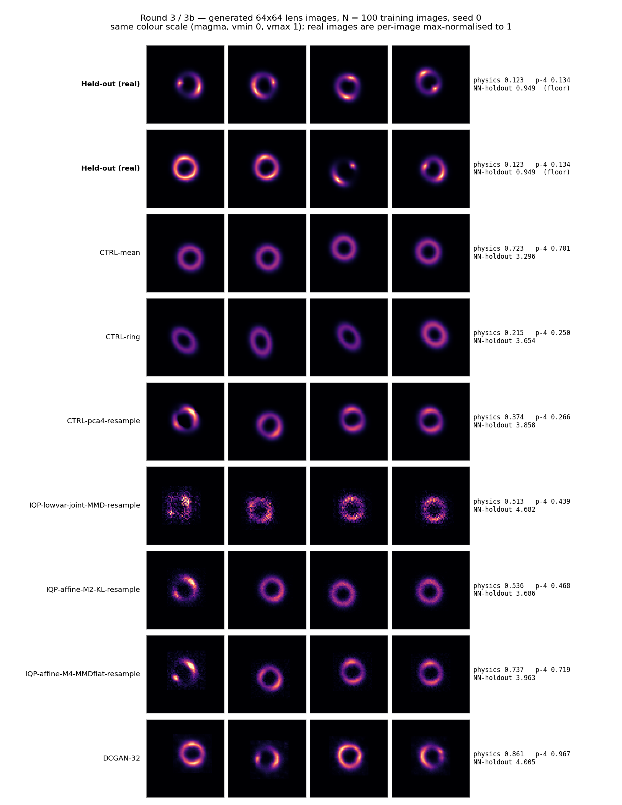
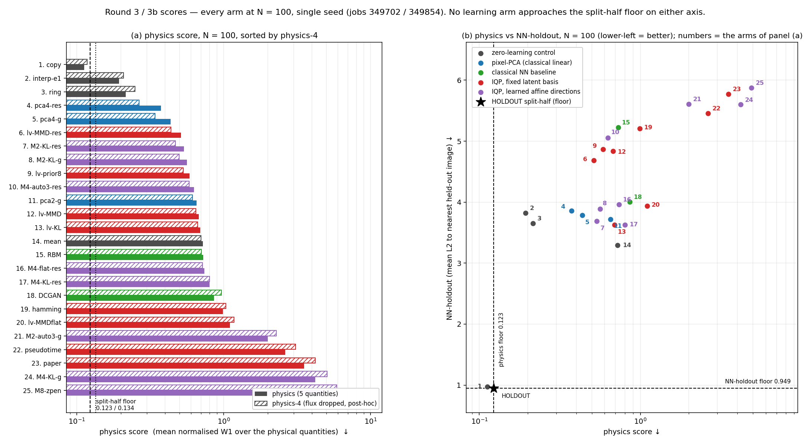

# IQP 生成模型於 DeepLense lens 影像 — round 3 與 round 3b 結果（學到的 latent 方向）

Round 3：job **349702**（`dev`，28 jobs，**fail=0**，2026-09-07 02:31:36 → 03:17:38，**46 min 02 s**，node `25a-hgpn006`）。
Round 3b：job **349854**（`dev`，22 jobs，**fail=0**，2026-09-07 03:05:03 → 03:08:22，**3 min 19 s**，node `25a-hgpn022`）。兩者皆 **單 seed（seed 0）**。
協定、25 個 arm 的定義、預測 **P10–P23** 與**兩套 decision rule** 全部寫在跑之前：`docs/IQP_LENS_ROUND3_PREREGISTRATION.md`（主體 ＋ pseudo-time / MMD-flat / latent-prior 三個 addendum ＋ scoring note ＋ Round 3b ＋ 3b amendment ＋ implementation notes）。
上一輪：`docs/IQP_LENS_ROUND2_RESULTS.md`（判定 failure；pmf 編碼修好的是亮度尺度不是空間結構）。程式與契約：`experiments/13_iqp_turbulence_replication/`。圖：`docs/figures/iqp_lens_round3.png`（生成影像）、`docs/figures/iqp_lens_round3_scores.png`（分數）。

**數字來源**：全部取自 `results_r3.jsonl` 與 `results_r3b.jsonl`，並與 `logs_lens/evaluate_r3.log` / `logs_lens/evaluate_r3b.log` 的表格逐格核對。
**兩份表為什麼可以合併**：3b 評分時 round 3 只完成 10/28，所以 3b 的表沒有 round-3 的 arm。兩次評分的 `HOLDOUT split-half` 參考列在 **26 個數值欄位上逐位相同**（physics 0.1229、NN-holdout 0.9489、MMD² 0.004006、PDF–JS 3.415e-05、NN-train 1.223/2.904 …），確認同一批 held-out、同一個指標實作，故本文合併呈現。
**唯一的 post-hoc 欄位是 `physics-4`**（見 §2 註），非 pre-registered，**不進 §4 的判定**。

## TL;DR

1. **Round 3 pre-registered 判定：failure。** 規則要求 N=100 下 IQP-lowvar-joint（MMD 或 KL）在 **NN-holdout 與 physics 兩項都贏 CTRL-mean**。physics 贏了（0.678 / 0.692 對 0.723），**NN-holdout 全滅**：4.839 / 3.625 對 CTRL-mean 的 **3.296**；把 P17 的 prior 變體也算進來仍然輸（resample 4.682、prior8 4.866）。第三個子條款（physics 在 CTRL-ring 的 1.2× 內＝≤ 0.258）最好也只到 **0.513**，2.4×。
2. **Round 3b pre-registered 判定：不算「有用」。** 規則要求同時贏 CTRL-pca4-resample 的 physics 與 held-out projection corr。physics **輸**：最好的 IQP-affine 是 M2-KL-resample **0.536** 對 pca4-resample **0.374**，差 0.162 大於 split-half 地板 0.123；projection corr 上 M4-MMDflat-resample **0.968** 小贏 pca4 的 0.952（+0.016，無地板可比）。**沒有任何單一 IQP arm 兩項都贏** → 依規則字面是 failure，實質讀法是「IQP-affine ≈ 相位空間裡的線性模型」。
3. **但這是本專案第一次讓 IQP 生成出「環」而且泛化。** 學到的方向（θ = θ⁰ + Φᵀz）讓 held-out projection corr 達 **0.91–0.97**，隨機方向對照只有 **0.67**、無 latent 也是 0.671（`mech_tests/mech_test2/diag2.json`）；0.968 已經等於「從 100 張訓練影像挑最近那張」的參考值 0.970。固定基底（round 3 全部 14 個 arm）做不到這件事，生成影像是雜訊斑塊（見圖 `iqp_lens_round3.png` 第 6 列）。
4. **硬體相容的 MMD-flat 泛化最好，論文的 auto3 kernel 最差。** M=4 下 projection corr：MMDflat **0.968** > KL 0.874 > auto3 0.794；MMD² 在 IQP arm 中也是 MMDflat 最低（0.086）並小勝其對照 pca4-resample 的 0.092，但仍輸給 DCGAN-32 的 0.037 與 RBM 的 0.075。論文原協定（sequential Algorithm 1）則直接崩：physics **3.520**，是所有非崩潰 arm 的 5–10 倍。
5. **零學習的五參數環模型贏過每一個學習模型的 physics**：CTRL-ring **0.215**，第二名是 pca4-resample 0.374，最好的 IQP 是 0.513。**CTRL-mean 則在 NN-holdout 上贏過所有生成 arm**（3.296）——這個資料集的影像 ≈ 平均環 ＋ 小變異，所以「輸給平均」不是弱，而是說明這個 benchmark 對生成模型不友善。
6. **一個設計缺陷貫穿全部結果**：所有 IQP、PCA、RBM 與 CTRL-mean 的生成影像總亮度被外部純量 S 鎖死（field = q × S，S = 訓練 crop 平均總亮度 124.92），所以它們的 **W1(flux) 在 N=100 全部剛好是 0.808 ≈ √(2/π)**（N=11 同樣是常數，值為 0.832）——那正是「零變異、但中心對」的理論值，不是擬合品質。它對 physics score 固定貢獻 **0.162**。去掉 flux 的 post-hoc `physics-4` **沒有改變排序結論**（ring 0.250 < pca4-res 0.266 < 最好 IQP 0.439）。

---

## 1. 設定摘要

**資料與表示**：`model_II.npz` 三類 pooled，seed-0 固定 split（訓練 N ∈ {11, 100}、held-out 200 張 val），每張 64×64 影像對強度質心對齊後裁出中心 **32×32**（保留 99.4% 的光），影像轉 pmf `p(kx,ky)`，`code = (kx<<5)|ky`，**10 qubits**、**全部 1,024 個 Z-string** 當 generator，exact simulation。生成 = 200 個 latent → exact q → 32×32 場 × S → 貼回全黑 64×64 框，offset 從訓練影像的 (dy,dx) 抽樣。**S = 124.92**（訓練 **crop** 平均總亮度；對應的 held-out **crop** 平均是 123.20，即 1.014 倍。注意 jsonl 的 `holdout_mean_total` = 123.87 是**全 64×64 框**的平均，含 crop 外那 ~0.6% 的光，與 S 不是同一個量）。

**Round 3 的 14 個 arm**（固定 latent 基底，1,024 參數，除非另註）：

| Arm | 變的是什麼 |
|---|---|
| IQP-lowvar-joint-MMD | primary：joint 協定（θ_core 共用 ＋ 每張影像 θ_lat 同時訓練）、d_lat=50 低階變異 latent、auto3 kernel MMD |
| IQP-lowvar-joint-KL / -MMDflat | 目標函數 → exact KL / flat Walsh 權重 MMD（硬體可估） |
| IQP-hamming-joint-MMD / IQP-lowvar-paper-MMD | latent 選法 → 論文 Hamming-first 50 / 協定 → 論文 sequential Algorithm 1 |
| IQP-lowvar-joint-MMD-prior8 / -resample | prior → rank-8 Gaussian / 非參數 resample＋jitter |
| IQP-lowvar-pseudotime-MMD | 以 e1 排序當 pseudo-time 的 Algorithm 1（conditional） |
| CTRL-copy / CTRL-mean / CTRL-ring | 零學習控制（ring = 平均徑向剖面被 flux/radius/e1/e2 bootstrap 拉伸） |
| CTRL-interp-e1 | 零學習 **conditional** 控制：對每張 held-out 影像的 e1，取 e1 最近的兩張訓練 crop 線性內插 |
| RBM-10bit (11,010) / DCGAN-32 (199,837) | 古典基線 |

**Round 3b 的 11 個 arm**（學到的仿射方向：θ_i = θ⁰ + Φᵀz_i，Φ ∈ R^{M×1024} 共用、z_i ∈ R^M 每張影像；參數量 = (1+M)×1024 + N×M）：

| Arm | M | 目標 | z 的 prior |
|---|---|---|---|
| IQP-affine-M2-KL-gauss / -resample | 2 | KL | full-cov Gaussian / resample |
| IQP-affine-M2-auto3-gauss | 2 | 論文 kernel | Gaussian |
| IQP-affine-M4-KL-gauss / -resample | 4 | KL | Gaussian / resample |
| IQP-affine-M4-MMDflat-resample | 4 | flat MMD | resample |
| IQP-affine-M4-auto3-resample | 4 | 論文 kernel | resample |
| IQP-affine-M8-KL-zpen-resample | 8 | KL ＋ z-penalty 0.3 | resample |
| CTRL-pca2-gauss / CTRL-pca4-gauss / CTRL-pca4-resample | – | – | 像素空間 PCA（古典線性對照） |

**指標**：每張影像由二階矩取 (dx, dy)、total flux、rms radius、e1、e2；每個量對 held-out 取 1-D Wasserstein-1 再除以 held-out 標準差；**physics = 五項平均**（offset 是 dx/dy 的平均）。另有 centred radial-profile RMSE、PDF–JS、Conv2D-MMD²、NN-train / NN-holdout（64×64 影像上），以及 3b 追加的 **held-out projection corr**（把 z 最佳化、其餘凍結，能重建 held-out crop 到多好）、**NN-within**（生成集自身的最近鄰距離＝多樣性）、**e1/e2 sd**。`HOLDOUT split-half` 給每個指標的地板。所有 arm 用同一組 held-out、同一份程式，可比。

---

## 2. 合併主表（round 3 ＋ round 3b）

`physics-4` = 去掉 flux 的四項平均（offset, radius, e1, e2）——**post-hoc、非 pre-registered**，理由見 §5(b)。`proj corr` 只有 3b 的 arm 有。粗體 = 該欄的最佳值。四列不參與評比：`HOLDOUT` 與 `CTRL-copy`（它們是資料本身），以及兩個 **conditional** arm `CTRL-interp-e1` 與 `IQP-lowvar-pseudotime-MMD`——它們生成時看得到每張 held-out 影像的 e1，與其餘無條件 arm 不可直接比（它們的分數仍照列，見表 C）。

### 表 A — N = 100

| Arm | params | physics ↓ | physics-4 ↓ | proj corr ↑ | e1 sd | PDF–JS ↓ | MMD² ↓ | NN-holdout ↓ | NN-ho (aligned) ↓ |
|---|---|---|---|---|---|---|---|---|---|
| HOLDOUT split-half (floor) | — | 0.123 | 0.134 | — | 0.1215 | 0.000034 | 0.0040 | 0.949 | 0.900 |
| CTRL-copy | 0 | 0.112 | 0.118 | — | — | 0.000038 | 0.0026 | 0.975 | 0.901 |
| CTRL-interp-e1 | 0 | 0.193 | 0.208 | — | — | 0.00037 | 0.0202 | 3.821 | 3.733 |
| CTRL-ring | 0 | **0.215** | **0.250** | — | — | 0.0063 | 0.0693 | 3.654 | 3.467 |
| CTRL-mean | 0 | 0.723 | 0.701 | (0.779 ref) | — | 0.0147 | 0.197 | **3.296** | **3.161** |
| CTRL-pca2-gauss | 3,272 | 0.652 | 0.613 | 0.894 | 0.016 | 0.0041 | 0.134 | 3.720 | 3.630 |
| CTRL-pca4-gauss | 5,520 | 0.435 | 0.342 | 0.952 | 0.102 | 0.0020 | 0.112 | 3.785 | 3.712 |
| CTRL-pca4-resample | 5,520 | 0.374 | 0.266 | 0.952 | **0.121** | 0.0011 | 0.0923 | 3.858 | 3.684 |
| RBM-10bit | 11,010 | 0.727 | 0.707 | — | — | 0.0020 | 0.0752 | 5.225 | 5.236 |
| DCGAN-32 | 199,837 | 0.861 | 0.967 | — | — | 0.0076 | **0.0371** | 4.005 | 3.768 |
| IQP-lowvar-joint-MMD | 1,024 | 0.678 | 0.645 | — | — | 0.0010 | 0.111 | 4.839 | 4.797 |
| IQP-lowvar-joint-KL | 1,024 | 0.692 | 0.664 | — | — | 0.0067 | 0.154 | 3.625 | 3.524 |
| IQP-lowvar-joint-MMDflat | 1,024 | 1.101 | 1.174 | — | — | 0.0037 | 0.108 | 3.938 | 3.870 |
| IQP-hamming-joint-MMD | 1,024 | 0.991 | 1.037 | — | — | 0.0014 | 0.130 | 5.205 | 5.158 |
| IQP-lowvar-paper-MMD | 1,024 | 3.520 | 4.199 | — | — | 0.0070 | 0.214 | 5.772 | 6.082 |
| IQP-lowvar-joint-MMD-prior8 | 1,024 | 0.587 | 0.531 | — | — | **0.00065** | 0.109 | 4.866 | 4.854 |
| IQP-lowvar-joint-MMD-resample | 1,024 | 0.513 | 0.439 | — | — | 0.00099 | 0.104 | 4.682 | 4.614 |
| IQP-lowvar-pseudotime-MMD | 1,024 | 2.627 | 3.081 | — | — | 0.0054 | 0.164 | 5.457 | 5.576 |
| IQP-affine-M2-KL-gauss | 3,272 | 0.561 | 0.499 | 0.914 | 0.032 | 0.0031 | 0.137 | 3.891 | 3.813 |
| IQP-affine-M2-KL-resample | 3,272 | 0.536 | 0.468 | 0.914 | 0.031 | 0.0030 | 0.136 | 3.686 | 3.611 |
| IQP-affine-M2-auto3-gauss | 3,272 | 1.992 | 2.288 | 0.744 | 0.064 | 0.0033 | 0.164 | 5.607 | 5.694 |
| IQP-affine-M4-KL-gauss | 5,520 | 4.201 | 5.050 | 0.874 | 0.021 | 0.0095 | 0.202 | 5.600 | 5.969 |
| IQP-affine-M4-KL-resample | 5,520 | 0.803 | 0.801 | 0.874 | 0.030 | 0.0054 | 0.162 | 3.626 | 3.456 |
| IQP-affine-M4-MMDflat-resample | 5,520 | 0.737 | 0.719 | **0.968** | 0.111 | 0.0024 | 0.0861 | 3.963 | 3.799 |
| IQP-affine-M4-auto3-resample | 5,520 | 0.628 | 0.583 | 0.794 | 0.103 | 0.00092 | 0.119 | 5.057 | 4.947 |
| IQP-affine-M8-KL-zpen-resample | 10,016 | 4.880 | 5.898 | 0.636 | 0.018 | 0.0103 | 0.244 | 5.875 | 6.353 |

參考值（3b 專用，N=100）：`mean crop` 的 projection corr = **0.779**；`nearest training image` 的 corr = **0.970**（記憶上限）。held-out 自身：NN-within 0.949、e1 sd 0.1215、e2 sd 0.1548。

### 表 B — N = 11

| Arm | physics ↓ | physics-4 ↓ | proj corr ↑ | e1 sd | PDF–JS ↓ | MMD² ↓ | NN-holdout ↓ | NN-ho (aligned) ↓ |
|---|---|---|---|---|---|---|---|---|
| HOLDOUT split-half (floor) | 0.123 | 0.134 | — | 0.1215 | 0.000034 | 0.0040 | 0.949 | 0.900 |
| CTRL-copy | 0.375 | 0.353 | — | — | 0.00038 | 0.0416 | 0.846 | 0.879 |
| CTRL-interp-e1 | 0.282 | 0.252 | — | — | 0.00072 | 0.0484 | 3.563 | 3.732 |
| CTRL-ring | **0.338** | 0.331 | — | — | 0.0086 | 0.153 | 3.563 | 3.597 |
| CTRL-mean | 0.728 | 0.702 | (0.765 ref) | — | 0.0106 | 0.287 | **3.174** | **3.195** |
| CTRL-pca2-gauss | 0.469 | 0.378 | 0.867 | 0.041 | 0.0025 | 0.189 | 3.731 | 3.927 |
| CTRL-pca4-gauss | 0.428 | **0.328** | **0.929** | 0.090 | 0.0011 | 0.128 | 3.844 | 4.112 |
| CTRL-pca4-resample | 0.484 | 0.398 | **0.929** | **0.104** | **0.00062** | 0.120 | 3.827 | 4.038 |
| RBM-10bit | 2.182 | 2.520 | — | — | 0.0063 | **0.0741** | 6.808 | 7.367 |
| DCGAN-32 | 1.351 | 1.498 | — | — | 0.0018 | 0.216 | 4.251 | 4.199 |
| IQP-lowvar-joint-MMD | 0.813 | 0.808 | — | — | 0.00097 | 0.144 | 4.878 | 5.288 |
| IQP-lowvar-joint-KL | 0.893 | 0.908 | — | — | 0.0055 | 0.259 | 3.554 | 3.769 |
| IQP-lowvar-joint-MMDflat | 1.269 | 1.378 | — | — | 0.0032 | 0.159 | 4.057 | 4.357 |
| IQP-hamming-joint-MMD | 0.927 | 0.951 | — | — | 0.0014 | 0.152 | 4.959 | 5.357 |
| IQP-lowvar-paper-MMD | 2.565 | 2.998 | — | — | 0.0061 | 0.203 | 4.931 | 5.523 |
| IQP-lowvar-joint-MMD-prior8 | 0.779 | 0.765 | — | — | 0.0010 | 0.146 | 4.857 | 5.268 |
| IQP-lowvar-joint-MMD-resample | 0.693 | 0.658 | — | — | 0.0013 | 0.142 | 4.567 | 4.918 |
| IQP-lowvar-pseudotime-MMD | 2.367 | 2.750 | — | — | 0.0051 | 0.157 | 4.815 | 5.264 |
| IQP-affine-M2-KL-gauss | 0.971 | 1.005 | 0.868 | 0.058 | 0.0023 | 0.160 | 4.087 | 4.322 |
| IQP-affine-M2-KL-resample | 0.557 | 0.488 | 0.868 | 0.056 | 0.0017 | 0.167 | 3.664 | 3.788 |
| IQP-affine-M2-auto3-gauss | 1.077 | 1.138 | 0.764 | 0.084 | 0.0016 | 0.143 | 4.697 | 5.075 |
| IQP-affine-M4-KL-gauss | 4.474 | 5.384 | 0.871 | 0.026 | 0.0108 | 0.221 | 5.384 | 6.139 |
| IQP-affine-M4-KL-resample | 0.578 | 0.515 | 0.871 | 0.053 | 0.0018 | 0.163 | 3.735 | 3.916 |
| IQP-affine-M4-MMDflat-resample | 0.752 | 0.732 | 0.909 | 0.093 | 0.0020 | 0.113 | 3.915 | 4.151 |
| IQP-affine-M4-auto3-resample | 0.469 | 0.378 | 0.787 | 0.099 | 0.00095 | 0.117 | 4.451 | 4.770 |
| IQP-affine-M8-KL-zpen-resample | 3.287 | 3.900 | 0.889 | 0.034 | 0.0089 | 0.195 | 4.830 | 5.374 |

N=11 的參考值：mean crop proj corr 0.765、nearest training image 0.892。**proj corr 只取決於學到的子空間、與 prior 無關**，所以 `-gauss` / `-resample` 成對的 arm 這一欄數值完全相同（pca4 兩列 0.952 / 0.929、M2-KL 兩列 0.914 / 0.868、M4-KL 兩列 0.874 / 0.871），並列時兩列都加粗。注意 **N=11 時 CTRL-copy 的 physics 是 0.375（大於地板 0.123）**——11 張影像本身就不足以代表 held-out 的分布，這是 N=11 這一欄整體的解析度上限。

### 表 C — 配對指標（conditional arm，200 對）

| Arm | N | \|Δe1\| ↓ | \|Δe2\| ↓ | \|Δflux\| ↓ | \|Δradius\| ↓ | paired L2 ↓ |
|---|---|---|---|---|---|---|
| CTRL-interp-e1 | 100 | **0.00059** | 0.158 | 23.35 | **0.149** | **3.941** |
| IQP-lowvar-pseudotime-MMD | 100 | 0.0724 | 0.137 | 22.49 | 1.883 | 5.869 |
| RANDOM-PAIRING (ref, from IQP-lowvar-joint-MMD) | 100 | 0.126 | 0.164 | 22.49 | 0.412 | 5.440 |
| CTRL-interp-e1 | 11 | **0.0038** | 0.170 | 27.47 | **0.152** | **4.031** |
| IQP-lowvar-pseudotime-MMD | 11 | 0.0513 | 0.135 | 22.94 | 1.667 | 5.278 |
| RANDOM-PAIRING (ref) | 11 | 0.124 | 0.163 | 22.94 | 0.481 | 5.504 |

註：`results_r3b.jsonl` 也寫了一列 RANDOM-PAIRING，但它是用 **IQP-affine-M4-KL-gauss** 的樣本配對出來的（`protocol` 欄可查），與 round 3 那列不是同一個參考集（\|Δradius\| 3.137 vs 0.412），**不可混用**；本表只用 round 3 的那列。

---

## 3. 分數圖

左圖每個 arm 的編號對應右圖的點。兩條地板線（physics 0.123 / NN-holdout 0.949）之外**沒有任何學習 arm 落在左下角**；最靠近地板的兩個點是 CTRL-copy（1）與 HOLDOUT 本身。

## 4. Decision rule 與 P10–P23 逐條

### 4.1 Round 3 decision rule（跑前寫定）

> N = 100：**success** = IQP-lowvar-joint（MMD 或 KL）在 NN-holdout **與** physics 都贏 CTRL-mean，**且** physics 在 CTRL-ring 的 1.2× 內。**Weak success** = 只贏 CTRL-mean。**Failure** 其他。

| 子條款 | 門檻 | IQP-lowvar-joint-MMD | IQP-lowvar-joint-KL | 判定 |
|---|---|---|---|---|
| physics 贏 CTRL-mean | < 0.723 | 0.678 ✓ | 0.692 ✓ | 通過 |
| NN-holdout 贏 CTRL-mean | < 3.296 | 4.839 ✗ | 3.625 ✗ | **不通過** |
| physics ≤ 1.2 × CTRL-ring | ≤ 0.258 | 0.678 ✗ | 0.692 ✗ | **不通過** |

**判定：failure。** 連 weak success 都不成立（weak success 要求「贏 CTRL-mean」＝兩項都贏）。把 P17 的 prior 變體也納入寬鬆檢查仍不變：resample NN-holdout 4.682、prior8 4.866，都輸 3.296。

### 4.2 Round 3b decision rule（跑前寫定）

> 「IQP 是這份資料上真正有用的生成器」要求在 **physics 與 held-out projection corr 兩項都贏 CTRL-pca4-resample，且差距大於 split-half 地板**；打平＝「IQP = 線性模型」；輸＝failure。

| 指標 | 最好的 IQP-affine | CTRL-pca4-resample | Δ | 地板 | 讀法 |
|---|---|---|---|---|---|
| physics | 0.536（M2-KL-res） | **0.374** | +0.162（差） | 0.123 | IQP **輸**，且超過地板 |
| physics-4（post-hoc） | 0.468（M2-KL-res） | **0.266** | +0.202（差） | 0.134 | IQP 輸 |
| proj corr | **0.968**（M4-flat-res） | 0.952 | +0.016（好） | 無地板 | 小贏，不可稱顯著 |
| MMD² | **0.0861**（M4-flat-res） | 0.0923 | −0.006（好） | 0.0040 | 小贏，勉強超地板 |
| NN-holdout | **3.686**（M2-KL-res） | 3.858 | −0.172（好） | 0.949 | 遠小於地板＝打平 |

**判定：不算「有用」。** physics 這一必要條款輸掉且差距超過地板，依規則字面是 failure；且**沒有任何單一 arm 同時是 physics 最好與 proj corr 最好的那個**（M2-KL-res 的 proj corr 只有 0.914；M4-flat-res 的 physics 是 0.737）。實質讀法：**IQP-affine 表現得像相位空間裡的一個線性模型**——這正是 P20 後半段預測的形狀。

### 4.3 P10–P23 評分

| # | 預測（摘要） | 結果 | 數字（N = 100 除非另註） |
|---|---|---|---|
| P10 | lowvar-joint-MMD 在 NN-holdout 與 physics 都贏 CTRL-mean | ◐ | physics 0.678 < 0.723 ✓；NN-holdout 4.839 > 3.296 ✗ |
| P11 | KL 在 physics 上「至少不輸」MMD | ◐ | 0.692 vs 0.678（差 0.014 < 地板 0.123）；N=11 0.893 vs 0.813（差 0.080 < 地板）→ 兩處都是打平，既未證實也未推翻。但 NN-holdout 上 KL 大勝（3.625 vs 4.839） |
| P12 | Hamming latent 在 physics 上明顯較差 | ✓ | 0.991 vs 0.678，差 0.313 > 地板；N=11 0.927 vs 0.813 僅差 0.114 ≈ 地板（◐） |
| P13 | 零學習的 CTRL-ring 在 physics 上贏過每一個 IQP arm | ✓ | ring 0.215 vs 最好 IQP 0.513；N=11 0.338 vs 0.469。**兩個 N 全部成立** |
| P14 | 沒有 IQP arm 在 NN-holdout 贏 DCGAN-32 | ✗ | **六個贏**：lv-KL 3.625、M4-KL-res 3.626、M2-KL-res 3.686、M2-KL-g 3.891、lv-MMDflat 3.938、M4-flat-res 3.963 < DCGAN 4.005（但 DCGAN 在 N=100 上是被餓死的基線，這個推翻不強） |
| P15 | pseudo-time 追 e1 優於 random pairing；CTRL-interp-e1 更好；其他量沒有更好 | ✓ | \|Δe1\| 0.0724 vs 0.126（約一半）✓；interp-e1 0.00059 ✓；\|Δradius\| 1.883 vs random 0.412（**差 4.6 倍**）、paired L2 5.869 vs 5.440、physics 2.627 vs 無條件 0.678 ✓ |
| P16 | MMDflat 介於 auto3 與 KL 之間 | ✗ | 固定基底：MMDflat **1.101** 比 MMD 0.678 與 KL 0.692 都差，不在中間。但 MMDflat 的 MMD² 最低（0.108 vs 0.111/0.154），且在 affine 家族中 proj corr 最高——kernel 影響的是像素級擬合，不是 physics |
| P17 | prior8 與 resample 都贏 rank-50 Gaussian 的 NN-holdout；resample 最接近 CTRL-copy 且 physics 為 IQP 最佳 | ◐ | prior8 4.866 vs 基線 4.839＝**沒贏**；resample 4.682 只好 0.157（< 地板 0.949）；但 resample physics **0.513 確實是所有 IQP arm（round 3＋3b）最佳** ✓ |
| P18 | M=4 的 proj corr ≥ 0.90、高於 CTRL-mean、與 pca4 差距 ≤ 0.05 | ◐ | 只有 MMDflat 成立（0.968 ≥ 0.90，vs mean 0.779，vs pca4 +0.016）；KL 0.874（< 0.90，離 pca4 −0.078）、auto3 0.794 都不成立 |
| P19 | resample prior 在 NN-holdout 與 ringiness 上贏 Gaussian prior（IQP 與 PCA 皆是） | ◐ | IQP 成立且在 M=4 上決定性：NN-holdout 3.626 vs 5.600、physics 0.803 vs 4.201；M=2 只差 0.205（地板內）。**PCA 不成立**：pca4 resample 3.858 vs gauss 3.785，方向相反（差 0.073，地板內） |
| P20 | M4-*-resample 首次在兩項都贏 CTRL-mean；但贏不過 pca4-resample 超過地板 | ✗ / ◐ | 前半 **✗**：M4-KL-res（0.803 / 3.626）、M4-flat-res（0.737 / 3.963）、M4-auto3-res（0.628 / 5.057）沒有一個兩項都贏 CTRL-mean（0.723 / 3.296）。後半 ◐：MMD² 上 M4-flat-res 以 0.006 > 地板 0.004 小勝 pca4-res |
| P21 | auto3 在 proj corr 上輸 KL 與 MMD-flat | ✓ | M=4：auto3 0.794 < KL 0.874 < flat 0.968；M=2：auto3 0.744 < KL 0.914 |
| P22 | M2 的 ringiness 與 physics 在 IQP 中最好，但多樣性最低 | ◐ | physics：M2-KL-res 0.536 為 affine 家族最佳 ✓；W1(radius) 0.570 為所有 IQP arm 最低 ✓；但「多樣性最低」不專屬 M2——e1 sd M2-KL-res 0.031 vs M4-KL-res 0.030（都只有真值 0.1215 的 25%），NN-within 1.486 vs 1.404 |
| P23 | z-penalty 無法把 M=8 的 projection 抬過 M=4 | ✓ | M8-zpen proj corr **0.636** < M4-KL 0.874 < M4-flat 0.968，且 physics 4.880 是全表最差。N=11 是唯一例外（0.889 略高於 M4 的 0.871），但該 arm 的 physics 仍是 3.287（崩） |

計分：✓ 5（P12、P13、P15、P21、P23）、◐ 6（P10、P11、P17、P18、P19、P22）、✗ 3（P14、P16、P20 前半）。

---

## 5. 解讀

### (a) 為什麼「學方向」有效、固定基底無效

三個跑前做完的機制測試（`mech_tests/`，結論已寫進 pre-reg）給出因果鏈：

1. **表達力不是瓶頸**：單張 aligned crop 被 1,024 相位的 10-qubit IQP 幾乎精確重建——corr **KL 0.9999 / MMD-flat 1.0000 / auto3 0.9962**（`mech_test/results.json` 的 `a/fits`）。所以固定基底 arm 的雜訊影像不是「電路畫不出環」。
2. **固定基底的插值會塌**：沿論文的 Hamming latent（或 ancilla 混合角）在兩張影像之間走，中途 `max(corrA, corrB)` 掉到 **0.233**、ringiness 掉到 0.353（`results.json` 的 `b/verdict`），而像素 cross-fade 的對照在每個 t 上 corr 都是 1.0。也就是說 latent 空間裡兩個「好點」之間全是壞點——這正是為什麼從 prior 抽樣的固定基底樣本是斑塊（圖第 6 列）。ancilla 邊際被驗證為**恰好等權重**的兩個 hologram 非相干混合（每支 mass 0.500000000000，殘差 ≤ 2.6e-18，`mech_tests/mech_test/branch_check.py` 重跑確認），所以沒有「混合角」可調，ancilla 加不了東西。
3. **學方向就不塌，而且泛化**：θ = θ⁰ + Φᵀz 訓練 20 張 crop 後，held-out crop 的 projection corr **0.911**（M=4）；換成**隨機 Φ 是 0.672、完全沒有 latent 是 0.671**（`mech_test2/diag2.json`）。增益全部來自「學到的方向」而不是「多了自由度」。正式跑（N=100）把這個數字推到 **0.968**（MMD-flat），等於「從 100 張訓練影像挑最近那張」的 0.970。

生成品質的分水嶺在 `‖z‖` 對上電路的**相干半徑**：M=2 的 ‖z‖ = 0.015 時 **100%** 的樣本是環（半徑 9.40 ± 0.21，真值 9.24 ± 0.13），M=4 的 ‖z‖ = 0.020（KL）/ 0.029（auto3）時是 84% / 96%；M=6 的 ‖z‖ 衝到 0.087，環的比例掉到 **0**、半徑跑到 12.84（`mech_test2/diag3.json`；真值半徑 9.24 ± 0.13 取自 `mech_test2/diag4.json` 的 `real.holdout_radius`）。M=8 加 z-penalty 也救不回來（P23）。

### (b) 為什麼還是輸給 PCA / ring / mean

四個獨立原因，按貢獻排序：

1. **flux 被鎖死（設計缺陷）**：所有 IQP、PCA、RBM 與 CTRL-mean 的生成影像總亮度都是同一個外部純量 S。生成 flux 是 delta 分布，於是 **W1(flux)/sd 在 N=100 剛好 = 0.808 ≈ √(2/π) = 0.798**（N=11 是 0.832，因為 S 只由 11 張訓練影像估計、略偏離 held-out 平均）——那是「零變異但中心對」的理論值，不是擬合品質（arm 列用來正規化的 held-out flux sd = 27.69；random pairing 的 \|Δflux\| 22.49 / 27.69 = 0.812，同一件事的另一個量測。`HOLDOUT split-half` 那列用它自己的半分裂 sd 27.50，所以兩列的正規化基準本來就略有不同）。它對 N=100 的 physics 固定貢獻 0.162，對每個受影響的 arm 一樣多，所以**不影響它們之間的排序**，但讓整張表的絕對值虛高。`physics-4` 就是把這欄拿掉重算，結論不變（ring 0.250 < pca4-res 0.266 < 最好 IQP 0.439）。
2. **radius 偏差**：IQP arm 的 W1(radius) 是 0.570（M2-KL-res，最好）到 21.9（M8）；pca4-resample 是 0.698、ring 是 0.578。一旦 z 稍微離開訓練點，環半徑就漂——這是相位參數化的非線性後果，PCA 在像素空間沒有這個問題。
3. **橢圓度散布不足**：held-out e1 sd = 0.1215。KL 系列的 IQP arm 只有 **0.021–0.032**（真值的 17–26%），也就是生成的環幾乎都是同一個形狀；只有 MMD-flat（0.111）與 auto3（0.103）接近真值，而 pca4-resample 是 **0.121**，剛好在靶心。目標函數在「擬合得準」與「散得開」之間有明確 trade-off：KL 準但塌，flat/auto3 散但半徑漂。
4. **線性模型的 cross-fade 本質對這份資料剛好夠用**：這批 lens 影像 ≈ 一個平均環 ＋ 小幅度的 (radius, e1, e2, 弧亮度) 變化。CTRL-mean 光靠「都輸出平均環」就拿到全表最好的 NN-holdout（3.296）；四個像素主成分就把 projection corr 撐到 0.952。要贏過它，需要的是模型能生成**平均之外的結構**，而不是更好的擬合。

### (c) MMD-flat vs KL vs auto3

三個目標函數在**不同的指標上**各自最好，沒有一個全面勝出：

| | proj corr | MMD² | e1 sd（真 0.1215） | physics |
|---|---|---|---|---|
| KL（exact，只能模擬） | 0.874 | 0.162 | 0.030 | 0.803 |
| MMD-flat（**硬體可估**） | **0.968** | **0.086** | **0.111** | 0.737 |
| auto3（論文 kernel） | 0.794 | 0.119 | 0.103 | **0.628** |

（M=4、resample prior、N=100。）結論對硬體路線是正面的：**需要 exact q(x) 的 KL 不是必要的**——flat-weight MMD 只用可抽樣估計的 ⟨Z_s⟩ 就在泛化與影像級距離上全面優於 KL。反過來，論文自己的 auto3 kernel 在 projection 上最差（P21 ✓），且在 sequential 協定下整個崩掉（physics 3.520）。

### (d) prior：resample vs gauss、以及 M 的上限

resample（bootstrap 訓練 z ＋ 0.2× 中位最近鄰間距的 jitter）對 IQP 是**決定性的**：M=4 KL 從 gauss 的 physics 4.201 / NN-holdout 5.600 變成 0.803 / 3.626。原因與 round 2 的診斷一致——高維 Gaussian 在少量 anchor 上擬合出來的質量幾乎全落在沒有任何真 latent 的區域，而 IQP 的相位空間離開訓練點就塌（§5a）。對 PCA 則幾乎沒差（3.858 vs 3.785，地板內），因為線性模型在 anchor 之間是安全的。**M 的上限是相干半徑，不是參數量**：M=2 生成最好、M=4 投影最好、M=8 兩者皆崩，加正則沒用。

### (e) 這對「IQP 生成模型」主張的意義

**可以主張**：在 10 qubits、1,024 個相位、把每個閘角寫成小 latent 的仿射函數之後，IQP circuit 能學到一個**能覆蓋未見影像的子空間**（held-out projection corr 0.968，隨機方向對照 0.67），並從該子空間的非參數 prior 抽樣生成**可辨識的透鏡環**（圖第 7、8 列）——這是本專案三輪以來第一次。其品質與一個**同參數量的古典像素 PCA** 同級（NN-holdout 打平、MMD²/proj corr 小勝、physics 明顯輸）。
**不可以主張**：優於古典基線、量子效用、或「IQP 是這份資料的好生成器」。兩套 pre-registered decision rule 一套 failure、一套「不算有用」；零學習的五參數 ring 模型與純粹輸出平均影像的控制分別在 physics 與 NN-holdout 上贏過所有學習模型。

---

## 6. 限制（誠實揭露）

1. **單 seed（seed 0）**，兩個 job 都沒有重複。所有「小於地板就當打平」的判讀依賴 split-half 地板，而地板本身也是單次估計。
2. **flux 不是模型產生的**：field = q × S，S 是訓練集平均總亮度。這讓每個受影響 arm 的 physics 固定虛高 0.162，也讓 MMD²/NN 這類吃總能量的指標失去對亮度的鑑別力（round 2 已記錄同一個 confound）。
3. **沒有分類器指標**：本輪完全不測「生成影像能不能騙過 substructure classifier」，所以「plausible」只在矩與影像距離的意義下成立。
4. **N = 100 是資料上限測試**，不是模型上限測試：N=11 那一欄連 CTRL-copy 的 physics 都是 0.375（地板 0.123），代表小 N 欄位的解析度本來就低；N=100 也只有 100 張，DCGAN 在這裡是被餓死的基線，P14 的推翻因此不強。
5. **proj corr 沒有 split-half 地板**（held-out 對自己做 projection 沒有定義），所以 3b decision rule 的「差距大於地板」在這一欄無法機械執行，本文改用 mean-crop（0.779）與 nearest-training（0.970）兩個參考值夾住它。
6. **physics-4 是 post-hoc**（只用來確認 flux 缺陷沒有改變排序，不進判定）；**兩份 RANDOM-PAIRING 參考列不同源**（round 3 用 lowvar-joint-MMD、3b 用 affine-M4-KL-gauss），表 C 只採用 round 3 那列。

---

## 7. 下一步（三條）

1. **把 flux 放回模型內**：讓每個 arm 從訓練集的 total-flux 分布抽樣（或把 log-flux 加進 z 的第一維），重評 physics。這條最便宜、影響最大——它會把 W1(flux) 從固定的 0.808 變成真正可比的量，並讓 physics 分數第一次可以跟 CTRL-ring 公平對照。
2. **細掃 resample ＋ MMD-flat 的 M = 2 / 3**：目前 M=2 physics 最好（0.536）、M=4 proj corr 最好（0.968），中間沒測。同時把 e1 dispersion 當作**選擇準則**（真值 0.1215），因為 KL 系列的 0.03 是目前最大的單一失分來源。加上 3 個 seed 以脫離單 seed。
3. **Round 4：CNN encoder ＋ IQP decoder**，但**必配一個相同 encoder 的古典 decoder**。本輪已經證明「學到的方向」是全部增益的來源，下一個自然問題是「方向由古典網路給、由量子電路解碼」是否比「同樣的方向 ＋ 古典線性解碼」好——不配對照就無法回答，這一輪的教訓（每個 IQP 結論都要有同參數量的古典線性對照）必須帶過去。

---

## 附錄

### A. Job 表

| Job | 名稱 | Partition | Node | 起 → 迄 | Elapsed | Jobs | Fail |
|---|---|---|---|---|---|---|---|
| 349702 | `iqp_lens_r3` | dev | 25a-hgpn006 | 2026-09-07 02:31:36 → 03:17:38 | 46 min 02 s | 28（14 arm × 2 N） | 0 |
| 349854 | `iqp_lens_r3b` | dev | 25a-hgpn022 | 2026-09-07 03:05:03 → 03:08:22 | 3 min 19 s | 22（11 arm × 2 N） | 0 |

### B. 檔案索引（皆在 `experiments/13_iqp_turbulence_replication/`）

| 用途 | 路徑 |
|---|---|
| 結果 / 表 / 提交 | `results_r3.jsonl`、`results_r3b.jsonl`、`logs_lens/evaluate_r3{,b}.log`、`submit_lens_r3{,b}.sbatch` |
| 訓練 | `train_iqp_r3.py`（固定基底）、`train_iqp_affine_r3.py`（學方向） |
| 控制 / 基線 / 評分 | `controls_r3.py`、`controls_pca_r3.py`、`baseline_rbm_r3.py`、`baseline_dcgan_r3.py`、`evaluate_r3.py`、`evaluate_r3b.py` |
| 資料 / 編碼 / 測試 | `data_lens_r3.py`（`load_r3`）、`codec10.py`、`latent_select_r3.py`、`test_r3.py`、`test_r3b.py` |
| 機制驗證 | `mech_tests/mech_test/{results,results2,results3}.json`、`mech_tests/mech_test2/diag{2,3,4}.json`、`mech_tests/diag_r2/run_diag.py` |
| 生成影像 / 圖 | `outputs_lens_r3{,b}/<tag>/generated_*.npy`（＋`crops/`）、`docs/figures/iqp_lens_round3{,_scores}.png`、`docs/figures/iqp_lens_mech_*.png` |
