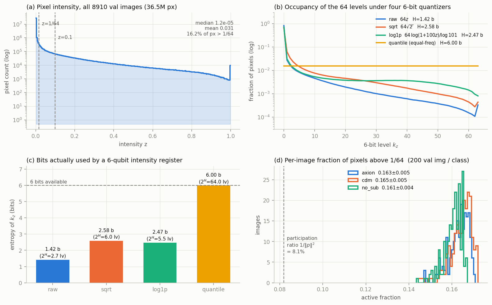
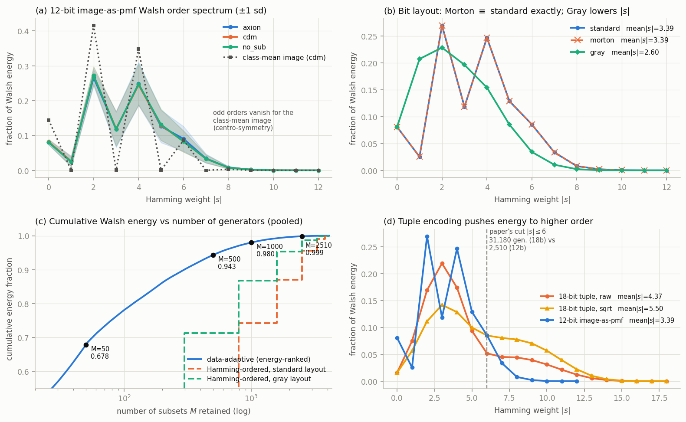
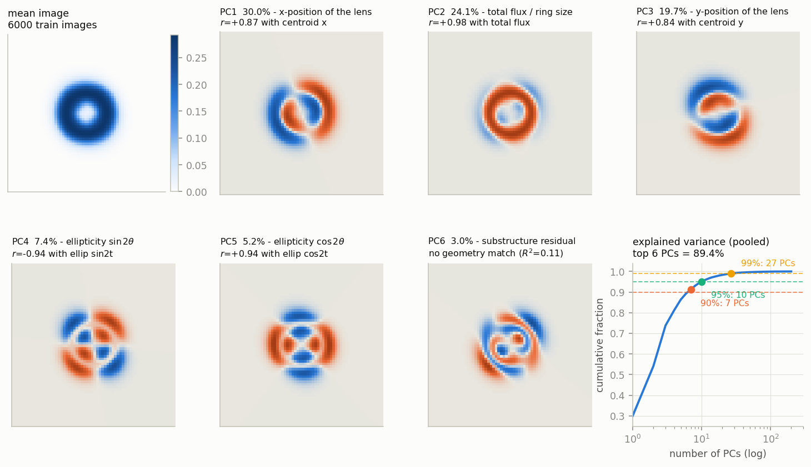
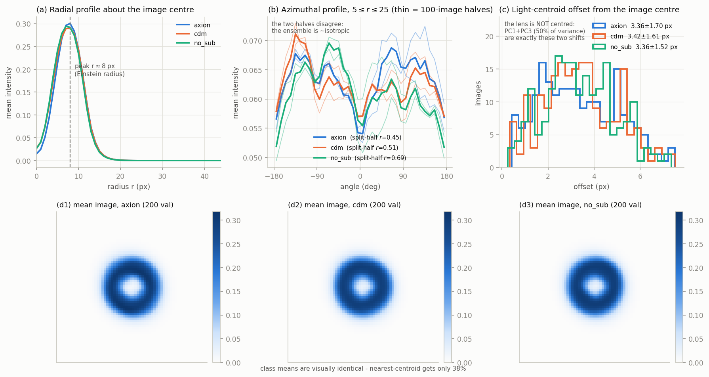

# DeepLense 透鏡影像特性量測 —— 給 IQP 生成模型 round 3 的電路設計依據

**日期**：2026-09-06
**資料**：`<HOME>/mae-lensing/model_II.npz`（train 80194、val 8910 張 64×64 float32 ∈[0,1]，class = axion / cdm / no_sub）
**腳本**：`experiments/13_iqp_turbulence_replication/analysis_lens/`（`lens_common.py`、`analyze_lens.py`、`analyze_bits.py`、`analyze_pc_semantics.py`、`analyze_latent_utility.py`、`analyze_latent_decisive.py`）
**數字**：全部來自實跑，落在 `analysis_lens/results*.json`。純 CPU、numpy，主分析 62 s。
**範圍**：只量測，未改動 round 2 的任何程式。

> 每一節結尾的「**含意**」就是對應的電路設計決定。最後一節是彙整的 round 3 建議。

---

## 0. 摘要 —— 六個會改變電路設計的結論

| # | 結論 | 關鍵數字 |
|---|------|---------|
| 1 | **18-bit (x,y,z) tuple 編碼是錯的成本結構**：它把能量推到高階，用 12 倍參數換到更差的覆蓋 | `|s|≤6`：18-bit 需 **31,180** generators 只涵蓋 **79.9%**；12-bit image-as-pmf 只需 **2,510** 就涵蓋 **95.6%** |
| 2 | **raw 6-bit 強度量化浪費 4.6 / 6 個 bit** | entropy **1.42 bits**（83.8% 的像素落在 level 0）；quantile 版 6.00 bits |
| 3 | **Morton/Z-order 版面在數學上不可能有幫助**；Gray 有幫助但只在 Hamming-ordered generator 下 | Morton 的 order-spectrum 與 standard **逐點相同**；Gray 使 mean\|s\| 3.39→**2.60** |
| 4 | **影像流形實質是 5 維**：x 位置、y 位置、flux/大小、兩個 ellipticity | 前 6 PC = **89.4%** 變異，各自 R²=0.83–0.98 對應一個物理量 |
| 5 | **latent 該用「低階 × 高方差」兩個條件一起選**，論文的 Hamming-first-50 不是最好的 | class acc（LDA）：論文 **48.8%** < 純方差排序 **57.2%** < **低階(\|s\|≤2)＋方差 66.8%**、\|s\|≤4 **71.7%** |
| 6 | **三類的一階統計幾乎相同**，class 訊號不在平滑幾何裡 | nearest-centroid 只有 **38.3%**；同樣 50 維但用 PCA rotation 可到 **79.3%（LDA）/ 85.7%（logistic）** |

---

## 1. 亮度層級 —— 強度該怎麼編碼

**先講一個決定性的資料事實**：每張影像都做過 **per-image min-max normalization**——8910 張 val 影像中，**每一張都恰好有 1 個像素 = 0、1 個像素 = 1**（8910 張全部實測，min=max=1，數字存於 `results_provenance.json`）。所以強度是「每張影像自己的相對尺度」，跨影像的絕對亮度沒有意義；per-image 總 flux = 125.7 ± 28.2（範圍 70.2–204.6，全部 8910 張）。

全部 36,495,360 個 val 像素的分布：

| 統計量 | 值 |
|---|---|
| mean / median | 0.0307 / 1.18e-05 |
| p90 / p99 / p99.9 | 0.0712 / 0.5917 / 0.9148 |
| 比例 > 1/64 | 16.25% |
| 比例 > 0.1 | 8.45% |

四種 6-bit 量化器（`kz = floor(64·f(z))`，clip 0..63）：

| 量化器 | entropy (bits) | 等效層級 2^H | 落在 level 0 的比例 |
|---|---|---|---|
| raw `64z` | **1.42** | 2.7 | **83.75%** |
| sqrt `64√z` | 2.58 | 6.0 | 66.07% |
| log1p `64·log(1+100z)/log101` | 2.47 | 5.5 | 71.25% |
| quantile（等頻） | **6.00** | 64.0 | 1.56% |

每張影像的活躍像素比例（極穩定，且三類幾乎相同）：

| class | >1/64 | >0.1 | 有效像素數 `1/‖p‖²` |
|---|---|---|---|
| axion | 0.1630 ± 0.0047（668 px） | 0.0848 ± 0.0128（348 px） | 331.1 ± 30.9 |
| cdm | 0.1645 ± 0.0050（674 px） | 0.0861 ± 0.0126（353 px） | 335.4 ± 31.2 |
| no_sub | 0.1607 ± 0.0042（658 px） | 0.0844 ± 0.0113（346 px） | 327.5 ± 28.0 |

**含意**：
- 一個 6-qubit 的強度暫存器在 raw 量化下**只承載 1.42 bits 的資訊**，其餘 4.6 bits 純粹是浪費的 Hilbert space。要用 tuple 編碼就必須換 quantile（6.00 bits）或至少 sqrt（2.58 bits）。
- 影像的**有效支撐只有 ~331 / 4096 個像素（8.1%）**，但**不是稀疏的**（每張只有 1 個嚴格為 0 的像素）。任何假設「像素多半為零」的稀疏化技巧都會失效；要用的是「能量集中」而不是「零值」。

---

## 2. 12-bit image-as-pmf 的 Walsh order-spectrum —— generator 要到幾階

把影像本身當機率分布（`code = (kx<<6)|ky`，`pmf = image/sum`），對 4096 維做 unnormalized FWHT，`P(s) = W[s]²`，依 `popcount(s)` 分組。

每張影像的能量比例（200 張/類，mean）：

| \|s\| | 0 | 1 | 2 | 3 | 4 | 5 | 6 | 7 | 8 | ≥9 |
|---|---|---|---|---|---|---|---|---|---|---|
| axion | .081 | .026 | **.266** | .118 | **.248** | .126 | .091 | .034 | .008 | .002 |
| cdm | .082 | .026 | **.272** | .120 | **.245** | .129 | .083 | .033 | .008 | .002 |
| no_sub | .080 | .024 | **.272** | .118 | **.248** | .131 | .083 | .034 | .008 | .002 |
| class-mean image (cdm) | .144 | .0001 | .416 | .0008 | .348 | .0007 | .086 | .0001 | .003 | ~0 |

Support mismatch（三類一致）：`|s|≤4` 之外還有 **25.6–26.1%** 的能量；`|s|≤6` 之外只剩 **4.3–4.4%**。mean\|s\| = 3.37–3.40。

**Data-adaptive support**（把 4096 個 subset 依平均能量排序後取前 M）：

| M | 50 | 100 | 200 | 500 | 1000 | 2510 | 4096 |
|---|---|---|---|---|---|---|---|
| pooled 累積能量 | **.678** | .781 | .862 | .943 | **.980** | .9986 | 1.0 |

對照：同樣 2,510 個 subset 但用 Hamming 順序（`|s|≤6`）只有 **.9555**；`|s|≤4`（794 個）為 **.7395**。

> 註：`|s|≤6` 在本報告出現兩個相近的值——**.9555**（本節：ensemble 平均能量的比值）與 **.9563**（§7/§8：每張影像各自算比例再平均）。兩者是不同但都合理的估計量（ratio-of-means vs mean-of-ratios），差 0.08 pp，不影響任何結論。以下凡引用 §7/§8 的表格時用 .9563，引用本節時用 .9555。

**含意**：
- 能量在 **\|s\|=2 與 \|s\|=4 有雙峰**，奇數階明顯較低；class-mean image 的奇數階直接消失到 1e-4 等級——這是**中心對稱**的簽名（平均影像是同心環）。單張影像的奇數階（\|s\|=3 為 .118、\|s\|=5 為 .126）才是「偏離中心」的部分，這與第 6 節的質心偏移一致。
- **generator 只需到 4 階就能拿到 74%，到 6 階拿到 95.6%**（.9555–.9563，見上註）；再往上是報酬遞減。
- **data-adaptive 完勝 Hamming 順序**：1,000 個 data-adaptive generators（98.0%）就打敗 2,510 個 Hamming generators（95.55%），省 2.5 倍參數。

---

## 3. 跨影像方差最大的 Walsh 係數 —— latent 50 個怎麼選（**本節結論與直覺相反**）

對每個 subset 算它的係數在影像間的方差 `Var_images(W[s])`，排序取前 50，對照論文的 Hamming-first 50（∅ + 12 singletons + 37 two-body）。

| 集合 | 涵蓋的跨影像方差 |
|---|---|
| data-adaptive top-50（pooled） | **48.4%** |
| 論文 Hamming-first 50 | **7.2%** |
| 比值 | **6.7×** |

（`Var(W[∅]) = 1.1e-32`：因為 pmf 恆歸一，`W[∅]≡1`。論文那 50 個裡有一個是**常數**，實質只有 49 個。）

pooled top-20（bit 命名：standard 版面下 bit 0–5 = ky，bit 6–11 = kx）：

| rank | subset | \|s\| | var 佔比 |
|---|---|---|---|
| 1–4 | y3+y4+x3+x4+x5、y3+y5+x3+x4+x5、y3+y4+y5+x3+x4、y3+y4+y5+x3+x5 | 5 | .0198–.0195 |
| 5–8 | y3+y4+x3、y3+y5+x3、y3+x3+x4、y3+x3+x5 | 3 | .0191–.0184 |
| 12 | y3 | 1 | .0135 |
| 13–16 | y5+x5、y5+x4、y4+x5、y4+x4 | 2 | .0131–.0124 |

**top-20 裡沒有任何一個用到 bit 0/1/2（座標的細位元）。** 逐 bit 的方差質量：

| bit | y0 | y1 | y2 | y3 | y4 | y5 | x0 | x1 | x2 | x3 | x4 | x5 |
|---|---|---|---|---|---|---|---|---|---|---|---|---|
| 含該 bit 的 subset 方差佔比 | .039 | .128 | .321 | **.588** | .502 | .501 | .039 | .132 | .312 | **.584** | .501 | .501 |

只用 6 個粗位元 {y3,y4,y5,x3,x4,x5} 張出的 **64 個 subset** 就佔 **43.3% 的方差、61.2% 的能量**；只用 6 個細位元的 64 個 subset 只佔 **0.67% 的方差**。三類的 top-50 互相重疊 44–50 / 50（axion-cdm 48、axion-no_sub 44、cdm-no_sub 46，見 `results_provenance.json`）→ **latent 基底與 class 無關**。

### 3.1 但是：光看方差會選錯 —— 決定性測試

把候選的 50 個係數拿去做兩件事：**(a) 還原 5 個物理量**（closed-form ridge），**(b) 預測 class**。訓練 3000 張 train、測試 600 張 val。

> **方法學註記（重要）**：第一版用的是自寫的固定步長 gradient-descent logistic probe，事後用獨立的 closed-form 分類器複驗，發現它在高方差特徵集上**嚴重未收斂**（把一個 LDA 可達 57% 的特徵集報成 33.5% 的亂猜水準）。下表全部改用三個獨立分類器重算：**regularised LDA**、**ridge-to-one-hot**、**Newton/IRLS logistic**（附最終梯度範數以佐證收斂）。以 LDA 為主要比較欄（它是唯一在所有特徵集上都穩定收斂的）。舊的 GD 數字已作廢。

| 50 維 latent（選法） | class acc (LDA) | ridge | logistic | 還原物理量 R² |
|---|---|---|---|---|
| 高階限定 top-50（\|s\|≥5，依方差） | .405 | .403 | .410 | — |
| **論文 Hamming-first-50**（∅+12 singletons+37 pairs） | **.488** | .495 | .480 | **.981** |
| data-adaptive top-50（**不限階**，依方差） | .572 | .562 | .462 | .974 |
| **低階 \|s\|≤2 ＋ 方差排序 top-50** | **.668** | .662 | .672 | **.993** |
| **低階 \|s\|≤4 ＋ 方差排序 top-50** | **.717** | — | — | .991 |
| 50 維 PCA rotation（非 axis-aligned，對照） | .793 | .665 | .857 | — |
| 全部 4096 個係數（對照，非上界） | .730 | .713 | 未收斂 | — |
| chance | .333 | | | |

600 張 val 的 binomial SE ≈ 2.0 pp，**差距小於約 4 pp 視為噪音**。

階數上限 K 的掃描（top-50 by variance，限制 `|s|≤K`）：

| K | 1 | 2 | 3 | 4 | 6 | 12（不限） |
|---|---|---|---|---|---|---|
| class acc (LDA) | .313 | **.668** | .545 | **.717** | .572 | .572 |
| 物理量 R² | .391 | **.993** | .986 | .991 | .974 | .974 |

（K=1 只有 13 個 subset 可選，所以塌掉；K=2 與 K=4 之間非單調，差距 4.9 pp 剛好在噪音邊緣，**不宜宣稱某個 K 最佳**，只能說 K∈{2,3,4} 這個區間明顯優於不限階與論文的固定選法。）

**為什麼低階有原則性依據（這是恆等式，不是巧合）**：對 image-as-pmf，單體係數滿足 `W[e_b] = 1 − 2·P(bit_b = 1)`，所以
- **質心精確線性於 6 個單體係數**（實測 max abs error **1.4e-14**）
- **二階矩（大小、ellipticity）精確線性於 單體 + 二體 係數**（實測 max abs error **2.1e-12**）

所以 `|s|≤2` 的 79 個 subset **恰好張出影像的一階與二階矩** = (x, y, flux, size, e1, e2)。論文限制在低階是對的；它做錯的是在低階裡用**固定的字典序**挑 37 個 two-body，而不是挑**方差最大**的。

**推薦的 latent**（存於 `analysis_lens/latent_recommended_lowvar50.npy`）：`|s|≤2` 中方差最大的 50 個 = **9 個 singletons + 41 個 pairs**，前幾名為 y5+x5、y5+x4、y4+x5、y4+x4、y3、x5、x4、x3。它同時拿到 **class acc .668** 與 **物理量 R² .9934**（centroid 兩項 R² = 1.0000，正是上面的恆等式）。

**含意**：
- **不要只用方差排序**（.572），也**不要只用 Hamming 字典序**（.488）。**兩個條件一起用**（限制低階、階內依方差排）可到 **.668–.717**，比論文的選法高 18–23 pp，遠超 4 pp 的噪音門檻。
- 高階係數雖然方差大（§3 的 6.7×），但對 class 幾乎沒用（\|s\|≥5 只有 .405）——**§3 的方差排名本身是誤導性的指標**，它衡量的是「係數變動多大」，不是「變動裡有沒有資訊」。
- 軸對齊選擇仍有天花板：同樣 50 維，**rotation 可達 .79–.86**。若 round 3 的架構允許 latent 是係數的線性組合而非單一係數，收益仍然可觀。

## 4. 像素空間 PCA —— 影像流形的真實維度

train 每類 2000 張與 pooled 6000 張：

| 集合 | 90% | 95% | 99% | 前 6 PC 累積 |
|---|---|---|---|---|
| pooled | **7** | 10 | 28 | **89.4%** |
| axion | 6 | 10 | 24 | 90.0% |
| cdm | 7 | 10 | 30 | 89.5% |
| no_sub | 6 | 9 | 19 | 90.3% |

把每個 PC 的分數與可解釋的幾何量做相關（600 張 held-out val）：

| PC | 變異 | 物理意義 | 最強相關 | 6 個幾何量的 R² |
|---|---|---|---|---|
| PC1 | 29.9% | **透鏡的 x 位置** | centroid_x **+0.873** | 0.840 |
| PC2 | 24.1% | **總 flux / 環大小** | total_flux **+0.976**、rms_radius −0.909 | 0.983 |
| PC3 | 19.7% | **透鏡的 y 位置** | centroid_y **+0.837** | 0.828 |
| PC4 | 7.4% | **ellipticity sin2θ** | ellip_sin2t **−0.939** | 0.950 |
| PC5 | 5.2% | **ellipticity cos2θ** | ellip_cos2t **+0.944** | 0.959 |
| PC6 | 3.0% | 子結構殘差 | 無 | **0.105** |

**含意**：
- **影像流形實質是 5 維**：(x, y, flux/大小, e1, e2) 解釋 89.4% 的像素變異。生成模型只要能表達這 5 個自由度，就已經能產出「看起來對」的透鏡影像。
- **平移就佔了 49.6%**（PC1 + PC3）。這是最大的單一變異來源，遠大於 ellipticity（12.6%）。
- PC6 起才是**子結構**（幾何量解釋不了，R²=0.105）——那才是 axion/cdm/no_sub 的差別所在，但它只佔 3.0% 的變異。**生成模型若以像素重建誤差為目標，會系統性地忽略掉唯一有科學價值的成分。**

---

## 5. 類別可分性 —— 該不該做 class-conditional 生成

全部用 1000 張 train/類 建模、200 張 val/類 測試，chance = 33.3%。分類器一律用 closed-form LDA（見 §3.1 的方法學註記），另附 logistic 供對照。

| 方法 | 空間 | val accuracy (LDA) | logistic |
|---|---|---|---|
| Nearest centroid（歐氏距離到類質心） | pixel | **38.3%** | — |
| Nearest centroid | 12-bit Walsh | **39.3%** | — |
| Top-50 PCs | pixel（raw） | 80.2% | 84.8% |
| Top-50 PCs | pixel（pmf 歸一） | 79.3% | **85.7%** |
| Top-50 PCs | 12-bit Walsh | 79.3% | **85.7%** |
| chance | — | 33.3% | |

（IRLS logistic 的最終梯度範數：pixel(raw) 為 6.9e-4（已收斂），pixel(pmf) 與 Walsh 兩列為 2.7e-3（未完全收斂）。未收斂的優化器**實際達到**的 val accuracy 仍是有效下界，故並列。真正危險的方向是未收斂讓結果看起來**更差**——那正是 §3.1 修正的那個錯誤。）

**含意**：
- **三類的平均影像幾乎完全相同**（nearest-centroid 只贏 chance 5–6 個百分點，圖 4 的 d1–d3 目視也一樣）。class 訊號**不在一階統計裡**，而在低變異的細結構方向。
- **Walsh 空間本身沒有損失**：pixel-pmf 與 Walsh 的 PCA-50 數字**逐項相同**（79.3% / 85.7%），因為 FWHT 是正交變換。**問題永遠是選法，不是空間**（§3.1）。
- **不要用「生成的影像能不能被分類器分對」當 round 3 的主要成功指標**：那要求模型抓住只佔 3.0% 變異的成分（§4 的 PC6 之後），在 round 1/2 連基本分布都還沒對上的階段是不合理的目標。

## 6. 弧的幾何 —— generator 要表達什麼結構

| class | 徑向峰值 | rms 半徑 | 光心偏移（px） | 活躍像素數 | 方位角 contrast |
|---|---|---|---|---|---|
| axion | r = 8 px | 10.14 ± 0.68 | **3.36 ± 1.70**（p95 6.17） | 668 ± 19 | 0.232 |
| cdm | r = 8 px | 10.03 ± 0.64 | **3.42 ± 1.61**（p95 6.21） | 674 ± 20 | 0.225 |
| no_sub | r = 7 px | 9.87 ± 0.62 | **3.36 ± 1.52**（p95 5.84） | 658 ± 17 | 0.292 |

**方位角結構是不是真的？** 把每類 200 張隨機切兩半各算一次 profile：split-half 相關只有 **r = 0.45 / 0.51 / 0.69**，且 contrast 在兩半之間從 0.22 跳到 0.36。**兩半彼此對不上 → 這是有限樣本噪音，整體 ensemble 近似各向同性（isotropic）。**

**含意**：
- 影像是 **r ≈ 8 px 的 Einstein 環**，寬度窄（r>20 px 幾乎全暗），能量集中在中央 ~20×20 的區域內。
- **透鏡不置中**：光心偏移 3.4 ± 1.6 px，p95 達 6.2 px。這正是 PC1+PC3（49.6% 變異）。**prior 必須顯式建模 (x, y) 平移，不可假設置中。**
- **不要為方位角加任何結構**（例如偏好某個方向的 generator）：split-half 測試顯示那是噪音。應該讓模型在方位上近似對稱。

---

## 7. bit 排列敏感度 —— 版面到底重不重要

同一批 600 張 pooled val 影像，三種 12-bit 版面：(a) standard `(kx<<6)|ky`、(b) Morton/Z-order 交錯、(c) Gray code 座標。

| 版面 | mean\|s\| | \|s\|≤4 | \|s\|≤6 | \|s\|≥8 | data-adaptive top-50 | top-2510 |
|---|---|---|---|---|---|---|
| standard | 3.386 | .7418 | .9563 | .0102 | .6780 | .9986 |
| Morton | **3.386** | **.7418** | **.9563** | **.0102** | .6780 | .9986 |
| Gray | **2.595** | **.8677** | **.9871** | .0024 | .6780 | .9986 |

**兩個結構性事實（已數值驗證，非近似）**：
1. **Morton 逐點等於 standard。** Z-order 只是把 code 的 bit 重新排列，而 bit permutation **不改變 popcount**，所以 order-spectrum 是恆等的。**任何 bit 交錯方案在數學上都不可能降低所需的 generator 階數。**
2. **Gray code 座標是 GF(2)-linear 可逆映射**（`g(k) = k ⊕ (k>>1)`），因此 Walsh 係數只是被**重新標記**而非改變：實測 standard 與 Gray 的 Walsh 能量 multiset 差異為 **0.0**（Morton 為 2.2e-16，浮點極限）。所以 Gray 改善的只是「Hamming 順序這個標記法」有多貼合資料。

**含意**：
- **Morton/Z-order：不要做。** 零效益是可以證明的。
- **Gray：只有在你堅持用 `|s|≤K` 這種 Hamming-ordered generator 集合時才有價值**，而且價值很大：`|s|≤4` 從 74.2% 提升到 **86.8%**（同樣 794 個 generators），`|s|≤6` 從 95.6% 到 **98.7%**。
- **如果改用 data-adaptive 選 generator，版面完全無關**（三種版面的 top-M 曲線完全相同）。這兩個選項二擇一即可，不必同時調。

---

## 8. 18-bit tuple pmf —— 量化 tuple 編碼的代價

每張影像 4096 個 `code = (kx<<12)|(ky<<6)|kz`，pmf 是 2^18 維上均勻分布在 4096 個點（每點 1/4096）。50 張/類，raw 與 sqrt 兩種 z 量化。

| 編碼 | mean\|s\| | \|s\|≤4 | \|s\|≤6 | \|s\|≥10 | E(∅) |
|---|---|---|---|---|---|
| 18-bit tuple, raw | 4.35–4.38 | .652–.656 | **.797–.801** | .072–.073 | .0156 |
| 18-bit tuple, sqrt | 5.48–5.52 | .452–.458 | **.637–.642** | .131–.133 | .0156 |
| 12-bit image-as-pmf（對照） | 3.386 | .742 | **.956** | ~0 | .0809 |

（`E(∅) = 1/64 = .0156` 是結構常數：均勻分布在 4096 / 262144 個點上，必然如此。）

**generator 預算對照表**（全部實測）：

| 方案 | generators | 涵蓋的 Walsh 能量 |
|---|---|---|
| **18-bit tuple, raw, `|s|≤6`（＝論文的 31k 參數）** | **31,180** | **.7989** |
| 18-bit tuple, sqrt, `|s|≤6` | 31,180 | .6391 |
| 18-bit tuple, raw, `|s|≤4` | 4,048 | .6535 |
| 12-bit image-as-pmf, standard, `|s|≤4` | 794 | .7418 |
| 12-bit image-as-pmf, standard, `|s|≤6` | 2,510 | .9563 |
| **12-bit image-as-pmf, Gray, `|s|≤4`** | **794** | **.8677** |
| **12-bit image-as-pmf, Gray, `|s|≤6`** | **2,510** | **.9871** |
| 12-bit, data-adaptive top-500 | 500 | .9432 |
| **12-bit, data-adaptive top-1000** | **1,000** | **.9799** |
| 10-bit（32×32）image-as-pmf, `|s|≤4` | 386 | .7613 |
| **10-bit（32×32）image-as-pmf, `|s|≤6`** | **848** | **.9669** |

**含意**：
- **tuple 編碼把能量推高約 1 個 Hamming 階**（mean\|s\| 3.39 → 4.37）。代價是：`|s|≤6` 在 18 bits 需要 31,180 個 generators（12 bits 只要 2,510），**參數多 12.4 倍，覆蓋反而從 95.6% 掉到 79.9%**。
- **sqrt 在 tuple 下反而更糟**（.639 vs .799）——但這是陷阱：raw 之所以「看起來低階」，是因為 83.8% 的像素被壓進 `kz=0`，z 的 6 個 qubit 幾乎是常數，**它是靠丟掉資訊換來低階**。這個 trade-off 無解，正確做法是換掉 tuple 編碼（見建議 1）。
- **32×32 幾乎不損失結構**（`|s|≤6` 覆蓋 96.7%，比 64×64 的 95.6% 還高），只要 848 個 generators。

---

## 9. 給 round 3 的設計建議

每條都附上面的數字依據。**建議 1、5、6 是會改變結論的，其餘是效率優化。**

| # | 決定 | 建議 | 依據 |
|---|---|---|---|
| **1** | **編碼** | **放棄 18-bit (x,y,z) tuple，改用 12-bit image-as-pmf**（影像本身即機率分布） | `|s|≤6` 下：31,180 gen → 79.9% vs 2,510 gen → 95.6%。參數 12.4×、覆蓋更差（§8） |
| 2 | 若必須保留 tuple | z 用 **quantile（等頻）**量化，不要 raw | raw 只用掉 1.42/6 bits，83.8% 落在 level 0；quantile 為 6.00 bits（§1）。但注意這會把 mean\|s\| 進一步推高，是 tuple 編碼的固有代價 |
| 3 | **bit 版面** | **不要做 Morton/Z-order**（可證明零效益）。若用 Hamming-ordered generator，**改用 Gray code 座標** | Morton 的 order-spectrum 與 standard 逐點相同；Gray 讓 `|s|≤4` 從 74.2%→86.8%（§7） |
| 4 | **generator 集合** | 便宜起點：**12-bit + Gray + `|s|≤4`（794 gen, 86.8%）**；要高保真：**data-adaptive top-1000（1,000 gen, 98.0%）**。用 data-adaptive 就不必管版面 | §2、§7、§8 的預算表；1,000 個 data-adaptive > 2,510 個 Hamming |
| **5** | **latent 50 個的選法** | **保留「低階」這個限制，但階內改用方差排序**：取 `|s|≤2`（或 `≤4`）中方差最大的 50 個，檔案已備好 `latent_recommended_lowvar50.npy`。順帶拿掉恆為 1 的 `W[∅]` | class acc（LDA）：論文固定字典序 .488 → 低階+方差 **.668**（`|s|≤4` 為 .717），高出 18–23 pp（噪音門檻 4 pp）；同時物理量 R² 從 .981 升到 **.993**。低階有恆等式依據：一二階矩精確線性於 singleton/pair 係數（誤差 1.4e-14 / 2.1e-12）（§3.1） |
| 5b | latent（若架構允許） | 若 latent 可以是係數的**線性組合**而非單一係數，改用 50 維 PCA rotation | 同樣 50 維：最好的軸對齊選擇 .717，PCA rotation 達 **.793（LDA）/ .857（logistic）**（§3.1、§5） |
| **6** | **目標函數** | **不要以 class-conditional 生成或「生成影像的分類正確率」為主要指標。** 改用：(a) 5 個物理量 (x, y, flux, e1, e2) 的分布匹配、(b) 徑向 profile、(c) 低階 Walsh 係數的分布 | 三類 mean image 幾乎相同（nearest-centroid 38.3%）；class 訊號在只佔 3.0% 變異的 PC6 之後（§4、§5） |
| **7** | **prior / 對稱性** | prior 必須**顯式建模 (x, y) 平移**（不要假設置中）；方位角上**不要**加任何偏好方向 | 光心偏移 3.4 ± 1.6 px，PC1+PC3 = 49.6% 變異；方位 profile split-half r 僅 0.45–0.69 → 各向同性（§4、§6） |
| 8 | **debug 解析度** | 若 round 2 仍不收斂，**先降到 32×32（10 qubits）**再 debug，結構幾乎不損失 | `|s|≤6` 覆蓋 96.7%（vs 64×64 的 95.6%），只要 848 個 generators（§8） |
| 9 | 稀疏化技巧 | **不要**假設影像稀疏 | 每張影像只有 1 個嚴格為 0 的像素；有效支撐 331/4096 是「能量集中」不是「零值」（§1） |

### 最需要 Leo 拍板的一點

建議 6 牽涉研究目標本身：**這批影像的三個 class 差異只佔 3% 的變異，且平均影像幾乎相同。** 如果 round 3 的目的是「證明 IQP 生成模型能捕捉暗物質子結構」，那目標本身就非常難——連經典 50 維線性 probe 也只到 85.7%（logistic）/ 79.3%（LDA），而生成模型要重現的是那 3% 的成分。若目的只是「證明 IQP 能生成透鏡影像」，則第 4 節的 5 個物理量就是正確且可達成的評估標的。這兩條路的電路預算差很多，建議先決定再投 round 3。

---

## 附錄：檔案

| 檔案 | 內容 |
|---|---|
| `analysis_lens/results.json` | 分析 1–8 的全部數字 |
| `analysis_lens/results_bits.json` | 逐 bit 方差、版面不變性、32×32 降採樣 |
| `analysis_lens/results_pc_semantics.json` | PC ↔ 物理量相關與 R²、方位角 split-half |
| `analysis_lens/results_latent_utility.json` | latent → 物理量 R²、generator 預算表 |
| `analysis_lens/results_latent_decisive.json` | 恆等式驗證；**其 class accuracy 欄位已作廢**（GD probe 未收斂），改看下一列 |
| `analysis_lens/results_latent_decisive2.json` | **各 latent 的 class accuracy（LDA / ridge / IRLS 三種分類器，附收斂證據）** |
| `analysis_lens/results_latent_recommended.json` | 階數上限 K 的掃描、推薦 latent 的組成與 R² |
| `analysis_lens/latent_recommended_lowvar50.npy` | **推薦採用的 latent**：`\|s\|≤2` 中方差最大的 50 個 mask |
| `analysis_lens/results_probe_control.json` | pixel/pmf/Walsh 的 PCA-50 probe 對照（**舊 GD probe，已被 decisive2 取代**） |
| `analysis_lens/latent_candidates_top50_{pooled,axion,cdm,no_sub}.npy` | **不限階**的方差排序 top-50 mask（class acc 僅 .572，**建議改用上面的 lowvar50**） |
| `analysis_lens/results_provenance.json` | per-image 正規化證據（8910 張的 0/1 像素計數、flux 分布）、三類 top-50 重疊數 |
| `analysis_lens/intermediates.npz` | 畫圖用的中間陣列 |
